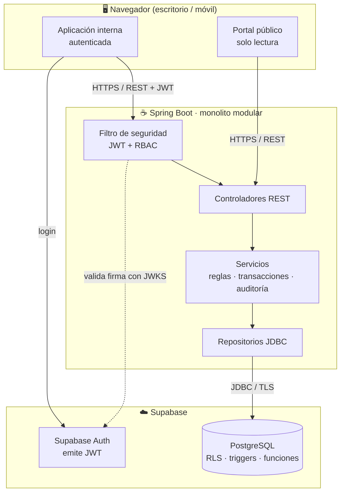

<div align="center">

# ⚽ SIGLIM

### Sistema de Gestión de la Liga Municipal de Futbol Amateur Morelia

Plataforma web para configurar temporadas, programar partidos, oficializar resultados
y publicar la tabla de posiciones de la Liga, con trazabilidad de cada cambio.


**Instituto Tecnológico de Morelia** · Ingeniería en Sistemas Computacionales · Fundamentos de Ingeniería de Software

[Documentación](docs/README.md) · [ERS](docs/requisitos/ERS.md) · [Arquitectura](docs/arquitectura/arquitectura-y-diseno-jerarquico.md) · [Base de datos](docs/base-de-datos/diccionario-de-datos.md) · [Diseño UI](docs/diseno-ui/README.md) · [Cómo contribuir](CONTRIBUTING.md)

</div>

---

## 📌 ¿Qué es SIGLIM?

La Liga Municipal de Futbol Amateur Morelia organiza su operación en
**Temporada → Categoría → Grupo → Equipos → Partidos**. SIGLIM digitaliza ese flujo en una
sola aplicación web con **dos caras**:

| | Aplicación interna | Portal público |
| --- | --- | --- |
| **Quién** | Administración, programación y captura | Cualquier visitante |
| **Acceso** | Inicio de sesión y permisos por rol | Sin cuenta, solo lectura |
| **Qué hace** | Configura, programa, captura, valida y publica | Consulta programación, resultados y tabla publicados |

La información interna **solo llega al portal después de un flujo de aprobación**
(Borrador → Revisión → Publicado) y no existe forma de editar datos desde el portal.

## 🔄 Flujo central de la entrega


Cada cambio crítico queda registrado con **usuario, fecha y motivo** (auditoría).

## 🧩 Módulos

| ID | Módulo | Qué cubre | Entrega |
| --- | --- | --- | --- |
| M-01 | Administración y seguridad | Inicio de sesión, roles, permisos por acción y auditoría | Esencial |
| M-02 | Temporadas y normativa | Temporada, convocatoria, categorías, grupos y referencia de reglas | Esencial |
| M-03 | Organización deportiva | Clubes, equipos y personas | Esencial |
| M-04 | Registros y elegibilidad | Alta y baja de jugadores con historial | Conveniente |
| M-06 | Canchas y recursos | Catálogo, disponibilidad y bloqueos | Esencial |
| M-07 | Programación manual | Jornadas, partidos y detección de conflictos | Esencial |
| M-08 | Partidos y resultados | Estados del partido, marcador, validación y tabla | Esencial |
| M-11 | Portal público y publicación | Flujo de publicación y consultas públicas con filtros | Esencial |
| M-09 | Disciplina reducida | Incidentes y resoluciones manuales | ⏸️ Pendiente (Q-05) |

> Lo que queda fuera de esta entrega (árbitros, programación automática, liguillas, reportes,
> integraciones) está en la sección 2.6 del [ERS](docs/requisitos/ERS.md).

## 🏗️ Arquitectura

Cliente-servidor de tres niveles: **SPA en React**, **monolito modular en Spring Boot** y
**PostgreSQL + Auth administrados por Supabase**.



El detalle (diagrama HIPO, diagramas IPO y decisiones justificadas) está en
[Arquitectura y diseño jerárquico](docs/arquitectura/arquitectura-y-diseno-jerarquico.md)
y en los [ADR](docs/arquitectura/adr/).

## 📁 Estructura del repositorio

```text
siglim/
├── README.md                 ← estás aquí
├── AGENTS.md                 ← reglas para agentes de IA (Claude, Codex, Copilot, Cursor…)
├── CLAUDE.md                 ← puente para Claude Code (importa AGENTS.md)
├── CONTRIBUTING.md           ← ramas, commits, PR y Definición de Terminado
│
├── docs/                     ← fuente de verdad del proyecto
│   ├── requisitos/           ← ERS (IEEE 830), BPMN, decisiones, fuentes e histórico
│   ├── arquitectura/         ← arquitectura, HIPO, figuras, convenciones de API y ADR
│   ├── base-de-datos/        ← diccionario de datos (+ histórico)
│   └── diseno-ui/            ← sistema de diseño, tokens, componentes, accesibilidad
│
├── supabase/
│   └── migrations/           ← esquema SQL versionado (única fuente del esquema)
│
├── frontend/                 ← React 19 + TypeScript 6 + Vite 8 + Tailwind CSS 4
└── backend/                  ← Spring Boot 4.1 + Java 21 (monolito modular)
```

## 🚀 Puesta en marcha

### Requisitos previos

| Herramienta | Versión |
| --- | --- |
| Node.js | 22 LTS o superior |
| JDK | 21 (Temurin recomendado) |
| Git | 2.40+ |
| Cuenta de Supabase | Proyecto creado con el esquema de `supabase/migrations` aplicado |

### 1. Clonar

```bash
git clone https://github.com/<organizacion>/siglim.git
cd siglim
```

### 2. Base de datos

Ejecuta `supabase/migrations/20261007000000_esquema_inicial.sql` en el **SQL Editor** de tu
proyecto de Supabase (o `supabase db push` si usan la CLI). Detalles en
[`supabase/README.md`](supabase/README.md).

### 3. Backend

```bash
cd backend
cp .env.example .env          # llena las variables de Supabase
./mvnw spring-boot:run        # Windows: mvnw.cmd spring-boot:run
```

API en `http://localhost:8080` · salud en `http://localhost:8080/actuator/health`

### 4. Frontend

```bash
cd frontend
cp .env.example .env.local    # llena las variables de Supabase y la URL del API
npm install
npm run dev
```

Aplicación en `http://localhost:5173`

## 🤖 Desarrollo asistido por IA

Este repositorio está preparado para trabajar con agentes de programación. Antes de pedirle algo
a una IA, asegúrate de que lea [`AGENTS.md`](AGENTS.md): ahí están las reglas del proyecto, el
orden de prioridad de los documentos y lo que **no** se debe implementar todavía.

## 👥 Equipo

| Integrante | Rol Scrum | Responsabilidad principal |
| --- | --- | --- |
| **Olvera Lobato David Geovani** | Product Owner | Backlog, historias de usuario y validación de requisitos |
| **López Meza Leonardo** | Scrum Master | Ceremonias, tablero, pruebas y verificación de entregables |
| **Olvera Bucio Jose Israel** | Desarrollo · Arquitectura y datos | Arquitectura, diseño de datos, repositorio y entorno |

**Profesor:** Claudio Ernesto Florian Arenas — Fundamentos de Ingeniería de Software

## 📄 Estado del proyecto

Proyecto académico en desarrollo. Los requisitos del ERS **aún no están aprobados formalmente
por la Liga**; lo marcado como `[PENDIENTE]` no forma parte del alcance hasta que se decida.

<div align="center">
<sub>Instituto Tecnológico de Morelia · 2026</sub>
</div>
