# Arquitectura y diseño jerárquico

**SIGLIM · Sistema de Gestión de la Liga Municipal de Futbol Amateur Morelia**  
Versión 2.0 · 19 de octubre de 2026 · Alineado con el [ERS Rev. 0.4](../requisitos/ERS.md) y el
[BPMN v2.0](../requisitos/bpmn/bpmn-procesos-del-sistema.md)

> [!NOTE]
> Este documento reemplaza la versión 1.0 (alcance de la Rev. 0.3, 8 módulos), que se conserva en
> [`historico/`](historico/). Las decisiones técnicas detalladas están en los [ADR](adr/README.md);
> el contrato REST, en las [convenciones de API](convenciones-api.md).

## Control del documento

| Versión | Fecha | Cambios |
| --- | --- | --- |
| 1.0 | 7 de octubre de 2026 | HIPO de 8 módulos, componentes y despliegue, decisiones de la Rev. 0.3. |
| 2.0 | 19 de octubre de 2026 | HIPO de los 14 módulos de la Rev. 0.4; vistas de contenedores, componentes, dinámica, datos, seguridad y despliegue; ADR-0006 a ADR-0012; aceptación de ADR-0003 y ADR-0005. |

## 1. Propósito, alcance y referencias

Este documento describe **cómo se construye** SIGLIM para cumplir el ERS Rev. 0.4: la
descomposición en módulos y submódulos (diseño jerárquico con la técnica HIPO), la arquitectura de
software en vistas (contexto, contenedores, componentes, comportamiento, datos, seguridad y
despliegue) y las decisiones que la justifican. Se dirige al equipo de desarrollo, al profesor y a
los agentes de IA que trabajan en el repositorio.

Cubre los requisitos de entrega **N** (núcleo) y **B** (backlog); los **F** (ERS §2.6) no se
diseñan. Los valores **[DEMO]** son configuración y los **[PROPUESTA]** son del equipo, pendientes
de validar con la Liga.

| ID | Documento |
| --- | --- |
| R1 | ERS SIGLIM Rev. 0.4 (`docs/requisitos/ERS.md`). |
| R2 | BPMN de los procesos del sistema v2.0 (`docs/requisitos/bpmn/`). |
| R3 | Registro de decisiones DEC-01 a DEC-44 (`docs/requisitos/decisiones/`). |
| R4 | ADR-0001 a ADR-0012 (`docs/arquitectura/adr/`). |
| R5 | ISO/IEC/IEEE 42010:2022, *Architecture description*. |
| R6 | S. Brown, *The C4 model for visualising software architecture*. |

## 2. Diseño jerárquico (HIPO)

El diseño jerárquico usa la técnica **HIPO** (*Hierarchy plus Input-Process-Output*): un diagrama de
jerarquía que descompone el sistema en módulos y submódulos, una tabla que vincula cada elemento con
los requisitos que lo justifican y diagramas IPO de los módulos que sostienen el flujo central. Los
módulos conservan la numeración del ERS (§2.2); **M-xx.n** identifica los submódulos.

### 2.1 Jerarquía de módulos

La Figura 1 muestra el primer nivel. Los módulos con borde discontinuo pertenecen por completo al
backlog priorizado (B); los demás tienen al menos un requisito del núcleo (N).

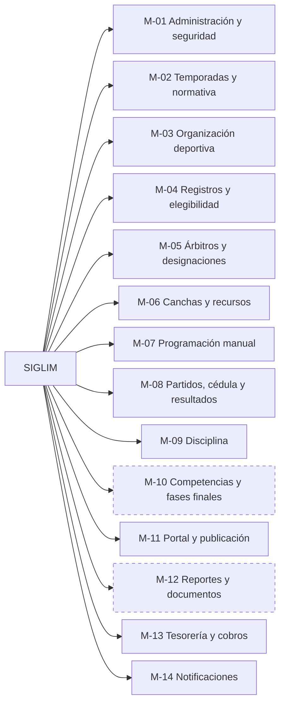

*Figura 1. Módulos funcionales (primer nivel).*

Las Figuras 2 y 3 descomponen cada módulo en sus submódulos. Los submódulos con borde discontinuo
son solo de backlog.

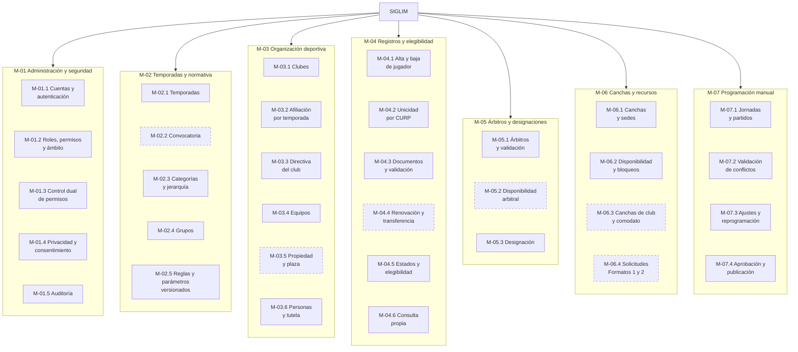

*Figura 2. Submódulos de M-01 a M-07.*

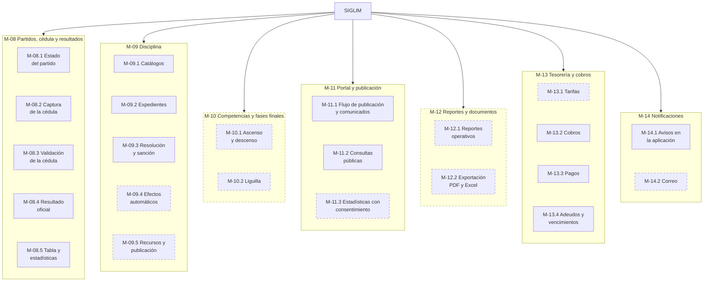

*Figura 3. Submódulos de M-08 a M-14.*

### 2.2 Módulos, submódulos y requisitos

La Tabla 1 vincula cada submódulo con sus requisitos funcionales y su entrega. Cubre los 139 RF
de entrega N o B del ERS; los seis RF de programación automática (F) no se asignan.

*Tabla 1. Submódulos, requisitos funcionales y entrega.*

| Submódulo | Descripción | RF | Entrega | Proceso |
| --- | --- | --- | --- | --- |
| **M-01 Administración y seguridad** | | | | |
| M-01.1 Cuentas y autenticación | Alta por invitación, activación, inicio de sesión con el servicio de identidad (ADR-0003). | RF-094 | N | — |
| M-01.2 Roles, permisos y ámbito | Roles editables, permisos `modulo.recurso:ACCION` con ámbito liga, club o propio (ADR-0007). | RF-094, RF-095 | N | P-13 |
| M-01.3 Control dual de permisos | Pares incompatibles pendientes de aprobación del Presidente. | RF-096 | N | P-13 |
| M-01.4 Privacidad y consentimiento | Aviso de privacidad, consentimiento del titular o del tutor, solicitudes ARCO. | RF-097 · RF-098 | N · B | P-02 |
| M-01.5 Auditoría | Registro inalterable de acciones críticas y su consulta. | RF-093, RF-134 | N | Transversal |
| **M-02 Temporadas y normativa** | | | | |
| M-02.1 Temporadas | Una temporada activa por liga; históricos sin sobrescribir. | RF-001, RF-003 | N | P-01 |
| M-02.2 Convocatoria | Referencia de la convocatoria de la temporada. | RF-002 | B | P-01 |
| M-02.3 Categorías y jerarquía | Catálogo con orden y categoría superior inmediata; categorías de la temporada. | RF-004, RF-099 | N | P-01 |
| M-02.4 Grupos | Uno o varios grupos por categoría de la temporada. | RF-005 | N | P-01 |
| M-02.5 Reglas y parámetros versionados | Puntos, desempates, bloque de cancha, marcador por default, plazo de cédula, liguilla y ascenso; interpretaciones pendientes. | RF-006, RF-100 · RF-007 | N · B | P-01 |
| **M-03 Organización deportiva** | | | | |
| M-03.1 Clubes | Registro de clubes; cambio de nombre como club nuevo. | RF-008 · RF-105 | N · B | P-02 |
| M-03.2 Afiliación por temporada | Tarjetón con folio sujeto a aprobación del Presidente. | RF-101 | N | P-02 |
| M-03.3 Directiva del club | Cargos y sus cambios con fecha y autorización. | RF-102 | N | P-02 |
| M-03.4 Equipos | Equipo del club en categoría y grupo de la temporada. | RF-009 | N | P-02 |
| M-03.5 Propiedad y plaza | Venta de equipo y conservación de plaza al cierre de temporada. | RF-103, RF-104 | B | P-12 |
| M-03.6 Personas y tutela | Identidad única por CURP, roles sin duplicar identidad, historial de pertenencia, vínculo con el tutor. | RF-010, RF-011, RF-012, RF-106 | N | P-02 |
| **M-04 Registros y elegibilidad** | | | | |
| M-04.1 Alta y baja de jugador | Alta pendiente de validación; baja con motivo e historial. | RF-013, RF-014 | N | P-02 |
| M-04.2 Unicidad por CURP | Un registro activo por CURP y temporada en toda la liga. | RF-107 | N | P-02 |
| M-04.3 Documentos y validación | Resguardo privado de documentos y fotos; validación por el Secretario (ADR-0008). | RF-108, RF-109 | N | P-02 |
| M-04.4 Renovación y transferencia | Renovación y cambio de club entre temporadas según configuración. | RF-015, RF-016, RF-111 | B | P-02 |
| M-04.5 Estados y elegibilidad | Estados del registro, elegibilidad, categoría superior, bloqueo por sanción; historial. | RF-017, RF-019, RF-020, RF-110 · RF-018 | N · B | P-05 |
| M-04.6 Consulta propia | Información del jugador o del menor para su tutor. | RF-144 | N | — |
| **M-05 Árbitros y designaciones** | | | | |
| M-05.1 Árbitros y validación | Árbitros presentados por los clubes, validación y catálogo; cuota por club. | RF-021, RF-112, RF-113 · RF-114 | N · B | P-03 |
| M-05.2 Disponibilidad arbitral | Disponibilidad por fecha y horario. | RF-022 | B | P-03 |
| M-05.3 Designación | Designación a partidos sin árbitros del propio club; historial. | RF-023, RF-115 · RF-024 | N · B | P-03 |
| **M-06 Canchas y recursos** | | | | |
| M-06.1 Canchas y sedes | Catálogo con ubicación y propietario; agrupación por sede. | RF-027 · RF-028 | N · B | P-01 |
| M-06.2 Disponibilidad y bloqueos | Disponibilidad, bloqueos, mantenimiento y partidos consecutivos por bloque. | RF-029, RF-030 · RF-031, RF-032 | N · B | P-03 |
| M-06.3 Canchas de club y comodato | Horarios por categoría de la cancha del club y comodato. | RF-119 | B | P-10 |
| M-06.4 Solicitudes (Formatos 1 y 2) | Préstamo, comodato y oferta de cancha; cartas con número de oficio. | RF-116, RF-117, RF-118 | B | P-10 |
| **M-07 Programación manual** | | | | |
| M-07.1 Jornadas y partidos | Registro manual de jornadas y partidos; asignación de cancha. | RF-033, RF-036 | N | P-03 |
| M-07.2 Validación de conflictos | Conflictos duros con mensaje explicativo; advertencias de localía. | RF-039 · RF-120 | N · B | P-03 |
| M-07.3 Ajustes y reprogramación | Cambios con motivo y traza. | RF-040 | N | P-03, P-04 |
| M-07.4 Aprobación y publicación | Aprobación del Presidente; publicación de la jornada. | RF-121 | N | P-03 |
| **M-08 Partidos, cédula y resultados** | | | | |
| M-08.1 Estado del partido | Máquina de estados, cambios automáticos, historial y acciones por estado. | RF-043 a RF-046, RF-127 | N | P-04 |
| M-08.2 Captura de la cédula | Alineación, marcador, goles, tarjetas, sustituciones, incidencias, no presentación y envío a validación. | RF-025, RF-026, RF-047, RF-122, RF-126 | N | P-05 |
| M-08.3 Validación de la cédula | Aprobación o devolución del árbitro; aprobación de la Comisión al vencer el plazo. | RF-123, RF-124 | N | P-05 |
| M-08.4 Resultado oficial | Oficialización por cédula aprobada o resolución; publicación automática; corrección con versión anterior. | RF-048, RF-052, RF-056, RF-125 | N | P-05, P-06 |
| M-08.5 Tabla y estadísticas | Tabla calculada con parámetros y desempates; estadísticas; dato oficial frente a indicador. | RF-049, RF-050, RF-053, RF-055 · RF-051, RF-054 | N · B | P-05 |
| **M-09 Disciplina** | | | | |
| M-09.1 Catálogos | Tipos de incidencia y artículos con sanción, sujeto, efecto y aplicación automática. | RF-128, RF-129 | N | P-06 |
| M-09.2 Expedientes | Apertura automática por incidencia; personas y equipos involucrados; consulta de artículos; evidencias. | RF-057, RF-058, RF-060 · RF-059 | N · B | P-06 |
| M-09.3 Resolución y sanción | Resolución, vigencia, bloqueo derivado e inmutabilidad; propuesta de sanción. | RF-062 a RF-065 · RF-061 | N · B | P-06 |
| M-09.4 Efectos automáticos | Baja automática, sanción retroactiva, partidos restantes, cobro por multa. | RF-130 a RF-133 | B | P-06, P-11 |
| M-09.5 Recursos y publicación | Recurso ante el Presidente; lista de castigados; publicación de sanciones. | RF-066, RF-067, RF-068 | B | P-06 |
| **M-10 Competencias y fases finales** | | | | |
| M-10.1 Ascenso y descenso | Reglas, posiciones finales, elegibilidad, propuesta y validación del Presidente. | RF-069 a RF-075 | B | P-07 |
| M-10.2 Liguilla | Configuración, clasificación, llaves, empates, avances, campeón y subcampeón. | RF-076 a RF-081 | B | P-08 |
| **M-11 Portal y publicación** | | | | |
| M-11.1 Flujo de publicación y comunicados | Borrador → Revisión → Publicado para programación y comunicados. | RF-090 | N | P-03, P-09 |
| M-11.2 Consultas públicas | Programación, resultados, tablas y filtros; calendario, comunicados, sanciones, equipos y competencias. | RF-082, RF-083, RF-084, RF-089 · RF-085 a RF-088 | N · B | P-09 |
| M-11.3 Estadísticas con consentimiento | Estadísticas con nombre solo con consentimiento de difusión. | RF-145 | B | P-09 |
| **M-12 Reportes y documentos** | | | | |
| M-12.1 Reportes operativos | REP-001 a REP-014 según permiso y ámbito. | RF-091 | B | Transversal |
| M-12.2 Exportación | Exportación a PDF y Excel. | RF-092 | B | Transversal |
| **M-13 Tesorería y cobros** | | | | |
| M-13.1 Tarifas | Tarifas de arbitraje y cancha por temporada y categoría. | RF-135 | B | P-01 |
| M-13.2 Cobros | Cobros manuales; cobros automáticos al publicar la jornada. | RF-137 · RF-136 | N · B | P-11 |
| M-13.3 Pagos | Pago en línea simulado; pagos fuera del sistema con comprobante (ADR-0012). | RF-138, RF-139 | N | P-11 |
| M-13.4 Adeudos y vencimientos | Adeudos por club y equipo; vencimiento automático. | RF-140 · RF-141 | N · B | P-11 |
| **M-14 Notificaciones** | | | | |
| M-14.1 Avisos en la aplicación | Avisos de los eventos del flujo (ADR-0010). | RF-142 | N | Transversal |
| M-14.2 Correo | Los mismos avisos por correo con bandeja de salida. | RF-143 | B | Transversal |

En las columnas RF y Entrega, el punto medio separa los requisitos N de los B del mismo submódulo.

### 2.3 Diagramas IPO

Se presentan los diagramas IPO de los siete módulos que sostienen el flujo central del núcleo:
seguridad (M-01), registro (M-04), programación (M-07), partidos (M-08), disciplina (M-09), portal
(M-11) y tesorería (M-13). Los demás módulos son principalmente de registro y consulta de catálogos
o pertenecen al backlog.

#### 2.3.1 M-01 Administración y seguridad

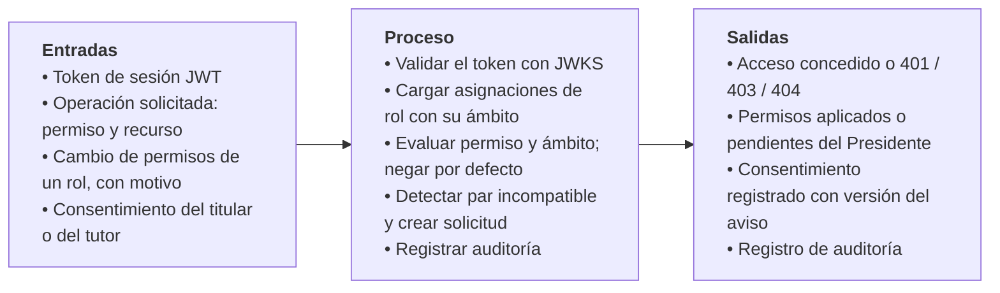

*Figura 4. IPO de M-01 Administración y seguridad (RF-093 a RF-097, RF-134).*

#### 2.3.2 M-04 Registros y elegibilidad

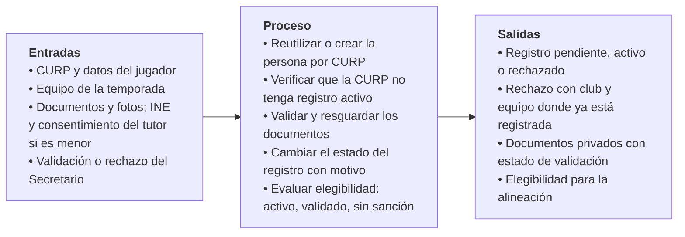

*Figura 5. IPO de M-04 Registros y elegibilidad (RF-013, RF-014, RF-017, RF-019, RF-020, RF-107 a RF-110).*

#### 2.3.3 M-07 Programación manual

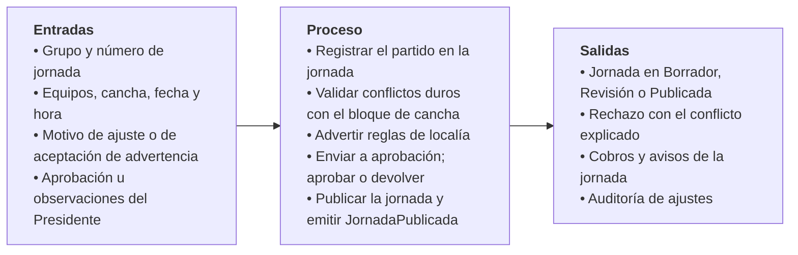

*Figura 6. IPO de M-07 Programación manual (RF-033, RF-036, RF-039, RF-040, RF-120, RF-121).*

#### 2.3.4 M-08 Partidos, cédula y resultados

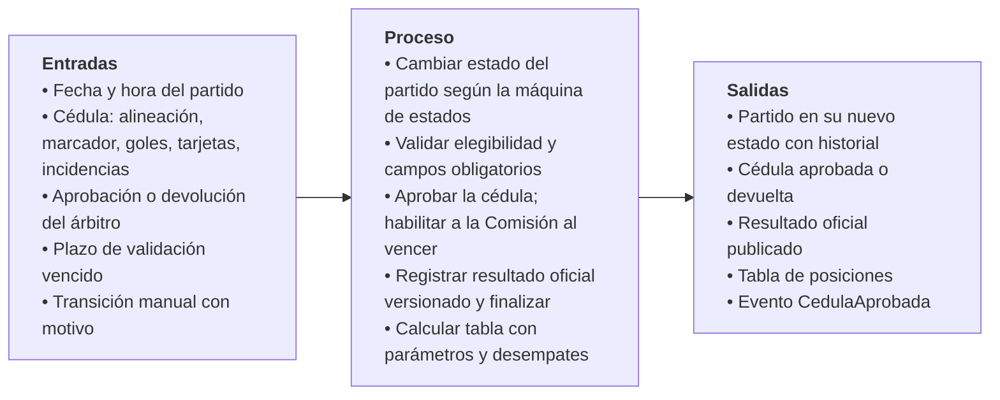

*Figura 7. IPO de M-08 Partidos, cédula y resultados (RF-025, RF-026, RF-043 a RF-056, RF-122 a RF-127).*

#### 2.3.5 M-09 Disciplina

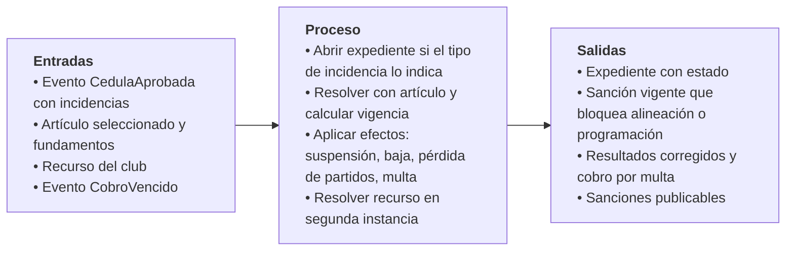

*Figura 8. IPO de M-09 Disciplina (RF-057 a RF-068, RF-128 a RF-133).*

#### 2.3.6 M-11 Portal público y publicación

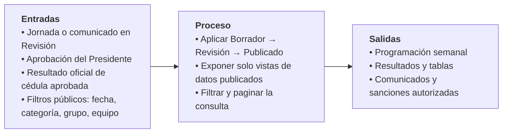

*Figura 9. IPO de M-11 Portal y publicación (RF-056, RF-082 a RF-090, RF-145).*

#### 2.3.7 M-13 Tesorería y cobros

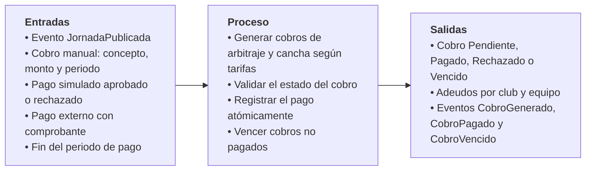

*Figura 10. IPO de M-13 Tesorería y cobros (RF-135 a RF-141).*

## 3. Vista de contexto y contenedores

El contexto del sistema (usuarios y servicios externos) está en la Figura 1 del ERS (§2.1). La
Figura 11 muestra los **contenedores** (modelo C4): las piezas que se despliegan por separado y cómo
se comunican.

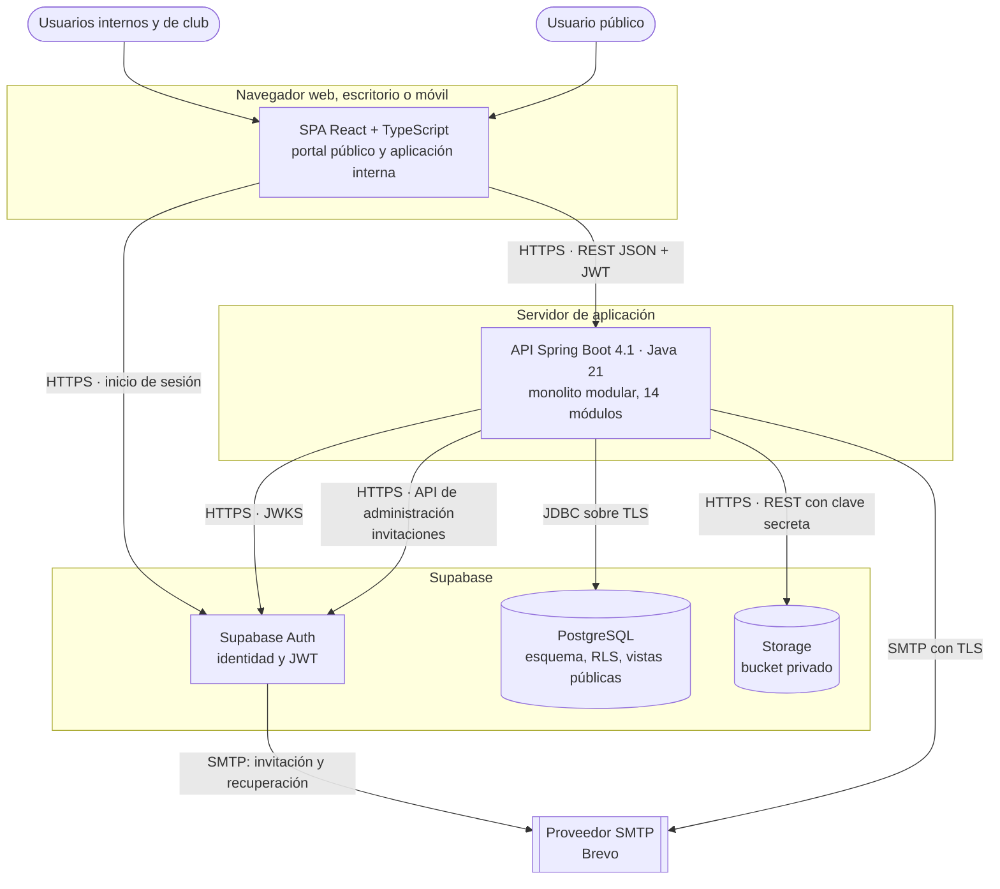

*Figura 11. Diagrama de contenedores.*

| Contenedor | Tecnología | Responsabilidad | Decisiones |
| --- | --- | --- | --- |
| SPA | React 19, TypeScript, Vite, Tailwind CSS 4, TanStack Query | Portal público (`/`) y aplicación interna (`/app`). Usa Supabase solo para iniciar sesión; todos los datos los pide a la API. | ADR-0001, ADR-0003 |
| API | Spring Boot 4.1, Java 21, Spring Security (Resource Server), Spring JDBC | Reglas de negocio, autorización, transacciones, auditoría, eventos, tareas programadas e integraciones. | ADR-0002, ADR-0005 a ADR-0012 |
| Supabase Auth | Servicio administrado | Credenciales, sesiones y emisión del JWT; nunca se guardan contraseñas en SIGLIM. | ADR-0003 |
| PostgreSQL | Supabase (PostgreSQL) | Datos, restricciones, triggers de historial, función de tabla, vistas de datos publicados y RLS. | ADR-0004, ADR-0007, ADR-0011 |
| Storage | Supabase Storage | Documentos, fotos, evidencias y comprobantes en un bucket privado. | ADR-0008 |
| Proveedor SMTP | Brevo (demostración) | Entrega de correos de la API y de Supabase Auth. | ADR-0010 |

No existe flujo inverso del portal hacia la API de escritura: las rutas públicas son de solo
lectura (`/api/v1/publico/**`).

## 4. Vista de componentes del backend

### 4.1 Capas dentro de cada módulo

Cada paquete de módulo tiene las mismas capas (ADR-0002):

| Capa | Clases | Responsabilidad |
| --- | --- | --- |
| Controlador | `XxxController` | HTTP ↔ DTO, validación de formato, códigos de estado. Sin reglas de negocio. |
| Servicio | `XxxService` (público) | Autorización (ADR-0007), reglas de negocio, máquinas de estado (DP-003), transacción, auditoría y eventos. Es lo único que otros módulos pueden usar. |
| Repositorio | `XxxRepository` | SQL con `JdbcClient` y parámetros con nombre; nombres del diccionario de datos. |
| Modelo | `record` de DTO, solicitudes, eventos (`eventos/`) | Datos inmutables. |

### 4.2 Dependencias entre módulos

La Figura 12 muestra la dirección permitida de las dependencias (ADR-0006). Las flechas continuas
son llamadas a servicios; las discontinuas, eventos o interfaces implementadas por el módulo
superior. Todos los módulos usan además `compartido`, `seguridad` y `auditoria`, que se omiten.

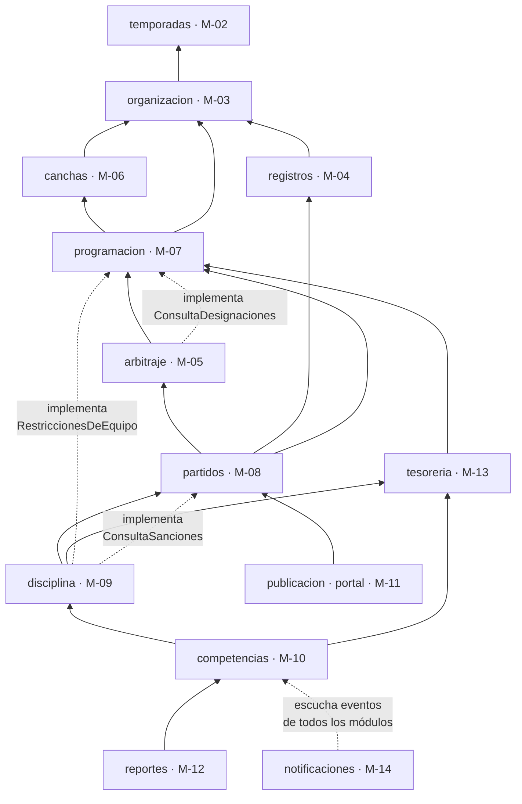

*Figura 12. Niveles de dependencia entre módulos (se muestran las relaciones principales).*

| Flujo que cruza módulos | Mecanismo | Atomicidad |
| --- | --- | --- |
| Cédula aprobada → abrir expedientes (RF-125, RN-046) | Evento `CedulaAprobada`, oyente síncrono en `disciplina` | Misma transacción |
| Jornada publicada → cobros de arbitraje y cancha (RF-136) | Evento `JornadaPublicada`, oyente síncrono en `tesoreria` | Misma transacción |
| Sanción de multa → cobro (RF-133) | `disciplina` llama a `TesoreriaService` | Misma transacción |
| Cobro vencido → baja por falta de pago (RF-130, RF-141) | Evento `CobroVencido`, oyente en `disciplina` | Misma transacción |
| Resolución con efecto retroactivo → resultados (RF-052, RF-131) | `disciplina` llama a `PartidosService` | Misma transacción |
| Sanción vigente → conflicto de programación o alineación (RF-020, RF-039) | Interfaces de `programacion` y `partidos` implementadas por `disciplina` | Solo lectura |
| Cualquier evento → avisos y correo (RF-142, RF-143) | Oyentes de `notificaciones`; correo por bandeja de salida | Aviso en la misma transacción; correo después |

### 4.3 Componentes transversales

| Componente | Paquete | Función | Decisión |
| --- | --- | --- | --- |
| Filtro de seguridad | `compartido` | Valida el JWT y rechaza peticiones sin token en rutas internas (401). | ADR-0003 |
| Contexto de usuario | `compartido` | Fija `request.jwt.claims` y el rol `authenticated` en cada transacción. | ADR-0005 |
| Autorización | `seguridad` | `exigir(permiso, objetivo)` con ámbito; control dual. | ADR-0007 |
| Auditoría | `auditoria` | Registro de acción crítica con usuario, fecha, módulo, acción, registro y motivo. | RF-093 |
| Eventos de dominio | cada módulo (`eventos/`) | `ApplicationEventPublisher`; oyentes síncronos o bandeja de salida. | ADR-0006 |
| Tareas programadas | módulo dueño | Inicio de partidos, plazo de cédula, vencimiento de cobros, envío de correos. | ADR-0009 |
| Almacenamiento | `compartido` | Carga validada y URL firmadas de Supabase Storage. | ADR-0008 |
| Correo | `notificaciones` | Plantillas y envío SMTP desde la bandeja de salida. | ADR-0010 |
| Pasarela de pago | `tesoreria` | `PasarelaDePago` con implementación simulada. | ADR-0012 |
| Manejo de errores | `compartido` | Respuestas RFC 9457 con `codigo` del ERS (VAL-xxx). | Convenciones de API |
| Reloj | `compartido` | `java.time.Clock` inyectable para reglas por tiempo y pruebas. | ADR-0009 |

## 5. Vista dinámica

### 5.1 Aprobar una cédula

Es la operación más crítica del núcleo (RNF-004): oficializa el resultado, finaliza el partido y
abre expedientes en una sola transacción. La tabla no se recalcula aparte porque se calcula al
consultarse a partir de los resultados oficiales.

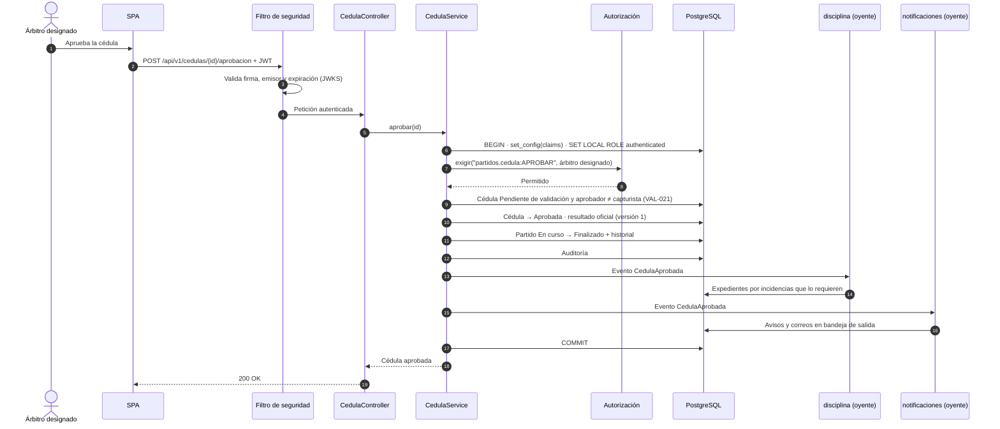

*Figura 13. Secuencia de aprobación de la cédula (P-05; RF-123, RF-125, RF-127).*

Si cualquier paso falla (por ejemplo, un catálogo de incidencias incompleto), la transacción se
revierte completa y la cédula sigue Pendiente de validación.

### 5.2 Cargar y consultar un documento

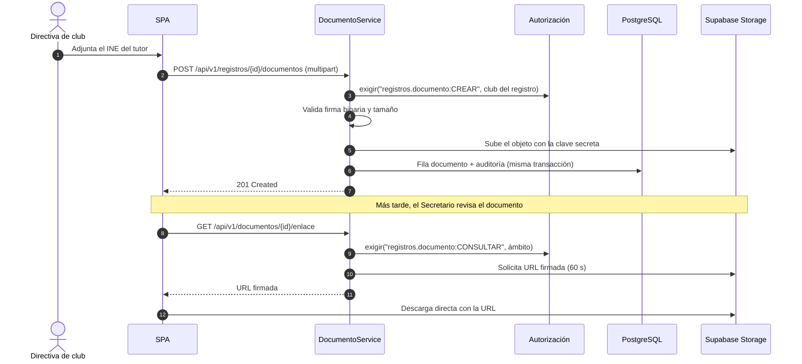

*Figura 14. Secuencia de carga y consulta de un documento (RF-108, RF-109, RNF-018).*

Si la subida a Storage tiene éxito pero la transacción falla, queda un objeto sin fila; una tarea de
limpieza lo detecta comparando el bucket con la tabla. El caso inverso no ocurre porque la fila se
escribe después de la subida.

### 5.3 Vencimiento del plazo de la cédula

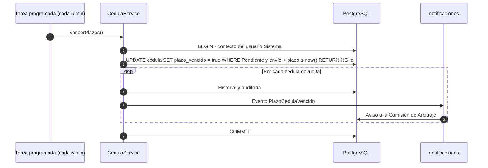

*Figura 15. Secuencia de vencimiento del plazo de validación (RF-124, DEC-20).*

## 6. Vista de datos

El modelo conceptual está en el ERS (§4.4) y el físico en el
[diccionario de datos](../base-de-datos/diccionario-de-datos.md), que se reescribe en el paso 4
junto con la nueva migración inicial (DEC-42). La arquitectura le impone estos principios:

| Principio | Aplicación | Origen |
| --- | --- | --- |
| Nada con historial se borra | Bajas, cancelaciones y reemplazos son cambios de estado; sin `DELETE` en tablas con historial. | RF-003, RF-044, RN-005, RN-020 |
| Estados explícitos | Enumeraciones para partido, cédula, registro, expediente, cobro, publicación, afiliación y solicitudes; transiciones validadas en el servicio y registradas en tablas de historial. | DP-003, ERS §4.3 |
| Resultados versionados | Cada resultado oficial tiene versión y origen (cédula o resolución); corregir crea una versión nueva. | RF-052, RN-024 |
| Tabla calculada | La tabla se calcula con una función a partir de resultados oficiales y parámetros de la temporada; nunca se guarda. El histórico por jornada (RF-051) guarda instantáneas solo de lectura. | RN-022, RF-049, RF-050 |
| Parámetros versionados | Los cálculos referencian la versión de parámetros que los produjo. | DP-002, RF-006, RF-075 |
| Liga en entidades raíz | `liga_id` y unicidad por liga. | ADR-0011 |
| Permisos como datos | Catálogo de permisos, roles, asignaciones con ámbito y pares incompatibles. | ADR-0007 |
| Datos publicados separados | Vistas o funciones de solo lectura para el portal, sin datos personales. | DP-006, RNF-012 |
| Auditoría inalterable | Tabla de auditoría solo con `INSERT` y lectura. | RNF-015 |
| Bandeja de salida | Tabla `correo_saliente` con estado e intentos. | ADR-0010 |
| Restricciones en la base | Unicidad de CURP activa por temporada, no traslape de partidos por cancha y equipo (exclusión con rangos de tiempo), llaves foráneas. El servicio valida antes y explica; la base es la última garantía. | RF-039, RF-107, VAL-003 a VAL-005 |

## 7. Seguridad y datos personales

| Amenaza o requisito | Control | Origen |
| --- | --- | --- |
| Suplantación | Supabase Auth; JWT firmado con claves asimétricas y validado por JWKS; alta solo por invitación; contraseña de 15 caracteres mínimo. | ADR-0003, RNF-013, RNF-014 |
| Escalamiento de privilegios | Permiso y ámbito en cada servicio; RLS en tablas sensibles; nunca por nombre de rol; control dual de pares incompatibles. | ADR-0007, RNF-003, RN-053 |
| Acceso a datos de otro club | Listados filtrados por ámbito; 404 fuera de ámbito; RLS. | RN-054, VAL-024 |
| Fuga de documentos | Bucket privado sin acceso del cliente; URL firmadas de 60 s; rutas sin datos personales. | ADR-0008, RNF-018 |
| Exposición en el portal | Solo vistas de datos publicados; estadísticas con nombre solo con consentimiento de difusión. | DP-006, RNF-012, RF-145 |
| Manipulación de la auditoría | Tabla solo de inserción; la escriben servicios y triggers. | RNF-015 |
| Intercepción | HTTPS en navegador y API; JDBC con `sslmode=require`; SMTP con TLS. | RNF-019 |
| Inyección SQL | Solo SQL parametrizado (`JdbcClient` con parámetros con nombre). | AGENTS.md §9 |
| Secretos | `backend/.env` y `frontend/.env.local` fuera de git; la clave secreta de Supabase solo en el backend. | AGENTS.md §9 |
| Datos de menores | Consentimiento expreso e INE del tutor; el menor no tiene credenciales; el tutor consulta. | RN-055, RF-097, RF-106 |
| Bitácoras | Sin contraseñas, tokens, CURP ni URL firmadas. | RNF-011 |

El tratamiento de datos personales sigue la LFPDPPP (ERS §3.4.4). La ley aplicable definitiva
depende de la naturaleza jurídica de la Liga (PEN-039) y la retención, de PEN-040.

## 8. Atributos de calidad y despliegue

### 8.1 Requisitos no funcionales y tácticas

| RNF | Meta | Táctica de arquitectura | Entrega |
| --- | --- | --- | --- |
| RNF-001 Disponibilidad | 99 % sábados y domingos 7:00–21:00 | API siempre encendida; Supabase en plan que no se pausa; punto de salud para monitoreo externo. | B |
| RNF-002 Consultas públicas | p95 < 2 s con 300 usuarios | Vistas públicas indexadas por temporada, grupo y fecha; paginación; `Cache-Control` de 60 s en GET públicos **[PROPUESTA]**. | N |
| RNF-003 Mínimo privilegio | Denegación por defecto | ADR-0007; pruebas de 401, 403 y fuera de ámbito por endpoint. | N |
| RNF-004 Integridad | Operaciones críticas atómicas | Transacción en el servicio; eventos síncronos en la misma transacción; restricciones en la base. | N |
| RNF-005 Escalabilidad funcional | Catálogos sin cambio de código | Categorías, artículos, tipos de incidencia, desempates y parámetros como datos. | N |
| RNF-009 Mantenibilidad | Sin ciclos entre módulos | ADR-0006 con prueba ArchUnit en `./mvnw verify`. | N |
| RNF-010 Respaldo | RPO 24 h, RTO 4 h | Ver 8.3. | B |
| RNF-011 Observabilidad | Bitácora estructurada y salud | Spring Boot Actuator (`/actuator/health`); bitácora JSON estructurada sin datos personales. | B |
| RNF-012 Datos personales | Portal sin datos personales | DP-006, RLS, consentimiento por finalidad. | N |
| RNF-013, RNF-014 | Sin contraseñas propias; sesiones seguras | ADR-0003. | N |
| RNF-015 Auditoría | Inalterable | Tabla solo de inserción. | N |
| RNF-016 Operaciones internas | p95 < 3 s; reporte < 10 s | Índices por liga, temporada y club; paginación; exportación por *streaming*. | N |
| RNF-017 Volumen | 250 clubes, 800 equipos, 15,000 personas | Índices y paginación; capacidad de Storage según ADR-0008. | N |
| RNF-018 Documentos | Repositorio privado y URL firmadas | ADR-0008. | N |
| RNF-019 Cifrado en tránsito | TLS en todo | HTTPS, JDBC con TLS, SMTP con TLS. | N |
| RNF-006 a RNF-008 | Usabilidad, responsive, WCAG 2.1 AA | Sistema de diseño del frontend (paso 5). | N |

### 8.2 Ambientes

| Ambiente | Frontend | Backend | Supabase | Uso |
| --- | --- | --- | --- | --- |
| Local | `npm run dev` (proxy `/api` → `:8080`) | `./mvnw spring-boot:run` | Proyecto de desarrollo compartido o `supabase start` (CLI y Docker) | Desarrollo de cada integrante |
| Demostración | Por definir (PEN-036, PEN-037) | Por definir | Proyecto de demostración | Revisiones de Sprint con el profesor y la Liga |

Las variables de cada ambiente se documentan en `backend/.env.example` y `frontend/.env.example`.
CI/CD y contenedores están fuera del alcance (ERS §2.6); el despliegue de demostración es manual.

### 8.3 Respaldo y recuperación (RNF-010)

- **Plan Pro de Supabase:** respaldo diario automático con 7 días de retención; cumple el RPO de
  24 h. La restauración se hace desde el panel del proyecto.
- **Plan gratuito:** no incluye respaldos automáticos. Mientras se use, se ejecuta
  `supabase db dump` (esquema y datos) antes de cada demostración y al cierre de cada Sprint, y el
  archivo se guarda fuera del repositorio porque contiene datos personales.
- Los respaldos de la base **no incluyen los archivos de Storage**: los documentos se copian aparte
  con un script que descarga el bucket mediante la API.
- **Prueba de restauración:** una vez por entrega, restaurar el último respaldo en un proyecto vacío,
  aplicar la configuración y comprobar inicio de sesión, consulta de tabla y descarga de un
  documento; registrar el tiempo para verificar el RTO de 4 h.
- Además, el plan gratuito pausa el proyecto tras una semana sin actividad; antes de una
  demostración se verifica que esté activo.

## 9. Pendientes y riesgos

| ID | Tema | Impacto en la arquitectura | Quién decide |
| --- | --- | --- | --- |
| PEN-036 | Ambientes de desarrollo, pruebas y producción | Dónde corre la API (debe estar siempre encendida por ADR-0009) y el frontend. | Equipo |
| PEN-037 | Dominio y alojamiento | Dominio para el correo (SPF, DKIM, DMARC) y para la SPA. | Liga y equipo |
| PEN-039 | Naturaleza jurídica de la Liga | Ley de datos personales aplicable; aviso de privacidad. | Liga |
| PEN-040 | Retención de datos, documentos y auditoría | Tareas de depuración y borrado definitivo en Storage. | Liga y equipo |
| — | Plan de Supabase | El plan gratuito no cumple RNF-001 ni RNF-010 y su capacidad de archivos (1 GB) no alcanza para una temporada real (ADR-0008). | Liga |
| — | Volumen de correo | Los planes gratuitos no alcanzan para la operación real (ADR-0010). | Liga |
| RSK-009 | 83 RF de núcleo en 8 semanas | La arquitectura prioriza lo transversal (seguridad, auditoría, eventos) en el Sprint 1 para no bloquear a los módulos. | Equipo |

## 10. Decisiones arquitectónicas

| Tema | Decisión | Justificación | ADR |
| --- | --- | --- | --- |
| Repositorio | Monorepo con `docs/`, `supabase/`, `backend/` y `frontend/` | Un cambio de requisito toca esquema, API y pantalla; equipo de tres. | 0001 |
| Estilo | Monolito modular en capas, un paquete por módulo | DD-002; equipo pequeño; transacciones locales. | 0002, 0006 |
| Presentación | SPA React + TypeScript | DD-001, RNF-007; portal y aplicación interna en una plataforma; DEC-43. | — |
| Acceso a datos | Spring JDBC con SQL explícito; sin JPA | Enumeraciones, rangos, RLS y funciones del esquema. | 0002 |
| Esquema | Solo migraciones versionadas | Trazabilidad del esquema; DD-003. | 0004 |
| Identidad | Supabase Auth, JWT con JWKS, alta por invitación | DD-012, RNF-013, RNF-014; PEN-030. | 0003 |
| Contexto en la base | Claims y rol `authenticated` por transacción | Historial con usuario y RLS efectivo. | 0005 |
| Autorización | Permiso y ámbito en servicios; RLS como defensa | DD-009, DP-008, RN-053, RN-054. | 0007 |
| Documentos | Supabase Storage privado por el backend; URL firmadas | RNF-018, DEC-10. | 0008 |
| Procesos por tiempo | `@Scheduled` idempotente por estado | DP-007; RF-124, RF-127, RF-141. | 0009 |
| Avisos y correo | Avisos en la base; correo SMTP con bandeja de salida | RF-142, RF-143, PEN-034. | 0010 |
| Varias ligas | Una liga con `liga_id` en entidades raíz | DD-011, DEC-07. | 0011 |
| Pagos | Pasarela simulada detrás de una interfaz | DEC-37. | 0012 |
| Integraciones fuera | Sin WhatsApp/SMS, mapas, API pública ni proveedores externos de identidad | ERS §2.6. | — |

## 11. Cambios respecto a la versión 1.0

| Aspecto | Versión 1.0 | Versión 2.0 |
| --- | --- | --- |
| Módulos | 8 módulos; M-05, M-10 y M-12 fuera; M-09 condicionado. | 14 módulos con 56 submódulos y su entrega N o B. |
| Diseño jerárquico | Imágenes exportadas de Word con texto de OCR. | Diagramas en el propio documento, editables y versionados. |
| Autorización | Rol y acción; RLS por nombre de rol. | Permiso y ámbito como datos; control dual; RLS con las mismas reglas. |
| Componentes | Filtro, controladores, servicios, repositorios. | Además: eventos de dominio, tareas programadas, almacenamiento, correo y pasarela simulada. |
| Vistas | Componentes y despliegue. | Contenedores, componentes, dependencias, secuencias, datos, seguridad, calidad y respaldo. |
| Decisiones | Tabla con [PROPUESTA] y pendientes PEN-024 a PEN-030. | ADR-0001 a ADR-0012; PEN-024 a PEN-026, PEN-030, PEN-031 y PEN-034 resueltos. |
