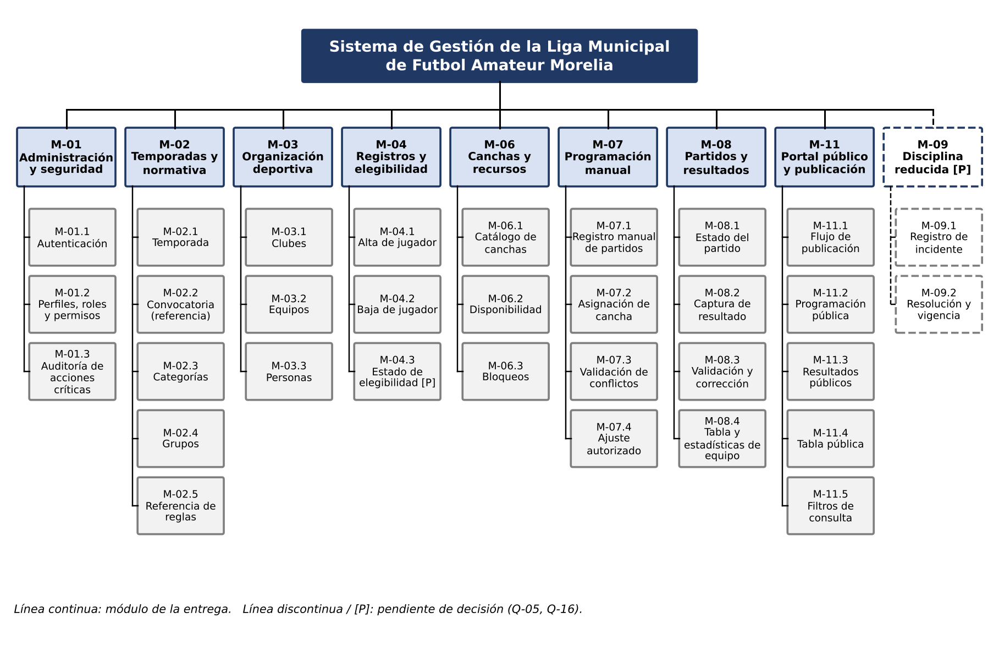
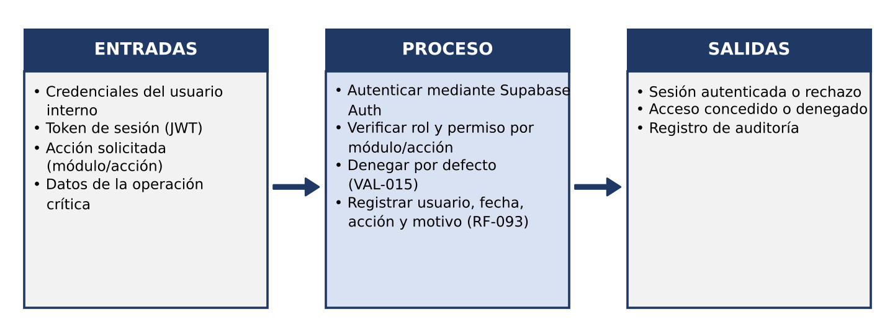
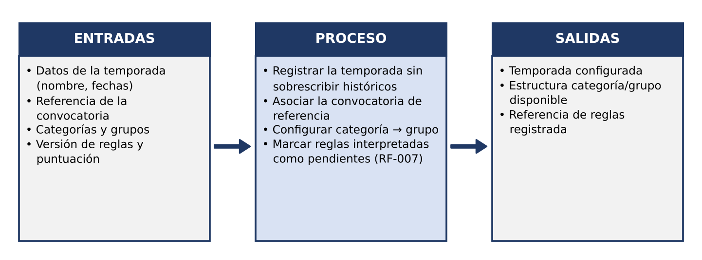
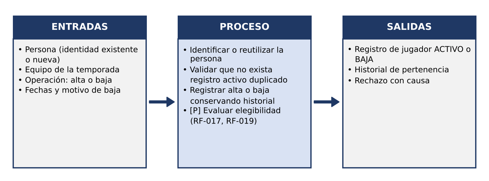
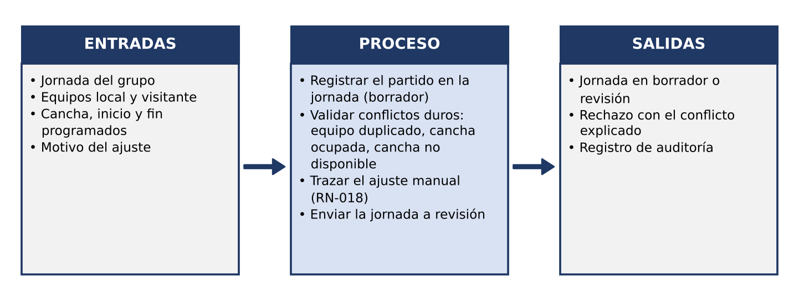
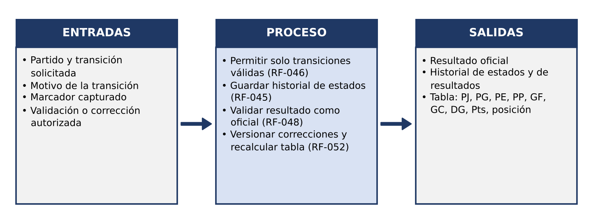
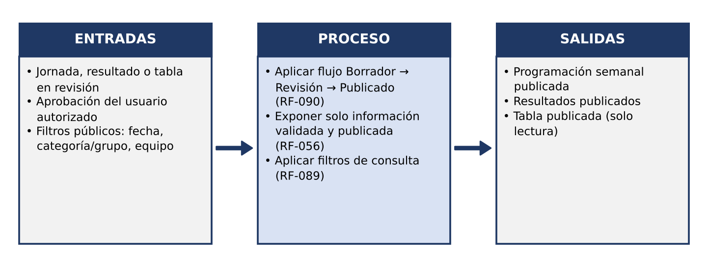
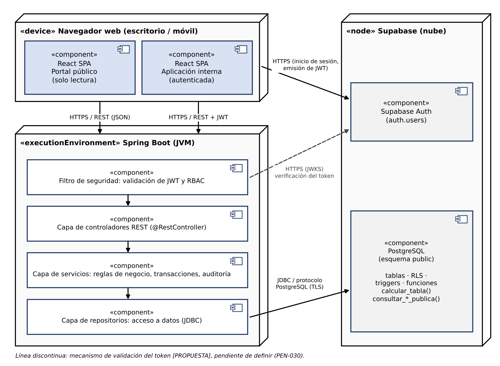

> [!WARNING]
> **REEMPLAZADO.** Versión 1.0 (alcance de la Rev. 0.3, 8 módulos). La vigente es la
> [versión 2.0](../../arquitectura-y-diseno-jerarquico.md). Se conserva como evidencia; no la uses
> para implementar.

> [!NOTE]
> Versión de texto extraída del PDF. Las **figuras** (HIPO, IPO y componentes) están enlazadas
> desde [`figuras/`](figuras/), exportadas del documento original
> ([`originales/arquitectura-diseno-jerarquico.docx`](originales/arquitectura-diseno-jerarquico.docx)).
> Los bloques `<!-- Start of picture text -->` son el texto que el OCR reconoció en cada figura; ignóralos y
> usa la imagen.
> Decisiones posteriores a este documento: [ADR](../../adr/README.md) · Contrato REST: [convenciones de API](../../convenciones-api.md).

Arquitectura y Diseño Jerárquico · Sistema de Gestión de la Liga Municipal de Futbol Amateur Morelia 

# **1. Diseño jerárquico (HIPO)** 

El diseño jerárquico se presenta con la técnica HIPO (Hierarchy plus Input-Process-Output), compuesta por un diagrama de jerarquía que descompone el sistema en módulos y submódulos, una tabla que vincula cada elemento con los requisitos que lo justifican y diagramas IPO que describen las entradas, el proceso y las salidas de los módulos principales. Los módulos se derivan de los requisitos funcionales (RF) y casos de uso (CU) incluidos en la entrega y conservan la numeración del ERS; los módulos fuera del alcance (M-05, M-10 y M-12, sección 2.6 del ERS) no se representan. La notación **M-xx.n** identifica los submódulos, y **[P]** marca los elementos pendientes de decisión. 

## **1.1 Diagrama de jerarquía de módulos** 

La Figura 1 muestra el sistema como nodo raíz, los módulos funcionales de la entrega como ramas y sus submódulos como sub-ramas. Se lee de arriba hacia abajo y de izquierda a derecha, siguiendo el orden del flujo vertical del ERS (configuración → organización → registro → recursos → programación → resultados → publicación); M-09 se ubica al final con trazo discontinuo por estar condicionado a Q-05. 

Pág. 1 

Arquitectura y Diseño Jerárquico · Sistema de Gestión de la Liga Municipal de Futbol Amateur Morelia 

<!-- Start of picture text -->
Sistema de Gestion de la Liga Municipal de Futbol Amateur Morelia M-01 prrsseeo lAdministracién|y seguridad |TemporadasnormativaM-02  y | | OrganizaciéndeportivaM-03 | | elegibilidadRegistrosM-04  y CanchasrecursosM-06  y ProgramaciénmanualM-07 resultadosPartidosM-08  y | | Portaly publicaciénM-11publico| | 1|| reducidaDisciplinaM09 [P] ||1 L--------! H Hloe M-01.1 i M-02.1 M-03.1 M-04.1 CatalogoM-06.1 de RegistroM-07.1manuall EstadoM-08.1del FlujoM-11.1de loHrH RegistrodeM091 || (Mie Tua lines Fed Uy canchas de partidos partido publicacin | 1) incidente 1 Hoot M-01.2 M-02.2 M-07.2 M-08.2 M-11.2 i M0920 1| Perfiles,y permisosroles Convocatoria(referencia) EquiposM-03.2 Bajaan deM-04.2 jugador) |} DisponibilidadpeleM-06.2. Asignaciéncancha de Capturaresultado de Programaciénpublica u| ResolucionVigencia y | nena AuditoriaM-01,34 de M-02.3 M-03.3 M-04.3 M-06.3 M-07.3 M-0M0 8 .32 M-11.3 SES; Cagaibi Personas elegibilidadEstado de(P] Bloqueos Validaciénconflictosde Validaciéncorrecciény Resultadospublicos M-08.4 M-02.4 wie Tabla y M-11.4 Grupos one estoditicas da Tabla publica M-02.5 M-11.5 Referencia de Filtros de reglas consulta Linea continua: médulo de la entrega. Linea discontinua / [P]: pendiente de decisién (Q-05, Q-16) <!-- End of picture text -->

**Figura 1.** Diagrama de jerarquía de módulos (structure chart) de la entrega. 

Pág. 2 

Arquitectura y Diseño Jerárquico · Sistema de Gestión de la Liga Municipal de Futbol Amateur Morelia 

## **1.2 Tabla complementaria de módulos y requisitos** 

La Tabla 1 describe cada módulo y submódulo e indica los RF que cubre. Los casos de uso asociados se citan entre paréntesis en la descripción. Las filas sombreadas en gris claro corresponden a elementos pendientes de decisión [P]. 

**Tabla 1.** Módulos, submódulos y requisitos funcionales que cubren. 

|**Módulo**|**Descripción**|**Requisito(s)** **funcional(es)**|
|---|---|---|
|**M-01 Administracióny segurida**|**d**||
|M-01.1 Autenticación|Inicio de sesión de usuarios internos (UI-001). No tiene RF propio; deriva de RNF-013 y RNF-014.|— (RNF-013, RNF-014)|
|M-01.2 Perfiles, roles y permisos|Control de acceso por módulo y acción con denegación por defecto (VAL-015, DD-009).|RF-040, RF-090 (acciones autorizadas); RNF-003|
|M-01.3 Auditoría de acciones críticas|Registro de usuario, fecha, acción y motivo de cambios críticos (VAL-016, RN-018).|RF-093, RF-045|
|**M-02 Temporadasy normativa**|||
|M-02.1 Temporada|Registro de la temporada de trabajo sin sobrescribir históricos (CU-001).|RF-001, RF-003|
|M-02.2 Convocatoria (referencia)|Asociación de la convocatoria como documento normativo de referencia (CU-001).|RF-002|
|M-02.3 Categorías|Registro de la categoría de la temporada; el modelo admite otras (CU-002).|RF-004|
|M-02.4 Grupos|Registro de uno o varios grupos por categoría (CU-002).|RF-005|
|M-02.5 Referencia de reglas|Versión o referencia de las reglas usadas (puntuación y desempates); interpretaciones como pendientes de validación.|RF-006, RF-007|
|**M-03 Organización deportiva**|||
|M-03.1 Clubes|Registro y administración de clubes afiliados (CU-003).|RF-008|
|M-03.2 Equipos|Equipo como representación de un club en categoría/grupo/temporada (CU-003).|RF-009|
|M-03.3 Personas|Identidad reutilizable, separada de sus roles, con historial de pertenencia (CU-004).|RF-010, RF-011, RF-012|
|**M-04 Registrosy elegibilidad**|||
|M-04.1 Alta de jugador|Alta básica del jugador en un equipo (CU-004).|RF-013|
|M-04.2 Baja de jugador|Baja conservando el historial (CU-004).|RF-014|
|M-04.3 Estado de elegibilidad [P]|Estados y verificación de elegibilidad; bloqueo por sanción. Condicionado a Q-16 y Q-17.|RF-017, RF-019, RF-020|
|**M-06 Canchasy recursos**|||
|M-06.1 Catálogo de canchas|Registro de canchas y características conocidas (CU- 005).|RF-027|
|M-06.2 Disponibilidad|Disponibilidad por fecha y hora (CU-005).|RF-029|
|M-06.3 Bloqueos|Bloqueo de una cancha por intervalo (CU-005).|RF-030|
|**M-07 Programación manual**|||

Pág. 3 

Arquitectura y Diseño Jerárquico · Sistema de Gestión de la Liga Municipal de Futbol Amateur Morelia 

|**Módulo**|**Descripción**|**Requisito(s)** **funcional(es)**|
|---|---|---|
|M-07.1 Registro manual de partidos|Captura de jornadas y partidos por categoría, grupo, equipos, cancha, fecha y hora (CU-006).|RF-033|
|M-07.2 Asignación de cancha|Asignación manual de una cancha disponible (CU-006).|RF-036|
|M-07.3 Validación de conflictos|Detección de equipo duplicado, cancha ocupada y cancha no disponible (VAL-003 a VAL-005).|RF-039|
|M-07.4 Ajuste autorizado|Modificación manual con traza del cambio y envío a revisión (CU-006, CU-007).|RF-040|
|**M-08 Partidosy resultados**|||
|M-08.1 Estado del partido|Ciclo de vida, conservación del historial y restricción de acciones por estado (P-04).|RF-043, RF-044, RF-045, RF-046|
|M-08.2 Captura de resultado|Registro del marcador y del estado del resultado (CU- 008).|RF-047|
|M-08.3 Validación y corrección|Oficialización del resultado y corrección autorizada con recálculo (CU-008).|RF-048, RF-052|
|M-08.4 Tabla y estadísticas de equipo|Cálculo de PJ, PG, PE, PP, GF, GC, DG, puntos y posición; desempates; separación de dato oficial e idid CU009|RF-049, RF-050 [P], RF- 053, RF-055|
|**M-11 Portalpúblicoy publicaci**|ncaor (-). **ón** ||
|M-11.1 Flujo de publicación|Borrador → Revisión → Publicado; solo se publica información validada (P-09, CU-007).|RF-090, RF-056|
|M-11.2 Programación pública|Consulta de la programación semanal publicada (CU- 016).|RF-082|
|M-11.3 Resultados públicos|Consulta de resultados validados y publicados (CU-016).|RF-083|
|M-11.4 Tabla pública|Consulta de la tabla publicada (CU-016).|RF-084|
|M-11.5 Filtros de consulta|Filtros por fecha, categoría/grupo y equipo; sin buscador eneral (CU-016)|RF-089|
|**M-09 Disciplina reducida[P] (c**|g . **ondicionado a Q-05)** ||
|M-09.1 Registro de incidente|Registro manual de un incidente relacionado con personas o equipos (CU-010).|RF-057, RF-058|
|M-09.2 Resolución y vigencia|Registro de la resolución y su vigencia por la autoridad; resolución inmutable (CU-011).|RF-062, RF-063, RF-065|

## **1.3 Diagramas IPO de los módulos principales** 

Se presentan seis diagramas IPO (Figuras 2 a 7) correspondientes a los módulos que sostienen el flujo central de la entrega. M-03 y M-06 se omiten por limitarse a operaciones de registro y consulta de catálogos, y M-09 por estar pendiente de decisión. 

### **1.3.1 M-01 Administración y seguridad** 

Concentra la autenticación, la autorización por módulo y acción y el registro de auditoría que exigen las demás operaciones críticas. 

Pág. 4 

Arquitectura y Diseño Jerárquico · Sistema de Gestión de la Liga Municipal de Futbol Amateur Morelia 

<!-- Start of picture text -->
ENTRADAS PROCESO SALIDAS + Credenciales del usuario * Autenticar mediante Supabasq + Sesién autenticada o rechazo interno Auth * Acceso concedido o denegado} * Token de sesién (JWT) * Verificar rol y permiso por * Registro de auditoria * Acci6n solicitada médulo/accién (médulo/accién) + Denegar por defecto * Datos de la operacién —p| (vALo15) — critica + Registrar usuario, fecha, accién y motivo (RF-093) <!-- End of picture text -->

**Figura 2.** Diagrama IPO del módulo M-01 Administración y seguridad. 

### **1.3.2 M-02 Temporadas y normativa** 

Prepara el marco deportivo y normativo sobre el que operan los demás módulos (proceso P-01). 

<!-- Start of picture text -->
ENTRADAS PROCESO SALIDAS * Datos de la temporada + Registrar la temporada sin + Temporada configurada (nombre, fechas) sobrescribir hist6ricos + Estructura categoria/grupo + Referencia de la * Asociar la convocatoria de disponible * Categoriasconvocatoriay grupos * Configurarreferencia categoria + grupo + Referenciaregistrada de reglas * Version de reglas y puntuacién =>| + Marcarcomo pendientes reglas interpretadas(RF-007) |=> <!-- End of picture text -->

**Figura 3.** Diagrama IPO del módulo M-02 Temporadas y normativa. 

### **1.3.3 M-04 Registros y elegibilidad** 

Gestiona la pertenencia de una persona a un equipo; la evaluación de elegibilidad queda condicionada a reglas confirmadas (proceso P-02). 

Pág. 5 

Arquitectura y Diseño Jerárquico · Sistema de Gestión de la Liga Municipal de Futbol Amateur Morelia 

<!-- Start of picture text -->
ENTRADAS PROCESO SALIDAS + Persona (identidad existente + Identificar o reutilizar la * Registro de jugador ACTIVO o © nueva) persona BAJA + Equipo de la temporada * Validar que no exista * Historial de pertenencia * Operacién: alta o baja registro activo duplicado + Rechazo con causa + Fechas y motivo de baja + Registrar alta o baja ==} conservando historial —> + [P] Evaluar elegibilidad (RF-017, RF-019) <!-- End of picture text -->

**Figura 4.** Diagrama IPO del módulo M-04 Registros y elegibilidad. 

### **1.3.4 M-07 Programación manual** 

Registra y ajusta manualmente los partidos de una jornada sin conflictos duros (proceso P-03). 

<!-- Start of picture text -->
ENTRADAS PROCESO SALIDAS + Jornada del grupo + Registrar el partido en la + Jornada en borrador o + Equipos local y visitante jornada (borrador) revision * Cancha, inicio y fin + Validar conflictos duros: + Rechazo con el conflicto programados equipo duplicado, cancha explicado + Motivo del ajuste ocupada, cancha no + Registro de auditoria —>|} disponible — + Trazar el ajuste manual (RN-018) * Enviar la jornada a revision <!-- End of picture text -->

**Figura 5.** Diagrama IPO del módulo M-07 Programación manual. 

### **1.3.5 M-08 Partidos y resultados** 

Controla el ciclo de vida del partido y convierte el marcador capturado en resultado oficial y tabla (procesos P-04 y P-05). 

Pág. 6 

Arquitectura y Diseño Jerárquico · Sistema de Gestión de la Liga Municipal de Futbol Amateur Morelia 

<!-- Start of picture text -->
ENTRADAS PROCESO SALIDAS * Partido y transicién + Permitir solo transiciones + Resultado oficial solicitada validas (RF-046) + Historial de estados y de + Motivo de la transicién + Guardar historial de estados resultados + Marcador capturado (RF-045) * Tabla: PJ, PG, PE, PP, GF, * Validacién 0 correccién + Validar resultado como GC, DG, Pts, posicién autorizada ——>| oficial (RF-048) —> + Versionar correcciones y recalcular tabla (RF-052) <!-- End of picture text -->

**Figura 6.** Diagrama IPO del módulo M-08 Partidos y resultados. 

**1.3.6 M-11 Portal público y publicación** 

Gobierna el paso de la información interna al portal de solo lectura (proceso P-09). 

<!-- Start of picture text -->
ENTRADAS PROCESO SALIDAS * Jornada, resultado o tabla * Aplicar flujo Borrador > + Programacién semanal en revision Revisién - Publicado publicada + Aprobacién del usuario (RF-090) + Resultados publicados * autorizadoFiltros publicos: fecha, + Exponervalidada soloy publicada informacion * Tablalectura)publicada (solo categoria/grupo, equipo ——p} (RF-056) —> * Aplicar filtros de consulta (RF-089) <!-- End of picture text -->

**Figura 7.** Diagrama IPO del módulo M-11 Portal público y publicación. 

Pág. 7 

Arquitectura y Diseño Jerárquico · Sistema de Gestión de la Liga Municipal de Futbol Amateur Morelia 

# **2. Arquitectura del sistema** 

## **2.1 Diagrama de componentes y despliegue** 

Se adopta una arquitectura cliente-servidor de tres niveles: un cliente web (React), un servidor de aplicación organizado como monolito modular en capas (Spring Boot) y un servicio administrado de datos e identidad (Supabase). La Figura 8 la representa con notación de componentes y nodos de UML 2.5; las flechas indican la dirección de la solicitud y el protocolo de comunicación. El ERS no fija el stack (PEN-024 a PEN-026): React y Spring Boot son una selección del equipo, y PostgreSQL sobre Supabase proviene del diseño de la base de datos. 

<!-- Start of picture text -->
ee 4 Zo «device» Navegador web (escritorio / movil) «node» Supabase (nube) «component» = «component» = React SPA React SPA HTTPS nico desesin, Portal publico Aplicacién interna emision de JWT) (solo lectura) (autenticada) a] «component» HTTPS / REST (SON) HTTPS / REST + JWT Supabaseatientsers)Auth TE, ee Sn4 «executionEnvironment» Spring Boot (JVM) _— Filtro de seguridad:component»validacién de JWT y RBAC FTV LAT veceshen Capa de controladores«component»REST (@RestController) a) =] component» PostgreSQL «component» o {esquema public) Capa de servicios: reglas de negocio, transacciones, auditoria J08¢ Prot co opr o toco l tablas - RLS- PostgreSQL (TLS) triggerscalcular_tabla()- funciones consultar_*publica() component» a Capa de repositorios: acceso a datos (JDBC) ] Linea discontinua: mecanismo de validacién del token [PROPUESTAI, pendiente de definir (PEN-030). <!-- End of picture text -->

**Figura 8.** Diagrama de componentes y despliegue (UML) de la arquitectura propuesta. 

## **2.2 Descripción de las capas** 

**Capa de presentación (React).** Aplicación de una sola página que agrupa el portal público de solo lectura y la aplicación interna autenticada. Muestra conflictos, estados del partido y estado de publicación (ERS 3.1.1) y se comunica con el backend mediante HTTPS/REST. 

**Filtro de seguridad (Spring Boot).** Primer componente de cada solicitud interna: valida el token emitido por Supabase Auth y aplica la denegación por defecto según rol y acción. Las rutas del portal público no requieren token. 

Pág. 8 

Arquitectura y Diseño Jerárquico · Sistema de Gestión de la Liga Municipal de Futbol Amateur Morelia 

**Capa de controladores (Spring Boot).** Expone los recursos REST de cada módulo (temporadas, equipos, partidos, resultados, publicación) y transforma solicitudes y respuestas JSON. No contiene reglas de negocio. 

**Capa de servicios (Spring Boot).** Implementa reglas de negocio, transiciones de estado del partido, validación de conflictos con mensajes explicativos y registro de auditoría. Delimita las transacciones de las operaciones críticas (RNF-004). 

**Capa de repositorios (Spring Boot).** Encapsula el acceso a datos mediante JDBC con el controlador de PostgreSQL; invoca las funciones del esquema, como calcular_tabla() y consultar_*_publica(). 

**Persistencia (PostgreSQL en Supabase).** Base de datos relacional con restricciones, triggers de historial y de conflictos, funciones de cálculo y consulta pública y políticas RLS definidas en database.sql. 

**Servicio de identidad (Supabase Auth).** Administra credenciales en auth.users y emite los tokens JWT; el sistema no almacena contraseñas propias (RNF-013). 

## **2.3 Decisiones arquitectónicas** 

La Tabla 2 relaciona cada decisión con los requisitos no funcionales (RNF), las decisiones de diseño (DD/DP) y las restricciones del ERS que la justifican. Las decisiones que no provienen del ERS se marcan como [PROPUESTA]. 

**Tabla 2.** Decisiones arquitectónicas y su justificación. 

|**Decisión / capa**|**Tecnología elegida**|**Justificación (RNF o restricción del ERS)**|
|---|---|---|
|Tipo de aplicación|Aplicación web responsive de una sola página (SPA)|RNF-007 (responsive); DD-001; ERS 3.1.2: acceso por navegador desde equipos de escritorio y móviles.|
|Presentación (frontend)|React [PROPUESTA]|ERS 2.1: dos caras (interna y pública) en una misma plataforma; RNF-007; RF-082 a RF-084. El ERS deja el stack abierto (PEN-024); selección del equipo.|
|Lógica de negocio (backend)|Spring Boot como monolito modular, un paquete por módulo M-xx [PROPUESTA]|DD-002 en su versión simplificada (backend modular dentro de una sola aplicación, sin API pública); DP- 001; S-05; RNF-009; restricción de 10 semanas y tres integrantes (ERS 2.4).|
|Organización interna del backend|Capas controlador → servicio → repositorio|Separación lógica entre interfaz, reglas, autorización y datos (ERS 4.4); DP-001; DP-003 (máquina de estados del partido en servicios); RNF-009.|
|Base de datos|PostgreSQL sobre Supabase (definido en el diseño de BD)|DD-003 (base relacional); RNF-004 (integridad transaccional); RNF-005 (nuevas temporadas y categorías sin rediseño); RN-005 (no sobrescribir históricos).|
|Acceso a datos|JDBC con transacciones delimitadas en la capa de servicios|RNF-004; RF-052 y RN-024 (corrección y recálculo trazados); aprovecha restricciones y triggers del esquema.|
|Autenticación|Supabase Auth con tokens JWT|RNF-013 (sin contraseñas en texto plano); RNF-014 (sesiones); UI-001. Política de sesión y contraseñas pendiente (PEN-030).|
|Autorización|RBAC por módulo y acción en filtro y servicios; RLS del esquema como defensa adicional|RNF-003 (mínimo privilegio); DD-009; VAL-015. Matriz de permisos pendiente (PEN-010, Q-07).|

Pág. 9 

Arquitectura y Diseño Jerárquico · Sistema de Gestión de la Liga Municipal de Futbol Amateur Morelia 

|**Decisión / capa**|**Tecnología elegida**|**Justificación (RNF o restricción del ERS)**|
|---|---|---|
|Comunicación|HTTPS/REST (JSON) entre cliente y servidor; JDBC sobre TLS hacia la base de datos|ERS 3.1.4 (acceso público por HTTPS); RNF-012 (protección de datos personales). Protocolos de interfaces internas pendientes en el ERS.|
|Validación de conflictos|Validación en la capa de servicios con mensaje explicativo y trigger validar_conflictos_partido como garantía|RF-039; VAL-003 a VAL-005; RN-012 a RN-014; DP- 005; RNF-004.|
|Trazabilidad y auditoría|Servicio transversal de auditoría (tabla auditoria) e historiales por trigger|RF-093; RF-045; RN-018; RN-021; RNF-015; DD-006.|
|Portal público|Endpoints públicos de solo lectura que consumen las funciones consultar_*_publica()|DD-008; RF-056; VAL-014; RNF-012; DP-006; ERS 2.4: sin flujo inverso desde el portal.|
|Integraciones externas|Ninguna en la entrega|ERS 2.4 y 3.1.3; sección 2.6 (correo, mensajería, API pública, autenticación externa aplazadas).|
|Despliegue|No definido; la Figura 8 muestra nodos lógicos|PEN-036, PEN-037 y Q-09 abiertos; CI/CD y contenedores fuera del alcance (PEN-038).|

Pág. 10 

