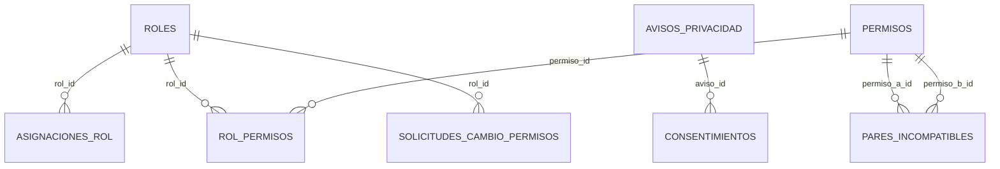
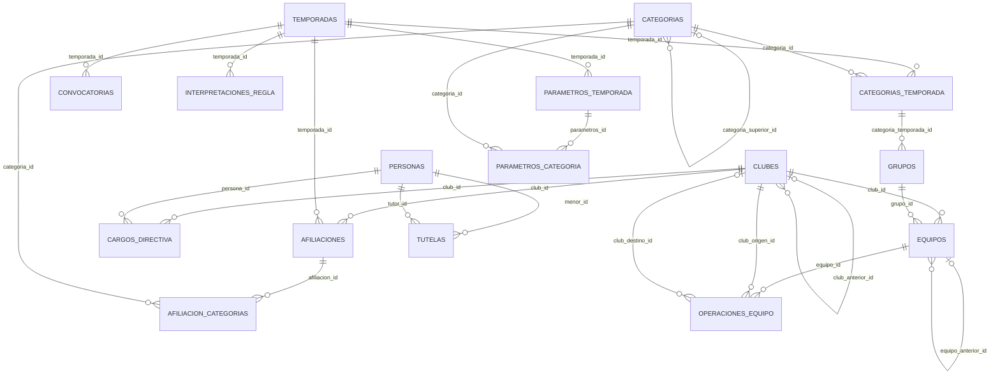
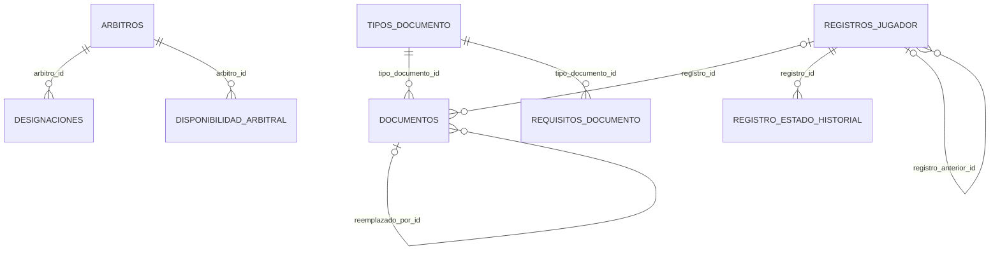
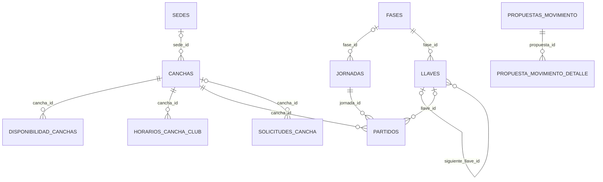
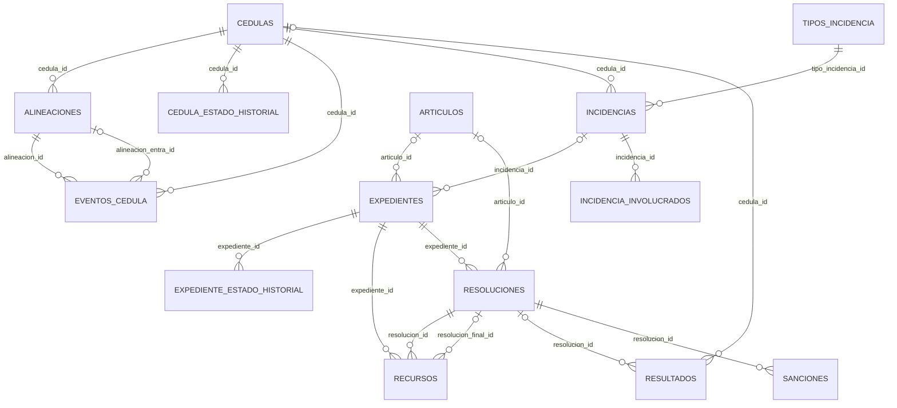
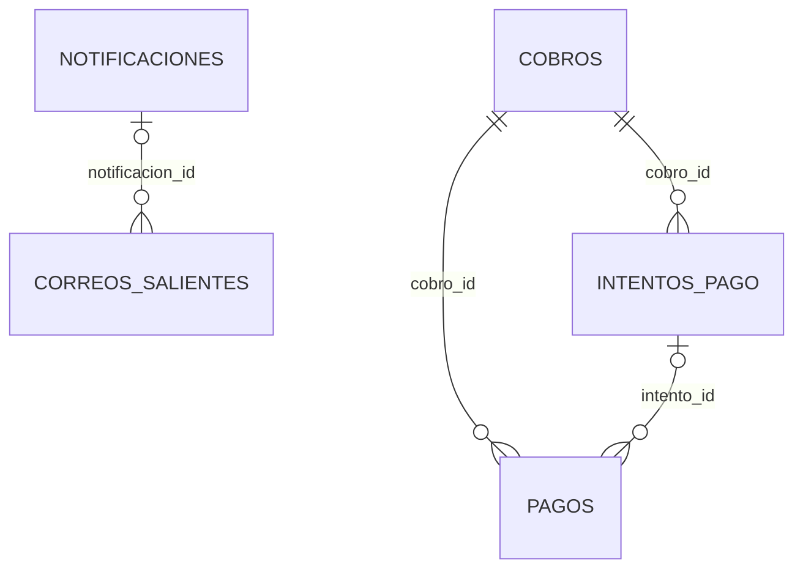

# Diccionario de datos

**SIGLIM · Sistema de Gestión de la Liga Municipal de Futbol Amateur Morelia**  
Versión 2.1 · 22 de octubre de 2026 · PostgreSQL 15+ en Supabase · Alineado con el [ERS Rev. 0.4.1](../requisitos/ERS.md) y la [arquitectura v2.1](../arquitectura/arquitectura-y-diseno-jerarquico.md)

> [!NOTE]
> Este diccionario describe la migración
> [`20261020090000_esquema_inicial.sql`](../../supabase/migrations/20261020090000_esquema_inicial.sql), que
> reemplaza el esquema de la Rev. 0.3 (DEC-42). Se generó leyendo el catálogo de PostgreSQL después
> de aplicar la migración, por lo que tablas, tipos, restricciones e índices coinciden con el script.
> Las migraciones posteriores se registran en el historial de versiones.
> La versión anterior está en [`historico/`](historico/).

## Control del documento

| Versión | Fecha | Cambios |
| --- | --- | --- |
| 1.0 | 7 de octubre de 2026 | 22 tablas del alcance de la Rev. 0.3 en el esquema `public`. |
| 2.0 | 20 de octubre de 2026 | 72 tablas del alcance de la Rev. 0.4 en el esquema `siglim`; permisos con ámbito, cédula, disciplina, tesorería, notificaciones y documentos en AWS S3; RLS por ámbito; pruebas de integración. |
| 2.1 | 22 de octubre de 2026 | Migración `20261022143000_fijar_search_path_error_negocio.sql`: `error_negocio` fija `search_path = siglim, pg_temp` como el resto de las funciones (aviso 0011 del asesor de seguridad). Sin cambios en tablas ni en el comportamiento. |

## 1. Propósito y alcance

Documenta el modelo físico de la base de datos: cada tabla con sus columnas, tipos, llaves,
restricciones, índices y triggers; los tipos enumerados; las funciones; las vistas del portal; la
seguridad (roles de base de datos, RLS y privilegios) y los datos semilla. Cubre las entidades de
entrega N y B del modelo conceptual del ERS (§4.4); las de entrega F no tienen tablas.

## 2. Motor, esquema y roles

| Elemento | Valor | Decisión |
| --- | --- | --- |
| Motor | PostgreSQL 15 o superior administrado por Supabase | DD-003, DEC-43 |
| Esquema | `siglim` (no expuesto por la API REST ni GraphQL de Supabase) | ADR-0014 |
| Identidad | `auth.users` de Supabase Auth, enlazado desde `perfiles.usuario_auth_id` | ADR-0003 |
| Rol de la aplicación | `siglim_app` (NOLOGIN); el backend lo adopta con `SET LOCAL ROLE` en cada transacción | ADR-0014 |
| Rol del portal | `siglim_publico` (NOLOGIN); solo lee las vistas `v_publica_*` y `calcular_tabla()` | ADR-0014, DP-006 |
| Contexto de usuario | `request.jwt.claims` con `perfil_id` y `siglim.motivo`, fijados por transacción | ADR-0005, ADR-0014 |
| Archivos | AWS S3 (bucket privado); la base guarda bucket, clave y URL | ADR-0013 |
| Extensión | `btree_gist` (en el esquema `extensions`) para la exclusión por cancha y horario | VAL-004 |

### 2.1 Cómo aplicar el esquema

1. En un proyecto de Supabase sin el esquema `siglim`: **SQL Editor → pegar el archivo completo → Run**
   (o `supabase db push` con la CLI).
2. Invitar al primer administrador en **Authentication → Users → Invite user**.
3. Ejecutar `SELECT siglim.registrar_administrador_inicial('correo@dominio');`.
4. El backend se conecta con el usuario `postgres` del *pooler* en modo transacción y, en cada
   transacción, ejecuta:

   ```sql
   SELECT set_config('request.jwt.claims', '{"sub":"<auth uuid>","perfil_id":"<uuid>"}', true);
   SELECT set_config('siglim.motivo', :motivo, true);   -- solo en cambios de estado
   SET LOCAL ROLE siglim_app;                          -- o siglim_publico en el portal
   ```

## 3. Convenciones

- Nombres en español y `snake_case`; tablas en plural; columnas de auditoría `creado_en`, `creado_por`,
  `actualizado_en` (la última la fija un trigger).
- Llaves `uuid` generadas con `gen_random_uuid()`; catálogos técnicos y bitácoras con `bigint` de identidad.
- Fechas y horas en `timestamptz`; las reglas de calendario usan `America/Mexico_City`.
- **Nada con historial se borra:** el rol de la aplicación no tiene `DELETE` en esas tablas; las bajas y
  cancelaciones son cambios de estado. Auditoría, historiales, parámetros y resoluciones solo admiten `INSERT`.
- **Estados como tipos enumerados** y transiciones validadas por triggers (última garantía; el servicio
  valida antes y explica, AGENTS.md §7).
- **Errores de negocio:** los triggers lanzan `P0001` con el código del ERS en `HINT` (por ejemplo `VAL-003`),
  para que el backend responda RFC 9457 con ese `codigo`.
- **Valores [DEMO]** como columnas con valor predeterminado o filas marcadas `es_demo`, nunca fijos en el código.
- **Motivo obligatorio:** las transiciones de partido y registro exigen `siglim.motivo` (RN-021).

## 4. Tablas por módulo

| Módulo | Tablas |
| --- | --- |
| M-01 Administración y seguridad | `asignaciones_rol`, `auditoria`, `avisos_privacidad`, `consentimientos`, `ligas`, `pares_incompatibles`, `perfiles`, `permisos`, `rol_permisos`, `roles`, `solicitudes_arco`, `solicitudes_cambio_permisos` |
| M-02 Temporadas y normativa | `categorias`, `categorias_temporada`, `convocatorias`, `grupos`, `interpretaciones_regla`, `parametros_categoria`, `parametros_temporada`, `temporadas` |
| M-03 Organización deportiva | `afiliacion_categorias`, `afiliaciones`, `cargos_directiva`, `clubes`, `equipos`, `operaciones_equipo`, `personas`, `tutelas` |
| M-04 Registros y elegibilidad | `documentos`, `registro_estado_historial`, `registros_jugador`, `requisitos_documento`, `tipos_documento` |
| M-05 Árbitros y designaciones | `arbitros`, `designaciones`, `disponibilidad_arbitral` |
| M-06 Canchas y recursos | `canchas`, `disponibilidad_canchas`, `horarios_cancha_club`, `sedes`, `solicitudes_cancha` |
| M-07 Programación manual | `historial_publicacion`, `jornadas`, `partidos` |
| M-08 Partidos, cédula y resultados | `alineaciones`, `cedula_estado_historial`, `cedulas`, `eventos_cedula`, `incidencia_involucrados`, `incidencias`, `partido_estado_historial`, `resultados`, `sorteos_desempate`, `tabla_historial` |
| M-09 Disciplina | `articulos`, `expediente_estado_historial`, `expedientes`, `recursos`, `resoluciones`, `sanciones`, `tipos_incidencia` |
| M-10 Competencias y fases finales | `fases`, `llaves`, `propuesta_movimiento_detalle`, `propuestas_movimiento` |
| M-11 Portal público y publicación | `comunicados` |
| M-13 Tesorería y cobros | `cobros`, `intentos_pago`, `pagos`, `tarifas` |
| M-14 Notificaciones | `correos_salientes`, `notificaciones` |

M-12 (reportes) no tiene tablas propias: consulta las existentes. Los datos de las fases finales (M-10)
se enlazan con jornadas y partidos.

### 4.1 Diagramas entidad-relación

Cada diagrama muestra las tablas del bloque y sus llaves foráneas hacia tablas del mismo bloque. Para
legibilidad se omiten las referencias a `ligas` (presentes en todas las entidades raíz) y a perfiles
(columnas `*_por`).



*Figura 1. Administración y seguridad.*



*Figura 2. Temporadas y organización deportiva.*



*Figura 3. Registros, documentos y árbitros.*



*Figura 4. Canchas, programación y fases finales.*



*Figura 5. Partidos, cédula, resultados y disciplina.*



*Figura 6. Publicación, tesorería y notificaciones.*

## 5. Detalle de tablas

### 5.1 M-01 Administración y seguridad

#### `asignaciones_rol`

Rol de un perfil con su ámbito: liga, club (club_id) o propio (RF-094, RN-054).

| Columna | Tipo | Nulo | Predeterminado | Llave | Descripción |
| --- | --- | --- | --- | --- | --- |
| `id` | uuid | No | gen_random_uuid() | PK | Identificador único. |
| `perfil_id` | uuid | No |  | FK → perfiles.id | Perfil de usuario. |
| `rol_id` | uuid | No |  | FK → roles.id | Rol. |
| `liga_id` | uuid | No |  | FK → ligas.id | Liga a la que pertenece (ADR-0011). |
| `ambito` | ambito | No |  |  | Ámbito de la asignación: LIGA, CLUB o PROPIO (RN-054). |
| `club_id` | uuid | Sí |  | FK → clubes.id | Club de la asignación; obligatorio solo con ámbito CLUB. |
| `activa` | boolean | No | true |  | Las asignaciones no se borran: se desactivan. |
| `creado_por` | uuid | Sí |  | FK → perfiles.id | Perfil que creó el registro. |
| `creado_en` | timestamptz | No | now() |  | Fecha y hora de creación. |
| `revocada_en` | timestamptz | Sí |  |  | Fecha y hora en que se desactivó. |

Restricciones, índices y triggers:

- `ck_asignaciones_club`: `CHECK (((ambito = 'CLUB') = (club_id IS NOT NULL)))`
- Índice `ix_asignaciones_perfil`: `USING btree (perfil_id) WHERE activa`
- Índice único `ux_asignaciones_activa`: `USING btree (perfil_id, rol_id, COALESCE(club_id, '00000000-0000-0000-0000-000000000000'::uuid)) WHERE activa`

#### `auditoria`

Auditoría inalterable: solo INSERT y SELECT (RF-093, RNF-015). detalle no debe contener datos personales.

| Columna | Tipo | Nulo | Predeterminado | Llave | Descripción |
| --- | --- | --- | --- | --- | --- |
| `id` | bigint | No | identidad | PK | Identificador único. |
| `liga_id` | uuid | Sí |  | FK → ligas.id | Liga a la que pertenece (ADR-0011). |
| `perfil_id` | uuid | Sí |  | FK → perfiles.id | Perfil que ejecutó la acción. |
| `ocurrido_en` | timestamptz | No | now() |  | Fecha y hora de la acción. |
| `modulo` | char(4) | No |  |  | Módulo del ERS donde ocurrió la acción. |
| `accion` | varchar(80) | No |  |  | Acción realizada (por ejemplo APROBAR_CEDULA). |
| `entidad` | varchar(60) | No |  |  | Tabla o recurso afectado. |
| `entidad_id` | text | Sí |  |  | Identificador del registro afectado. |
| `motivo` | text | Sí |  |  | Motivo de la operación o del cambio. |
| `detalle` | jsonb | Sí |  |  | Datos adicionales en JSON, sin datos personales. |

Restricciones, índices y triggers:

- `ck_auditoria_modulo`: `CHECK ((modulo ~ '^M-[0-9]{2}$'::text))`
- Índice `ix_auditoria_entidad`: `USING btree (entidad, entidad_id)`
- Índice `ix_auditoria_fecha`: `USING btree (ocurrido_en DESC)`
- Índice `ix_auditoria_perfil`: `USING btree (perfil_id, ocurrido_en DESC)`
- Trigger `tg_auditoria_inmutable` (before delete or update) → `tg_inmutable()`

#### `avisos_privacidad`

Versiones del aviso de privacidad integral y simplificado (RF-097, DEC-40).

| Columna | Tipo | Nulo | Predeterminado | Llave | Descripción |
| --- | --- | --- | --- | --- | --- |
| `id` | uuid | No | gen_random_uuid() | PK | Identificador único. |
| `liga_id` | uuid | No |  | FK → ligas.id | Liga a la que pertenece (ADR-0011). |
| `tipo` | tipo_aviso_privacidad | No |  |  | Aviso integral o simplificado (LFPDPPP). |
| `version` | varchar(20) | No |  |  | Versión. |
| `contenido` | text | No |  |  | Texto del aviso aprobado por la Liga. |
| `finalidades` | text[] | No |  |  | Finalidades que el titular puede aceptar por separado. |
| `vigente_desde` | date | No |  |  | Fecha desde la que se usa esta versión. |
| `creado_en` | timestamptz | No | now() |  | Fecha y hora de creación. |

Restricciones, índices y triggers:

- `avisos_privacidad_liga_id_tipo_version_key`: `UNIQUE (liga_id, tipo, version)`

#### `consentimientos`

Consentimiento expreso del titular o, si es menor, de su tutor (otorgado_por_id) (RF-097, RN-055).

| Columna | Tipo | Nulo | Predeterminado | Llave | Descripción |
| --- | --- | --- | --- | --- | --- |
| `id` | uuid | No | gen_random_uuid() | PK | Identificador único. |
| `persona_id` | uuid | No |  | FK → personas.id | Titular de los datos. |
| `otorgado_por_id` | uuid | No |  | FK → personas.id | Quien otorga: el propio titular o, si es menor, su tutor. |
| `aviso_id` | uuid | No |  | FK → avisos_privacidad.id | Versión del aviso de privacidad aceptada. |
| `finalidades` | text[] | No |  |  | Finalidades aceptadas (DIFUSION habilita mostrar el nombre en el portal). |
| `otorgado_en` | timestamptz | No | now() |  | Fecha y hora de otorgamiento. |
| `revocado_en` | timestamptz | Sí |  |  | Fecha y hora de revocación. |
| `registrado_por` | uuid | Sí |  | FK → perfiles.id | Perfil que registró el consentimiento. |

Restricciones, índices y triggers:

- `ck_consentimientos_finalidades`: `CHECK ((cardinality(finalidades) > 0))`

#### `ligas`

Organización que opera el sistema. Una sola fila en esta entrega (ADR-0011, DD-011).

| Columna | Tipo | Nulo | Predeterminado | Llave | Descripción |
| --- | --- | --- | --- | --- | --- |
| `id` | uuid | No | gen_random_uuid() | PK | Identificador único. |
| `nombre` | varchar(150) | No |  | UQ | Nombre. |
| `nombre_corto` | varchar(40) | Sí |  |  | Siglas de la liga. |
| `activa` | boolean | No | true |  | Indica si está activa. |
| `creado_en` | timestamptz | No | now() |  | Fecha y hora de creación. |

#### `pares_incompatibles`

Pares que no deben concentrarse en un rol sin aprobación del Presidente (RF-096, RN-053).

| Columna | Tipo | Nulo | Predeterminado | Llave | Descripción |
| --- | --- | --- | --- | --- | --- |
| `permiso_a_id` | bigint | No |  | PK; FK → permisos.id | Primer permiso del par (menor identificador). |
| `permiso_b_id` | bigint | No |  | PK; FK → permisos.id | Segundo permiso del par. |
| `motivo` | text | No |  |  | Motivo de la operación o del cambio. |

Restricciones, índices y triggers:

- `ck_pares_orden`: `CHECK ((permiso_a_id < permiso_b_id))`

#### `perfiles`

Cuenta de SIGLIM. usuario_auth_id enlaza con Supabase Auth; el perfil Sistema no tiene cuenta (ADR-0003, ADR-0014).

| Columna | Tipo | Nulo | Predeterminado | Llave | Descripción |
| --- | --- | --- | --- | --- | --- |
| `id` | uuid | No | gen_random_uuid() | PK | Identificador único. |
| `usuario_auth_id` | uuid | Sí |  | FK → auth.users.id; UQ | Usuario de Supabase Auth (auth.users.id); nulo para el perfil Sistema. |
| `persona_id` | uuid | Sí |  | FK → personas.id; UQ | Persona asociada a la cuenta (árbitro, directivo, tutor o jugador adulto). |
| `nombre_mostrado` | varchar(150) | No |  |  | Nombre que muestra la aplicación. |
| `correo` | varchar(254) | Sí |  |  | Correo de la cuenta. |
| `activo` | boolean | No | true |  | Una cuenta inactiva se rechaza aunque su token siga vigente (ADR-0003). |
| `es_sistema` | boolean | No | false |  | Marca el perfil técnico «Sistema» de las tareas programadas (ADR-0009). |
| `creado_en` | timestamptz | No | now() |  | Fecha y hora de creación. |
| `actualizado_en` | timestamptz | No | now() |  | Fecha y hora de la última modificación (la fija un trigger). |

Restricciones, índices y triggers:

- `ck_perfiles_sistema`: `CHECK (((NOT es_sistema) OR (usuario_auth_id IS NULL)))`
- Trigger `tg_perfiles_actualizado_en` (before update) → `tg_actualizado_en()`

#### `permisos`

Catálogo de permisos modulo.recurso:ACCION (ADR-0007). Semilla de la migración.

| Columna | Tipo | Nulo | Predeterminado | Llave | Descripción |
| --- | --- | --- | --- | --- | --- |
| `id` | bigint | No | identidad | PK | Identificador único. |
| `codigo` | varchar(80) | No |  | UQ | Código modulo.recurso:ACCION que evalúa el backend (ADR-0007). |
| `modulo` | char(4) | No |  |  | Módulo del ERS (M-01 a M-14). |
| `descripcion` | text | No |  |  | Descripción. |

Restricciones, índices y triggers:

- `ck_permisos_codigo`: `CHECK (((codigo)::text ~ '^[a-z]+\.[a-z_]+:[A-Z_]+$'::text))`
- `ck_permisos_modulo`: `CHECK ((modulo ~ '^M-[0-9]{2}$'::text))`

#### `rol_permisos`

Permisos de cada rol (matriz del Apéndice E del ERS).

| Columna | Tipo | Nulo | Predeterminado | Llave | Descripción |
| --- | --- | --- | --- | --- | --- |
| `rol_id` | uuid | No |  | PK; FK → roles.id | Rol. |
| `permiso_id` | bigint | No |  | PK; FK → permisos.id | Permiso. |

Restricciones, índices y triggers:

- Trigger `tg_rol_permisos_propio` (before insert or delete or update) → `tg_rol_permisos_propio()`

#### `roles`

Tipos de usuario (ERS §2.3). Sus permisos son configurables (RF-095).

| Columna | Tipo | Nulo | Predeterminado | Llave | Descripción |
| --- | --- | --- | --- | --- | --- |
| `id` | uuid | No | gen_random_uuid() | PK | Identificador único. |
| `liga_id` | uuid | No |  | FK → ligas.id | Liga a la que pertenece (ADR-0011). |
| `codigo` | varchar(40) | No |  |  | Código único legible por el sistema. |
| `nombre` | varchar(100) | No |  |  | Nombre. |
| `descripcion` | text | Sí |  |  | Descripción. |
| `ambito_predeterminado` | ambito | No |  |  | Ámbito con que se asigna normalmente el rol (liga, club o propio). |
| `asignable` | boolean | No | true |  | Falso para roles técnicos o sin cuenta (Sistema, Usuario público). |
| `creado_en` | timestamptz | No | now() |  | Fecha y hora de creación. |

Restricciones, índices y triggers:

- `roles_liga_id_codigo_key`: `UNIQUE (liga_id, codigo)`

#### `solicitudes_arco`

Solicitudes de acceso, rectificación, cancelación y oposición (RF-098, backlog).

| Columna | Tipo | Nulo | Predeterminado | Llave | Descripción |
| --- | --- | --- | --- | --- | --- |
| `id` | uuid | No | gen_random_uuid() | PK | Identificador único. |
| `liga_id` | uuid | No |  | FK → ligas.id | Liga a la que pertenece (ADR-0011). |
| `persona_id` | uuid | No |  | FK → personas.id | Persona. |
| `tipo` | tipo_solicitud_arco | No |  |  | Acceso, rectificación, cancelación u oposición. |
| `descripcion` | text | No |  |  | Descripción. |
| `estado` | estado_solicitud_arco | No | RECIBIDA |  | Estado actual (máquinas de estado del ERS §4.3). |
| `recibida_en` | timestamptz | No | now() |  | Fecha y hora de recepción. |
| `atendida_por` | uuid | Sí |  | FK → perfiles.id | Perfil que atendió. |
| `atendida_en` | timestamptz | Sí |  |  | Fecha y hora de atención. |
| `respuesta` | text | Sí |  |  | Respuesta entregada al titular. |

#### `solicitudes_cambio_permisos`

Control dual: cambio que crea un par incompatible, pendiente del Presidente (P-13, VAL-023).

| Columna | Tipo | Nulo | Predeterminado | Llave | Descripción |
| --- | --- | --- | --- | --- | --- |
| `id` | uuid | No | gen_random_uuid() | PK | Identificador único. |
| `rol_id` | uuid | No |  | FK → roles.id | Rol. |
| `permisos_agregados` | bigint[] | No | {}::bigint[] |  | Identificadores de permisos que se agregarían al rol. |
| `permisos_quitados` | bigint[] | No | {}::bigint[] |  | Identificadores de permisos que se quitarían al rol. |
| `motivo` | text | No |  |  | Motivo de la operación o del cambio. |
| `estado` | estado_solicitud_permisos | No | SOLICITADO |  | Estado actual (máquinas de estado del ERS §4.3). |
| `solicitado_por` | uuid | No |  | FK → perfiles.id | Perfil que solicitó. |
| `solicitado_en` | timestamptz | No | now() |  | Fecha y hora de solicitud. |
| `resuelto_por` | uuid | Sí |  | FK → perfiles.id | Perfil que resolvió. |
| `resuelto_en` | timestamptz | Sí |  |  | Fecha y hora de resolución. |
| `observaciones` | text | Sí |  |  | Observaciones del usuario que resolvió o capturó. |

Restricciones, índices y triggers:

- `ck_solicitudes_permisos_dual`: `CHECK (((resuelto_por IS NULL) OR (resuelto_por <> solicitado_por)))`
- `ck_solicitudes_permisos_resolucion`: `CHECK (((estado = 'SOLICITADO') = (resuelto_por IS NULL)))`

### 5.2 M-02 Temporadas y normativa

#### `categorias`

Catálogo con orden y categoría superior inmediata configurables (RF-099, DEC-16).

| Columna | Tipo | Nulo | Predeterminado | Llave | Descripción |
| --- | --- | --- | --- | --- | --- |
| `id` | uuid | No | gen_random_uuid() | PK | Identificador único. |
| `liga_id` | uuid | No |  | FK → ligas.id | Liga a la que pertenece (ADR-0011). |
| `nombre` | varchar(80) | No |  |  | Nombre. |
| `tipo` | tipo_categoria | No |  |  | Tipo de categoría que define los documentos exigidos (DEC-10). |
| `orden` | smallint | No |  |  | Posición en el catálogo (configurable). |
| `categoria_superior_id` | uuid | Sí |  | FK → categorias.id | Categoría inmediata superior para alinear jugadores (RF-110, DEC-12). |
| `activa` | boolean | No | true |  | Indica si está activa. |
| `creado_en` | timestamptz | No | now() |  | Fecha y hora de creación. |

Restricciones, índices y triggers:

- `categorias_liga_id_nombre_key`: `UNIQUE (liga_id, nombre)`
- `ck_categorias_superior`: `CHECK (((categoria_superior_id IS NULL) OR (categoria_superior_id <> id)))`
- Índice único `ux_categorias_orden`: `USING btree (liga_id, orden) WHERE activa`

#### `categorias_temporada`

Categorías que participan en la temporada (RF-004).

| Columna | Tipo | Nulo | Predeterminado | Llave | Descripción |
| --- | --- | --- | --- | --- | --- |
| `id` | uuid | No | gen_random_uuid() | PK | Identificador único. |
| `temporada_id` | uuid | No |  | FK → temporadas.id | Temporada en que participa la categoría. |
| `categoria_id` | uuid | No |  | FK → categorias.id | Categoría del catálogo. |

Restricciones, índices y triggers:

- `categorias_temporada_temporada_id_categoria_id_key`: `UNIQUE (temporada_id, categoria_id)`

#### `convocatorias`

Referencia de la convocatoria de la temporada (RF-002, backlog).

| Columna | Tipo | Nulo | Predeterminado | Llave | Descripción |
| --- | --- | --- | --- | --- | --- |
| `id` | uuid | No | gen_random_uuid() | PK | Identificador único. |
| `temporada_id` | uuid | No |  | FK → temporadas.id; UQ | Temporada. |
| `referencia` | text | No |  |  | Referencia o título de la convocatoria. |
| `version` | varchar(30) | Sí |  |  | Versión. |
| `documento_url` | text | Sí |  |  | Enlace al documento de la convocatoria. |
| `creado_en` | timestamptz | No | now() |  | Fecha y hora de creación. |

#### `grupos`

Uno o varios grupos por categoría de la temporada (RF-005).

| Columna | Tipo | Nulo | Predeterminado | Llave | Descripción |
| --- | --- | --- | --- | --- | --- |
| `id` | uuid | No | gen_random_uuid() | PK | Identificador único. |
| `categoria_temporada_id` | uuid | No |  | FK → categorias_temporada.id | Categoría de la temporada a la que pertenece el grupo. |
| `nombre` | varchar(60) | No |  |  | Nombre. |

Restricciones, índices y triggers:

- `grupos_categoria_temporada_id_nombre_key`: `UNIQUE (categoria_temporada_id, nombre)`

#### `interpretaciones_regla`

Interpretación administrativa pendiente de autorización del Presidente (RF-007, backlog).

| Columna | Tipo | Nulo | Predeterminado | Llave | Descripción |
| --- | --- | --- | --- | --- | --- |
| `id` | uuid | No | gen_random_uuid() | PK | Identificador único. |
| `temporada_id` | uuid | No |  | FK → temporadas.id | Temporada. |
| `descripcion` | text | No |  |  | Descripción. |
| `estado` | estado_interpretacion | No | PENDIENTE |  | Estado actual (máquinas de estado del ERS §4.3). |
| `registrada_por` | uuid | No |  | FK → perfiles.id | Perfil que registró. |
| `registrada_en` | timestamptz | No | now() |  | Fecha y hora de registro. |
| `resuelta_por` | uuid | Sí |  | FK → perfiles.id | Perfil que resolvió. |
| `resuelta_en` | timestamptz | Sí |  |  | Fecha y hora de resolución. |
| `observaciones` | text | Sí |  |  | Observaciones del usuario que resolvió o capturó. |

#### `parametros_categoria`

Duración de juego y bloque de cancha por categoría; sin fila se usan los de la temporada (RF-100, DEC-25).

| Columna | Tipo | Nulo | Predeterminado | Llave | Descripción |
| --- | --- | --- | --- | --- | --- |
| `parametros_id` | uuid | No |  | PK; FK → parametros_temporada.id | Versión de parámetros de la temporada usada. |
| `categoria_id` | uuid | No |  | PK; FK → categorias.id | Categoría del catálogo. |
| `duracion_juego_min` | smallint | No |  |  | Duración de juego de la categoría en minutos. |
| `bloque_cancha_min` | smallint | No |  |  | Bloque de cancha de la categoría en minutos. |

Restricciones, índices y triggers:

- `ck_parametros_categoria`: `CHECK (((duracion_juego_min > 0) AND (bloque_cancha_min >= duracion_juego_min)))`

#### `parametros_temporada`

Reglas versionadas de la temporada; la versión mayor es la vigente (RF-006, RF-100, DP-002). Valores por defecto [DEMO] (DEC-25 a DEC-29).

| Columna | Tipo | Nulo | Predeterminado | Llave | Descripción |
| --- | --- | --- | --- | --- | --- |
| `id` | uuid | No | gen_random_uuid() | PK | Identificador único. |
| `temporada_id` | uuid | No |  | FK → temporadas.id | Temporada. |
| `version` | integer | No |  |  | Versión consecutiva por temporada (la fija un trigger); la mayor es la vigente. |
| `puntos_victoria` | smallint | No | 3 |  | Puntos por victoria (3 [DEMO], DEC-26). |
| `puntos_empate` | smallint | No | 1 |  | Puntos por empate (1 [DEMO]). |
| `puntos_derrota` | smallint | No | 0 |  | Puntos por derrota (0 [DEMO]). |
| `criterios_desempate` | criterio_desempate[] | No | {PUNTOS,DIFERENCIA_GOLES,GOLES_FAVOR,ENFRENTAMIENTO_DIRECTO,MENOS_EXPULSIONES,SORTEO} |  | Orden de criterios; siempre inicia en PUNTOS (DEC-27). |
| `goles_default_ganador` | smallint | No | 3 |  | Goles del equipo presente en una no presentación (3 [DEMO], DEC-24). |
| `goles_default_perdedor` | smallint | No | 0 |  | Goles del equipo no presentado (0 [DEMO]). |
| `plazo_validacion_cedula` | interval | No | 48:00:00 |  | Plazo del árbitro para validar la cédula (48 h [DEMO], DEC-20). |
| `duracion_juego_min` | smallint | No | 90 |  | Duración de juego base en minutos (90, DEC-25). |
| `bloque_cancha_min` | smallint | No | 120 |  | Bloque de cancha en minutos para detectar choques (120 [DEMO]). |
| `clasificados_liguilla` | smallint | No | 8 |  | Equipos que clasifican a la liguilla por grupo (8 [DEMO], DEC-28). |
| `formato_liguilla` | formato_eliminatoria | No | PARTIDO_UNICO |  | Partido único o ida y vuelta. |
| `empate_liguilla_por_penales` | boolean | No | true |  | Si un empate en liguilla se define por penales registrados en la cédula. |
| `equipos_ascienden` | smallint | No | 2 |  | Equipos que suben por categoría (2 [DEMO], DEC-29). |
| `equipos_descienden` | smallint | No | 2 |  | Equipos que bajan por categoría (2 [DEMO]). |
| `permite_cambio_club` | boolean | No | true |  | Si se aceptan cambios de club entre temporadas (RF-111, DEC-13). |
| `es_demo` | boolean | No | true |  | Valor de demostración [DEMO]: configurable y rotulado «no oficial» en la interfaz. |
| `motivo` | text | No |  |  | Motivo de la operación o del cambio. |
| `creado_por` | uuid | Sí |  | FK → perfiles.id | Perfil que creó el registro. |
| `creado_en` | timestamptz | No | now() |  | Fecha y hora de creación. |

Restricciones, índices y triggers:

- `ck_parametros_criterios`: `CHECK ((criterios_desempate[1] = 'PUNTOS'))`
- `ck_parametros_default`: `CHECK (((goles_default_ganador > goles_default_perdedor) AND (goles_default_perdedor >= 0)))`
- `ck_parametros_liguilla`: `CHECK ((clasificados_liguilla = ANY (ARRAY[2, 4, 8, 16, 32])))`
- `ck_parametros_movimientos`: `CHECK (((equipos_ascienden >= 0) AND (equipos_descienden >= 0)))`
- `ck_parametros_puntos`: `CHECK (((puntos_victoria >= puntos_empate) AND (puntos_empate >= puntos_derrota) AND (puntos_derrota >= 0)))`
- `ck_parametros_tiempos`: `CHECK (((duracion_juego_min > 0) AND (bloque_cancha_min >= duracion_juego_min) AND (plazo_validacion_cedula > '00:00:00'::interval)))`
- `parametros_temporada_temporada_id_version_key`: `UNIQUE (temporada_id, version)`
- Trigger `tg_parametros_inmutable` (before delete or update) → `tg_inmutable()`
- Trigger `tg_parametros_version` (before insert) → `tg_parametros_version()`

#### `temporadas`

Periodo deportivo; una sola ACTIVA por liga (RF-001, RN-058). No se borra (RF-003).

| Columna | Tipo | Nulo | Predeterminado | Llave | Descripción |
| --- | --- | --- | --- | --- | --- |
| `id` | uuid | No | gen_random_uuid() | PK | Identificador único. |
| `liga_id` | uuid | No |  | FK → ligas.id | Liga a la que pertenece (ADR-0011). |
| `nombre` | varchar(100) | No |  |  | Nombre. |
| `fecha_inicio` | date | No |  |  | Primer día de la temporada. |
| `fecha_fin` | date | Sí |  |  | Último día de la temporada. |
| `estado` | estado_temporada | No | CONFIGURACION |  | Estado actual (máquinas de estado del ERS §4.3). |
| `creado_por` | uuid | Sí |  | FK → perfiles.id | Perfil que creó el registro. |
| `creado_en` | timestamptz | No | now() |  | Fecha y hora de creación. |
| `actualizado_en` | timestamptz | No | now() |  | Fecha y hora de la última modificación (la fija un trigger). |

Restricciones, índices y triggers:

- `ck_temporadas_fechas`: `CHECK (((fecha_fin IS NULL) OR (fecha_fin >= fecha_inicio)))`
- `temporadas_liga_id_nombre_key`: `UNIQUE (liga_id, nombre)`
- Índice único `ux_temporadas_activa`: `USING btree (liga_id) WHERE (estado = 'ACTIVA')`
- Trigger `tg_temporadas_actualizado_en` (before update) → `tg_actualizado_en()`
- Trigger `tg_temporadas_estado` (before update of estado) → `tg_temporadas_estado()`

### 5.3 M-03 Organización deportiva

#### `afiliacion_categorias`

Categorías en que se inscribe el club en el tarjetón (DEC-09).

| Columna | Tipo | Nulo | Predeterminado | Llave | Descripción |
| --- | --- | --- | --- | --- | --- |
| `afiliacion_id` | uuid | No |  | PK; FK → afiliaciones.id | Afiliación (tarjetón). |
| `categoria_id` | uuid | No |  | PK; FK → categorias.id | Categoría del catálogo. |

#### `afiliaciones`

Tarjetón del club por temporada con folio, sujeto a aprobación del Presidente (RF-101, DEC-09). Firmas: documento TARJETON_FIRMADO.

| Columna | Tipo | Nulo | Predeterminado | Llave | Descripción |
| --- | --- | --- | --- | --- | --- |
| `id` | uuid | No | gen_random_uuid() | PK | Identificador único. |
| `club_id` | uuid | No |  | FK → clubes.id | Club. |
| `temporada_id` | uuid | No |  | FK → temporadas.id | Temporada. |
| `folio` | varchar(30) | No |  |  | Folio del tarjetón, único por temporada (DEC-09). |
| `colores_uniforme` | varchar(120) | No |  |  | Colores del uniforme declarados en el tarjetón. |
| `estado` | estado_afiliacion | No | SOLICITADA |  | Estado actual (máquinas de estado del ERS §4.3). |
| `capturada_por` | uuid | No |  | FK → perfiles.id | Perfil que capturó. |
| `capturada_en` | timestamptz | No | now() |  | Fecha y hora de captura. |
| `resuelta_por` | uuid | Sí |  | FK → perfiles.id | Perfil que resolvió. |
| `resuelta_en` | timestamptz | Sí |  |  | Fecha y hora de resolución. |
| `observaciones` | text | Sí |  |  | Observaciones del usuario que resolvió o capturó. |

Restricciones, índices y triggers:

- `afiliaciones_club_id_temporada_id_key`: `UNIQUE (club_id, temporada_id)`
- `afiliaciones_temporada_id_folio_key`: `UNIQUE (temporada_id, folio)`

#### `cargos_directiva`

Directiva del club (presidente, secretario, tesorero, delegado) con vigencia (RF-102).

| Columna | Tipo | Nulo | Predeterminado | Llave | Descripción |
| --- | --- | --- | --- | --- | --- |
| `id` | uuid | No | gen_random_uuid() | PK | Identificador único. |
| `club_id` | uuid | No |  | FK → clubes.id | Club. |
| `persona_id` | uuid | No |  | FK → personas.id | Persona. |
| `cargo` | cargo_directiva | No |  |  | Presidente, secretario, tesorero o delegado del club. |
| `desde` | date | No |  |  | Inicio del cargo. |
| `hasta` | date | Sí |  |  | Fin del cargo; nulo si está vigente. |
| `autorizado_por` | uuid | Sí |  | FK → perfiles.id | Perfil que autorizó el cambio de directiva. |
| `creado_en` | timestamptz | No | now() |  | Fecha y hora de creación. |

Restricciones, índices y triggers:

- `ck_cargos_vigencia`: `CHECK (((hasta IS NULL) OR (hasta >= desde)))`
- Índice único `ux_cargos_vigentes`: `USING btree (club_id, cargo) WHERE (hasta IS NULL)`

#### `clubes`

Club afiliado. Un cambio de nombre crea un club nuevo y cierra el anterior (RF-008, RF-105, DEC-15).

| Columna | Tipo | Nulo | Predeterminado | Llave | Descripción |
| --- | --- | --- | --- | --- | --- |
| `id` | uuid | No | gen_random_uuid() | PK | Identificador único. |
| `liga_id` | uuid | No |  | FK → ligas.id | Liga a la que pertenece (ADR-0011). |
| `nombre` | varchar(150) | No |  |  | Nombre. |
| `estado` | estado_club | No | ACTIVO |  | Estado actual (máquinas de estado del ERS §4.3). |
| `club_anterior_id` | uuid | Sí |  | FK → clubes.id | Club cerrado del que proviene por cambio de nombre (DEC-15). |
| `cerrado_en` | date | Sí |  |  | Fecha de cierre del club. |
| `motivo_cierre` | text | Sí |  |  | Motivo del cierre (por ejemplo, cambio de nombre). |
| `creado_en` | timestamptz | No | now() |  | Fecha y hora de creación. |
| `actualizado_en` | timestamptz | No | now() |  | Fecha y hora de la última modificación (la fija un trigger). |

Restricciones, índices y triggers:

- `ck_clubes_cierre`: `CHECK (((estado = 'CERRADO') = (cerrado_en IS NOT NULL)))`
- `clubes_liga_id_nombre_key`: `UNIQUE (liga_id, nombre)`
- Trigger `tg_clubes_actualizado_en` (before update) → `tg_actualizado_en()`

#### `equipos`

Representación del club en un grupo de la temporada (RF-009). equipo_anterior_id liga la plaza entre temporadas (RF-104).

| Columna | Tipo | Nulo | Predeterminado | Llave | Descripción |
| --- | --- | --- | --- | --- | --- |
| `id` | uuid | No | gen_random_uuid() | PK | Identificador único. |
| `club_id` | uuid | No |  | FK → clubes.id | Club. |
| `grupo_id` | uuid | No |  | FK → grupos.id | Grupo de la categoría en la temporada. |
| `nombre` | varchar(150) | No |  |  | Nombre. |
| `estado` | estado_equipo | No | ACTIVO |  | Estado actual (máquinas de estado del ERS §4.3). |
| `equipo_anterior_id` | uuid | Sí |  | FK → equipos.id | Equipo de la temporada anterior que conserva la plaza (RF-104). |
| `baja_en` | date | Sí |  |  | Fecha de baja del equipo. |
| `motivo_baja` | text | Sí |  |  | Motivo de la baja (por ejemplo, artículo aplicado). |
| `creado_en` | timestamptz | No | now() |  | Fecha y hora de creación. |
| `actualizado_en` | timestamptz | No | now() |  | Fecha y hora de la última modificación (la fija un trigger). |

Restricciones, índices y triggers:

- `ck_equipos_baja`: `CHECK (((estado = 'BAJA') = ((baja_en IS NOT NULL) AND (motivo_baja IS NOT NULL))))`
- `equipos_grupo_id_nombre_key`: `UNIQUE (grupo_id, nombre)`
- Índice `ix_equipos_club`: `USING btree (club_id)`
- Índice `ix_equipos_grupo`: `USING btree (grupo_id)`
- Trigger `tg_equipos_actualizado_en` (before update) → `tg_actualizado_en()`

#### `operaciones_equipo`

Venta de equipo y conservación de plaza, autorizadas por el Presidente y aplicadas al cierre (RF-103, RF-104, RN-040; backlog). Es el historial de propietarios.

| Columna | Tipo | Nulo | Predeterminado | Llave | Descripción |
| --- | --- | --- | --- | --- | --- |
| `id` | uuid | No | gen_random_uuid() | PK | Identificador único. |
| `tipo` | tipo_operacion_equipo | No |  |  | Venta del equipo o conservación de la plaza (operaciones independientes, DEC-14). |
| `equipo_id` | uuid | No |  | FK → equipos.id | Equipo. |
| `club_origen_id` | uuid | No |  | FK → clubes.id | Club propietario al solicitar. |
| `club_destino_id` | uuid | Sí |  | FK → clubes.id | Club comprador (solo en venta). |
| `estado` | estado_operacion_equipo | No | SOLICITADA |  | Estado actual (máquinas de estado del ERS §4.3). |
| `solicitada_por` | uuid | No |  | FK → perfiles.id | Perfil que solicitó. |
| `solicitada_en` | timestamptz | No | now() |  | Fecha y hora de solicitud. |
| `autorizada_por` | uuid | Sí |  | FK → perfiles.id | Perfil que autorizó. |
| `autorizada_en` | timestamptz | Sí |  |  | Fecha y hora de autorización. |
| `aplicada_en` | timestamptz | Sí |  |  | Fecha y hora en que se aplicó al cierre de la temporada. |
| `observaciones` | text | Sí |  |  | Observaciones del usuario que resolvió o capturó. |

Restricciones, índices y triggers:

- `ck_operaciones_venta`: `CHECK (((tipo <> 'VENTA') OR ((club_destino_id IS NOT NULL) AND (club_destino_id <> club_origen_id))))`

#### `personas`

Identidad única por CURP, reutilizable como jugador, tutor, directivo o árbitro (RF-010, RF-011, DEC-10). Global a todas las ligas.

| Columna | Tipo | Nulo | Predeterminado | Llave | Descripción |
| --- | --- | --- | --- | --- | --- |
| `id` | uuid | No | gen_random_uuid() | PK | Identificador único. |
| `curp` | char(18) | No |  | UQ | CURP de 18 caracteres; clave única de la persona en todo el sistema (DEC-10). |
| `nombre` | varchar(100) | No |  |  | Nombre. |
| `apellido_paterno` | varchar(100) | No |  |  | Apellido paterno. |
| `apellido_materno` | varchar(100) | Sí |  |  | Apellido materno (opcional). |
| `fecha_nacimiento` | date | No |  |  | Fecha de nacimiento; determina si es menor de edad (RN-055). |
| `correo` | varchar(254) | Sí |  |  | Correo de contacto (el del tutor se usa para su invitación). |
| `telefono` | varchar(20) | Sí |  |  | Teléfono de contacto. |
| `creado_por` | uuid | Sí |  | FK → perfiles.id | Perfil que creó el registro. |
| `creado_en` | timestamptz | No | now() |  | Fecha y hora de creación. |
| `actualizado_en` | timestamptz | No | now() |  | Fecha y hora de la última modificación (la fija un trigger). |

Restricciones, índices y triggers:

- `ck_personas_correo`: `CHECK (((correo IS NULL) OR ((correo)::text ~* '^[^@\s]+@[^@\s]+\.[^@\s]+$'::text)))`
- `ck_personas_curp`: `CHECK ((curp ~ '^[A-Z][AEIOUX][A-Z]{2}[0-9]{6}[HMX][A-Z]{5}[0-9A-Z][0-9]$'::text))`
- Índice `ix_personas_apellidos`: `USING btree (apellido_paterno, apellido_materno, nombre)`
- Trigger `tg_personas_actualizado_en` (before update) → `tg_actualizado_en()`

#### `tutelas`

Vínculo menor–tutor; la cuenta del tutor gestiona al menor (RF-106, DEC-11).

| Columna | Tipo | Nulo | Predeterminado | Llave | Descripción |
| --- | --- | --- | --- | --- | --- |
| `id` | uuid | No | gen_random_uuid() | PK | Identificador único. |
| `menor_id` | uuid | No |  | FK → personas.id | Persona menor de edad. |
| `tutor_id` | uuid | No |  | FK → personas.id | Persona tutora, cuya cuenta gestiona al menor (DEC-11). |
| `parentesco` | varchar(40) | No |  |  | Parentesco o relación con el menor. |
| `vigente` | boolean | No | true |  | Indica si es la versión o relación vigente. |
| `creado_por` | uuid | Sí |  | FK → perfiles.id | Perfil que creó el registro. |
| `creado_en` | timestamptz | No | now() |  | Fecha y hora de creación. |

Restricciones, índices y triggers:

- `ck_tutelas_distintos`: `CHECK ((menor_id <> tutor_id))`
- Índice único `ux_tutelas_vigente`: `USING btree (menor_id, tutor_id) WHERE vigente`

### 5.4 M-04 Registros y elegibilidad

#### `documentos`

Documentos, fotos, evidencias y comprobantes en un bucket privado de AWS S3; aquí se guardan bucket, clave y URL del objeto. Se leen con URL prefirmadas (RF-059, RF-108, RF-139, RNF-018, ADR-0013).

| Columna | Tipo | Nulo | Predeterminado | Llave | Descripción |
| --- | --- | --- | --- | --- | --- |
| `id` | uuid | No | gen_random_uuid() | PK | Identificador único. |
| `tipo_documento_id` | bigint | No |  | FK → tipos_documento.id | Tipo de documento. |
| `registro_id` | uuid | Sí |  | FK → registros_jugador.id | Registro de jugador al que pertenece (exactamente un dueño por documento). |
| `persona_id` | uuid | Sí |  | FK → personas.id | Persona dueña del documento (por ejemplo, INE del tutor). |
| `afiliacion_id` | uuid | Sí |  | FK → afiliaciones.id | Afiliación (tarjetón firmado). |
| `expediente_id` | uuid | Sí |  | FK → expedientes.id | Expediente (evidencia disciplinaria). |
| `pago_id` | uuid | Sí |  | FK → pagos.id | Pago (comprobante). |
| `s3_bucket` | varchar(63) | No |  |  | Bucket privado de AWS S3 (ADR-0013). |
| `s3_clave` | varchar(512) | No |  |  | Clave del objeto en S3; sin nombres ni CURP. |
| `url` | text | No |  |  | URL del objeto en S3 (no pública: se lee con una URL prefirmada de 60 s). |
| `tipo_mime` | varchar(60) | No |  |  | Tipo verificado por la firma binaria del archivo. |
| `tamano_bytes` | integer | No |  |  | Tamaño del archivo (máximo 5 MB [PROPUESTA]). |
| `sha256` | char(64) | No |  |  | Huella SHA-256 para verificar integridad. |
| `estado_validacion` | estado_validacion | No | PENDIENTE |  | Pendiente, aprobado o rechazado por el Secretario (RF-109). |
| `validado_por` | uuid | Sí |  | FK → perfiles.id | Perfil que validó. |
| `validado_en` | timestamptz | Sí |  |  | Fecha y hora de validación. |
| `observaciones` | text | Sí |  |  | Observaciones del usuario que resolvió o capturó. |
| `reemplazado_por_id` | uuid | Sí |  | FK → documentos.id | Documento nuevo que lo reemplaza (el anterior se conserva). |
| `cargado_por` | uuid | No |  | FK → perfiles.id | Perfil que cargó. |
| `cargado_en` | timestamptz | No | now() |  | Fecha y hora de carga. |

Restricciones, índices y triggers:

- `ck_documentos_clave`: `CHECK (((s3_clave)::text !~ '\.\.'::text))`
- `ck_documentos_dueno`: `CHECK ((num_nonnulls(registro_id, persona_id, afiliacion_id, expediente_id, pago_id) = 1))`
- `ck_documentos_tamano`: `CHECK (((tamano_bytes > 0) AND (tamano_bytes <= 5242880)))`
- `ck_documentos_tipo`: `CHECK (((tipo_mime)::text = ANY ((ARRAY['image/jpeg'::character varying, 'image/png'::character varying, 'image/webp'::character varying, 'application/pdf'::character varying])::text[])))`
- `ck_documentos_url`: `CHECK ((url ~ '^https://'::text))`
- `documentos_s3_bucket_s3_clave_key`: `UNIQUE (s3_bucket, s3_clave)`
- Índice `ix_documentos_persona`: `USING btree (persona_id) WHERE (persona_id IS NOT NULL)`
- Índice `ix_documentos_registro`: `USING btree (registro_id) WHERE (registro_id IS NOT NULL)`
- Trigger `tg_documentos_validar` (before update) → `tg_documentos_validar()`

#### `registro_estado_historial`

Cambios de estado del registro con usuario y motivo (RF-017, RF-018).

| Columna | Tipo | Nulo | Predeterminado | Llave | Descripción |
| --- | --- | --- | --- | --- | --- |
| `id` | bigint | No | identidad | PK | Identificador único. |
| `registro_id` | uuid | No |  | FK → registros_jugador.id | Registro de jugador. |
| `estado_anterior` | estado_registro | Sí |  |  | Estado antes del cambio (nulo en la creación). |
| `estado_nuevo` | estado_registro | No |  |  | Estado después del cambio. |
| `motivo` | text | No |  |  | Motivo de la operación o del cambio. |
| `cambiado_por` | uuid | Sí |  | FK → perfiles.id | Perfil que hizo el cambio (usuario Sistema en procesos automáticos). |
| `cambiado_en` | timestamptz | No | now() |  | Fecha y hora del cambio. |

#### `registros_jugador`

Persona en un equipo por temporada. Una CURP con un solo registro activo por temporada (RF-013, RF-107, RN-037). temporada_id lo fija un trigger.

| Columna | Tipo | Nulo | Predeterminado | Llave | Descripción |
| --- | --- | --- | --- | --- | --- |
| `id` | uuid | No | gen_random_uuid() | PK | Identificador único. |
| `persona_id` | uuid | No |  | FK → personas.id | Persona. |
| `equipo_id` | uuid | No |  | FK → equipos.id | Equipo. |
| `temporada_id` | uuid | No |  | FK → temporadas.id | Temporada del equipo; la fija un trigger para validar la unicidad por CURP. |
| `estado` | estado_registro | No | PENDIENTE_VALIDACION |  | Estado actual (máquinas de estado del ERS §4.3). |
| `registro_anterior_id` | uuid | Sí |  | FK → registros_jugador.id | Registro de la temporada anterior (renovación o transferencia). |
| `alta_en` | date | No | CURRENT_DATE |  | Fecha de alta. |
| `baja_en` | date | Sí |  |  | Fecha de baja; obligatoria con estado BAJA. |
| `validado_por` | uuid | Sí |  | FK → perfiles.id | Perfil que validó. |
| `validado_en` | timestamptz | Sí |  |  | Fecha y hora de validación. |
| `observaciones` | text | Sí |  |  | Observaciones del usuario que resolvió o capturó. |
| `creado_por` | uuid | Sí |  | FK → perfiles.id | Perfil que creó el registro. |
| `creado_en` | timestamptz | No | now() |  | Fecha y hora de creación. |
| `actualizado_en` | timestamptz | No | now() |  | Fecha y hora de la última modificación (la fija un trigger). |

Restricciones, índices y triggers:

- `ck_registros_baja`: `CHECK (((estado = 'BAJA') = (baja_en IS NOT NULL)))`
- Índice `ix_registros_equipo`: `USING btree (equipo_id, estado)`
- Índice `ix_registros_persona`: `USING btree (persona_id)`
- Índice único `ux_registros_activo`: `USING btree (persona_id, temporada_id) WHERE (estado = ANY (ARRAY['PENDIENTE_VALIDACION', 'ACTIVO', 'SUSPENDIDO']))`
- Trigger `tg_registros_historial` (after insert or update) → `tg_registros_historial()`
- Trigger `tg_registros_jugador_actualizado_en` (before update) → `tg_actualizado_en()`
- Trigger `tg_registros_validar` (before insert or update) → `tg_registros_validar()`

#### `requisitos_documento`

Documentos exigidos por tipo de categoría y para menores (RF-108, DEC-10). Configurable.

| Columna | Tipo | Nulo | Predeterminado | Llave | Descripción |
| --- | --- | --- | --- | --- | --- |
| `id` | bigint | No | identidad | PK | Identificador único. |
| `liga_id` | uuid | No |  | FK → ligas.id | Liga a la que pertenece (ADR-0011). |
| `tipo_categoria` | tipo_categoria | No |  |  | Tipo de categoría al que aplica el requisito. |
| `tipo_documento_id` | bigint | No |  | FK → tipos_documento.id | Tipo de documento. |
| `cantidad` | smallint | No | 1 |  | Número de archivos exigidos. |
| `solo_menores` | boolean | No | false |  | Se exige solo cuando el jugador es menor (INE del tutor). |
| `es_demo` | boolean | No | false |  | Valor de demostración [DEMO]: configurable y rotulado «no oficial» en la interfaz. |

Restricciones, índices y triggers:

- `ck_requisitos_cantidad`: `CHECK ((cantidad > 0))`
- `requisitos_documento_liga_id_tipo_categoria_tipo_documento__key`: `UNIQUE (liga_id, tipo_categoria, tipo_documento_id)`

#### `tipos_documento`

Catálogo de tipos de documento (DEC-10).

| Columna | Tipo | Nulo | Predeterminado | Llave | Descripción |
| --- | --- | --- | --- | --- | --- |
| `id` | bigint | No | identidad | PK | Identificador único. |
| `codigo` | varchar(40) | No |  | UQ | Código del tipo de documento. |
| `nombre` | varchar(100) | No |  |  | Nombre. |
| `descripcion` | text | Sí |  |  | Descripción. |

### 5.5 M-05 Árbitros y designaciones

#### `arbitros`

Árbitros presentados por los clubes y validados por la Comisión de Arbitraje (RF-021, RF-112, RF-113).

| Columna | Tipo | Nulo | Predeterminado | Llave | Descripción |
| --- | --- | --- | --- | --- | --- |
| `id` | uuid | No | gen_random_uuid() | PK | Identificador único. |
| `persona_id` | uuid | No |  | FK → personas.id; UQ | Persona que actúa como árbitro. |
| `club_id` | uuid | No |  | FK → clubes.id | Club que presenta al árbitro (RF-112). |
| `estado` | estado_arbitro | No | PROPUESTO |  | Estado actual (máquinas de estado del ERS §4.3). |
| `propuesto_por` | uuid | Sí |  | FK → perfiles.id | Perfil que propuso. |
| `propuesto_en` | timestamptz | No | now() |  | Fecha y hora de propuesta. |
| `validado_por` | uuid | Sí |  | FK → perfiles.id | Perfil que validó. |
| `validado_en` | timestamptz | Sí |  |  | Fecha y hora de validación. |
| `observaciones` | text | Sí |  |  | Observaciones del usuario que resolvió o capturó. |

Restricciones, índices y triggers:

- Índice `ix_arbitros_club`: `USING btree (club_id)`

#### `designaciones`

Árbitros designados a un partido; un central vigente; nunca del club de un equipo (RF-023, RF-115, VAL-019).

| Columna | Tipo | Nulo | Predeterminado | Llave | Descripción |
| --- | --- | --- | --- | --- | --- |
| `id` | uuid | No | gen_random_uuid() | PK | Identificador único. |
| `partido_id` | uuid | No |  | FK → partidos.id | Partido. |
| `arbitro_id` | uuid | No |  | FK → arbitros.id | Árbitro. |
| `funcion` | funcion_arbitral | No | CENTRAL |  | Central o asistente; un solo central vigente por partido. |
| `vigente` | boolean | No | true |  | Indica si es la versión o relación vigente. |
| `designado_por` | uuid | Sí |  | FK → perfiles.id | Perfil que designó. |
| `designado_en` | timestamptz | No | now() |  | Fecha y hora de designación. |
| `motivo_cambio` | text | Sí |  |  | Motivo al sustituir una designación. |

Restricciones, índices y triggers:

- Índice `ix_designaciones_arbitro`: `USING btree (arbitro_id) WHERE vigente`
- Índice único `ux_designaciones_arbitro`: `USING btree (partido_id, arbitro_id) WHERE vigente`
- Índice único `ux_designaciones_central`: `USING btree (partido_id) WHERE (vigente AND (funcion = 'CENTRAL'))`
- Trigger `tg_designaciones_validar` (before insert or update) → `tg_designaciones_validar()`

#### `disponibilidad_arbitral`

Disponibilidad por fecha y horario (RF-022, backlog).

| Columna | Tipo | Nulo | Predeterminado | Llave | Descripción |
| --- | --- | --- | --- | --- | --- |
| `id` | uuid | No | gen_random_uuid() | PK | Identificador único. |
| `arbitro_id` | uuid | No |  | FK → arbitros.id | Árbitro. |
| `periodo` | tstzrange | No |  |  | Intervalo de fecha y hora (tstzrange). |
| `disponible` | boolean | No | true |  | Verdadero si está disponible en el periodo; falso si no. |
| `creado_en` | timestamptz | No | now() |  | Fecha y hora de creación. |

Restricciones, índices y triggers:

- `ck_disponibilidad_arbitral`: `CHECK ((NOT isempty(periodo)))`

### 5.6 M-06 Canchas y recursos

#### `canchas`

Canchas con ubicación y propietario (RF-027, DEC-33).

| Columna | Tipo | Nulo | Predeterminado | Llave | Descripción |
| --- | --- | --- | --- | --- | --- |
| `id` | uuid | No | gen_random_uuid() | PK | Identificador único. |
| `liga_id` | uuid | No |  | FK → ligas.id | Liga a la que pertenece (ADR-0011). |
| `sede_id` | uuid | Sí |  | FK → sedes.id | Sede o unidad deportiva. |
| `nombre` | varchar(120) | No |  |  | Nombre. |
| `ubicacion` | ubicacion_cancha | No |  |  | Unidad deportiva o externa. |
| `direccion` | text | Sí |  |  | Domicilio o ubicación descriptiva. |
| `propietario` | propietario_cancha | No |  |  | Liga, club o externo (DEC-33). |
| `club_id` | uuid | Sí |  | FK → clubes.id | Club propietario cuando el propietario es CLUB. |
| `propietario_externo` | varchar(150) | Sí |  |  | Nombre del dueño cuando es EXTERNO. |
| `caracteristicas` | text | Sí |  |  | Características conocidas (superficie, medidas, iluminación). |
| `activa` | boolean | No | true |  | Indica si está activa. |
| `creado_en` | timestamptz | No | now() |  | Fecha y hora de creación. |

Restricciones, índices y triggers:

- `canchas_liga_id_nombre_key`: `UNIQUE (liga_id, nombre)`
- `ck_canchas_propietario`: `CHECK ((((propietario = 'CLUB') = (club_id IS NOT NULL)) AND ((propietario = 'EXTERNO') = (propietario_externo IS NOT NULL))))`

#### `disponibilidad_canchas`

Disponibilidad, bloqueos con motivo y mantenimiento (RF-029 a RF-031).

| Columna | Tipo | Nulo | Predeterminado | Llave | Descripción |
| --- | --- | --- | --- | --- | --- |
| `id` | uuid | No | gen_random_uuid() | PK | Identificador único. |
| `cancha_id` | uuid | No |  | FK → canchas.id | Cancha. |
| `tipo` | tipo_disponibilidad | No |  |  | Disponible, bloqueo o mantenimiento; los dos últimos impiden programar (VAL-005). |
| `periodo` | tstzrange | No |  |  | Intervalo de fecha y hora (tstzrange). |
| `motivo` | text | Sí |  |  | Motivo de la operación o del cambio. |
| `creado_por` | uuid | Sí |  | FK → perfiles.id | Perfil que creó el registro. |
| `creado_en` | timestamptz | No | now() |  | Fecha y hora de creación. |

Restricciones, índices y triggers:

- `ck_disponibilidad_cancha_motivo`: `CHECK (((tipo = 'DISPONIBLE') OR (motivo IS NOT NULL)))`
- `ck_disponibilidad_cancha_periodo`: `CHECK ((NOT isempty(periodo)))`
- Índice `ix_disponibilidad_cancha`: `USING gist (cancha_id, periodo)`

#### `horarios_cancha_club`

Horarios por categoría de la cancha que ofrece un club o que tiene en comodato (RF-119, DEC-33; backlog).

| Columna | Tipo | Nulo | Predeterminado | Llave | Descripción |
| --- | --- | --- | --- | --- | --- |
| `id` | uuid | No | gen_random_uuid() | PK | Identificador único. |
| `cancha_id` | uuid | No |  | FK → canchas.id | Cancha. |
| `club_id` | uuid | No |  | FK → clubes.id | Club. |
| `temporada_id` | uuid | No |  | FK → temporadas.id | Temporada. |
| `categoria_id` | uuid | No |  | FK → categorias.id | Categoría del catálogo. |
| `dia_semana` | smallint | No |  |  | Día de la semana (1 = lunes … 7 = domingo). |
| `hora_inicio` | time without time zone | No |  |  | Hora de inicio del horario ofrecido. |
| `hora_fin` | time without time zone | No |  |  | Hora de fin del horario ofrecido. |
| `es_comodato` | boolean | No | false |  | Verdadero si la cancha está en comodato del club por la temporada. |

Restricciones, índices y triggers:

- `ck_horarios_dia`: `CHECK (((dia_semana >= 1) AND (dia_semana <= 7)))`
- `ck_horarios_horas`: `CHECK ((hora_fin > hora_inicio))`

#### `sedes`

Sede o unidad deportiva que agrupa canchas (RF-028, backlog).

| Columna | Tipo | Nulo | Predeterminado | Llave | Descripción |
| --- | --- | --- | --- | --- | --- |
| `id` | uuid | No | gen_random_uuid() | PK | Identificador único. |
| `liga_id` | uuid | No |  | FK → ligas.id | Liga a la que pertenece (ADR-0011). |
| `nombre` | varchar(120) | No |  |  | Nombre. |
| `direccion` | text | Sí |  |  | Domicilio o ubicación descriptiva. |

Restricciones, índices y triggers:

- `sedes_liga_id_nombre_key`: `UNIQUE (liga_id, nombre)`

#### `solicitudes_cancha`

Formato 1 (préstamo o comodato) y Formato 2 (oferta) con número de oficio (RF-116 a RF-118, DEC-35; backlog).

| Columna | Tipo | Nulo | Predeterminado | Llave | Descripción |
| --- | --- | --- | --- | --- | --- |
| `id` | uuid | No | gen_random_uuid() | PK | Identificador único. |
| `liga_id` | uuid | No |  | FK → ligas.id | Liga a la que pertenece (ADR-0011). |
| `tipo` | tipo_solicitud_cancha | No |  |  | Préstamo o comodato (Formato 1) u oferta (Formato 2). |
| `numero_oficio` | varchar(30) | Sí |  |  | Número de oficio de la carta generada (RF-118). |
| `club_id` | uuid | Sí |  | FK → clubes.id | Club solicitante u oferente. |
| `solicitante_externo` | varchar(150) | Sí |  |  | Nombre del oferente externo sin cuenta (lo captura el Secretario). |
| `cancha_id` | uuid | Sí |  | FK → canchas.id | Cancha. |
| `temporada_id` | uuid | Sí |  | FK → temporadas.id | Temporada. |
| `datos_formato` | jsonb | No |  |  | Campos del Formato 1 o 2 en JSON (R8). |
| `estado` | estado_solicitud_cancha | No |  |  | Estado actual (máquinas de estado del ERS §4.3). |
| `capturada_por` | uuid | No |  | FK → perfiles.id | Perfil que capturó. |
| `capturada_en` | timestamptz | No | now() |  | Fecha y hora de captura. |
| `resuelta_por` | uuid | Sí |  | FK → perfiles.id | Perfil que resolvió. |
| `resuelta_en` | timestamptz | Sí |  |  | Fecha y hora de resolución. |
| `observaciones` | text | Sí |  |  | Observaciones del usuario que resolvió o capturó. |

Restricciones, índices y triggers:

- `ck_solicitudes_cancha_estado`: `CHECK ((((tipo = ANY (ARRAY['PRESTAMO', 'COMODATO'])) AND (estado = ANY (ARRAY['PENDIENTE', 'APROBADA', 'NO_APROBADA']))) OR ((tipo = 'OFERTA') AND (estado = ANY (ARRAY['PENDIENTE_NEGOCIACION', 'ACEPTADA', 'RECHAZADA'])))))`
- `ck_solicitudes_cancha_solicitante`: `CHECK (((club_id IS NULL) <> (solicitante_externo IS NULL)))`
- `solicitudes_cancha_liga_id_numero_oficio_key`: `UNIQUE (liga_id, numero_oficio)`

### 5.7 M-07 Programación manual

#### `historial_publicacion`

Cambios Borrador → Revisión → Publicado de jornadas y comunicados (RF-090, RF-121).

| Columna | Tipo | Nulo | Predeterminado | Llave | Descripción |
| --- | --- | --- | --- | --- | --- |
| `id` | bigint | No | identidad | PK | Identificador único. |
| `entidad` | entidad_publicable | No |  |  | Jornada o comunicado. |
| `entidad_id` | uuid | No |  |  | Identificador de la jornada o el comunicado. |
| `estado_anterior` | estado_publicacion | Sí |  |  | Estado antes del cambio (nulo en la creación). |
| `estado_nuevo` | estado_publicacion | No |  |  | Estado después del cambio. |
| `motivo` | text | Sí |  |  | Motivo de la operación o del cambio. |
| `cambiado_por` | uuid | Sí |  | FK → perfiles.id | Perfil que hizo el cambio (usuario Sistema en procesos automáticos). |
| `cambiado_en` | timestamptz | No | now() |  | Fecha y hora del cambio. |

#### `jornadas`

Jornada con estado de publicación Borrador → Revisión → Publicado; la aprueba el Presidente (RF-033, RF-121, DP-004).

| Columna | Tipo | Nulo | Predeterminado | Llave | Descripción |
| --- | --- | --- | --- | --- | --- |
| `id` | uuid | No | gen_random_uuid() | PK | Identificador único. |
| `grupo_id` | uuid | No |  | FK → grupos.id | Grupo de la categoría en la temporada. |
| `fase_id` | uuid | Sí |  | FK → fases.id | Fase final (liguilla); nulo en la fase regular. |
| `numero` | smallint | No |  |  | Número de la jornada en el grupo o en la fase. |
| `estado_publicacion` | estado_publicacion | No | BORRADOR |  | Borrador, revisión o publicado (ERS §4.3.6). |
| `enviada_por` | uuid | Sí |  | FK → perfiles.id | Programador que envió a aprobación. |
| `enviada_en` | timestamptz | Sí |  |  | Fecha y hora del envío a aprobación del Presidente. |
| `aprobada_por` | uuid | Sí |  | FK → perfiles.id | Presidente que aprobó la publicación. |
| `aprobada_en` | timestamptz | Sí |  |  | Fecha y hora de aprobación. |
| `publicada_en` | timestamptz | Sí |  |  | Fecha y hora de publicación (la fija un trigger). |
| `observaciones` | text | Sí |  |  | Observaciones del usuario que resolvió o capturó. |
| `creado_por` | uuid | Sí |  | FK → perfiles.id | Perfil que creó el registro. |
| `creado_en` | timestamptz | No | now() |  | Fecha y hora de creación. |
| `actualizado_en` | timestamptz | No | now() |  | Fecha y hora de la última modificación (la fija un trigger). |

Restricciones, índices y triggers:

- `ck_jornadas_aprobacion`: `CHECK (((aprobada_por IS NULL) OR (enviada_por IS NULL) OR (aprobada_por <> enviada_por)))`
- `ck_jornadas_numero`: `CHECK ((numero > 0))`
- Índice `ix_jornadas_grupo`: `USING btree (grupo_id, estado_publicacion)`
- Índice único `ux_jornadas_fase`: `USING btree (fase_id, numero) WHERE (fase_id IS NOT NULL)`
- Índice único `ux_jornadas_regular`: `USING btree (grupo_id, numero) WHERE (fase_id IS NULL)`
- Trigger `tg_jornadas_actualizado_en` (before update) → `tg_actualizado_en()`
- Trigger `tg_jornadas_publicacion` (before update of estado_publicacion) → `tg_publicacion_estado()`

#### `partidos`

Partido programado manualmente. fin_bloque = inicio + bloque de cancha de la categoría (DEC-25). Sin traslapes de cancha (VAL-004) ni de equipo (trigger, VAL-003).

| Columna | Tipo | Nulo | Predeterminado | Llave | Descripción |
| --- | --- | --- | --- | --- | --- |
| `id` | uuid | No | gen_random_uuid() | PK | Identificador único. |
| `jornada_id` | uuid | No |  | FK → jornadas.id | Jornada. |
| `llave_id` | uuid | Sí |  | FK → llaves.id | Llave de la fase final a la que pertenece el partido. |
| `equipo_local_id` | uuid | No |  | FK → equipos.id | Equipo local. |
| `equipo_visitante_id` | uuid | No |  | FK → equipos.id | Equipo visitante. |
| `cancha_id` | uuid | No |  | FK → canchas.id | Cancha. |
| `inicio` | timestamptz | No |  |  | Fecha y hora de inicio programada. |
| `fin_bloque` | timestamptz | No |  |  | Fin del bloque de cancha = inicio + bloque de la categoría (lo calcula un trigger). |
| `estado` | estado_partido | No | PROGRAMADO |  | Estado actual (máquinas de estado del ERS §4.3). |
| `motivo_localia` | text | Sí |  |  | Motivo con el que se aceptó una advertencia de localía (RF-120). |
| `creado_por` | uuid | Sí |  | FK → perfiles.id | Perfil que creó el registro. |
| `creado_en` | timestamptz | No | now() |  | Fecha y hora de creación. |
| `actualizado_en` | timestamptz | No | now() |  | Fecha y hora de la última modificación (la fija un trigger). |

Restricciones, índices y triggers:

- `ck_partidos_bloque`: `CHECK ((fin_bloque > inicio))`
- `ck_partidos_equipos`: `CHECK ((equipo_local_id <> equipo_visitante_id))`
- `ex_partidos_cancha_ocupada`: `EXCLUDE USING gist (cancha_id WITH =, tstzrange(inicio, fin_bloque) WITH &&) WHERE ((estado <> 'CANCELADO'))` — VAL-004: la cancha ya está ocupada en ese horario.
- Índice `ix_partidos_estado_inicio`: `USING btree (estado, inicio)`
- Índice `ix_partidos_jornada`: `USING btree (jornada_id)`
- Índice `ix_partidos_local`: `USING btree (equipo_local_id, inicio)`
- Índice `ix_partidos_visitante`: `USING btree (equipo_visitante_id, inicio)`
- Trigger `tg_partidos_actualizado_en` (before update) → `tg_actualizado_en()`
- Trigger `tg_partidos_estado` (before update) → `tg_partidos_estado()`
- Trigger `tg_partidos_historial` (after insert or update) → `tg_partidos_historial()`
- Trigger `tg_partidos_programacion` (before insert or update of jornada_id, equipo_local_id, equipo_visitante_id, cancha_id, inicio) → `tg_partidos_programacion()`

### 5.8 M-08 Partidos, cédula y resultados

#### `alineaciones`

Jugadores del partido; categoria_superior indica alineación en la categoría inmediata superior de su club (RF-019, RF-110, DEC-12).

| Columna | Tipo | Nulo | Predeterminado | Llave | Descripción |
| --- | --- | --- | --- | --- | --- |
| `id` | uuid | No | gen_random_uuid() | PK | Identificador único. |
| `cedula_id` | uuid | No |  | FK → cedulas.id | Cédula del partido. |
| `registro_jugador_id` | uuid | No |  | FK → registros_jugador.id | Registro activo del jugador en la temporada. |
| `equipo_id` | uuid | No |  | FK → equipos.id | Equipo con el que juega este partido. |
| `numero_playera` | smallint | Sí |  |  | Número de playera. |
| `titular` | boolean | No | true |  | Verdadero si inicia el partido. |
| `categoria_superior` | boolean | No | false |  | Juega con el equipo de la categoría inmediata superior de su club (lo fija un trigger). |

Restricciones, índices y triggers:

- `alineaciones_cedula_id_registro_jugador_id_key`: `UNIQUE (cedula_id, registro_jugador_id)`
- `ck_alineaciones_playera`: `CHECK (((numero_playera IS NULL) OR ((numero_playera >= 0) AND (numero_playera <= 99))))`
- Índice `ix_alineaciones_registro`: `USING btree (registro_jugador_id)`
- Trigger `tg_alineaciones_en_captura` (before insert or delete or update) → `tg_cedula_en_captura()`
- Trigger `tg_alineaciones_validar` (before insert or update) → `tg_alineaciones_validar()`

#### `cedula_estado_historial`

Transiciones de la cédula (ERS §4.3.2).

| Columna | Tipo | Nulo | Predeterminado | Llave | Descripción |
| --- | --- | --- | --- | --- | --- |
| `id` | bigint | No | identidad | PK | Identificador único. |
| `cedula_id` | uuid | No |  | FK → cedulas.id | Cédula del partido. |
| `estado_anterior` | estado_cedula | Sí |  |  | Estado antes del cambio (nulo en la creación). |
| `estado_nuevo` | estado_cedula | No |  |  | Estado después del cambio. |
| `motivo` | text | Sí |  |  | Motivo de la operación o del cambio. |
| `cambiado_por` | uuid | Sí |  | FK → perfiles.id | Perfil que hizo el cambio (usuario Sistema en procesos automáticos). |
| `cambiado_en` | timestamptz | No | now() |  | Fecha y hora del cambio. |

#### `cedulas`

Cédula del partido: la captura el Capturista y la aprueba el árbitro designado o, con plazo vencido, la Comisión (RF-025, RF-122 a RF-124, VAL-021).

| Columna | Tipo | Nulo | Predeterminado | Llave | Descripción |
| --- | --- | --- | --- | --- | --- |
| `id` | uuid | No | gen_random_uuid() | PK | Identificador único. |
| `partido_id` | uuid | No |  | FK → partidos.id; UQ | Partido. |
| `estado` | estado_cedula | No | EN_CAPTURA |  | Estado actual (máquinas de estado del ERS §4.3). |
| `capturista_id` | uuid | No |  | FK → perfiles.id | Perfil que captura la cédula; no puede aprobarla (VAL-021). |
| `goles_local` | smallint | Sí |  |  | Goles del local según la cédula. |
| `goles_visitante` | smallint | Sí |  |  | Goles del visitante según la cédula. |
| `penales_local` | smallint | Sí |  |  | Penales anotados por el local en tanda de desempate (liguilla). |
| `penales_visitante` | smallint | Sí |  |  | Penales anotados por el visitante en tanda de desempate. |
| `no_presentado_equipo_id` | uuid | Sí |  | FK → equipos.id | Equipo que no se presentó; el marcador es el de default (RF-126). |
| `observaciones` | text | Sí |  |  | Observaciones del usuario que resolvió o capturó. |
| `enviada_en` | timestamptz | Sí |  |  | Fecha y hora del envío a validación. |
| `plazo_vence_en` | timestamptz | Sí |  |  | Vencimiento del plazo del árbitro (envío + plazo de la temporada). |
| `plazo_vencido` | boolean | No | false |  | Lo marca la tarea programada; habilita a la Comisión de Arbitraje (RF-124). |
| `devuelta_observaciones` | text | Sí |  |  | Observaciones del árbitro al devolver la cédula. |
| `aprobada_por` | uuid | Sí |  | FK → perfiles.id | Árbitro central designado o integrante de la Comisión de Arbitraje. |
| `aprobada_en` | timestamptz | Sí |  |  | Fecha y hora de aprobación. |
| `aprobada_por_comision` | boolean | No | false |  | Verdadero si la aprobó la Comisión por plazo vencido. |
| `creado_en` | timestamptz | No | now() |  | Fecha y hora de creación. |
| `actualizado_en` | timestamptz | No | now() |  | Fecha y hora de la última modificación (la fija un trigger). |

Restricciones, índices y triggers:

- `ck_cedulas_aprobacion`: `CHECK (((estado = 'APROBADA') = ((aprobada_por IS NOT NULL) AND (aprobada_en IS NOT NULL))))`
- `ck_cedulas_comision`: `CHECK (((NOT aprobada_por_comision) OR plazo_vencido))`
- `ck_cedulas_goles`: `CHECK (((goles_local >= 0) AND (goles_visitante >= 0) AND (COALESCE((penales_local)::integer, 0) >= 0) AND (COALESCE((penales_visitante)::integer, 0) >= 0)))`
- `ck_cedulas_penales`: `CHECK (((penales_local IS NULL) = (penales_visitante IS NULL)))`
- `ck_cedulas_separacion`: `CHECK (((aprobada_por IS NULL) OR (aprobada_por <> capturista_id)))`
- Índice `ix_cedulas_pendientes`: `USING btree (plazo_vence_en) WHERE (estado = 'PENDIENTE_VALIDACION')`
- Trigger `tg_cedulas_actualizado_en` (before update) → `tg_actualizado_en()`
- Trigger `tg_cedulas_historial` (after insert or update) → `tg_cedulas_historial()`
- Trigger `tg_cedulas_validar` (before insert or update) → `tg_cedulas_validar()`

#### `eventos_cedula`

Goles, tarjetas y sustituciones de la cédula (RF-025, DEC-19).

| Columna | Tipo | Nulo | Predeterminado | Llave | Descripción |
| --- | --- | --- | --- | --- | --- |
| `id` | uuid | No | gen_random_uuid() | PK | Identificador único. |
| `cedula_id` | uuid | No |  | FK → cedulas.id | Cédula del partido. |
| `tipo` | tipo_evento_cedula | No |  |  | Gol, autogol, tarjeta amarilla, tarjeta roja o sustitución. |
| `minuto` | smallint | Sí |  |  | Minuto de juego. |
| `equipo_id` | uuid | No |  | FK → equipos.id | Equipo al que se atribuye el evento. |
| `alineacion_id` | uuid | No |  | FK → alineaciones.id | Jugador del evento (en sustitución, el que sale). |
| `alineacion_entra_id` | uuid | Sí |  | FK → alineaciones.id | Jugador que entra (solo en sustitución). |
| `observaciones` | text | Sí |  |  | Observaciones del usuario que resolvió o capturó. |

Restricciones, índices y triggers:

- `ck_eventos_minuto`: `CHECK (((minuto IS NULL) OR ((minuto >= 0) AND (minuto <= 150))))`
- `ck_eventos_sustitucion`: `CHECK (((tipo = 'SUSTITUCION') = (alineacion_entra_id IS NOT NULL)))`
- Índice `ix_eventos_cedula`: `USING btree (cedula_id)`
- Trigger `tg_eventos_en_captura` (before insert or delete or update) → `tg_cedula_en_captura()`

#### `incidencia_involucrados`

Personas o equipos involucrados en una incidencia (RF-026, RF-058).

| Columna | Tipo | Nulo | Predeterminado | Llave | Descripción |
| --- | --- | --- | --- | --- | --- |
| `id` | uuid | No | gen_random_uuid() | PK | Identificador único. |
| `incidencia_id` | uuid | No |  | FK → incidencias.id | Incidencia de la cédula. |
| `persona_id` | uuid | Sí |  | FK → personas.id | Persona involucrada. |
| `equipo_id` | uuid | Sí |  | FK → equipos.id | Equipo involucrado. |

Restricciones, índices y triggers:

- `ck_involucrados_uno`: `CHECK (((persona_id IS NULL) <> (equipo_id IS NULL)))`
- Trigger `tg_involucrados_en_captura` (before insert or delete or update) → `tg_cedula_en_captura()`

#### `incidencias`

Incidencias de la cédula (RF-026).

| Columna | Tipo | Nulo | Predeterminado | Llave | Descripción |
| --- | --- | --- | --- | --- | --- |
| `id` | uuid | No | gen_random_uuid() | PK | Identificador único. |
| `cedula_id` | uuid | No |  | FK → cedulas.id | Cédula del partido. |
| `tipo_incidencia_id` | bigint | No |  | FK → tipos_incidencia.id | Tipo de incidencia. |
| `minuto` | smallint | Sí |  |  | Minuto de juego. |
| `descripcion` | text | No |  |  | Descripción de los hechos. |

Restricciones, índices y triggers:

- Índice `ix_incidencias_cedula`: `USING btree (cedula_id)`
- Trigger `tg_incidencias_en_captura` (before insert or delete or update) → `tg_cedula_en_captura()`

#### `partido_estado_historial`

Transiciones del partido con usuario, fecha y motivo (RF-045, RN-021).

| Columna | Tipo | Nulo | Predeterminado | Llave | Descripción |
| --- | --- | --- | --- | --- | --- |
| `id` | bigint | No | identidad | PK | Identificador único. |
| `partido_id` | uuid | No |  | FK → partidos.id | Partido. |
| `estado_anterior` | estado_partido | Sí |  |  | Estado antes del cambio (nulo en la creación). |
| `estado_nuevo` | estado_partido | No |  |  | Estado después del cambio. |
| `motivo` | text | No |  |  | Motivo de la operación o del cambio. |
| `cambiado_por` | uuid | Sí |  | FK → perfiles.id | Perfil que hizo el cambio (usuario Sistema en procesos automáticos). |
| `cambiado_en` | timestamptz | No | now() |  | Fecha y hora del cambio. |

Restricciones, índices y triggers:

- Índice `ix_partido_historial`: `USING btree (partido_id)`

#### `resultados`

Resultado oficial versionado: la versión vigente es la oficial; corregir crea una versión nueva (RF-048, RF-052, RN-024).

| Columna | Tipo | Nulo | Predeterminado | Llave | Descripción |
| --- | --- | --- | --- | --- | --- |
| `id` | uuid | No | gen_random_uuid() | PK | Identificador único. |
| `partido_id` | uuid | No |  | FK → partidos.id | Partido. |
| `version` | integer | No |  |  | Versión consecutiva del resultado del partido (la fija un trigger). |
| `goles_local` | smallint | No |  |  | Goles oficiales del local. |
| `goles_visitante` | smallint | No |  |  | Goles oficiales del visitante. |
| `penales_local` | smallint | Sí |  |  | Penales del local en tanda de desempate. |
| `penales_visitante` | smallint | Sí |  |  | Penales del visitante en tanda de desempate. |
| `origen` | origen_resultado | No |  |  | Cédula aprobada o resolución disciplinaria (RF-048). |
| `cedula_id` | uuid | Sí |  | FK → cedulas.id | Cédula aprobada que lo oficializó. |
| `resolucion_id` | uuid | Sí |  | FK → resoluciones.id | Resolución que lo modificó. |
| `por_default` | boolean | No | false |  | Marcador asignado por no presentación o por resolución (DEC-24, DEC-32). |
| `vigente` | boolean | No | true |  | Verdadero en la versión oficial vigente; solo esta columna admite cambios. |
| `motivo` | text | No |  |  | Motivo de la operación o del cambio. |
| `registrado_por` | uuid | Sí |  | FK → perfiles.id | Perfil que registró. |
| `registrado_en` | timestamptz | No | now() |  | Fecha y hora de registro. |

Restricciones, índices y triggers:

- `ck_resultados_goles`: `CHECK (((goles_local >= 0) AND (goles_visitante >= 0)))`
- `ck_resultados_origen`: `CHECK ((((origen = 'CEDULA') AND (cedula_id IS NOT NULL) AND (resolucion_id IS NULL)) OR ((origen = 'RESOLUCION') AND (resolucion_id IS NOT NULL))))`
- `ck_resultados_penales`: `CHECK (((penales_local IS NULL) = (penales_visitante IS NULL)))`
- `resultados_partido_id_version_key`: `UNIQUE (partido_id, version)`
- Índice único `ux_resultados_vigente`: `USING btree (partido_id) WHERE vigente`
- Trigger `tg_resultados_inmutable` (before delete or update) → `tg_resultados_inmutable()`
- Trigger `tg_resultados_version` (before insert) → `tg_resultados_version()`

#### `sorteos_desempate`

Sorteo registrado por el Presidente como último criterio de desempate (DEC-27).

| Columna | Tipo | Nulo | Predeterminado | Llave | Descripción |
| --- | --- | --- | --- | --- | --- |
| `grupo_id` | uuid | No |  | PK; FK → grupos.id | Grupo de la categoría en la temporada. |
| `equipo_id` | uuid | No |  | PK; FK → equipos.id | Equipo. |
| `orden` | smallint | No |  |  | Lugar asignado por sorteo (1 = mejor), último criterio de DEC-27. |
| `registrado_por` | uuid | No |  | FK → perfiles.id | Perfil que registró. |
| `registrado_en` | timestamptz | No | now() |  | Fecha y hora de registro. |

Restricciones, índices y triggers:

- `sorteos_desempate_grupo_id_orden_key`: `UNIQUE (grupo_id, orden)`

#### `tabla_historial`

Instantánea de la tabla al cerrar cada jornada, solo lectura (RF-051; backlog). La tabla vigente siempre se calcula.

| Columna | Tipo | Nulo | Predeterminado | Llave | Descripción |
| --- | --- | --- | --- | --- | --- |
| `id` | bigint | No | identidad | PK | Identificador único. |
| `grupo_id` | uuid | No |  | FK → grupos.id | Grupo de la categoría en la temporada. |
| `jornada_id` | uuid | No |  | FK → jornadas.id; UQ | Jornada. |
| `datos` | jsonb | No |  |  | Tabla calculada al cierre de la jornada, en JSON. |
| `generada_en` | timestamptz | No | now() |  | Fecha y hora de generación. |

### 5.9 M-09 Disciplina

#### `articulos`

Artículos del reglamento con sanción, sujeto, efecto y aplicación automática (RF-129, DEC-30). Semilla [DEMO].

| Columna | Tipo | Nulo | Predeterminado | Llave | Descripción |
| --- | --- | --- | --- | --- | --- |
| `id` | uuid | No | gen_random_uuid() | PK | Identificador único. |
| `liga_id` | uuid | No |  | FK → ligas.id | Liga a la que pertenece (ADR-0011). |
| `numero` | varchar(20) | No |  |  | Número del artículo del reglamento. |
| `descripcion` | text | No |  |  | Descripción. |
| `tipo_sancion` | tipo_sancion | No |  |  | Tipo de sanción (DEC-30). |
| `sujeto` | sujeto_sancion | No |  |  | A quién aplica: jugador, equipo o club. |
| `efecto` | efecto_sancion | No | HACIA_ADELANTE |  | Hacia adelante o retroactivo (RF-131). |
| `aplicacion_automatica` | boolean | No | false |  | Se aplica sin resolución (DEC-31). |
| `partidos_suspension` | smallint | Sí |  |  | Partidos de suspensión. |
| `puntos` | smallint | Sí |  |  | Puntos que se restan en la tabla. |
| `monto_multa` | numeric(12,2) | Sí |  |  | Monto de la multa que genera un cobro (RF-133). |
| `otorga_default_restantes` | boolean | No | true |  | En una baja, otorga por default al rival los partidos pendientes (DEC-32). |
| `activo` | boolean | No | true |  | Indica si está activo. |
| `es_demo` | boolean | No | false |  | Valor de demostración [DEMO]: configurable y rotulado «no oficial» en la interfaz. |

Restricciones, índices y triggers:

- `articulos_liga_id_numero_key`: `UNIQUE (liga_id, numero)`
- `ck_articulos_valores`: `CHECK ((((tipo_sancion <> 'SUSPENSION_PARTIDOS') OR (partidos_suspension > 0)) AND ((tipo_sancion <> 'PERDIDA_PUNTOS') OR (puntos > 0)) AND ((tipo_sancion <> 'MULTA') OR (monto_multa > (0)::numeric))))`

#### `expediente_estado_historial`

Transiciones del expediente (ERS §4.3.4).

| Columna | Tipo | Nulo | Predeterminado | Llave | Descripción |
| --- | --- | --- | --- | --- | --- |
| `id` | bigint | No | identidad | PK | Identificador único. |
| `expediente_id` | uuid | No |  | FK → expedientes.id | Expediente disciplinario. |
| `estado_anterior` | estado_expediente | Sí |  |  | Estado antes del cambio (nulo en la creación). |
| `estado_nuevo` | estado_expediente | No |  |  | Estado después del cambio. |
| `motivo` | text | Sí |  |  | Motivo de la operación o del cambio. |
| `cambiado_por` | uuid | Sí |  | FK → perfiles.id | Perfil que hizo el cambio (usuario Sistema en procesos automáticos). |
| `cambiado_en` | timestamptz | No | now() |  | Fecha y hora del cambio. |

#### `expedientes`

Caso disciplinario; uno por incidencia que lo requiere, o automático por artículo (RF-057, RF-130).

| Columna | Tipo | Nulo | Predeterminado | Llave | Descripción |
| --- | --- | --- | --- | --- | --- |
| `id` | uuid | No | gen_random_uuid() | PK | Identificador único. |
| `liga_id` | uuid | No |  | FK → ligas.id | Liga a la que pertenece (ADR-0011). |
| `temporada_id` | uuid | No |  | FK → temporadas.id | Temporada. |
| `folio` | varchar(30) | No |  |  | Folio del expediente, único por liga. |
| `origen` | origen_expediente | No |  |  | Incidencia de cédula, artículo automático o apertura manual. |
| `incidencia_id` | uuid | Sí |  | FK → incidencias.id; UQ | Incidencia de la cédula. |
| `articulo_id` | uuid | Sí |  | FK → articulos.id | Artículo automático que lo originó, si aplica. |
| `estado` | estado_expediente | No | ABIERTO |  | Estado actual (máquinas de estado del ERS §4.3). |
| `descripcion` | text | Sí |  |  | Descripción. |
| `abierto_por` | uuid | Sí |  | FK → perfiles.id | Perfil que abrió. |
| `abierto_en` | timestamptz | No | now() |  | Fecha y hora de apertura. |
| `actualizado_en` | timestamptz | No | now() |  | Fecha y hora de la última modificación (la fija un trigger). |

Restricciones, índices y triggers:

- `ck_expedientes_origen`: `CHECK (((origen = 'INCIDENCIA') = (incidencia_id IS NOT NULL)))`
- `expedientes_liga_id_folio_key`: `UNIQUE (liga_id, folio)`
- Índice `ix_expedientes_estado`: `USING btree (liga_id, estado)`
- Trigger `tg_expedientes_actualizado_en` (before update) → `tg_actualizado_en()`
- Trigger `tg_expedientes_estado` (before update) → `tg_expedientes_estado()`
- Trigger `tg_expedientes_historial` (after insert or update) → `tg_expedientes_historial()`

#### `recursos`

Recurso de inconformidad resuelto por el Presidente en segunda instancia (RF-067, DEC-31; backlog). Plazo: PEN-041.

| Columna | Tipo | Nulo | Predeterminado | Llave | Descripción |
| --- | --- | --- | --- | --- | --- |
| `id` | uuid | No | gen_random_uuid() | PK | Identificador único. |
| `expediente_id` | uuid | No |  | FK → expedientes.id | Expediente disciplinario. |
| `resolucion_id` | uuid | No |  | FK → resoluciones.id | Resolución impugnada. |
| `club_id` | uuid | No |  | FK → clubes.id | Club. |
| `motivo` | text | No |  |  | Argumentos del club. |
| `estado` | estado_recurso | No | INTERPUESTO |  | Estado actual (máquinas de estado del ERS §4.3). |
| `interpuesto_por` | uuid | No |  | FK → perfiles.id | Perfil que interpuso. |
| `interpuesto_en` | timestamptz | No | now() |  | Fecha y hora de interposición. |
| `resolucion_final_id` | uuid | Sí |  | FK → resoluciones.id | Resolución del Presidente en segunda instancia. |

Restricciones, índices y triggers:

- `ck_recursos_resolucion`: `CHECK (((estado = 'RESUELTO') = (resolucion_final_id IS NOT NULL)))`

#### `resoluciones`

Resolución inmutable de primera instancia o de recurso (RF-062, RF-065, RF-067).

| Columna | Tipo | Nulo | Predeterminado | Llave | Descripción |
| --- | --- | --- | --- | --- | --- |
| `id` | uuid | No | gen_random_uuid() | PK | Identificador único. |
| `expediente_id` | uuid | No |  | FK → expedientes.id | Expediente disciplinario. |
| `instancia` | instancia_resolucion | No | PRIMERA |  | Primera instancia (Comisión Disciplinaria) o recurso (Presidente). |
| `articulo_id` | uuid | Sí |  | FK → articulos.id | Artículo del reglamento aplicado. |
| `fundamentos` | text | No |  |  | Fundamentos de la resolución. |
| `sin_sancion` | boolean | No | false |  | Verdadero si se resuelve sin sanción. |
| `resuelta_por` | uuid | No |  | FK → perfiles.id | Perfil que resolvió. |
| `resuelta_en` | timestamptz | No | now() |  | Fecha y hora de resolución. |

Restricciones, índices y triggers:

- `ck_resoluciones_articulo`: `CHECK ((sin_sancion OR (articulo_id IS NOT NULL)))`
- Trigger `tg_resoluciones_inmutable` (before delete or update) → `tg_inmutable()`

#### `sanciones`

Consecuencia de una resolución con vigencia por partidos o fechas; bloquea alineación o programación (RF-063, RF-064, RN-057).

| Columna | Tipo | Nulo | Predeterminado | Llave | Descripción |
| --- | --- | --- | --- | --- | --- |
| `id` | uuid | No | gen_random_uuid() | PK | Identificador único. |
| `resolucion_id` | uuid | No |  | FK → resoluciones.id | Resolución. |
| `tipo` | tipo_sancion | No |  |  | Tipo de sanción. |
| `sujeto` | sujeto_sancion | No |  |  | Jugador, equipo o club sancionado. |
| `efecto` | efecto_sancion | No |  |  | Hacia adelante o retroactivo. |
| `persona_id` | uuid | Sí |  | FK → personas.id | Jugador sancionado. |
| `equipo_id` | uuid | Sí |  | FK → equipos.id | Equipo. |
| `club_id` | uuid | Sí |  | FK → clubes.id | Club. |
| `temporada_id` | uuid | No |  | FK → temporadas.id | Temporada. |
| `partidos` | smallint | Sí |  |  | Partidos de suspensión. |
| `partidos_cumplidos` | smallint | No | 0 |  | Partidos ya cumplidos de la suspensión. |
| `puntos` | smallint | Sí |  |  | Puntos restados en la tabla. |
| `monto` | numeric(12,2) | Sí |  |  | Monto de la multa. |
| `vigente_desde` | date | No | CURRENT_DATE |  | Inicio de la vigencia. |
| `vigente_hasta` | date | Sí |  |  | Fin de la vigencia por fecha, si aplica. |
| `estado` | estado_sancion | No | VIGENTE |  | Estado actual (máquinas de estado del ERS §4.3). |
| `publicable` | boolean | No | false |  | La Comisión autorizó su difusión (RF-068). |
| `publicada_en` | timestamptz | Sí |  |  | Fecha y hora de publicación en el portal. |
| `creado_en` | timestamptz | No | now() |  | Fecha y hora de creación. |

Restricciones, índices y triggers:

- `ck_sanciones_publicacion`: `CHECK (((publicada_en IS NULL) OR publicable))`
- `ck_sanciones_sujeto`: `CHECK ((((sujeto = 'JUGADOR') AND (persona_id IS NOT NULL) AND (equipo_id IS NULL) AND (club_id IS NULL)) OR ((sujeto = 'EQUIPO') AND (equipo_id IS NOT NULL) AND (persona_id IS NULL) AND (club_id IS NULL)) OR ((sujeto = 'CLUB') AND (club_id IS NOT NULL) AND (persona_id IS NULL) AND (equipo_id IS NULL))))`
- `ck_sanciones_valores`: `CHECK ((((tipo <> 'SUSPENSION_PARTIDOS') OR (partidos > 0)) AND ((tipo <> 'PERDIDA_PUNTOS') OR (puntos > 0)) AND ((tipo <> 'MULTA') OR (monto > (0)::numeric)) AND (partidos_cumplidos >= 0) AND ((partidos IS NULL) OR (partidos_cumplidos <= partidos))))`
- `ck_sanciones_vigencia`: `CHECK (((vigente_hasta IS NULL) OR (vigente_hasta >= vigente_desde)))`
- Índice `ix_sanciones_equipo`: `USING btree (equipo_id) WHERE (equipo_id IS NOT NULL)`
- Índice `ix_sanciones_persona`: `USING btree (persona_id) WHERE (estado = 'VIGENTE')`

#### `tipos_incidencia`

Catálogo configurable; cada tipo indica si abre expediente (RF-128, DEC-22).

| Columna | Tipo | Nulo | Predeterminado | Llave | Descripción |
| --- | --- | --- | --- | --- | --- |
| `id` | bigint | No | identidad | PK | Identificador único. |
| `liga_id` | uuid | No |  | FK → ligas.id | Liga a la que pertenece (ADR-0011). |
| `codigo` | varchar(40) | No |  |  | Código único legible por el sistema. |
| `nombre` | varchar(100) | No |  |  | Nombre. |
| `abre_expediente` | boolean | No |  |  | Si la incidencia abre expediente al aprobarse la cédula (DEC-22). |
| `activo` | boolean | No | true |  | Indica si está activo. |
| `es_demo` | boolean | No | false |  | Valor de demostración [DEMO]: configurable y rotulado «no oficial» en la interfaz. |

Restricciones, índices y triggers:

- `tipos_incidencia_liga_id_codigo_key`: `UNIQUE (liga_id, codigo)`

### 5.10 M-10 Competencias y fases finales

#### `fases`

Fase final (liguilla) del grupo con la versión de parámetros usada (RF-076 a RF-081; backlog). La fase regular no tiene fila.

| Columna | Tipo | Nulo | Predeterminado | Llave | Descripción |
| --- | --- | --- | --- | --- | --- |
| `id` | uuid | No | gen_random_uuid() | PK | Identificador único. |
| `grupo_id` | uuid | No |  | FK → grupos.id | Grupo de la categoría en la temporada. |
| `tipo` | tipo_fase | No | LIGUILLA |  | Tipo de fase final. |
| `parametros_id` | uuid | No |  | FK → parametros_temporada.id | Versión de parámetros de la temporada usada. |
| `estado` | estado_fase | No | CONFIGURACION |  | Estado actual (máquinas de estado del ERS §4.3). |
| `campeon_id` | uuid | Sí |  | FK → equipos.id | Equipo campeón (RF-081). |
| `subcampeon_id` | uuid | Sí |  | FK → equipos.id | Equipo subcampeón (RF-081). |
| `configurada_por` | uuid | Sí |  | FK → perfiles.id | Perfil que configuró. |
| `creado_en` | timestamptz | No | now() |  | Fecha y hora de creación. |

Restricciones, índices y triggers:

- `fases_grupo_id_tipo_key`: `UNIQUE (grupo_id, tipo)`

#### `llaves`

Llaves de eliminación; sus partidos se programan manualmente (RF-078, RF-080; backlog).

| Columna | Tipo | Nulo | Predeterminado | Llave | Descripción |
| --- | --- | --- | --- | --- | --- |
| `id` | uuid | No | gen_random_uuid() | PK | Identificador único. |
| `fase_id` | uuid | No |  | FK → fases.id | Fase final (liguilla); nulo en la fase regular. |
| `ronda` | smallint | No |  |  | Ronda de eliminación (1 = primera ronda). |
| `orden` | smallint | No |  |  | Posición de la llave dentro de la ronda. |
| `equipo_a_id` | uuid | Sí |  | FK → equipos.id | Primer equipo de la llave. |
| `equipo_b_id` | uuid | Sí |  | FK → equipos.id | Segundo equipo de la llave. |
| `ganador_id` | uuid | Sí |  | FK → equipos.id | Equipo que avanza. |
| `siguiente_llave_id` | uuid | Sí |  | FK → llaves.id | Llave a la que avanza el ganador. |

Restricciones, índices y triggers:

- `ck_llaves_equipos`: `CHECK (((equipo_a_id IS NULL) OR (equipo_b_id IS NULL) OR (equipo_a_id <> equipo_b_id)))`
- `ck_llaves_ganador`: `CHECK (((ganador_id IS NULL) OR ((ganador_id = equipo_a_id) OR (ganador_id = equipo_b_id))))`
- `llaves_fase_id_ronda_orden_key`: `UNIQUE (fase_id, ronda, orden)`

#### `propuesta_movimiento_detalle`

Equipos que suben o bajan y exclusiones por RN-052 (RF-070, RF-071; backlog).

| Columna | Tipo | Nulo | Predeterminado | Llave | Descripción |
| --- | --- | --- | --- | --- | --- |
| `id` | uuid | No | gen_random_uuid() | PK | Identificador único. |
| `propuesta_id` | uuid | No |  | FK → propuestas_movimiento.id | Propuesta de ascenso y descenso. |
| `equipo_id` | uuid | No |  | FK → equipos.id | Equipo. |
| `tipo` | tipo_movimiento | No |  |  | Ascenso o descenso. |
| `categoria_origen_id` | uuid | No |  | FK → categorias.id | Categoría actual del equipo. |
| `categoria_destino_id` | uuid | No |  | FK → categorias.id | Categoría a la que se movería. |
| `posicion_final` | smallint | No |  |  | Posición final en la tabla. |
| `excluido` | boolean | No | false |  | Excluido por RN-052 (adeudos, baja o club con equipo arriba). |
| `motivo_exclusion` | text | Sí |  |  | Causa de la exclusión. |

Restricciones, índices y triggers:

- `ck_detalle_exclusion`: `CHECK (((NOT excluido) OR (motivo_exclusion IS NOT NULL)))`
- `propuesta_movimiento_detalle_propuesta_id_equipo_id_key`: `UNIQUE (propuesta_id, equipo_id)`

#### `propuestas_movimiento`

Propuesta de ascensos y descensos con la versión de reglas usada; la valida el Presidente (RF-073 a RF-075; backlog).

| Columna | Tipo | Nulo | Predeterminado | Llave | Descripción |
| --- | --- | --- | --- | --- | --- |
| `id` | uuid | No | gen_random_uuid() | PK | Identificador único. |
| `temporada_id` | uuid | No |  | FK → temporadas.id | Temporada. |
| `parametros_id` | uuid | No |  | FK → parametros_temporada.id | Versión de reglas que produjo la propuesta (RF-075). |
| `estado` | estado_propuesta | No | PROPUESTA |  | Estado actual (máquinas de estado del ERS §4.3). |
| `generada_en` | timestamptz | No | now() |  | Fecha y hora de generación. |
| `validada_por` | uuid | Sí |  | FK → perfiles.id | Perfil que validó. |
| `validada_en` | timestamptz | Sí |  |  | Fecha y hora de validación. |
| `observaciones` | text | Sí |  |  | Observaciones del usuario que resolvió o capturó. |

### 5.11 M-11 Portal público y publicación

#### `comunicados`

Comunicados con flujo Borrador → Revisión → Publicado y aprobación del Presidente (RF-086, RF-090, P-09).

| Columna | Tipo | Nulo | Predeterminado | Llave | Descripción |
| --- | --- | --- | --- | --- | --- |
| `id` | uuid | No | gen_random_uuid() | PK | Identificador único. |
| `liga_id` | uuid | No |  | FK → ligas.id | Liga a la que pertenece (ADR-0011). |
| `titulo` | varchar(200) | No |  |  | Título. |
| `cuerpo` | text | No |  |  | Texto completo. |
| `estado_publicacion` | estado_publicacion | No | BORRADOR |  | Borrador, revisión o publicado (ERS §4.3.6). |
| `redactado_por` | uuid | No |  | FK → perfiles.id | Secretario que redactó el comunicado. |
| `aprobado_por` | uuid | Sí |  | FK → perfiles.id | Presidente que aprobó; distinto de quien redactó. |
| `aprobado_en` | timestamptz | Sí |  |  | Fecha y hora de aprobación. |
| `publicado_en` | timestamptz | Sí |  |  | Fecha y hora de publicación. |
| `observaciones` | text | Sí |  |  | Observaciones del usuario que resolvió o capturó. |
| `creado_en` | timestamptz | No | now() |  | Fecha y hora de creación. |
| `actualizado_en` | timestamptz | No | now() |  | Fecha y hora de la última modificación (la fija un trigger). |

Restricciones, índices y triggers:

- `ck_comunicados_dual`: `CHECK (((aprobado_por IS NULL) OR (aprobado_por <> redactado_por)))`
- Trigger `tg_comunicados_actualizado_en` (before update) → `tg_actualizado_en()`
- Trigger `tg_comunicados_publicacion` (before update of estado_publicacion) → `tg_publicacion_estado()`

### 5.12 M-13 Tesorería y cobros

#### `cobros`

Cargos a club o equipo: automáticos por partido, por multa o manuales (RF-133, RF-136, RF-137). Estados ERS §4.3.5.

| Columna | Tipo | Nulo | Predeterminado | Llave | Descripción |
| --- | --- | --- | --- | --- | --- |
| `id` | uuid | No | gen_random_uuid() | PK | Identificador único. |
| `liga_id` | uuid | No |  | FK → ligas.id | Liga a la que pertenece (ADR-0011). |
| `club_id` | uuid | No |  | FK → clubes.id | Club. |
| `equipo_id` | uuid | Sí |  | FK → equipos.id | Equipo al que se carga, si el cobro es por equipo. |
| `tipo` | tipo_cobro | No |  |  | Arbitraje, cancha, multa o manual. |
| `concepto` | varchar(200) | No |  |  | Concepto que ve el club. |
| `monto` | numeric(12,2) | No |  |  | Importe en pesos mexicanos. |
| `periodo_inicio` | date | No | CURRENT_DATE |  | Inicio del periodo de pago. |
| `fecha_limite` | date | No |  |  | Último día para pagar; después la tarea lo vence (RF-141). |
| `estado` | estado_cobro | No | PENDIENTE |  | Estado actual (máquinas de estado del ERS §4.3). |
| `partido_id` | uuid | Sí |  | FK → partidos.id | Partido que generó el cobro automático (RF-136). |
| `sancion_id` | uuid | Sí |  | FK → sanciones.id | Sanción de multa que generó el cobro (RF-133). |
| `creado_por` | uuid | Sí |  | FK → perfiles.id | Perfil que creó el registro. |
| `creado_en` | timestamptz | No | now() |  | Fecha y hora de creación. |
| `actualizado_en` | timestamptz | No | now() |  | Fecha y hora de la última modificación (la fija un trigger). |

Restricciones, índices y triggers:

- `ck_cobros_monto`: `CHECK ((monto > (0)::numeric))`
- `ck_cobros_origen`: `CHECK ((((tipo = ANY (ARRAY['ARBITRAJE', 'CANCHA'])) AND (partido_id IS NOT NULL) AND (equipo_id IS NOT NULL)) OR ((tipo = 'MULTA') AND (sancion_id IS NOT NULL)) OR (tipo = 'MANUAL')))`
- `ck_cobros_periodo`: `CHECK ((fecha_limite >= periodo_inicio))`
- Índice `ix_cobros_club`: `USING btree (club_id, estado)`
- Índice `ix_cobros_vencimiento`: `USING btree (fecha_limite) WHERE (estado = 'PENDIENTE')`
- Índice único `ux_cobros_partido`: `USING btree (partido_id, equipo_id, tipo) WHERE (partido_id IS NOT NULL)`
- Índice único `ux_cobros_sancion`: `USING btree (sancion_id) WHERE (sancion_id IS NOT NULL)`
- Trigger `tg_cobros_actualizado_en` (before update) → `tg_actualizado_en()`
- Trigger `tg_cobros_estado` (before update) → `tg_cobros_estado()`

#### `intentos_pago`

Intento de pago simulado con referencia ficticia; no guarda datos de tarjeta (RF-138, ADR-0012).

| Columna | Tipo | Nulo | Predeterminado | Llave | Descripción |
| --- | --- | --- | --- | --- | --- |
| `id` | uuid | No | gen_random_uuid() | PK | Identificador único. |
| `cobro_id` | uuid | No |  | FK → cobros.id | Cobro. |
| `referencia` | varchar(40) | No |  | UQ | Referencia ficticia SIM-AAAAMMDD-XXXXXX (ADR-0012). |
| `estado` | estado_intento_pago | No | PENDIENTE |  | Estado actual (máquinas de estado del ERS §4.3). |
| `iniciado_por` | uuid | No |  | FK → perfiles.id | Perfil que inició. |
| `iniciado_en` | timestamptz | No | now() |  | Fecha y hora de inicio. |
| `resuelto_en` | timestamptz | Sí |  |  | Fecha y hora de resolución. |

Restricciones, índices y triggers:

- `ck_intentos_referencia`: `CHECK (((referencia)::text ~ '^SIM-[0-9]{8}-[A-Z0-9]{6}$'::text))`
- Índice único `ux_intentos_pendiente`: `USING btree (cobro_id) WHERE (estado = 'PENDIENTE')`

#### `pagos`

Pago de un cobro, en línea simulado o registrado por el Tesorero con comprobante (RF-138, RF-139).

| Columna | Tipo | Nulo | Predeterminado | Llave | Descripción |
| --- | --- | --- | --- | --- | --- |
| `id` | uuid | No | gen_random_uuid() | PK | Identificador único. |
| `cobro_id` | uuid | No |  | FK → cobros.id; UQ | Cobro. |
| `intento_id` | uuid | Sí |  | FK → intentos_pago.id; UQ | Intento de pago simulado que originó el pago. |
| `medio` | medio_pago | No |  |  | En línea simulado, efectivo, transferencia u otro. |
| `monto` | numeric(12,2) | No |  |  | Importe pagado; igual al del cobro. |
| `referencia` | varchar(60) | Sí |  |  | Referencia del pago o del comprobante. |
| `pagado_en` | timestamptz | No | now() |  | Fecha y hora del pago. |
| `registrado_por` | uuid | No |  | FK → perfiles.id | Perfil que registró. |

Restricciones, índices y triggers:

- `ck_pagos_medio`: `CHECK (((medio = 'EN_LINEA_SIMULADO') = (intento_id IS NOT NULL)))`
- `ck_pagos_monto`: `CHECK ((monto > (0)::numeric))`
- Trigger `tg_pagos_validar` (before insert) → `tg_pagos_validar()`

#### `tarifas`

Tarifas de arbitraje y cancha por temporada y categoría (RF-135; backlog). Montos reales: PEN-042.

| Columna | Tipo | Nulo | Predeterminado | Llave | Descripción |
| --- | --- | --- | --- | --- | --- |
| `id` | uuid | No | gen_random_uuid() | PK | Identificador único. |
| `temporada_id` | uuid | No |  | FK → temporadas.id | Temporada. |
| `categoria_id` | uuid | No |  | FK → categorias.id | Categoría del catálogo. |
| `concepto` | concepto_tarifa | No |  |  | Arbitraje o cancha. |
| `monto` | numeric(12,2) | No |  |  | Importe en pesos mexicanos. |

Restricciones, índices y triggers:

- `ck_tarifas_monto`: `CHECK ((monto >= (0)::numeric))`
- `tarifas_temporada_id_categoria_id_concepto_key`: `UNIQUE (temporada_id, categoria_id, concepto)`

### 5.13 M-14 Notificaciones

#### `correos_salientes`

Bandeja de salida de correos (patrón transactional outbox, RF-143, ADR-0010).

| Columna | Tipo | Nulo | Predeterminado | Llave | Descripción |
| --- | --- | --- | --- | --- | --- |
| `id` | uuid | No | gen_random_uuid() | PK | Identificador único. |
| `notificacion_id` | uuid | Sí |  | FK → notificaciones.id | Aviso que originó el correo. |
| `destinatario` | varchar(254) | No |  |  | Correo del destinatario. |
| `asunto` | varchar(200) | No |  |  | Asunto del correo. |
| `cuerpo` | text | No |  |  | Texto completo. |
| `estado` | estado_correo | No | PENDIENTE |  | Estado actual (máquinas de estado del ERS §4.3). |
| `intentos` | smallint | No | 0 |  | Intentos de envío realizados (máximo 5). |
| `proximo_intento_en` | timestamptz | No | now() |  | Fecha y hora del siguiente intento. |
| `ultimo_error` | text | Sí |  |  | Último error del proveedor SMTP. |
| `enviado_en` | timestamptz | Sí |  |  | Fecha y hora de envío. |
| `creado_en` | timestamptz | No | now() |  | Fecha y hora de creación. |

Restricciones, índices y triggers:

- `ck_correos_intentos`: `CHECK (((intentos >= 0) AND (intentos <= 5)))`
- Índice `ix_correos_pendientes`: `USING btree (proximo_intento_en) WHERE (estado = 'PENDIENTE')`

#### `notificaciones`

Avisos dentro de la aplicación (RF-142, ADR-0010).

| Columna | Tipo | Nulo | Predeterminado | Llave | Descripción |
| --- | --- | --- | --- | --- | --- |
| `id` | uuid | No | gen_random_uuid() | PK | Identificador único. |
| `perfil_id` | uuid | No |  | FK → perfiles.id | Perfil de usuario. |
| `evento` | varchar(60) | No |  |  | Evento de dominio que originó el aviso (por ejemplo CEDULA_APROBADA). |
| `titulo` | varchar(200) | No |  |  | Título. |
| `cuerpo` | text | Sí |  |  | Texto completo. |
| `enlace` | varchar(300) | Sí |  |  | Ruta de la pantalla relacionada en la aplicación. |
| `creada_en` | timestamptz | No | now() |  | Fecha y hora de creación. |
| `leida_en` | timestamptz | Sí |  |  | Fecha y hora de lectura. |

Restricciones, índices y triggers:

- Índice `ix_notificaciones_perfil`: `USING btree (perfil_id, creada_en DESC)`

## 6. Tipos enumerados

| Tipo | Valores |
| --- | --- |
| `ambito` | LIGA, CLUB, PROPIO |
| `cargo_directiva` | PRESIDENTE, SECRETARIO, TESORERO, DELEGADO |
| `concepto_tarifa` | ARBITRAJE, CANCHA |
| `criterio_desempate` | PUNTOS, DIFERENCIA_GOLES, GOLES_FAVOR, MENOS_GOLES_CONTRA, PARTIDOS_GANADOS, ENFRENTAMIENTO_DIRECTO, MENOS_EXPULSIONES, SORTEO |
| `efecto_sancion` | HACIA_ADELANTE, RETROACTIVO |
| `entidad_publicable` | JORNADA, COMUNICADO |
| `estado_afiliacion` | SOLICITADA, APROBADA, RECHAZADA |
| `estado_arbitro` | PROPUESTO, VALIDADO, RECHAZADO, BAJA |
| `estado_cedula` | EN_CAPTURA, PENDIENTE_VALIDACION, DEVUELTA, APROBADA |
| `estado_club` | ACTIVO, CERRADO |
| `estado_cobro` | PENDIENTE, PAGADO, RECHAZADO, VENCIDO |
| `estado_correo` | PENDIENTE, ENVIADO, FALLIDO |
| `estado_equipo` | ACTIVO, BAJA |
| `estado_expediente` | ABIERTO, EN_REVISION, RESUELTO, EN_RECURSO, CERRADO |
| `estado_fase` | CONFIGURACION, EN_JUEGO, CONCLUIDA |
| `estado_intento_pago` | PENDIENTE, APROBADO, RECHAZADO |
| `estado_interpretacion` | PENDIENTE, AUTORIZADA, RECHAZADA |
| `estado_operacion_equipo` | SOLICITADA, AUTORIZADA, RECHAZADA, APLICADA |
| `estado_partido` | PROGRAMADO, EN_CURSO, FINALIZADO, SUSPENDIDO, REPROGRAMADO, CANCELADO |
| `estado_propuesta` | PROPUESTA, VALIDADA, OBSERVADA |
| `estado_publicacion` | BORRADOR, REVISION, PUBLICADO |
| `estado_recurso` | INTERPUESTO, RESUELTO |
| `estado_registro` | PENDIENTE_VALIDACION, ACTIVO, SUSPENDIDO, BAJA, RECHAZADO |
| `estado_sancion` | VIGENTE, CUMPLIDA, REVOCADA |
| `estado_solicitud_arco` | RECIBIDA, EN_ATENCION, ATENDIDA, RECHAZADA |
| `estado_solicitud_cancha` | PENDIENTE, APROBADA, NO_APROBADA, PENDIENTE_NEGOCIACION, ACEPTADA, RECHAZADA |
| `estado_solicitud_permisos` | SOLICITADO, APROBADO, RECHAZADO |
| `estado_temporada` | CONFIGURACION, ACTIVA, CERRADA |
| `estado_validacion` | PENDIENTE, APROBADO, RECHAZADO |
| `formato_eliminatoria` | PARTIDO_UNICO, IDA_Y_VUELTA |
| `funcion_arbitral` | CENTRAL, ASISTENTE |
| `instancia_resolucion` | PRIMERA, RECURSO |
| `medio_pago` | EN_LINEA_SIMULADO, EFECTIVO, TRANSFERENCIA, OTRO |
| `origen_expediente` | INCIDENCIA, AUTOMATICO, MANUAL |
| `origen_resultado` | CEDULA, RESOLUCION |
| `propietario_cancha` | LIGA, CLUB, EXTERNO |
| `sujeto_sancion` | JUGADOR, EQUIPO, CLUB |
| `tipo_aviso_privacidad` | INTEGRAL, SIMPLIFICADO |
| `tipo_categoria` | INFANTIL, LIBRE, VETERANOS |
| `tipo_cobro` | ARBITRAJE, CANCHA, MULTA, MANUAL |
| `tipo_disponibilidad` | DISPONIBLE, BLOQUEO, MANTENIMIENTO |
| `tipo_evento_cedula` | GOL, AUTOGOL, TARJETA_AMARILLA, TARJETA_ROJA, SUSTITUCION |
| `tipo_fase` | LIGUILLA |
| `tipo_movimiento` | ASCENSO, DESCENSO |
| `tipo_operacion_equipo` | VENTA, CONSERVACION_PLAZA |
| `tipo_sancion` | SUSPENSION_PARTIDOS, MULTA, PERDIDA_PUNTOS, PERDIDA_PARTIDO, BAJA |
| `tipo_solicitud_arco` | ACCESO, RECTIFICACION, CANCELACION, OPOSICION |
| `tipo_solicitud_cancha` | PRESTAMO, COMODATO, OFERTA |
| `ubicacion_cancha` | UNIDAD_DEPORTIVA, EXTERNA |

## 7. Funciones

| Función | Devuelve | Seguridad | Propósito |
| --- | --- | --- | --- |
| `bloque_cancha(p_temporada uuid, p_categoria uuid)` | `interval` | invocador | Bloque de cancha de la categoría (120 min [DEMO], DEC-25) usado para detectar choques. |
| `calcular_tabla(p_grupo uuid)` | `TABLE(posicion integer, equipo_id uuid, equipo varchar, pj integer, pg integer, pe integer, pp integer, gf integer, gc integer, dg integer, puntos integer, expulsiones integer)` | SECURITY DEFINER | Tabla de posiciones del grupo (fase regular) con puntos y desempates de la versión vigente de parámetros. Empate total = misma posición. |
| `categoria_de_equipo(p_equipo uuid)` | `uuid` | invocador | Categoría del catálogo en que juega el equipo. |
| `club_de_equipo(p_equipo uuid)` | `uuid` | SECURITY DEFINER | Club propietario del equipo. |
| `club_visible(p_club uuid)` | `boolean` | SECURITY DEFINER | Verdadero si el club está en el ámbito del usuario (liga o su club). |
| `clubes_usuario()` | `SETOF uuid` | SECURITY DEFINER | Clubes de las asignaciones activas con ámbito CLUB del usuario actual. |
| `cobro_visible(p_cobro uuid)` | `boolean` | SECURITY DEFINER | Verdadero si el cobro pertenece a un club del ámbito del usuario. |
| `error_negocio(p_codigo text, p_mensaje text)` | `void` | invocador | Lanza un error de negocio (SQLSTATE `P0001`) con el código del ERS (VAL-xxx, RN-xxx) en HINT para que el backend lo traduzca a RFC 9457. `search_path` fijo desde la versión 2.1. |
| `es_menor(p_persona uuid, p_fecha date DEFAULT CURRENT_DATE)` | `boolean` | invocador | Verdadero si la persona tiene menos de 18 años en la fecha indicada (RN-055). |
| `es_titular(p_persona uuid)` | `boolean` | SECURITY DEFINER | Verdadero si la persona es el usuario actual o un menor bajo su tutela (ámbito propio, RF-144). |
| `es_usuario_liga()` | `boolean` | SECURITY DEFINER | Verdadero si el usuario actual tiene una asignación activa con ámbito LIGA. |
| `expediente_visible(p_expediente uuid)` | `boolean` | SECURITY DEFINER | Verdadero si el expediente involucra al ámbito del usuario (liga, club o propio). |
| `motivo_actual()` | `text` | invocador | Motivo de la operación en curso (siglim.motivo), exigido en las transiciones de estado (RN-021). |
| `parametros_vigentes(p_temporada uuid)` | `parametros_temporada` | invocador | Versión vigente (la mayor) de los parámetros de la temporada (RF-006, DP-002). |
| `persona_usuario()` | `uuid` | SECURITY DEFINER | Persona asociada al perfil del usuario actual. |
| `persona_visible(p_persona uuid)` | `boolean` | SECURITY DEFINER | Ámbito de datos personales: liga, club (jugadores, tutores, directivos y árbitros del club) o propio (RN-054, RNF-012). |
| `registrar_administrador_inicial(p_correo text)` | `uuid` | invocador | Arranque: crea el perfil y la asignación del primer Administrador general. Solo el dueño del esquema la ejecuta. |
| `registro_visible(p_registro uuid)` | `boolean` | SECURITY DEFINER | Verdadero si el registro de jugador está en el ámbito del usuario. |
| `temporada_de_grupo(p_grupo uuid)` | `uuid` | invocador | Temporada a la que pertenece el grupo. |
| `usuario_actual()` | `uuid` | invocador | Perfil de SIGLIM que ejecuta la transacción (claim perfil_id que fija el backend). |

Las funciones de trigger (`tg_*`) son `SECURITY DEFINER` para validar contra datos fuera del ámbito del
usuario (por ejemplo, la CURP registrada en otro club, VAL-017) sin exponerlos; se listan en cada tabla.

## 8. Vistas del portal público

| Vista | Propósito | Columnas |
| --- | --- | --- |
| `v_publica_comunicados` | Comunicados aprobados por el Presidente (RF-086, P-09). | comunicado_id, liga_id, titulo, cuerpo, publicado_en |
| `v_publica_equipos` | Equipos de temporadas activas o cerradas (RF-088). | equipo_id, liga_id, temporada_id, temporada, categoria_id, categoria, grupo_id, grupo, equipo, club, estado |
| `v_publica_programacion` | Programación de jornadas PUBLICADAS (RF-082, RF-085, RF-089). | partido_id, liga_id, temporada_id, temporada, categoria_id, categoria, grupo_id, grupo, jornada_id, jornada, es_fase_final, inicio, equipo_local_id, equipo_local, equipo_visitante_id, equipo_visitante, cancha, sede, estado |
| `v_publica_resultados` | Resultados oficiales vigentes; se publican al aprobarse la cédula (RF-083, RF-125, DEC-21). | partido_id, liga_id, temporada_id, categoria_id, categoria, grupo_id, grupo, jornada, es_fase_final, inicio, equipo_local_id, equipo_local, equipo_visitante_id, equipo_visitante, goles_local, goles_visitante, penales_local, penales_visitante, por_default, version_resultado, origen, oficial_desde |
| `v_publica_sanciones` | Sanciones vigentes autorizadas para difusión; el nombre del jugador solo con consentimiento de la finalidad DIFUSION (RF-068, RF-087, RF-145). | sancion_id, liga_id, temporada_id, tipo, sujeto, partidos, vigente_desde, vigente_hasta, sancionado, articulo, publicada_en |

`calcular_tabla(grupo)` complementa las vistas con la tabla de posiciones. Ninguna vista expone CURP,
fechas de nacimiento, contactos ni documentos (RNF-012).

## 9. Seguridad

### 9.1 Políticas RLS por ámbito

Todas las tablas tienen RLS. Estas tienen políticas específicas porque guardan datos personales o de
ámbito de club; RLS acota lecturas y cambios por ámbito (liga, club o propio) y los permisos finos los
evalúa el backend (ADR-0007).

| Tabla | Política | Comando | Condición |
| --- | --- | --- | --- |
| `auditoria` | `auditoria_crear` | INSERT | `true` |
| `auditoria` | `auditoria_leer` | SELECT | `siglim.es_usuario_liga()` |
| `cobros` | `cobros_crear` | INSERT | `true` |
| `cobros` | `cobros_editar` | UPDATE | `siglim.club_visible(club_id)` |
| `cobros` | `cobros_leer` | SELECT | `siglim.club_visible(club_id)` |
| `consentimientos` | `consentimientos_crear` | INSERT | `true` |
| `consentimientos` | `consentimientos_editar` | UPDATE | `siglim.persona_visible(persona_id)` |
| `consentimientos` | `consentimientos_leer` | SELECT | `(siglim.persona_visible(persona_id) OR (registrado_por = siglim.usuario_actual()))` |
| `correos_salientes` | `correos_crear` | INSERT | `true` |
| `correos_salientes` | `correos_editar` | UPDATE | `siglim.es_usuario_liga()` |
| `correos_salientes` | `correos_leer` | SELECT | `siglim.es_usuario_liga()` |
| `documentos` | `documentos_crear` | INSERT | `true` |
| `documentos` | `documentos_editar` | UPDATE | `(siglim.es_usuario_liga() OR (cargado_por = siglim.usuario_actual()))` |
| `documentos` | `documentos_leer` | SELECT | `((cargado_por = siglim.usuario_actual()) OR ((registro_id IS NOT NULL) AND siglim.registro_visible(registro_id)) OR ((persona_id IS NOT NULL) AND siglim.persona_visible(persona_id)) OR ((afiliacion_id IS NOT NULL) AND siglim.club_visible(( SELECT afiliaciones.club_id FROM siglim.afiliaciones WHERE (afiliaciones.id = documentos.afiliacion_id)))) OR ((expediente_id IS NOT NULL) AND siglim.expediente_visible(expediente_id)) OR ((pago_id IS NOT NULL) AND siglim.cobro_visible(( SELECT pagos.cobro_id FROM siglim.pagos WHERE (pagos.id = documentos.pago_id)))))` |
| `expediente_estado_historial` | `expediente_historial_crear` | INSERT | `true` |
| `expediente_estado_historial` | `expediente_historial_leer` | SELECT | `siglim.expediente_visible(expediente_id)` |
| `expedientes` | `expedientes_crear` | INSERT | `true` |
| `expedientes` | `expedientes_editar` | UPDATE | `siglim.es_usuario_liga()` |
| `expedientes` | `expedientes_leer` | SELECT | `siglim.expediente_visible(id)` |
| `intentos_pago` | `intentos_crear` | INSERT | `siglim.cobro_visible(cobro_id)` |
| `intentos_pago` | `intentos_editar` | UPDATE | `siglim.cobro_visible(cobro_id)` |
| `intentos_pago` | `intentos_leer` | SELECT | `siglim.cobro_visible(cobro_id)` |
| `notificaciones` | `notificaciones_crear` | INSERT | `true` |
| `notificaciones` | `notificaciones_editar` | UPDATE | `(perfil_id = siglim.usuario_actual())` |
| `notificaciones` | `notificaciones_leer` | SELECT | `(perfil_id = siglim.usuario_actual())` |
| `pagos` | `pagos_crear` | INSERT | `siglim.cobro_visible(cobro_id)` |
| `pagos` | `pagos_leer` | SELECT | `siglim.cobro_visible(cobro_id)` |
| `perfiles` | `perfiles_crear` | INSERT | `siglim.es_usuario_liga()` |
| `perfiles` | `perfiles_editar` | UPDATE | `((id = siglim.usuario_actual()) OR siglim.es_usuario_liga())` |
| `perfiles` | `perfiles_leer` | SELECT | `((id = siglim.usuario_actual()) OR siglim.es_usuario_liga())` |
| `personas` | `personas_crear` | INSERT | `true` |
| `personas` | `personas_editar` | UPDATE | `(siglim.persona_visible(id) OR (creado_por = siglim.usuario_actual()))` |
| `personas` | `personas_leer` | SELECT | `(siglim.persona_visible(id) OR (creado_por = siglim.usuario_actual()))` |
| `registro_estado_historial` | `registro_historial_crear` | INSERT | `true` |
| `registro_estado_historial` | `registro_historial_leer` | SELECT | `siglim.registro_visible(registro_id)` |
| `registros_jugador` | `registros_crear` | INSERT | `siglim.club_visible(siglim.club_de_equipo(equipo_id))` |
| `registros_jugador` | `registros_editar` | UPDATE | `siglim.club_visible(siglim.club_de_equipo(equipo_id))` |
| `registros_jugador` | `registros_leer` | SELECT | `(siglim.club_visible(siglim.club_de_equipo(equipo_id)) OR siglim.es_titular(persona_id))` |
| `sanciones` | `sanciones_crear` | INSERT | `true` |
| `sanciones` | `sanciones_editar` | UPDATE | `siglim.es_usuario_liga()` |
| `sanciones` | `sanciones_leer` | SELECT | `(siglim.es_usuario_liga() OR (club_id IN ( SELECT siglim.clubes_usuario() AS clubes_usuario)) OR (siglim.club_de_equipo(equipo_id) IN ( SELECT siglim.clubes_usuario() AS clubes_usuario)) OR ((persona_id IS NOT NULL) AND siglim.persona_visible(persona_id)))` |
| `solicitudes_arco` | `arco_crear` | INSERT | `true` |
| `solicitudes_arco` | `arco_editar` | UPDATE | `siglim.es_usuario_liga()` |
| `solicitudes_arco` | `arco_leer` | SELECT | `(siglim.es_usuario_liga() OR siglim.es_titular(persona_id))` |
| `tutelas` | `tutelas_crear` | INSERT | `true` |
| `tutelas` | `tutelas_editar` | UPDATE | `siglim.persona_visible(menor_id)` |
| `tutelas` | `tutelas_leer` | SELECT | `(siglim.persona_visible(menor_id) OR (creado_por = siglim.usuario_actual()))` |

Tablas con la política `app_sin_restriccion` (el rol `siglim_app` opera sin filtro de fila): `afiliacion_categorias`, `afiliaciones`, `alineaciones`, `arbitros`, `articulos`, `asignaciones_rol`, `avisos_privacidad`, `canchas`, `cargos_directiva`, `categorias`, `categorias_temporada`, `cedula_estado_historial`, `cedulas`, `clubes`, `comunicados`, `convocatorias`, `designaciones`, `disponibilidad_arbitral`, `disponibilidad_canchas`, `equipos`, `eventos_cedula`, `fases`, `grupos`, `historial_publicacion`, `horarios_cancha_club`, `incidencia_involucrados`, `incidencias`, `interpretaciones_regla`, `jornadas`, `ligas`, `llaves`, `operaciones_equipo`, `parametros_categoria`, `parametros_temporada`, `pares_incompatibles`, `partido_estado_historial`, `partidos`, `permisos`, `propuesta_movimiento_detalle`, `propuestas_movimiento`, `recursos`, `requisitos_documento`, `resoluciones`, `resultados`, `rol_permisos`, `roles`, `sedes`, `solicitudes_cambio_permisos`, `solicitudes_cancha`, `sorteos_desempate`, `tabla_historial`, `tarifas`, `temporadas`, `tipos_documento`, `tipos_incidencia`.

### 9.2 Privilegios del rol `siglim_app`

| Privilegios | Tablas |
| --- | --- |
| INSERT, SELECT, UPDATE | `afiliaciones`, `arbitros`, `articulos`, `asignaciones_rol`, `avisos_privacidad`, `canchas`, `cargos_directiva`, `categorias`, `categorias_temporada`, `cedulas`, `clubes`, `cobros`, `comunicados`, `consentimientos`, `convocatorias`, `correos_salientes`, `designaciones`, `documentos`, `equipos`, `expedientes`, `fases`, `grupos`, `intentos_pago`, `interpretaciones_regla`, `jornadas`, `ligas`, `llaves`, `notificaciones`, `operaciones_equipo`, `pagos`, `partidos`, `perfiles`, `permisos`, `personas`, `propuesta_movimiento_detalle`, `propuestas_movimiento`, `recursos`, `registros_jugador`, `roles`, `sanciones`, `sedes`, `solicitudes_arco`, `solicitudes_cambio_permisos`, `solicitudes_cancha`, `tarifas`, `temporadas`, `tipos_documento`, `tipos_incidencia`, `tutelas`, `v_publica_comunicados`, `v_publica_equipos`, `v_publica_programacion`, `v_publica_resultados`, `v_publica_sanciones` |
| DELETE, INSERT, SELECT, UPDATE | `afiliacion_categorias`, `alineaciones`, `disponibilidad_arbitral`, `disponibilidad_canchas`, `eventos_cedula`, `horarios_cancha_club`, `incidencia_involucrados`, `incidencias`, `parametros_categoria`, `pares_incompatibles`, `requisitos_documento`, `rol_permisos`, `sorteos_desempate` |
| INSERT, SELECT | `auditoria`, `cedula_estado_historial`, `expediente_estado_historial`, `historial_publicacion`, `parametros_temporada`, `partido_estado_historial`, `registro_estado_historial`, `resoluciones`, `resultados`, `tabla_historial` |

En `resultados` solo se concede `UPDATE (vigente)`. `siglim_publico` tiene `SELECT` sobre las vistas
`v_publica_*` y `EXECUTE` sobre `calcular_tabla`. Los roles `anon` y `authenticated` de Supabase no tienen
acceso al esquema.

## 10. Datos semilla

La migración carga la liga, el perfil técnico «Sistema», los roles, el catálogo de permisos con la
matriz inicial del Apéndice E del ERS (configurable, DEC-04), los pares incompatibles y catálogos
[DEMO]. No carga categorías, clubes ni tarifas: los registra la Liga.

### 10.1 Roles y permisos iniciales

| Rol | Nombre | Ámbito | Con cuenta | Permisos |
| --- | --- | --- | --- | --- |
| `ADMINISTRADOR_GENERAL` | Administrador general | LIGA | Sí | auditoria.registro:CONSULTAR, canchas.cancha:CONSULTAR, canchas.cancha:EDITAR, disciplina.catalogo:EDITAR, notificaciones.aviso:CONSULTAR, organizacion.club:CONSULTAR, organizacion.club:EDITAR, organizacion.equipo:CONSULTAR, organizacion.equipo:EDITAR, reportes.reporte:CONSULTAR, reportes.reporte:EXPORTAR, seguridad.arco:GESTIONAR, seguridad.rol:CONSULTAR, seguridad.rol:EDITAR, seguridad.usuario:CONSULTAR, seguridad.usuario:CREAR, seguridad.usuario:EDITAR, temporadas.interpretacion:REGISTRAR, temporadas.parametros:EDITAR, temporadas.temporada:CONSULTAR, temporadas.temporada:EDITAR |
| `ARBITRO` | Árbitro | PROPIO | Sí | arbitraje.designacion:CONSULTAR, arbitraje.disponibilidad:EDITAR, notificaciones.aviso:CONSULTAR, partidos.cedula:APROBAR, partidos.cedula:CONSULTAR, partidos.partido:CONSULTAR |
| `CAPTURISTA` | Capturista | LIGA | Sí | notificaciones.aviso:CONSULTAR, partidos.cedula:CAPTURAR, partidos.cedula:CONSULTAR, partidos.partido:CONSULTAR |
| `COMISION_ARBITRAJE` | Comisión de Arbitraje | LIGA | Sí | arbitraje.arbitro:CONSULTAR, arbitraje.arbitro:VALIDAR, arbitraje.designacion:CONSULTAR, arbitraje.designacion:EDITAR, arbitraje.disponibilidad:EDITAR, notificaciones.aviso:CONSULTAR, partidos.cedula:APROBAR_VENCIDA, partidos.cedula:CONSULTAR, partidos.partido:CONSULTAR, programacion.jornada:CONSULTAR, reportes.reporte:CONSULTAR, reportes.reporte:EXPORTAR |
| `COMISION_DISCIPLINARIA` | Comisión Disciplinaria | LIGA | Sí | disciplina.catalogo:EDITAR, disciplina.expediente:CONSULTAR, disciplina.expediente:RESOLVER, disciplina.sancion:PUBLICAR, notificaciones.aviso:CONSULTAR, partidos.cedula:CONSULTAR, partidos.partido:CONSULTAR, registros.registro:CONSULTAR, reportes.reporte:CONSULTAR, reportes.reporte:EXPORTAR |
| `DIRECTIVA_CLUB` | Directiva de club | CLUB | Sí | arbitraje.arbitro:CONSULTAR, arbitraje.arbitro:PROPONER, canchas.solicitud:CREAR, disciplina.expediente:CONSULTAR, disciplina.recurso:INTERPONER, notificaciones.aviso:CONSULTAR, organizacion.afiliacion:CAPTURAR, organizacion.club:CONSULTAR, organizacion.directiva:EDITAR, organizacion.equipo:CONSULTAR, organizacion.equipo:EDITAR, organizacion.persona:CONSULTAR, organizacion.persona:EDITAR, organizacion.venta:SOLICITAR, partidos.partido:CONSULTAR, programacion.jornada:CONSULTAR, registros.documento:CONSULTAR, registros.documento:CREAR, registros.registro:CONSULTAR, registros.registro:EDITAR, reportes.reporte:CONSULTAR, reportes.reporte:EXPORTAR, seguridad.consentimiento:REGISTRAR, tesoreria.cobro:CONSULTAR, tesoreria.pago:PAGAR |
| `JUGADOR_TUTOR` | Jugador o tutor | PROPIO | Sí | disciplina.expediente:CONSULTAR, notificaciones.aviso:CONSULTAR, partidos.partido:CONSULTAR, registros.documento:CONSULTAR, registros.registro:CONSULTAR |
| `PRESIDENTE` | Presidente del Comité Ejecutivo | LIGA | Sí | auditoria.registro:CONSULTAR, canchas.cancha:CONSULTAR, canchas.solicitud:APROBAR, competencias.propuesta:APROBAR, disciplina.expediente:CONSULTAR, disciplina.recurso:RESOLVER, notificaciones.aviso:CONSULTAR, organizacion.afiliacion:APROBAR, organizacion.club:CONSULTAR, organizacion.directiva:APROBAR, organizacion.equipo:CONSULTAR, organizacion.venta:APROBAR, partidos.partido:CONSULTAR, partidos.sorteo:REGISTRAR, programacion.jornada:APROBAR, programacion.jornada:CONSULTAR, publicacion.comunicado:APROBAR, reportes.reporte:CONSULTAR, reportes.reporte:EXPORTAR, seguridad.permisos:APROBAR_INCOMPATIBLE, seguridad.rol:CONSULTAR, temporadas.interpretacion:APROBAR, temporadas.temporada:CONSULTAR |
| `PROGRAMADOR` | Programador de partidos | LIGA | Sí | arbitraje.arbitro:CONSULTAR, arbitraje.designacion:CONSULTAR, canchas.cancha:CONSULTAR, competencias.fase:EDITAR, notificaciones.aviso:CONSULTAR, organizacion.equipo:CONSULTAR, partidos.partido:CAMBIAR_ESTADO, partidos.partido:CONSULTAR, programacion.jornada:CONSULTAR, programacion.jornada:EDITAR, programacion.jornada:ENVIAR, temporadas.temporada:CONSULTAR |
| `SECRETARIO` | Secretario (liga) | LIGA | Sí | canchas.cancha:CONSULTAR, canchas.oficio:GENERAR, canchas.solicitud:CREAR, notificaciones.aviso:CONSULTAR, organizacion.afiliacion:CAPTURAR, organizacion.club:CONSULTAR, organizacion.club:EDITAR, organizacion.directiva:EDITAR, organizacion.equipo:CONSULTAR, organizacion.persona:CONSULTAR, organizacion.persona:EDITAR, publicacion.comunicado:REDACTAR, registros.documento:CONSULTAR, registros.documento:VALIDAR, registros.registro:CONSULTAR, registros.registro:VALIDAR, reportes.reporte:CONSULTAR, reportes.reporte:EXPORTAR, seguridad.consentimiento:REGISTRAR, temporadas.convocatoria:EDITAR, temporadas.temporada:CONSULTAR |
| `SISTEMA` | Sistema | LIGA | No | — |
| `TESORERO` | Tesorero (liga) | LIGA | Sí | canchas.cancha:CONSULTAR, notificaciones.aviso:CONSULTAR, organizacion.club:CONSULTAR, reportes.reporte:CONSULTAR, reportes.reporte:EXPORTAR, tesoreria.cobro:CONSULTAR, tesoreria.cobro:CREAR, tesoreria.pago:REGISTRAR, tesoreria.tarifa:EDITAR |
| `USUARIO_PUBLICO` | Usuario público | LIGA | No | — |

### 10.2 Catálogo de permisos

| Módulo | Permiso | Descripción |
| --- | --- | --- |
| M-01 | `auditoria.registro:CONSULTAR` | Consultar la auditoría (RF-134) |
| M-01 | `seguridad.arco:GESTIONAR` | Atender solicitudes ARCO (RF-098) |
| M-01 | `seguridad.consentimiento:REGISTRAR` | Registrar el consentimiento del titular o del tutor (RF-097) |
| M-01 | `seguridad.permisos:APROBAR_INCOMPATIBLE` | Aprobar o rechazar un par de permisos incompatibles (RF-096) |
| M-01 | `seguridad.rol:CONSULTAR` | Consultar roles y permisos |
| M-01 | `seguridad.rol:EDITAR` | Modificar los permisos de un rol (RF-095) |
| M-01 | `seguridad.usuario:CONSULTAR` | Consultar cuentas y sus roles |
| M-01 | `seguridad.usuario:CREAR` | Invitar cuentas y asignar roles con ámbito |
| M-01 | `seguridad.usuario:EDITAR` | Activar, desactivar o cambiar roles de una cuenta |
| M-02 | `temporadas.convocatoria:EDITAR` | Asociar la convocatoria (RF-002) |
| M-02 | `temporadas.interpretacion:APROBAR` | Autorizar o rechazar una regla interpretada (RF-007) |
| M-02 | `temporadas.interpretacion:REGISTRAR` | Registrar una regla interpretada (RF-007) |
| M-02 | `temporadas.parametros:EDITAR` | Registrar una versión de parámetros deportivos (RF-100) |
| M-02 | `temporadas.temporada:CONSULTAR` | Consultar temporadas, categorías, grupos y parámetros |
| M-02 | `temporadas.temporada:EDITAR` | Crear, activar y cerrar temporadas; categorías y grupos |
| M-03 | `organizacion.afiliacion:APROBAR` | Aprobar o rechazar la afiliación (RF-101) |
| M-03 | `organizacion.afiliacion:CAPTURAR` | Capturar el tarjetón de afiliación (RF-101) |
| M-03 | `organizacion.club:CONSULTAR` | Consultar clubes, afiliaciones y directivas |
| M-03 | `organizacion.club:EDITAR` | Registrar y editar clubes; cambio de nombre |
| M-03 | `organizacion.directiva:APROBAR` | Autorizar cambios de directiva (RF-102) |
| M-03 | `organizacion.directiva:EDITAR` | Registrar cambios de directiva (RF-102) |
| M-03 | `organizacion.equipo:CONSULTAR` | Consultar equipos |
| M-03 | `organizacion.equipo:EDITAR` | Registrar equipos y su baja (RF-009) |
| M-03 | `organizacion.persona:CONSULTAR` | Consultar personas de su ámbito |
| M-03 | `organizacion.persona:EDITAR` | Registrar personas y tutores (RF-010, RF-106) |
| M-03 | `organizacion.venta:APROBAR` | Autorizar venta de equipo o conservación de plaza (RF-103, RF-104) |
| M-03 | `organizacion.venta:SOLICITAR` | Registrar venta de equipo o conservación de plaza (RF-103, RF-104) |
| M-04 | `registros.documento:CONSULTAR` | Ver documentos con URL prefirmada (RNF-018) |
| M-04 | `registros.documento:CREAR` | Cargar documentos y fotos (RF-108) |
| M-04 | `registros.documento:VALIDAR` | Aprobar o rechazar documentos (RF-109) |
| M-04 | `registros.registro:CONSULTAR` | Consultar registros de jugadores y elegibilidad |
| M-04 | `registros.registro:EDITAR` | Dar de alta, renovar o dar de baja jugadores (RF-013 a RF-016) |
| M-04 | `registros.registro:VALIDAR` | Validar o rechazar un registro (RF-109) |
| M-05 | `arbitraje.arbitro:CONSULTAR` | Consultar árbitros |
| M-05 | `arbitraje.arbitro:PROPONER` | Registrar árbitros del club (RF-112) |
| M-05 | `arbitraje.arbitro:VALIDAR` | Validar árbitros (RF-113) |
| M-05 | `arbitraje.designacion:CONSULTAR` | Consultar designaciones |
| M-05 | `arbitraje.designacion:EDITAR` | Designar árbitros a partidos (RF-023) |
| M-05 | `arbitraje.disponibilidad:EDITAR` | Registrar disponibilidad arbitral (RF-022) |
| M-06 | `canchas.cancha:CONSULTAR` | Consultar canchas y disponibilidad |
| M-06 | `canchas.cancha:EDITAR` | Registrar canchas, sedes, disponibilidad y bloqueos (RF-027 a RF-031) |
| M-06 | `canchas.oficio:GENERAR` | Generar cartas con número de oficio (RF-118) |
| M-06 | `canchas.solicitud:APROBAR` | Aprobar o aceptar trámites de cancha (RF-116, RF-117) |
| M-06 | `canchas.solicitud:CREAR` | Capturar Formato 1 u oferta Formato 2 (RF-116, RF-117) |
| M-07 | `programacion.jornada:APROBAR` | Aprobar o devolver la jornada (RF-121) |
| M-07 | `programacion.jornada:CONSULTAR` | Consultar jornadas y partidos internos |
| M-07 | `programacion.jornada:EDITAR` | Registrar y ajustar jornadas y partidos (RF-033, RF-036, RF-040) |
| M-07 | `programacion.jornada:ENVIAR` | Enviar la jornada a aprobación |
| M-08 | `partidos.cedula:APROBAR` | Aprobar o devolver la cédula como árbitro designado (RF-123) |
| M-08 | `partidos.cedula:APROBAR_VENCIDA` | Aprobar la cédula con plazo vencido (RF-124) |
| M-08 | `partidos.cedula:CAPTURAR` | Capturar la cédula y enviarla a validación (RF-025, RF-122) |
| M-08 | `partidos.cedula:CONSULTAR` | Consultar cédulas |
| M-08 | `partidos.partido:CAMBIAR_ESTADO` | Suspender, reprogramar o cancelar con motivo (RF-043) |
| M-08 | `partidos.partido:CONSULTAR` | Consultar partidos, resultados y tabla |
| M-08 | `partidos.sorteo:REGISTRAR` | Registrar el sorteo de desempate (DEC-27) |
| M-09 | `disciplina.catalogo:EDITAR` | Configurar tipos de incidencia y artículos (RF-128, RF-129) |
| M-09 | `disciplina.expediente:CONSULTAR` | Consultar expedientes y sanciones de su ámbito |
| M-09 | `disciplina.expediente:RESOLVER` | Revisar y resolver expedientes (RF-062) |
| M-09 | `disciplina.recurso:INTERPONER` | Interponer recurso de inconformidad (RF-067) |
| M-09 | `disciplina.recurso:RESOLVER` | Resolver el recurso en segunda instancia (RF-067) |
| M-09 | `disciplina.sancion:PUBLICAR` | Autorizar la difusión de sanciones (RF-068) |
| M-10 | `competencias.fase:EDITAR` | Configurar fases finales y llaves (RF-076, RF-078) |
| M-10 | `competencias.propuesta:APROBAR` | Validar ascensos y descensos (RF-074) |
| M-11 | `publicacion.comunicado:APROBAR` | Aprobar o devolver comunicados (RF-090) |
| M-11 | `publicacion.comunicado:REDACTAR` | Redactar comunicados y enviarlos a revisión |
| M-12 | `reportes.reporte:CONSULTAR` | Consultar reportes de su ámbito (RF-091) |
| M-12 | `reportes.reporte:EXPORTAR` | Exportar reportes a PDF o Excel (RF-092) |
| M-13 | `tesoreria.cobro:CONSULTAR` | Consultar cobros y adeudos de su ámbito (RF-140) |
| M-13 | `tesoreria.cobro:CREAR` | Crear cobros manuales (RF-137) |
| M-13 | `tesoreria.pago:PAGAR` | Pagar en línea (simulado) los cobros de su club (RF-138) |
| M-13 | `tesoreria.pago:REGISTRAR` | Registrar pagos recibidos fuera del sistema (RF-139) |
| M-13 | `tesoreria.tarifa:EDITAR` | Configurar tarifas (RF-135) |
| M-14 | `notificaciones.aviso:CONSULTAR` | Consultar y marcar como leídos sus avisos (RF-142) |

### 10.3 Pares de permisos incompatibles [PROPUESTA]

| Permiso A | Permiso B | Motivo |
| --- | --- | --- |
| `seguridad.rol:EDITAR` | `seguridad.permisos:APROBAR_INCOMPATIBLE` | Modificar permisos y aprobar pares incompatibles (RN-053) |
| `programacion.jornada:EDITAR` | `programacion.jornada:APROBAR` | Programar y aprobar la programación |
| `partidos.cedula:CAPTURAR` | `partidos.cedula:APROBAR` | Capturar y validar la cédula (RN-044) |
| `partidos.cedula:CAPTURAR` | `partidos.cedula:APROBAR_VENCIDA` | Capturar y validar la cédula con plazo vencido (RN-044) |
| `disciplina.expediente:RESOLVER` | `disciplina.recurso:RESOLVER` | Resolver un expediente y su recurso |
| `publicacion.comunicado:REDACTAR` | `publicacion.comunicado:APROBAR` | Redactar y aprobar comunicados |

Ningún rol de la matriz inicial contiene un par incompatible.

### 10.4 Documentos por tipo de categoría (DEC-10)

| Tipo de categoría | Documento | Cantidad | Solo menores | [DEMO] |
| --- | --- | --- | --- | --- |
| INFANTIL | Constancia de estudios | 1 | No | No |
| INFANTIL | Identificación | 1 | No | No |
| INFANTIL | Fotografía | 2 | No | Sí |
| INFANTIL | Credencial INE del tutor | 1 | Sí | No |
| LIBRE | Identificación | 1 | No | No |
| LIBRE | Fotografía | 2 | No | No |
| LIBRE | Credencial INE del tutor | 1 | Sí | No |
| VETERANOS | Credencial INE | 1 | No | No |
| VETERANOS | Comprobante de domicilio | 1 | No | No |
| VETERANOS | Fotografía | 2 | No | Sí |
| VETERANOS | Credencial INE del tutor | 1 | Sí | No |

### 10.5 Disciplina [DEMO] (DEC-22, DEC-30, DEC-31)

| Tipo de incidencia | Abre expediente |
| --- | --- |
| Amonestación (`AMONESTACION`) | No |
| Expulsión (`EXPULSION`) | Sí |
| Riña (`RINA`) | Sí |

| Artículo | Descripción | Sanción | Sujeto | Automático |
| --- | --- | --- | --- | --- |
| DEMO-1 | Baja del equipo por riña (requiere resolución de la Comisión Disciplinaria). | BAJA | EQUIPO | No |
| DEMO-2 | Baja del equipo por 5 partidos perdidos por default. | BAJA | EQUIPO | Sí |
| DEMO-3 | Baja del equipo por falta de pago. | BAJA | EQUIPO | Sí |

## 11. Trazabilidad ERS → base de datos

| Requisitos | Regla | Objetos |
| --- | --- | --- |
| RF-001, RF-003, RN-058 | Temporada única activa por liga; sin borrado | `temporadas`, índice `ux_temporadas_activa`, `tg_temporadas_estado` |
| RF-006, RF-100, DP-002 | Parámetros versionados e inmutables | `parametros_temporada` (versión por trigger), `parametros_categoria` |
| RF-010, RF-107, VAL-017, RN-037 | CURP única; un registro activo por temporada | `personas.curp` UQ, `ux_registros_activo`, `tg_registros_validar` |
| VAL-025, RN-055 | Menor con tutor y consentimiento antes de activarse | `tutelas`, `consentimientos`, `tg_registros_validar` |
| VAL-026, RN-039 | Sin cambio de club dentro de la temporada | `tg_registros_validar` |
| RF-039, VAL-003 a VAL-005 | Conflictos duros de programación | `ex_partidos_cancha_ocupada`, `tg_partidos_programacion` |
| RF-043 a RF-046, RF-127, RN-021 | Máquina de estados del partido con motivo | `tg_partidos_estado`, `partido_estado_historial` |
| RF-115, VAL-019 | Árbitro ajeno a los clubes del partido | `tg_designaciones_validar` |
| RF-122 a RF-124, VAL-020, VAL-021 | Cédula con validación arbitral y plazo | `cedulas`, `tg_cedulas_validar`, `cedula_estado_historial` |
| RF-019, RF-020, RF-110, VAL-018 | Elegibilidad y categoría inmediata superior | `tg_alineaciones_validar` |
| RF-048, RF-052, RN-024 | Resultado oficial versionado | `resultados`, `ux_resultados_vigente`, `tg_resultados_version` |
| RF-049, RF-050, RF-053, RN-022 | Tabla calculada con desempates configurables | `calcular_tabla()`, `sorteos_desempate` |
| RF-057, RF-062 a RF-065 | Expediente, resolución inmutable y sanción | `expedientes`, `resoluciones`, `sanciones` |
| RF-090, RF-121, DD-008 | Publicación con aprobación del Presidente | `tg_publicacion_estado`, `historial_publicacion` |
| RF-136 a RF-141, VAL-028 | Cobros, pago simulado y vencimiento | `cobros`, `intentos_pago`, `pagos`, `tg_cobros_estado`, `tg_pagos_validar` |
| RF-093, RNF-015 | Auditoría inalterable | `auditoria` (solo INSERT/SELECT), `tg_auditoria_inmutable` |
| RF-095, RF-096, VAL-022, VAL-023 | Permisos configurables y control dual | `rol_permisos`, `pares_incompatibles`, `solicitudes_cambio_permisos`, `tg_rol_permisos_propio` |
| RN-054, RNF-012, VAL-024 | Ámbito de club y datos personales | Políticas RLS (§9.1) |
| RNF-018, RF-108 | Documentos privados | `documentos` (bucket, clave y URL de S3) |
| RF-142, RF-143 | Avisos y bandeja de salida | `notificaciones`, `correos_salientes` |
| DD-011, DEC-07 | Una liga preparada para varias | `ligas` y `liga_id` en entidades raíz |

## 12. Pruebas del esquema

[`supabase/pruebas/`](../../supabase/pruebas/) contiene una simulación mínima de Supabase y pruebas que
recorren P-01, P-02, P-03, P-05, P-06 y P-11 con el rol `siglim_app` y verifican 50 reglas (conflictos,
separación de funciones, RLS por ámbito, inmutabilidad, desempates). Se ejecutan con
`supabase/pruebas/ejecutar.sh` contra un PostgreSQL local.

## 13. Cambios respecto a la versión 1.0

| Aspecto | Versión 1.0 (Rev. 0.3) | Versión 2.0 (Rev. 0.4) |
| --- | --- | --- |
| Tablas | 22 en `public` | 72 en `siglim` |
| Roles | 3 roles semilla; RLS por nombre de rol | 12 tipos de usuario + Sistema; permisos `modulo.recurso:ACCION` con ámbito; RLS por ámbito |
| Estados del partido | 8 (con NO_PROGRAMADO y RESUELTO_ADMINISTRATIVAMENTE) | 6 (DEC-23) |
| Resultado | Capturado → validado | Cédula con validación arbitral; resultado versionado por cédula o resolución |
| Tabla | Desempate final por nombre del equipo | Criterios configurables; empate total comparte posición |
| Nuevos dominios | — | Persona con CURP y tutela, afiliación, directiva, árbitros, disciplina, liguilla, ascensos, tesorería, avisos, documentos |
| Exposición | Tablas en `public` (visibles para la API de Supabase) | Esquema `siglim` solo para el backend (ADR-0014) |
