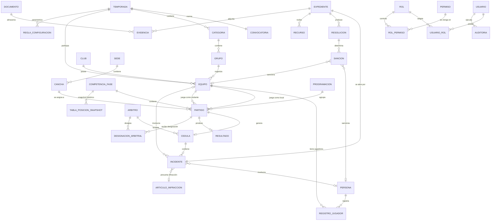

> [!CAUTION]
> **DOCUMENTO REEMPLAZADO — NO USAR PARA IMPLEMENTAR.**
> Este es el diseño preliminar v0.1. Lo reemplazan el
> [diccionario de datos](../diccionario-de-datos.md) y la
> [migración inicial](../../../supabase/migrations/20261007000000_esquema_inicial.sql).
> Usa otras convenciones (tablas en singular, PK `BIGINT`, columnas `creado_en`) e incluye
> entidades fuera del alcance de la entrega (árbitros, cédula, expedientes, sedes). Se conserva solo
> como evidencia del proceso de diseño.

# Diseño Preliminar de Base de Datos
## Sistema de Gestión de la Liga Municipal de Futbol Amateur Morelia

> **Estado del documento:** Modelo lógico PRELIMINAR (v0.1) — base para el diseño físico definitivo.
> **Derivado de:** Sección 11 del documento base ERS + reglas de negocio RN-001 a RN-036.
> **No reemplaza al ERS:** los atributos marcados **[PENDIENTE]** deben confirmarse antes de congelar el esquema.
> **Motor objetivo:** PostgreSQL (dialecto del DDL incluido). Cambiar de motor es **[PENDIENTE]** (PEN-026).

### Convenciones de certeza

| Etiqueta | Significado |
| --- | --- |
| **[C]** CONFIRMADO | Respaldado por la fuente |
| **[I]** INFERIDO | Deducido razonablemente del dominio |
| **[P]** PROPUESTA | Decisión técnica del análisis, requiere validación |
| **[?]** PENDIENTE | Atributo/regla que debe definir la Liga |

### Convenciones de nombrado (propuestas)

- Tablas en plural snake_case: `persona`, `registro_jugador`.
- PKs: `id_<entidad>` (BIGINT GENERATED ALWAYS AS IDENTITY).
- FKs: `id_<entidad_referenciada>`.
- Timestamps de auditoría: `creado_en`, `actualizado_en` (auditoría completa en tabla `auditoria`).
- Estados enumerados: tipo `VARCHAR` + CHECK (o ENUM PostgreSQL) — la lista de valores queda documentada en cada tabla.

---

## 1. Catálogo de entidades y atributos

### 1.1 Núcleo normativo y estructura deportiva

#### `temporada` **[C]**
Periodo deportivo. Nunca se sobrescribe (RN-005).

| Columna | Tipo | Nulo | Origen | Descripción |
| --- | --- | --- | --- | --- |
| id_temporada | BIGINT PK | no | [C] | Identificador |
| nombre | VARCHAR(100) | no | [C] | Ej. "Temporada 2026-2027" |
| fecha_inicio | DATE | no | [P] | Inicio del periodo |
| fecha_fin | DATE | no | [P] | Fin del periodo |
| id_convocatoria | BIGINT FK → convocatoria | no | [C] | Convocatoria normativa vigente (RN-002) |
| estatus | VARCHAR(20) | no | [P] | CONFIGURACION / ACTIVA / CERRADA / HISTORICA |

#### `convocatoria` **[C]**
Documento normativo. Debe versionarse (RN-004).

| Columna | Tipo | Nulo | Origen | Descripción |
| --- | --- | --- | --- | --- |
| id_convocatoria | BIGINT PK | no | [C] | Identificador |
| titulo | VARCHAR(200) | no | [P] | Título del documento |
| version | INT | no | [P] | Versión normativa (RN-004) |
| contenido | TEXT | sí | [P] | Contenido/texto — **[?]** formato final (documento vs. texto) |
| ruta_archivo | VARCHAR(500) | sí | [P] | Si se almacena en almacenamiento documental |
| fecha_emision | DATE | no | [P] | Fecha de emisión |

#### `categoria` **[C]**
Nivel deportivo. Puede variar por temporada (RN-003).

| Columna | Tipo | Nulo | Origen | Descripción |
| --- | --- | --- | --- | --- |
| id_categoria | BIGINT PK | no | [C] | Identificador |
| id_temporada | BIGINT FK → temporada | no | [C] | Pertenece a una temporada |
| nombre | VARCHAR(80) | no | [C] | Ej. "Primera Especial", "Veteranos" |
| orden | INT | sí | [P] | Jerarquía para ordenar en listados |

#### `grupo` **[C]**
Agrupación dentro de categoría (una categoría tiene 1..N grupos).

| Columna | Tipo | Nulo | Origen | Descripción |
| --- | --- | --- | --- | --- |
| id_grupo | BIGINT PK | no | [C] | Identificador |
| id_categoria | BIGINT FK → categoria | no | [C] | Grupo de la categoría |
| nombre | VARCHAR(20) | no | [P] | Ej. "A", "B" |

#### `competencia_fase` **[C]**
Estructura de competencia: fase regular, liguilla, fases finales (RF-076).

| Columna | Tipo | Nulo | Origen | Descripción |
| --- | --- | --- | --- | --- |
| id_competencia | BIGINT PK | no | [C] | Identificador |
| id_temporada | BIGINT FK → temporada | no | [C] | Temporada de la competencia |
| id_categoria | BIGINT FK → categoria | no | [C] | Categoría |
| tipo | VARCHAR(30) | no | [P] | FASE_REGULAR / LIGUILLA / CUARTOS / SEMIFINAL / FINAL |
| formato | VARCHAR(30) | sí | [?] | Formato de llave — pendiente definir |
| estatus | VARCHAR(20) | no | [P] | CONFIGURACION / EN_CURSO / CERRADA |

#### `regla_configuracion` **[P]** — motor de reglas versionado
Parametriza reglas por temporada sin hardcodear (RF-006, RF-069, RF-050; RN-004, RN-023, RN-033).

| Columna | Tipo | Nulo | Origen | Descripción |
| --- | --- | --- | --- | --- |
| id_regla | BIGINT PK | no | [P] | Identificador |
| id_temporada | BIGINT FK → temporada | no | [P] | Alcance de la regla |
| tipo | VARCHAR(40) | no | [P] | ASCENSO / DESCENSO / DESEMPATE / PUNTAJE / ELEGIBILIDAD / PROGRAMACION |
| version | INT | no | [P] | Versión (RN-004) |
| parametros | JSONB | no | [P] | Configuración flexible (ej. criterios de desempate ordenados) |
| estatus | VARCHAR(20) | no | [C] | PROPUESTA / PENDIENTE_VALIDACION / APROBADA / RECHAZADA (RF-007, RN-006) |
| id_usuario_aprueba | BIGINT FK → usuario | sí | [I] | Autoridad que valida |
| fecha_aprobacion | TIMESTAMPTZ | sí | [I] | Fecha de aprobación |

---

### 1.2 Organización deportiva y personas

#### `persona` **[C]**
Identidad reutilizable separada de roles (RF-010, RF-011; RN-008). **Contiene datos personales protegidos (RNF-012).**

| Columna | Tipo | Nulo | Origen | Descripción |
| --- | --- | --- | --- | --- |
| id_persona | BIGINT PK | no | [C] | Identificador |
| nombres | VARCHAR(100) | no | [P] | **[?]** confirmar campos de identificación |
| apellido_paterno | VARCHAR(80) | no | [P] | |
| apellido_materno | VARCHAR(80) | sí | [P] | |
| fecha_nacimiento | DATE | sí | [P] | **[?]** obligatoriedad |
| curp | VARCHAR(18) | sí | [P] | **[?]** ¿existe y es obligatoria? |
| telefono | VARCHAR(20) | sí | [P] | **[?]** |
| correo | VARCHAR(120) | sí | [P] | **[?]** |
| foto_url | VARCHAR(500) | sí | [?] | Almacenamiento documental pendiente |

#### `club` **[C]**

| Columna | Tipo | Nulo | Origen | Descripción |
| --- | --- | --- | --- | --- |
| id_club | BIGINT PK | no | [C] | Identificador |
| nombre | VARCHAR(120) | no | [P] | **[?]** datos específicos del club |
| id_persona_representante | BIGINT FK → persona | sí | [I] | Representante (presidente/delegado) |
| estatus | VARCHAR(20) | no | [P] | ACTIVO / INACTIVO / SUSPENDIDO |

#### `equipo` **[C]**
Representación deportiva de un club en categoría/grupo/temporada (RF-009; RN-007).

| Columna | Tipo | Nulo | Origen | Descripción |
| --- | --- | --- | --- | --- |
| id_equipo | BIGINT PK | no | [C] | Identificador |
| id_club | BIGINT FK → club | no | [C] | Club propietario |
| id_temporada | BIGINT FK → temporada | no | [C] | Temporada de participación |
| id_categoria | BIGINT FK → categoria | no | [C] | Categoría |
| id_grupo | BIGINT FK → grupo | no | [C] | Grupo |
| nombre | VARCHAR(120) | no | [P] | Nombre del equipo |

**Restricción [P]:** único `(id_temporada, id_categoria, id_grupo, nombre)`.

#### `registro_jugador` **[I]** — entidad relación Persona↔Equipo
Alta, baja, renovación, transferencia y elegibilidad (RF-013 a RF-020; RN-009, RN-010).

| Columna | Tipo | Nulo | Origen | Descripción |
| --- | --- | --- | --- | --- |
| id_registro | BIGINT PK | no | [I] | Identificador |
| id_persona | BIGINT FK → persona | no | [I] | Jugador |
| id_equipo | BIGINT FK → equipo | no | [I] | Equipo |
| id_temporada | BIGINT FK → temporada | no | [I] | Temporada |
| tipo_movimiento | VARCHAR(20) | no | [I] | ALTA / BAJA / RENOVACION / TRANSFERENCIA |
| fecha_movimiento | DATE | no | [I] | Fecha del movimiento |
| estatus | VARCHAR(20) | no | [I] | ACTIVO / SUSPENDIDO / BAJA / INELEGIBLE (RF-017) |
| motivo_estatus | VARCHAR(300) | sí | [I] | Causa de bloqueo (VAL-002, CA-006) |

**Restricción [P]:** un jugador con estatus ACTIVO aparece máximo una vez por temporada (salvo transferencia que cierra el registro anterior).

---

### 1.3 Recursos: canchas y árbitros

#### `sede` **[I]**

| Columna | Tipo | Nulo | Origen | Descripción |
| --- | --- | --- | --- | --- |
| id_sede | BIGINT PK | no | [I] | Identificador |
| nombre | VARCHAR(120) | no | [I] | |
| direccion | VARCHAR(300) | sí | [?] | |
| ubicacion_mapa | VARCHAR(500) | sí | [?] | Integración mapas pendiente |

#### `cancha` **[C]**

| Columna | Tipo | Nulo | Origen | Descripción |
| --- | --- | --- | --- | --- |
| id_cancha | BIGINT PK | no | [C] | Identificador |
| id_sede | BIGINT FK → sede | sí | [I] | Sede |
| nombre | VARCHAR(120) | no | [P] | |
| caracteristicas | VARCHAR(300) | sí | [?] | Características conocidas |

#### `disponibilidad_cancha` **[I]** — incluye bloqueos y mantenimiento
RF-029 a RF-031; RN-014.

| Columna | Tipo | Nulo | Origen | Descripción |
| --- | --- | --- | --- | --- |
| id_disponibilidad | BIGINT PK | no | [I] | Identificador |
| id_cancha | BIGINT FK → cancha | no | [I] | Cancha |
| fecha_inicio | TIMESTAMPTZ | no | [I] | Inicio del periodo |
| fecha_fin | TIMESTAMPTZ | no | [I] | Fin del periodo |
| tipo | VARCHAR(20) | no | [I] | DISPONIBLE / BLOQUEO / MANTENIMIENTO |
| motivo | VARCHAR(300) | sí | [I] | Causa del bloqueo |

#### `arbitro` **[C]**
Rol de persona. Catálogo y disponibilidad (RF-021, RF-022).

| Columna | Tipo | Nulo | Origen | Descripción |
| --- | --- | --- | --- | --- |
| id_persona | BIGINT PK/FK → persona | no | [C] | La persona que es árbitro (RN-008) |
| categoria_arbitral | VARCHAR(40) | sí | [?] | **[?]** datos del catálogo arbitral |
| estatus | VARCHAR(20) | no | [P] | ACTIVO / INACTIVO |

#### `disponibilidad_arbitro` **[I]**

| Columna | Tipo | Nulo | Origen | Descripción |
| --- | --- | --- | --- | --- |
| id_disponibilidad | BIGINT PK | no | [I] | |
| id_persona | BIGINT FK → arbitro | no | [I] | Árbitro |
| fecha | DATE | no | [I] | Día disponible |
| hora_inicio | TIME | no | [P] | |
| hora_fin | TIME | no | [P] | |

---

### 1.4 Programación y partidos

#### `programacion` **[C]**
Documento de jornada con flujo de publicación (RF-033, RF-090; P-09).

| Columna | Tipo | Nulo | Origen | Descripción |
| --- | --- | --- | --- | --- |
| id_programacion | BIGINT PK | no | [C] | Identificador |
| id_temporada | BIGINT FK → temporada | no | [C] | |
| id_categoria | BIGINT FK → categoria | no | [C] | |
| jornada | INT | no | [P] | Número de jornada — **[?]** convención |
| fecha_inicio | DATE | no | [P] | Inicio de la semana/jornada |
| fecha_fin | DATE | no | [P] | |
| estado_publicacion | VARCHAR(20) | no | [C] | BORRADOR / REVISION / PUBLICADO (P-09) |
| causa_generacion | VARCHAR(400) | sí | [C] | Por qué se generó/modificó (RF-041) |
| generada_automaticamente | BOOLEAN | no | [I] | true = automática, false = ajuste manual |

#### `partido` **[C]**
Núcleo del sistema. Ciclo de vida por máquina de estados (RF-043 a RF-046; Anexo A).

| Columna | Tipo | Nulo | Origen | Descripción |
| --- | --- | --- | --- | --- |
| id_partido | BIGINT PK | no | [C] | Identificador |
| id_competencia | BIGINT FK → competencia_fase | no | [C] | Competencia/fase |
| id_programacion | BIGINT FK → programacion | no | [I] | Jornada a la que pertenece |
| id_equipo_local | BIGINT FK → equipo | no | [C] | Equipo local |
| id_equipo_visitante | BIGINT FK → equipo | no | [C] | Equipo visitante |
| id_cancha | BIGINT FK → cancha | sí | [C] | Cancha asignada |
| fecha | DATE | sí | [C] | Fecha del partido |
| hora | TIME | sí | [C] | Hora |
| estado | VARCHAR(30) | no | [C] | BORRADOR/PROGRAMADO/CONFIRMADO/EN_JUEGO/FINALIZADO/SUSPENDIDO/CANCELADO/REPROGRAMADO/NO_PROGRAMADO/RESUELTO_ADMINISTRATIVAMENTE |
| motivo_estado | VARCHAR(400) | sí | [C] | Motivo de transición (RF-045) |
| id_usuario_transicion | BIGINT FK → usuario | sí | [C] | Quien hizo el cambio (auditoría) |
| fecha_transicion | TIMESTAMPTZ | sí | [C] | Cuándo |

**Reglas:**
- `id_equipo_local <> id_equipo_visitante` [P].
- Transiciones sólo por máquina de estados (validación en aplicación, RN-019, RN-021).
- Nunca DELETE si tiene historial (RN-020) → borrado lógico mediante estados.

#### `resultado` **[C]**
RF-047, RF-048; RN-022, RN-025.

| Columna | Tipo | Nulo | Origen | Descripción |
| --- | --- | --- | --- | --- |
| id_resultado | BIGINT PK | no | [C] | Identificador |
| id_partido | BIGINT FK → partido | no | [C] | Partido (1:1) |
| goles_local | INT | no | [P] | **[?]** formato exacto del marcador |
| goles_visitante | INT | no | [P] | |
| estado | VARCHAR(20) | no | [C] | CAPTURADO / VALIDADO / OFICIAL (RF-048) — **[?]** cuándo es "oficial" (AMB-002) |
| id_usuario_captura | BIGINT FK → usuario | no | [I] | Capturista |
| id_usuario_valida | BIGINT FK → usuario | sí | [I] | Autoridad que valida |
| fecha_validacion | TIMESTAMPTZ | sí | [I] | |
| es_correccion | BOOLEAN | no | [I] | true si corrige un resultado previo (RN-024) |

**Restricción [P]:** un partido tiene un solo resultado OFICIAL vigente; correcciones se versionan.

#### `tabla_posicion_snapshot` **[P]**
Histórico de tabla por fecha (RF-051). Dato derivado: recalculable pero se congela para trazabilidad.

| Columna | Tipo | Nulo | Origen | Descripción |
| --- | --- | --- | --- | --- |
| id_snapshot | BIGINT PK | no | [P] | |
| id_competencia | BIGINT FK → competencia_fase | no | [P] | |
| id_equipo | BIGINT FK → equipo | no | [P] | |
| pj / pg / pe / pp | SMALLINT | no | [C] | Partidos jugados/ganados/empatados/perdidos (RF-053) |
| gf / gc / dg | SMALLINT | no | [C] | Goles a favor/contra/diferencia |
| puntos | SMALLINT | no | [C] | Puntos según reglas (RF-049) |
| posicion | SMALLINT | no | [P] | Posición calculada |
| fecha_corte | TIMESTAMPTZ | no | [P] | Momento del cálculo |

---

### 1.5 Disciplina

#### `cedula` **[C]**
RF-025. Documento arbitral del partido.

| Columna | Tipo | Nulo | Origen | Descripción |
| --- | --- | --- | --- | --- |
| id_cedula | BIGINT PK | no | [C] | Identificador |
| id_partido | BIGINT FK → partido | no | [C] | Partido (1:1 cuando aplica) |
| id_arbitro | BIGINT FK → arbitro | no | [I] | Árbitro que levanta la cédula |
| observaciones | TEXT | sí | [?] | Estructura de la cédula pendiente (PEN-020) |
| capturada_por | BIGINT FK → usuario | no | [I] | Árbitro o capturista (separación de funciones) |
| fecha_captura | TIMESTAMPTZ | no | [I] | |

#### `incidente` **[C]**
RF-026, RF-058; RN-026.

| Columna | Tipo | Nulo | Origen | Descripción |
| --- | --- | --- | --- | --- |
| id_incidente | BIGINT PK | no | [C] | Identificador |
| id_cedula | BIGINT FK → cedula | no | [C] | Cédula origen |
| id_partido | BIGINT FK → partido | no | [I] | Partido (redundante útil para consulta) |
| id_persona | BIGINT FK → persona | sí | [C] | Persona involucrada (jugador/árbitro) |
| id_equipo | BIGINT FK → equipo | sí | [C] | Equipo involucrado |
| descripcion | VARCHAR(600) | no | [P] | **[?]** tipos y estructura de incidencias |
| minuto | SMALLINT | sí | [P] | Minuto del partido |
| id_articulo_presunto | BIGINT FK → articulo_infraccion | sí | [I] | Presunta infracción (RN-027) |

#### `articulo_infraccion` **[C]**
Catálogo normativo (RF-060).

| Columna | Tipo | Nulo | Origen | Descripción |
| --- | --- | --- | --- | --- |
| id_articulo | BIGINT PK | no | [C] | Identificador |
| codigo | VARCHAR(30) | no | [P] | Ej. "ART. 45" — **[?]** formato real |
| descripcion | VARCHAR(300) | no | [P] | |
| texto_normativo | TEXT | sí | [?] | Texto de la convocatoria |
| vigente | BOOLEAN | no | [P] | |

#### `catalogo_sancion` **[I]** — catálogo de tipos de sanción
Necesario para el motor disciplinario (RF-061). **[?]** catálogo real pendiente (PEN-021).

| Columna | Tipo | Nulo | Origen | Descripción |
| --- | --- | --- | --- | --- |
| id_tipo_sancion | BIGINT PK | no | [I] | |
| descripcion | VARCHAR(200) | no | [I] | Ej. "Suspensión 1 partido" |
| unidad_duracion | VARCHAR(20) | no | [I] | PARTIDOS / DIAS / MESES |
| duracion_default | INT | sí | [I] | Duración sugerida |

#### `regla_articulo_sancion` **[P]**
Correspondencia artículo → sanción propuesta (RF-061). Permite la propuesta automática.

| Columna | Tipo | Nulo | Origen | Descripción |
| --- | --- | --- | --- | --- |
| id_regla_sancion | BIGINT PK | no | [P] | |
| id_articulo | BIGINT FK → articulo_infraccion | no | [P] | |
| id_tipo_sancion | BIGINT FK → catalogo_sancion | no | [P] | |
| parametros | JSONB | sí | [P] | Condiciones (reincidencia, etc.) |

#### `expediente` **[C]**
RF-057. Trazabilidad completa.

| Columna | Tipo | Nulo | Origen | Descripción |
| --- | --- | --- | --- | --- |
| id_expediente | BIGINT PK | no | [C] | Identificador |
| folio | VARCHAR(30) | no | [P] | Folio único **[?]** convención de foliado |
| id_incidente_origen | BIGINT FK → incidente | no | [I] | Incidente que origina |
| estado | VARCHAR(30) | no | [I] | ABIERTO / EN_REVISION / RESUELTO / CON_RECURSO / CERRADO |
| fecha_apertura | TIMESTAMPTZ | no | [I] | |
| fecha_cierre | TIMESTAMPTZ | sí | [I] | |

#### `resolucion` **[C/I]** — inmutable (RF-065; RN-030)

| Columna | Tipo | Nulo | Origen | Descripción |
| --- | --- | --- | --- | --- |
| id_resolucion | BIGINT PK | no | [I] | Identificador |
| id_expediente | BIGINT FK → expediente | no | [C] | Expediente resuelto |
| id_usuario_resuelve | BIGINT FK → usuario | no | [C] | Autoridad competente (RN-028) |
| decision | TEXT | no | [P] | Fundamento y decisión |
| fecha_resolucion | TIMESTAMPTZ | no | [I] | |
| vigencia_inicio | DATE | no | [C] | Vigencia calculable (RF-063, RN-029) |
| vigencia_fin | DATE | no | [C] | |

#### `sancion` **[C]**
RF-062 a RF-066. Alcance exacto **[?]** (AMB-001: ¿participación, programación o ambas?).

| Columna | Tipo | Nulo | Origen | Descripción |
| --- | --- | --- | --- | --- |
| id_sancion | BIGINT PK | no | [C] | Identificador |
| id_resolucion | BIGINT FK → resolucion | no | [C] | Resolución que la impone |
| id_tipo_sancion | BIGINT FK → catalogo_sancion | sí | [I] | Tipo |
| id_persona | BIGINT FK → persona | sí | [C] | Persona sancionada |
| id_equipo | BIGINT FK → equipo | sí | [C] | Equipo sancionado (si aplica) |
| alcance | VARCHAR(30) | no | [?] | PARTICIPACION / PROGRAMACION / AMBOS — **[?]** AMB-001 |
| estado | VARCHAR(20) | no | [I] | VIGENTE / CUMPLIDA / CANCELADA |
| publicada | BOOLEAN | no | [C] | Sólo sanciones autorizadas se publican (RF-068, RN-032) |

#### `recurso` **[C]**
RF-067; RN-031.

| Columna | Tipo | Nulo | Origen | Descripción |
| --- | --- | --- | --- | --- |
| id_recurso | BIGINT PK | no | [C] | |
| id_expediente | BIGINT FK → expediente | no | [C] | Expediente impugnado |
| motivo | TEXT | no | [P] | **[?]** forma de presentación |
| fecha_presentacion | TIMESTAMPTZ | no | [I] | |
| estado | VARCHAR(20) | no | [I] | PRESENTADO / EN_REVISION / RESUELTO |
| id_resolucion_recurso | BIGINT FK → resolucion | sí | [I] | Resolución del recurso (nuevo estado) |

#### `evidencia` **[I]**
RF-059. Almacenamiento documental pendiente.

| Columna | Tipo | Nulo | Origen | Descripción |
| --- | --- | --- | --- | --- |
| id_evidencia | BIGINT PK | no | [I] | |
| id_expediente | BIGINT FK → expediente | no | [I] | |
| id_documento | BIGINT FK → documento | no | [I] | Archivo asociado |
| descripcion | VARCHAR(300) | sí | [I] | |

---

### 1.6 Seguridad, publicación y auditoría

#### `usuario` **[C]**

| Columna | Tipo | Nulo | Origen | Descripción |
| --- | --- | --- | --- | --- |
| id_usuario | BIGINT PK | no | [C] | Identificador |
| correo | VARCHAR(120) | no | [P] | Usuario de acceso — **[?]** ¿username o correo? |
| password_hash | VARCHAR(255) | no | [C] | Hash seguro, nunca texto plano (RNF-013) |
| id_persona | BIGINT FK → persona | sí | [I] | Vinculación usuario↔persona |
| estatus | VARCHAR(20) | no | [P] | ACTIVO / BLOQUEADO / INACTIVO |
| ultimo_acceso | TIMESTAMPTZ | sí | [I] | |

#### `rol` / `usuario_rol` / `permiso` / `rol_permiso` **[C/I]**
RBAC (RN de sección 2.2). Matriz completa **[?]** pendiente (PEN-010, PEN-029).

- `rol(id_rol PK, nombre UNIQUE, descripcion)`
- `usuario_rol(id_usuario FK, id_rol FK, id_temporada FK NULL [P], PK compuesta)` — el rol puede variar por temporada **[PROPUESTA]**.
- `permiso(id_permiso PK, modulo VARCHAR(60), accion VARCHAR(60), UNIQUE(modulo, accion))`
- `rol_permiso(id_rol FK, id_permiso FK, PK compuesta)`

#### `documento` **[C]** — convocatorias, comunicados, noticias
Flujo de publicación (RF-090).

| Columna | Tipo | Nulo | Origen | Descripción |
| --- | --- | --- | --- | --- |
| id_documento | BIGINT PK | no | [C] | |
| tipo | VARCHAR(30) | no | [P] | CONVOCATORIA / COMUNICADO / NOTICIA / EVIDENCIA / OTRO |
| titulo | VARCHAR(200) | no | [P] | |
| contenido | TEXT | sí | [P] | |
| ruta_archivo | VARCHAR(500) | sí | [P] | Almacenamiento documental |
| estado_publicacion | VARCHAR(20) | no | [C] | BORRADOR / REVISION / PUBLICADO |
| fecha_publicacion | TIMESTAMPTZ | sí | [I] | |
| id_temporada | BIGINT FK → temporada | sí | [I] | Alcance |

#### `auditoria` **[I]** — RF-093, RNF-015; RN-021
Toda operación crítica deja rastro (usuario, fecha, motivo).

| Columna | Tipo | Nulo | Origen | Descripción |
| --- | --- | --- | --- | --- |
| id_auditoria | BIGINT PK | no | [I] | |
| id_usuario | BIGINT FK → usuario | sí | [I] | Quien ejecutó (NULL = sistema) |
| entidad | VARCHAR(60) | no | [I] | Tabla afectada |
| id_registro | BIGINT | no | [I] | PK del registro afectado |
| accion | VARCHAR(20) | no | [I] | INSERT / UPDATE / DELETE / TRANSICION / PUBLICACION |
| motivo | VARCHAR(400) | sí | [C] | Motivo/contexto obligatorio en operaciones críticas |
| fecha | TIMESTAMPTZ | no | [I] | |
| detalle | JSONB | sí | [P] | Valores antes/después |

---

## 2. Matriz de relaciones y cardinalidades

| # | Origen | Relación | Destino | Cardinalidad | Tipo | Regla |
| --- | --- | --- | --- | --- | --- | --- |
| 1 | temporada | tiene | convocatoria | 1:1 | Fuerte | RN-002 |
| 2 | temporada | contiene | categoria | 1:N | Fuerte | RN-003 |
| 3 | categoria | contiene | grupo | 1:N | Fuerte | RF-005 |
| 4 | club | posee | equipo | 1:N | Fuerte | RF-008/009 |
| 5 | temporada | participa | equipo | 1:N | Fuerte | RN-007 |
| 6 | equipo | pertenece a | grupo | N:1 | Fuerte | — |
| 7 | persona | registra | equipo | N:M vía registro_jugador | Fuerte | RN-009 |
| 8 | competencia_fase | contiene | partido | 1:N | Fuerte | RF-076 |
| 9 | equipo | juega como local | partido | 1:N | Fuerte | — |
| 10 | equipo | juega como visitante | partido | 1:N | Fuerte | — |
| 11 | cancha | recibe | partido | 1:N | Débil (partido puede no tener cancha aún) | RN-014 |
| 12 | partido | genera | cedula | 1:0..1 | Fuerte | RF-025 |
| 13 | cedula | contiene | incidente | 1:N | Fuerte | RN-026 |
| 14 | incidente | involucra | persona | N:1 | Débil | RF-058 |
| 15 | incidente | involucra | equipo | N:1 | Débil | RF-058 |
| 16 | incidente | presuntamente infringe | articulo_infraccion | N:0..1 | Débil | RN-027 |
| 17 | expediente | integra | incidente | 1:1 origen | Fuerte | RF-057 |
| 18 | expediente | produce | resolucion | 1:N | Fuerte | RN-030 (inmutable) |
| 19 | resolucion | determina | sancion | 1:N | Fuerte | RF-062 |
| 20 | sancion | afecta | persona/equipo | N:1 | Fuerte | RN-011, AMB-001 |
| 21 | expediente | recibe | recurso | 1:N | Fuerte | RN-031 |
| 22 | partido | produce | resultado | 1:0..1 (1 oficial) | Fuerte | RN-022, RN-025 |
| 23 | programacion | agrupa | partido | 1:N | Fuerte | RF-033 |
| 24 | arbitro | designa en | partido | N:M vía designacion_arbitral | Fuerte | RF-023 |
| 25 | usuario | posee | rol | N:M vía usuario_rol | Fuerte | RBAC |
| 26 | rol | agrupa | permiso | N:M vía rol_permiso | Fuerte | RF permisos por módulo/acción |
| 27 | temporada | parametriza | regla_configuracion | 1:N | Fuerte | RN-004 |
| 28 | competencia_fase | snapshot | tabla_posicion_snapshot | 1:N | Derivado | RF-051 |
| 29 | expediente | adjunta | evidencia | 1:N | Fuerte | RF-059 |

**Notas:**
- Cardinalidades **[I/VALIDAR]**: tal como advierte el documento base (§11.3), estas cardinalidades son hipótesis a confirmar; ninguna debe congelarse sin validación.
- Las relaciones 14-16 son débiles porque un incidente puede no tener persona/equipo identificado inicialmente (VAL-012: queda en revisión).

---

## 3. Diagrama ER (Mermaid)

---

## 4. Reglas de integridad mapeadas a reglas de negocio

| Regla BD (constraint/trigger) | Regla de negocio | Implementación |
| --- | --- | --- |
| No superposición de disponibilidad por cancha | RN-014 | Trigger o validación en app |
| Un equipo no dos partidos el mismo día/hora | RN-012 | Constraint exclusion (PostgreSQL: `EXCLUDE`) o validación en generador |
| Cancha sin disponibilidad no asignable | RN-013, RN-014 | FK + validación en servicio de programación |
| Resultado sólo en partidos FINALIZADO | RN-019 | Trigger |
| Un solo resultado OFICIAL por partido | RN-022, RN-025 | Unique partial index |
| Resolución inmutable | RN-030 | Revocar UPDATE/DELETE; cambios sólo por nuevo recurso |
| Transiciones de estado válidas | RN-019, RN-021 | Máquina de estados en aplicación + auditoría obligatoria |
| Publicación sólo desde estado REVISION → PUBLICADO | RN-025, P-09 | Trigger + rol de publicación |
| Jugador elegible para ser convocado | RN-010, RN-011 | Validación en app (consulta sanciones vigentes) |
| `goles >= 0`, fechas coherentes | Integridad | CHECK constraints |

---

## 5. Decisiones pendientes antes de congelar el esquema

| ID | Decisión | Bloquea |
| --- | --- | --- |
| DB-01 | ¿CURP u otro identificador oficial de persona? | tabla persona, índices únicos |
| DB-02 | Estructura real de la cédula (campos, tipos de incidencia) | cedula, incidente |
| DB-03 | Catálogo de artículos y sanciones reales | articulo_infraccion, catalogo_sancion |
| DB-04 | Alcance de sanción: participación/programación/ambos | sancion.alcance, validaciones |
| DB-05 | ¿Cuándo un resultado es oficial? | resultado.estado |
| DB-06 | Convención de jornadas y foliado de expedientes | programacion, expediente |
| DB-07 | Motor de BD definitivo (PostgreSQL/MySQL/SQL Server) | DDL, tipos JSON/EXCLUDE |
| DB-08 | Almacenamiento documental: ¿BD (bytea) vs. servicio externo? | documento, evidencia |
| DB-09 | ¿Roles varían por temporada? | usuario_rol |
| DB-10 | Estrategia de borrado: todo borrado lógico, sin DELETE físico | todas las tablas con estatus |

---

## 6. Principios de diseño aplicados (del documento base §11.5)

1. **Catálogos e identificadores** para nombres variables y abreviaturas. ✅ (articulo_infraccion, catalogo_sancion, regla_configuracion)
2. **No sobrescribir históricos.** ✅ (snapshots, versiones, estados; RN-005)
3. **Identidad separada de roles.** ✅ (persona + registro_jugador + arbitro + usuario)
4. **Dato oficial vs. calculado.** ✅ (resultado.estado vs. tabla_posicion_snapshot; RF-055)
5. **Datos personales protegidos.** ✅ (tabla persona aislada; visibilidad por permisos)
6. **Trazabilidad de configuraciones.** ✅ (regla_configuracion.version, auditoria, motivo en transiciones)
