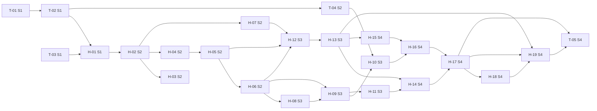

# Plan de sprints — SIGLIM (backlog v4)

**SIGLIM · Sistema de Gestión de la Liga Municipal de Futbol Amateur Morelia**  
Versión 4.0 · 20 de octubre de 2026 · Alineado con el [ERS Rev. 0.4.1](../requisitos/ERS.md), la [arquitectura v2.1](../arquitectura/arquitectura-y-diseno-jerarquico.md), las [convenciones de API v2.0](../arquitectura/convenciones-api.md) y las [pantallas aprobadas](../diseno-ui/pantallas/README.md)

> [!NOTE]
> Este archivo y [`backlog-siglim.csv`](backlog-siglim.csv) se generan juntos con [`fuente/generar.py`](fuente/generar.py) a partir de [`fuente/datos.py`](fuente/datos.py). Para cambiar el backlog, edita `datos.py` y vuelve a generar: así el plan y el CSV no se desalinean. Reemplaza al backlog v3 y a los 81 issues anteriores de Jira (DEC-44, DEC-47).

## 1. Resumen y supuestos

| Concepto | Valor |
| --- | --- |
| Elementos | 14 épicas · 63 historias (31 del núcleo y 32 de entrega B) · 5 tareas · 121 subtareas · **203 filas** |
| Comprometido en sprints (Must) | 63 SP · 189 h |
| Núcleo no comprometido (Should, sin sprint) | 12 historias · 32 SP |
| Backlog B (Could, sin sprint ni subtareas) | 32 historias · 80 SP |
| Equipo | 3 integrantes; 10 h por persona por semana (supuesto aprobado el 20 oct 2026) |
| Equivalencia | 1 SP ≈ 3 h del equipo; solo para comprobar capacidad. Se recalibra con la velocidad real del Sprint 2. |
| Jerarquía en Jira | Épica → Historia → Subtarea; y Épica → Tarea → Subtarea para trabajo técnico sin usuario final. Jira *team-managed* no permite una Tarea hija de una Historia (DEC-47). |

Supuestos y reglas:

- **Prioridad MoSCoW dentro del núcleo (DEC-47).** El ERS llama «núcleo comprometido» a 83 RF y 28 pantallas, que no caben en unas 6.5 semanas con 3 personas. Se compromete el **flujo central de punta a punta** (Must); el resto del núcleo (Should) queda listo para entrar en cuanto haya capacidad, y lo B queda como backlog.
- **Nada pendiente se implementa como aprobado.** Las historias usan valores configurables, [DEMO] o [PROPUESTA] donde el ERS lo indica y no implementan las diferencias D-01 a D-12 de las pantallas.
- **No entra trabajo ya hecho**: ERS, BPMN, arquitectura, BD, API y diseño. Sí entra lo que falta fuera del repositorio: aplicar la migración en Supabase (T-01) y crear la cuenta y el bucket de AWS (T-04).
- **La demostración es local** con el proyecto Supabase de desarrollo mientras PEN-036 y PEN-037 sigan abiertos.

Excluido de la planificación:

| Elemento | Referencia | Motivo |
| --- | --- | --- |
| 2FA y «Mantener sesión activa» | PEN-044 (nuevo) y PEN-030 | Pendiente por decisión del equipo (20 oct 2026). |
| Programación automática | RF-034, RF-035, RF-037, RF-038, RF-041, RF-042 | Fuera de alcance (F, DEC-06). |
| Despliegue en un ambiente público | PEN-036, PEN-037 | Pendiente; la demo es local. |
| Respaldo diario y disponibilidad de fin de semana | RNF-010, RNF-001 (B) | Dependen del alojamiento (PEN-037). |

## 2. Sprints: duración, objetivo y capacidad

| Sprint | Fechas | Objetivo | Capacidad | Comprometido |
| --- | --- | --- | --- | --- |
| 1 | 2026-10-12 → 2026-10-26 (2 semanas) | Un usuario interno inicia sesión con Supabase Auth y llega a su panel, que muestra solo los módulos de sus permisos; backend y frontend corren contra el esquema `siglim` ya aplicado en Supabase. | 27 h · 9 SP | 9 SP · 27 h |
| 2 | 2026-10-26 → 2026-11-09 (2 semanas) | La Liga configura su operación: cuentas con rol y ámbito, temporada con categorías, grupos y parámetros versionados, clubes, equipos y canchas con disponibilidad; cada operación se autoriza por permiso y queda auditada. | 54 h · 18 SP | 17 SP · 51 h |
| 3 | 2026-11-09 → 2026-11-23 (2 semanas) | Los clubes afilian y registran jugadores por CURP con documentos validados, presentan árbitros, y el Programador arma una jornada sin conflictos que el Presidente aprueba y publica. | 54 h · 18 SP | 17 SP · 51 h |
| 4 | 2026-11-23 → 2026-12-07 (2 semanas) | Un partido publicado se juega de punta a punta: árbitros designados, cambio de estado, cédula capturada y validada, resultado oficial, tabla recalculada y todo visible en el portal público. | 60 h · 20 SP | 20 SP · 60 h |

**Por qué sprints de dos semanas.** El Sprint 1 ya está fijado en dos semanas y DEC-08 fija 8 semanas en 4 sprints. Mantener 2 semanas en los Sprints 2 a 4 conserva una velocidad comparable para recalibrar. Con 1 semana, historias verticales como H-12 o H-16 (5 SP, backend + pantalla + pruebas) no cerrarían dentro del sprint. Con 3 semanas solo quedarían dos revisiones y el riesgo del flujo de cédula se descubriría tarde. Los días feriados (2 y 16 de noviembre) se descuentan de la capacidad, no de la duración.

- **Sprint 1:** Sprint activo en Jira. Los primeros 8 días se dedicaron a la reformulación documental (ERS 0.4.1, BPMN, arquitectura, BD, API y diseño), que no entra a este backlog; quedan unos 6 días (≈ 27 h del equipo).
- **Sprint 2:** 60 h nominales (3 personas × 10 h × 2 semanas) menos el 2 de noviembre.
- **Sprint 3:** 60 h nominales menos el 16 de noviembre.
- **Sprint 4:** 60 h nominales; incluye la demostración final.

## 3. Épicas

| Épica | Módulo | Nombre | SP en sprints | SP sin sprint (Should + B) |
| --- | --- | --- | --- | --- |
| E01 | M-01 | Acceso, permisos y auditoría | 14 | 7 |
| E02 | M-02 | Temporadas y normativa | 5 | 3 |
| E03 | M-03 | Organización deportiva | 4 | 6 |
| E04 | M-04 | Registro de jugadores y elegibilidad | 8 | 9 |
| E05 | M-05 | Árbitros y designaciones | 4 | 4 |
| E06 | M-06 | Canchas y recursos | 3 | 9 |
| E07 | M-07 | Programación manual | 7 | 2 |
| E08 | M-08 | Partidos, cédula y resultados | 13 | 4 |
| E09 | M-09 | Disciplina | 0 | 21 |
| E10 | M-10 | Competencias y fases finales | 0 | 13 |
| E11 | M-11 | Portal público y publicación | 5 | 8 |
| E12 | M-12 | Reportes y exportación | 0 | 5 |
| E13 | M-13 | Tesorería y cobros | 0 | 15 |
| E14 | M-14 | Notificaciones | 0 | 6 |

## 4. Contenido de cada sprint

Cada elemento lista sus requisitos, pantallas, dependencias, criterios de aceptación y subtareas con su condición de terminado. Las claves (H-01, T-01, H-01.1…) aparecen al inicio del resumen en Jira.

### Sprint 1 · 2026-10-12 → 2026-10-26

**Objetivo.** Un usuario interno inicia sesión con Supabase Auth y llega a su panel, que muestra solo los módulos de sus permisos; backend y frontend corren contra el esquema `siglim` ya aplicado en Supabase.

**Carga.** 9 SP · 27 h de 27 h disponibles.

#### E01 · Acceso, permisos y auditoría

- **T-01 · Tarea** — Aplicar el esquema inicial en Supabase y registrar al administrador · **1 SP** · Highest · épica E01
  - Requisitos: DEC-42, ADR-0004, ADR-0014, RF-094
  - Depende de: —
  - Resultado esperado: Proyecto Supabase con el esquema `siglim`, semilla cargada y un administrador que puede iniciar sesión.
  - Subtareas (3 h):
    - **T-01.1** Crear el proyecto Supabase y aplicar la migración — 1.5 h · `infra`  
      Terminado cuando: La migración corre sin errores en el SQL Editor; `siglim` no aparece en Exposed schemas; las credenciales quedan solo en los `.env` locales de cada integrante.
    - **T-01.2** Registrar al Administrador general y verificar la semilla — 1.5 h · `bd`  
      Terminado cuando: Usuario invitado en Authentication; `registrar_administrador_inicial` devuelve su perfil; consulta de verificación: 13 roles, 73 permisos, 1 liga.
- **T-02 · Tarea** — Crear el esqueleto del backend Spring Boot con seguridad y contexto de base de datos · **3 SP** · Highest · épica E01
  - Requisitos: RNF-003, RNF-011, RNF-013, RNF-019, ADR-0002, ADR-0003, ADR-0006, ADR-0014
  - Depende de: T-01
  - Resultado esperado: `./mvnw verify` en verde; `GET /api/v1/salud` responde; una petición con token válido ejecuta SQL como `siglim_app` con el perfil del usuario.
  - Subtareas (9 h):
    - **T-02.1** Generar el proyecto con paquetes por módulo y configuración por variables de entorno — 2 h · `backend`  
      Terminado cuando: Estructura `mx.tecnm.morelia.siglim.<modulo>`; `backend/.env.example` documenta cada variable; sin secretos en el repositorio.
    - **T-02.2** Validar el JWT de Supabase con JWKS — 2 h · `backend`  
      Terminado cuando: Peticiones sin token o con token vencido responden 401 `NO_AUTENTICADO`; prueba automatizada.
    - **T-02.3** Implementar el contexto transaccional (`set_config` + `SET LOCAL ROLE`) — 3 h · `backend`  
      Terminado cuando: Prueba de integración contra PostgreSQL local: el trigger de auditoría registra el perfil del token; sin contexto, RLS niega.
    - **T-02.4** Implementar el manejador de errores RFC 9457 y la tabla HINT → HTTP — 2 h · `backend`  
      Terminado cuando: Pruebas: `P0001` con HINT `VAL-003` → 409; `23P01` → 409 `VAL-004`; `42501` en lectura → 404.
- **T-03 · Tarea** — Crear el esqueleto del frontend React con el sistema de diseño aprobado · **3 SP** · Highest · épica E01
  - Requisitos: RNF-006, RNF-007, RNF-008, PEN-014
  - Pantallas: F-01, F-07, F-36
  - Depende de: —
  - Resultado esperado: `npm run lint && npm test && npm run build` en verde; los layouts se ven como F-01 y F-07 sin desplazamiento horizontal a 360 px.
  - Subtareas (9 h):
    - **T-03.1** Generar el proyecto y configurar tokens, tipografía y rutas — 2 h · `frontend`  
      Terminado cuando: Colores, tipografías (Inter, JetBrains Mono) y radios de DESIGN.md como tokens de Tailwind; rutas `/` y `/app` con `RutaProtegida`.
    - **T-03.2** Construir los layouts del portal y de la aplicación interna — 3 h · `frontend`  
      Terminado cuando: Encabezado del portal y barra lateral colapsable; responsivos desde 360 px; foco visible.
    - **T-03.3** Construir los componentes base y las páginas de estado — 2.5 h · `frontend`  
      Terminado cuando: Botones, insignias con ícono y texto, modal de motivo (mínimo 10 caracteres), alerta de bloqueo, vacío, carga, 403 y 404, con pruebas de componente.
    - **T-03.4** Crear el cliente API con manejo de `ApiError` — 1.5 h · `frontend`  
      Terminado cuando: Agrega `Authorization`, expone `problema.codigo` y `errores`; prueba unitaria con un 409.
- **H-01 · Historia** — Iniciar sesión y ver el panel con mis módulos permitidos · **2 SP** · Highest · épica E01
  - *Como* usuario interno de la Liga, *quiero* iniciar sesión con mi correo y contraseña y llegar a un panel que muestre solo los módulos que mis permisos me dejan usar, *para* trabajar sin ver ni intentar acciones que no me corresponden.
  - Requisitos: RF-094, RNF-013, RNF-014, UI-001, UI-002, VAL-015
  - Pantallas: F-05, F-07, F-08
  - Depende de: T-02, T-03
  - Criterios de aceptación:
    1. Dado un usuario invitado y activo, cuando ingresa correo y contraseña correctos, entonces llega a `/app` y ve su nombre, rol y ámbito en la barra superior.
    2. Dado un correo o contraseña incorrectos, cuando intenta entrar, entonces ve «Correo o contraseña incorrectos» sin revelar cuál falló.
    3. Dado un usuario con rol Capturista, cuando abre el panel, entonces la barra lateral solo muestra los módulos de sus permisos según `GET /api/v1/yo`.
    4. Dada una sesión iniciada, cuando cierra sesión, entonces el token se elimina y `/app` redirige al inicio de sesión.
    5. La pantalla no ofrece registro libre, folio, proveedores externos ni 2FA.
  - Subtareas (6 h):
    - **H-01.1** Implementar `GET /api/v1/yo` con asignaciones y permisos efectivos — 2 h · `backend`  
      Terminado cuando: Devuelve perfil, asignaciones (rol, ámbito, club) y lista de permisos; pruebas 200 y 401.
    - **H-01.2** Construir la pantalla de inicio de sesión (F-05) con Supabase Auth — 2 h · `frontend`  
      Terminado cuando: Correo, contraseña, mostrar/ocultar, recuperar contraseña y mensajes de error; sin folio ni 2FA.
    - **H-01.3** Filtrar la navegación del panel por permisos — 1 h · `frontend`  
      Terminado cuando: La barra lateral se arma desde `/yo`; prueba con dos roles distintos.
    - **H-01.4** Prueba de aceptación del inicio y cierre de sesión — 1 h · `pruebas`  
      Terminado cuando: Escenarios de los criterios automatizados o documentados con evidencia.

**Entregable demostrable.**

Iniciar sesión como Administrador general y como un segundo rol de prueba; cada uno ve en el panel solo sus módulos. `./mvnw verify` y la verificación del frontend en verde; la migración aplicada en Supabase.

**Incremento terminado cuando:** todas las historias del sprint cumplen sus criterios y la Definición de Terminado, el recorrido demostrable funciona en `main` con la migración vigente y no quedan defectos críticos abiertos.

### Sprint 2 · 2026-10-26 → 2026-11-09

**Objetivo.** La Liga configura su operación: cuentas con rol y ámbito, temporada con categorías, grupos y parámetros versionados, clubes, equipos y canchas con disponibilidad; cada operación se autoriza por permiso y queda auditada.

**Carga.** 17 SP · 51 h de 54 h disponibles.

#### E01 · Acceso, permisos y auditoría

- **H-02 · Historia** — Autorizar cada operación por permiso y ámbito y auditar las operaciones críticas · **3 SP** · Highest · épica E01
  - *Como* Presidente del Comité Ejecutivo, *quiero* que cada acción se permita solo con el permiso y el ámbito correctos y que las operaciones críticas queden auditadas, *para* confiar en que nadie actúa fuera de su función y poder rastrear cualquier cambio.
  - Requisitos: RF-093, RNF-003, RNF-012, RNF-015, VAL-015, VAL-016, VAL-024
  - Pantallas: F-36
  - Depende de: H-01
  - Criterios de aceptación:
    1. Dado un usuario sin el permiso, cuando llama a un endpoint protegido, entonces recibe 403 con `codigo` VAL-015.
    2. Dado un usuario con ámbito CLUB, cuando consulta un recurso de otro club, entonces recibe 404 sin revelar que existe (VAL-024).
    3. Dado un listado, cuando lo consulta un usuario de club, entonces solo recibe filas de su club y el total cuenta solo esas.
    4. Dada una operación crítica, cuando se confirma, entonces existe un registro de auditoría con usuario, fecha, módulo, acción, entidad y motivo, y nadie puede modificarlo (RNF-015).
  - Subtareas (9 h):
    - **H-02.1** Implementar `autorizacion.exigir` y el objetivo por ámbito — 3 h · `backend`  
      Terminado cuando: Pruebas parametrizadas LIGA, CLUB y PROPIO; sin coincidencia → 403.
    - **H-02.2** Implementar el servicio transversal de auditoría — 2 h · `backend`  
      Terminado cuando: Registro en la misma transacción; prueba de que UPDATE/DELETE sobre `auditoria` fallan.
    - **H-02.3** Crear el arnés de pruebas 401/403/404 reutilizable por endpoint — 2 h · `pruebas`  
      Terminado cuando: Utilidad de pruebas que cada historia usa para sus endpoints (RNF-003).
    - **H-02.4** Ocultar en la interfaz las acciones sin permiso y manejar 403/404 — 2 h · `frontend`  
      Terminado cuando: Componentes condicionados por permisos; páginas 403/404 en uso.
- **H-03 · Historia** — Invitar usuarios y asignarles roles con ámbito · **2 SP** · High · épica E01
  - *Como* Administrador general, *quiero* invitar cuentas y asignarles uno o más roles con su ámbito, *para* que cada integrante de la Liga y de los clubes trabaje con sus permisos.
  - Requisitos: RF-094, VAL-022, UI-029
  - Pantallas: F-12
  - Depende de: H-02
  - Criterios de aceptación:
    1. Dado el Administrador, cuando invita un correo con rol y ámbito, entonces se crea el perfil, la asignación y el usuario recibe la invitación.
    2. Dada una asignación con ámbito CLUB, cuando se guarda sin club, entonces se rechaza con 400.
    3. Dada una cuenta, cuando el Administrador la desactiva con motivo, entonces ya no puede operar y el cambio queda auditado.
    4. Dado el Administrador, cuando intenta cambiar las asignaciones de su propio rol, entonces se rechaza (VAL-022).
  - Subtareas (6 h):
    - **H-03.1** Endpoints de usuarios, invitación y asignaciones — 3 h · `backend`  
      Terminado cuando: Invitación vía API de administración de Supabase desde el backend; pruebas 201, 400, 403.
    - **H-03.2** Pantalla de usuarios con panel lateral e invitación (F-12) — 2.5 h · `frontend`  
      Terminado cuando: Tabla con filtros, modal de invitación y revocación con motivo.
    - **H-03.3** Pruebas de aceptación de invitación y desactivación — 0.5 h · `pruebas`  
      Terminado cuando: Escenarios de los criterios con evidencia.

#### E02 · Temporadas y normativa

- **H-04 · Historia** — Gestionar temporadas con una sola activa y proteger las cerradas · **2 SP** · High · épica E02
  - *Como* Administrador general, *quiero* crear, activar y cerrar temporadas, *para* trabajar siempre sobre una temporada vigente sin alterar el histórico.
  - Requisitos: RF-001, RF-003, UI-003, RN-005
  - Pantallas: F-10
  - Depende de: H-02
  - Criterios de aceptación:
    1. Dada una temporada ACTIVA, cuando se intenta activar otra, entonces se rechaza con el mensaje de la temporada activa.
    2. Dada una temporada sin parámetros, cuando se intenta activar, entonces se rechaza (RF-100) y la lista de verificación muestra lo que falta.
    3. Dada una temporada CERRADA, cuando se intenta editar, entonces se rechaza y sus datos se conservan.
    4. El cierre pide motivo y queda en auditoría.
  - Subtareas (6 h):
    - **H-04.1** Endpoints de temporadas con activación y cierre — 3 h · `backend`  
      Terminado cuando: Transiciones según `estado_temporada`; pruebas de la regla de una activa y de solo lectura.
    - **H-04.2** Pantalla de temporadas con lista de verificación (F-10) — 2.5 h · `frontend`  
      Terminado cuando: Tabla, botón de activar deshabilitado con explicación, modal de cierre con motivo.
    - **H-04.3** Prueba de aceptación del ciclo de vida de la temporada — 0.5 h · `pruebas`  
      Terminado cuando: Evidencia de los criterios.
- **H-05 · Historia** — Configurar categorías, grupos y parámetros deportivos versionados · **3 SP** · High · épica E02
  - *Como* Administrador general, *quiero* definir las categorías con su jerarquía, los grupos y los parámetros deportivos de la temporada, *para* que la programación, la tabla y la cédula usen reglas configuradas y rastreables.
  - Requisitos: RF-004, RF-005, RF-006, RF-099, RF-100, RNF-005, UI-004, DEC-25, DEC-26, DEC-27
  - Pantallas: F-11
  - Depende de: H-04
  - Criterios de aceptación:
    1. Dada una categoría, cuando se define su categoría superior inmediata, entonces la jerarquía se guarda sin cambios de código (RF-099).
    2. Dados parámetros vigentes, cuando se guardan cambios, entonces se crea una versión nueva y la anterior se conserva (RF-006).
    3. Los valores de demostración se muestran con la insignia «No oficial».
    4. Los criterios de desempate se ordenan y nunca incluyen el nombre del equipo (RF-050).
  - Subtareas (9 h):
    - **H-05.1** Endpoints de categorías, categorías de temporada y grupos — 3 h · `backend`  
      Terminado cuando: CRUD con validación de jerarquía; pruebas de permisos.
    - **H-05.2** Endpoints de versiones de parámetros con `esDemo` — 2 h · `backend`  
      Terminado cuando: POST crea versión; GET devuelve vigente e historial; pruebas.
    - **H-05.3** Pantalla de estructura y parámetros con pestañas (F-11) — 3 h · `frontend`  
      Terminado cuando: Lista arrastrable de categorías y desempates; historial de versiones; insignias «No oficial».
    - **H-05.4** Prueba de aceptación de versionado de parámetros — 1 h · `pruebas`  
      Terminado cuando: Evidencia de los criterios.

#### E03 · Organización deportiva

- **H-06 · Historia** — Registrar clubes y sus equipos en la categoría y grupo de la temporada · **2 SP** · High · épica E03
  - *Como* Secretario de la Liga, *quiero* registrar los clubes y sus equipos en una categoría y grupo, *para* tener la estructura sobre la que se registran jugadores y se programan partidos.
  - Requisitos: RF-008, RF-009, UI-005, RN-005
  - Pantallas: F-15
  - Depende de: H-05
  - Criterios de aceptación:
    1. Dado el Secretario, cuando registra un club y un equipo en un grupo de la temporada activa, entonces ambos aparecen en el detalle del club.
    2. Dada la Directiva de un club, cuando lista equipos, entonces solo ve los de su club.
    3. Dado un equipo con historial, cuando se da de baja, entonces queda en estado BAJA con motivo y no se borra (RN-005).
  - Subtareas (6 h):
    - **H-06.1** Endpoints de clubes y equipos con ámbito de club — 3 h · `backend`  
      Terminado cuando: Pruebas de ámbito y de baja sin borrado.
    - **H-06.2** Pantalla de clubes con detalle y pestaña de equipos (F-15) — 2.5 h · `frontend`  
      Terminado cuando: Lista, detalle, alta de equipo y baja con motivo; sin exportar.
    - **H-06.3** Prueba de aceptación de clubes y equipos — 0.5 h · `pruebas`  
      Terminado cuando: Evidencia de los criterios.

#### E06 · Canchas y recursos

- **H-07 · Historia** — Registrar canchas con su disponibilidad y bloqueos · **3 SP** · High · épica E06
  - *Como* Administrador general, *quiero* registrar canchas, su disponibilidad y sus bloqueos con motivo, *para* que la programación solo use canchas disponibles.
  - Requisitos: RF-027, RF-029, RF-030, VAL-005, UI-008, PEN-007
  - Pantallas: F-21
  - Depende de: H-02
  - Criterios de aceptación:
    1. Dada una cancha, cuando se registra con ubicación y propietario, entonces aparece en el catálogo.
    2. Dado un intervalo, cuando se registra disponibilidad o bloqueo con motivo, entonces se ve en el calendario semanal.
    3. Dado un bloqueo sobre partidos programados, cuando se intenta guardar, entonces se listan los partidos afectados y no se reprograma ninguno automáticamente.
    4. Una cancha inactiva o bloqueada no puede usarse en la programación (VAL-005).
  - Subtareas (9 h):
    - **H-07.1** Endpoints de canchas, disponibilidad y ocupación — 4 h · `backend`  
      Terminado cuando: Intervalos `tstzrange` como `{desde, hasta}`; pruebas de traslape y de bloqueo con partidos.
    - **H-07.2** Pantalla de canchas con calendario semanal y modal de bloqueo (F-21) — 4 h · `frontend`  
      Terminado cuando: Bloques Disponible/Bloqueo/Mantenimiento/Partido; aviso de partidos afectados.
    - **H-07.3** Prueba de aceptación de disponibilidad y bloqueo — 1 h · `pruebas`  
      Terminado cuando: Evidencia de los criterios.

#### E04 · Registro de jugadores y elegibilidad

- **T-04 · Tarea** — Configurar AWS S3 y el servicio de almacenamiento de documentos · **2 SP** · High · épica E04
  - Requisitos: RNF-018, ADR-0013, DEC-45, RF-108
  - Depende de: T-02
  - Resultado esperado: Prueba de integración que sube un PDF, rechaza un ejecutable renombrado y genera una URL prefirmada que expira; credenciales solo en `backend/.env`.
  - Subtareas (6 h):
    - **T-04.1** Crear la cuenta de AWS, el bucket privado y el usuario IAM de mínimo privilegio — 2 h · `infra`  
      Terminado cuando: Block Public Access activo; política solo Put/Get en `liga/*`; región documentada en `.env.example`.
    - **T-04.2** Implementar `AlmacenamientoDocumentos` con firma binaria y URL prefirmada — 3 h · `backend`  
      Terminado cuando: JPEG, PNG, WebP y PDF de hasta 5 MB [PROPUESTA]; 413 y 415 según convenciones.
    - **T-04.3** Prueba de integración con S3 y nota de costos — 1 h · `pruebas`  
      Terminado cuando: Prueba ejecutable con perfil local; nota de costo esperado en el README del backend.

**Entregable demostrable.**

Con cuentas de distintos roles: crear y activar una temporada con categorías, grupos y parámetros; registrar clubes, equipos y canchas con un bloqueo; mostrar un 403 sin permiso, un 404 fuera de ámbito y el registro de auditoría de cada operación.

**Incremento terminado cuando:** todas las historias del sprint cumplen sus criterios y la Definición de Terminado, el recorrido demostrable funciona en `main` con la migración vigente y no quedan defectos críticos abiertos.

### Sprint 3 · 2026-11-09 → 2026-11-23

**Objetivo.** Los clubes afilian y registran jugadores por CURP con documentos validados, presentan árbitros, y el Programador arma una jornada sin conflictos que el Presidente aprueba y publica.

**Carga.** 17 SP · 51 h de 54 h disponibles.

#### E03 · Organización deportiva

- **H-08 · Historia** — Solicitar y aprobar la afiliación del club por temporada (tarjetón) · **2 SP** · High · épica E03
  - *Como* Directiva de club, *quiero* capturar el tarjetón de mi club y enviarlo a aprobación, *para* que mi club quede afiliado a la temporada.
  - Requisitos: RF-101, UI-023, DEC-09
  - Pantallas: F-16
  - Depende de: H-06
  - Criterios de aceptación:
    1. Dada la Directiva, cuando envía el tarjetón completo, entonces queda SOLICITADA con folio.
    2. Dado el Presidente, cuando aprueba o rechaza, entonces el estado cambia, se registran quién y cuándo, y el rechazo exige observaciones.
    3. Dado un usuario de otro club, cuando consulta la afiliación, entonces recibe 404.
  - Subtareas (6 h):
    - **H-08.1** Endpoints de afiliación con folio y resolución — 2.5 h · `backend`  
      Terminado cuando: Pruebas de estados y de ámbito.
    - **H-08.2** Pantalla de tarjetón con vistas de captura y revisión (F-16) — 3 h · `frontend`  
      Terminado cuando: Formulario por secciones y modales de aprobar/rechazar.
    - **H-08.3** Prueba de aceptación de la afiliación — 0.5 h · `pruebas`  
      Terminado cuando: Evidencia de los criterios.

#### E04 · Registro de jugadores y elegibilidad

- **H-09 · Historia** — Registrar un jugador por CURP con tutor y consentimiento · **3 SP** · Highest · épica E04
  - *Como* Directiva de club, *quiero* registrar jugadores en mis equipos usando su CURP, *para* que cada persona tenga un solo registro activo por temporada y los menores tengan tutor.
  - Requisitos: RF-010, RF-011, RF-012, RF-013, RF-097, RF-106, RF-107, VAL-017, VAL-025, UI-006, UI-033
  - Pantallas: F-17, F-18, F-06
  - Depende de: H-06, H-08
  - Criterios de aceptación:
    1. Dada una CURP nueva, cuando se registra al jugador, entonces se crea la persona y el registro queda PENDIENTE_VALIDACION.
    2. Dada una CURP con registro activo en la temporada, cuando se intenta registrar, entonces se rechaza con el club y el equipo donde está (VAL-017).
    3. Dado un menor sin tutor o sin consentimiento, cuando se envía, entonces no se completa el registro (VAL-025).
    4. Dada una persona ya existente, cuando se registra en otra temporada, entonces se reutiliza su identidad sin duplicarla (RF-010).
  - Subtareas (9 h):
    - **H-09.1** Endpoints de personas, tutela y consentimiento — 3 h · `backend`  
      Terminado cuando: POST con CURP existente responde 409 con el id; pruebas de tutela y consentimiento.
    - **H-09.2** Endpoint de alta de registro con unicidad por CURP — 2 h · `backend`  
      Terminado cuando: Traduce VAL-017 y VAL-025 con mensaje explicativo; pruebas.
    - **H-09.3** Asistente de alta (pasos 1, 2 y 4) y pantalla de consentimiento (F-18, F-06) — 3 h · `frontend`  
      Terminado cuando: Búsqueda por CURP, datos y tutor, consentimiento; mensajes de bloqueo.
    - **H-09.4** Plantilla del equipo (F-17) — 1 h · `frontend`  
      Terminado cuando: Lista con estado, CURP enmascarada y elegibilidad.
- **H-10 · Historia** — Cargar documentos del jugador y validar el registro · **3 SP** · Highest · épica E04
  - *Como* Secretario de la Liga, *quiero* revisar los documentos de cada registro y validarlo o rechazarlo, *para* que solo jueguen personas con identidad comprobada.
  - Requisitos: RF-108, RF-109, RF-017, VAL-001, RNF-018, UI-024
  - Pantallas: F-18, F-19
  - Depende de: H-09, T-04
  - Criterios de aceptación:
    1. Dado un registro, cuando la Directiva carga los documentos requeridos, entonces quedan PENDIENTE con tipo, tamaño y hash.
    2. Dado un archivo que no es JPEG, PNG, WebP ni PDF por su firma, cuando se carga, entonces se rechaza con 415.
    3. Dado el Secretario, cuando aprueba todos los documentos y valida, entonces el registro pasa a ACTIVO; si rechaza, exige observaciones y pasa a RECHAZADO.
    4. La URL de un documento expira a los 60 s y no se guarda ni se registra (RNF-018).
    5. Faltando un documento obligatorio, el registro no puede validarse (VAL-001).
  - Subtareas (9 h):
    - **H-10.1** Endpoints de carga, requisitos, enlace y validación de documentos — 3 h · `backend`  
      Terminado cuando: Usa `AlmacenamientoDocumentos`; pruebas 413/415, ámbito y expiración.
    - **H-10.2** Endpoint de validación del registro — 1.5 h · `backend`  
      Terminado cuando: Transición con observaciones; prueba de VAL-001.
    - **H-10.3** Paso 3 del asistente y bandeja de validación (F-18, F-19) — 3.5 h · `frontend`  
      Terminado cuando: Carga con vista previa; visor seguro; aprobar/rechazar con observaciones.
    - **H-10.4** Prueba de aceptación del registro completo — 1 h · `pruebas`  
      Terminado cuando: Alta → documentos → validación.

#### E05 · Árbitros y designaciones

- **H-11 · Historia** — Presentar árbitros del club y validarlos · **2 SP** · High · épica E05
  - *Como* Comisión de Arbitraje, *quiero* validar o rechazar a los árbitros que presentan los clubes, *para* contar con un catálogo de árbitros validados para designar.
  - Requisitos: RF-021, RF-112, RF-113, UI-007
  - Pantallas: F-20
  - Depende de: H-09
  - Criterios de aceptación:
    1. Dada la Directiva, cuando presenta un árbitro, entonces queda PROPUESTO ligado a su club.
    2. Dada la Comisión, cuando valida o rechaza con observaciones, entonces cambia su estado y queda auditado.
    3. Solo los árbitros VALIDADO aparecen en el catálogo para designar.
  - Subtareas (6 h):
    - **H-11.1** Endpoints de árbitros con validación — 2.5 h · `backend`  
      Terminado cuando: Pruebas de estados y ámbito.
    - **H-11.2** Pantalla de árbitros con vistas Comisión y club (F-20) — 3 h · `frontend`  
      Terminado cuando: Pestañas por estado; modales de registro y rechazo; sin «Colegio».
    - **H-11.3** Prueba de aceptación de árbitros — 0.5 h · `pruebas`  
      Terminado cuando: Evidencia de los criterios.

#### E07 · Programación manual

- **H-12 · Historia** — Programar una jornada con detección de conflictos explicada · **5 SP** · Highest · épica E07
  - *Como* Programador de partidos, *quiero* registrar a mano los partidos de una jornada y que el sistema rechace los conflictos explicándome la causa, *para* publicar una programación sin choques de equipos ni de canchas.
  - Requisitos: RF-033, RF-036, RF-039, RF-040, VAL-003, VAL-004, VAL-005, VAL-006, UI-009, RF-032
  - Pantallas: F-22
  - Depende de: H-07, H-05, H-06
  - Criterios de aceptación:
    1. Dado un partido cuya cancha ya está ocupada en el bloque, cuando se guarda, entonces se rechaza con 409 VAL-004 y el mensaje nombra el otro partido, la cancha y el horario.
    2. Dado un equipo con otro partido en el bloque, cuando se guarda, entonces se rechaza con VAL-003.
    3. Dada una cancha bloqueada o inactiva, cuando se asigna, entonces se rechaza con VAL-005.
    4. Dada una jornada, cuando se pide «Verificar conflictos», entonces se listan todos sin guardar.
    5. Dado un ajuste a un partido existente, cuando se guarda sin motivo, entonces se rechaza; con motivo, queda en el historial y la auditoría (RF-040).
  - Subtareas (15 h):
    - **H-12.1** Endpoints de jornadas y partidos en borrador — 3 h · `backend`  
      Terminado cuando: Registro y ajuste con motivo; pruebas de estado BORRADOR.
    - **H-12.2** Validador de conflictos VAL-003 a VAL-006 en el servicio — 4 h · `backend`  
      Terminado cuando: Usa el bloque de cancha de los parámetros; mensajes explicativos; pruebas por cada regla.
    - **H-12.3** Endpoint de verificación y traducción de errores del trigger — 2 h · `backend`  
      Terminado cuando: Devuelve conflictos y advertencias; prueba de que el trigger respalda al servicio.
    - **H-12.4** Pantalla de programación con validación en línea (F-22) — 4 h · `frontend`  
      Terminado cuando: Tabla editable, filas con conflicto marcadas con su explicación, botón de envío deshabilitado con conflictos.
    - **H-12.5** Prueba de aceptación de conflictos — 2 h · `pruebas`  
      Terminado cuando: Un escenario por regla, con evidencia.
- **H-13 · Historia** — Enviar la jornada a aprobación y publicarla · **2 SP** · Highest · épica E07
  - *Como* Presidente del Comité Ejecutivo, *quiero* revisar la jornada que envía el Programador y aprobarla o devolverla, *para* que solo se publique la programación autorizada.
  - Requisitos: RF-121, RF-090, UI-009, DD-008
  - Pantallas: F-22, F-23
  - Depende de: H-12
  - Criterios de aceptación:
    1. Dada una jornada sin conflictos, cuando el Programador la envía, entonces pasa a REVISION.
    2. Dada una jornada en REVISION, cuando el Presidente la aprueba, entonces pasa a PUBLICADO y queda visible en `v_publica_programacion`.
    3. Dada una devolución, cuando no lleva observaciones, entonces se rechaza; con observaciones vuelve a BORRADOR.
    4. Un usuario con permiso de editar la jornada no puede aprobarla.
  - Subtareas (6 h):
    - **H-13.1** Endpoints de envío, resolución y pendientes de publicación — 2.5 h · `backend`  
      Terminado cuando: Transiciones con historial; pruebas de separación de funciones.
    - **H-13.2** Pantalla de revisión de la jornada (F-23) y envío desde F-22 — 3 h · `frontend`  
      Terminado cuando: Resumen, tabla de solo lectura, modales de aprobar y devolver.
    - **H-13.3** Prueba de aceptación del flujo de publicación — 0.5 h · `pruebas`  
      Terminado cuando: Evidencia de los criterios.

**Entregable demostrable.**

Una Directiva afilia su club, registra a un menor con tutor y consentimiento, carga documentos que el Secretario valida; el Programador arma una jornada, ve rechazados un choque de cancha y uno de equipo con su explicación, la envía y el Presidente la publica.

**Incremento terminado cuando:** todas las historias del sprint cumplen sus criterios y la Definición de Terminado, el recorrido demostrable funciona en `main` con la migración vigente y no quedan defectos críticos abiertos.

### Sprint 4 · 2026-11-23 → 2026-12-07

**Objetivo.** Un partido publicado se juega de punta a punta: árbitros designados, cambio de estado, cédula capturada y validada, resultado oficial, tabla recalculada y todo visible en el portal público.

**Carga.** 20 SP · 60 h de 60 h disponibles.

#### E05 · Árbitros y designaciones

- **H-14 · Historia** — Designar árbitros a los partidos de una jornada · **2 SP** · High · épica E05
  - *Como* Comisión de Arbitraje, *quiero* designar árbitro central y asistentes a cada partido, *para* que cada partido tenga quién valide su cédula.
  - Requisitos: RF-023, RF-115, RF-039, VAL-019, UI-025
  - Pantallas: F-24
  - Depende de: H-11, H-13
  - Criterios de aceptación:
    1. Dado un árbitro del mismo club que un equipo del partido, cuando se designa, entonces se rechaza con VAL-019.
    2. Dado un árbitro ya designado en otro partido a la misma hora, cuando se designa, entonces se rechaza con el conflicto explicado.
    3. Dada una designación válida, cuando se guarda, entonces el árbitro ve el partido en «Mis designaciones».
  - Subtareas (6 h):
    - **H-14.1** Endpoints de designación y mis designaciones — 2.5 h · `backend`  
      Terminado cuando: Pruebas VAL-019 y choque de horario.
    - **H-14.2** Pantalla de designación con selectores filtrados (F-24) — 3 h · `frontend`  
      Terminado cuando: Árbitros no elegibles deshabilitados con su causa; indicador de avance.
    - **H-14.3** Prueba de aceptación de designación — 0.5 h · `pruebas`  
      Terminado cuando: Evidencia de los criterios.

#### E08 · Partidos, cédula y resultados

- **H-15 · Historia** — Gestionar el estado del partido con motivo e historial · **3 SP** · Highest · épica E08
  - *Como* Programador de partidos, *quiero* suspender, reprogramar o cancelar un partido con motivo y ver su historial, *para* reflejar lo que pasa en la cancha sin perder la trazabilidad.
  - Requisitos: RF-043, RF-044, RF-045, RF-046, RF-127, VAL-008, RN-021, UI-010
  - Pantallas: F-25
  - Depende de: H-13
  - Criterios de aceptación:
    1. Dado un partido PROGRAMADO, cuando se reprograma con nueva fecha y motivo, entonces pasa a REPROGRAMADO y el historial guarda usuario, fecha y motivo.
    2. Dada una transición no permitida (por ejemplo, suspender un PROGRAMADO), cuando se intenta, entonces se rechaza con 409 VAL-008/RF-046.
    3. Dada la hora de inicio, cuando corre la tarea programada, entonces el partido pasa a EN_CURSO una sola vez aunque la tarea se repita.
    4. El detalle muestra solo las acciones permitidas para el estado y el usuario.
  - Subtareas (9 h):
    - **H-15.1** Endpoints de partido con `accionesPermitidas` y transiciones — 3 h · `backend`  
      Terminado cuando: Pruebas de cada transición permitida y prohibida.
    - **H-15.2** Tarea programada que inicia los partidos a su hora — 2 h · `backend`  
      Terminado cuando: Idempotente con usuario Sistema; prueba de doble ejecución.
    - **H-15.3** Pantalla de detalle del partido con pestañas e historial (F-25) — 3 h · `frontend`  
      Terminado cuando: Barra de acciones según estado; modal de reprogramación con motivo.
    - **H-15.4** Prueba de aceptación de estados del partido — 1 h · `pruebas`  
      Terminado cuando: Evidencia de los criterios.
- **H-16 · Historia** — Capturar la cédula del partido y enviarla a validación · **5 SP** · Highest · épica E08
  - *Como* Capturista, *quiero* capturar alineaciones, marcador, goles, tarjetas, sustituciones, incidencias y observaciones del partido, *para* que el árbitro valide un registro completo y el resultado pueda oficializarse.
  - Requisitos: RF-025, RF-026, RF-047, RF-122, RF-126, RF-019, RF-020, RF-110, VAL-002, VAL-018, VAL-020, UI-011
  - Pantallas: F-26
  - Depende de: H-15, H-10
  - Criterios de aceptación:
    1. Dado un jugador sin registro activo o con sanción vigente, cuando se agrega a la alineación, entonces se rechaza con la causa (VAL-002, RF-020).
    2. Dado un jugador de otro equipo del club que no está en la categoría inmediata inferior, cuando se alinea, entonces se rechaza (VAL-018).
    3. Dada la no presentación de un equipo, cuando se marca, entonces se aplica el marcador por default configurado.
    4. Dada una cédula incompleta, cuando se envía, entonces se rechaza listando lo que falta (VAL-020); completa, pasa a PENDIENTE_VALIDACION.
    5. Una cédula en validación o aprobada no se edita.
  - Subtareas (15 h):
    - **H-16.1** Endpoints de cédula, alineación con elegibilidad y marcador — 4 h · `backend`  
      Terminado cuando: Errores por jugador en `errores`; pruebas VAL-002, VAL-018 y default.
    - **H-16.2** Endpoints de eventos, incidencias y envío a validación — 3 h · `backend`  
      Terminado cuando: Pruebas VAL-020 y bloqueo de edición fuera de EN_CAPTURA.
    - **H-16.3** Pantalla de captura de cédula (F-26) — 6 h · `frontend`  
      Terminado cuando: Tres columnas, línea de eventos, incidencias, guardado y validación previa al envío.
    - **H-16.4** Prueba de aceptación de captura — 2 h · `pruebas`  
      Terminado cuando: Escenarios de elegibilidad, default y envío.
- **H-17 · Historia** — Validar la cédula y oficializar el resultado · **3 SP** · Highest · épica E08
  - *Como* Árbitro designado, *quiero* aprobar la cédula de mi partido o devolverla con observaciones, *para* que el resultado quede oficial solo con mi validación.
  - Requisitos: RF-048, RF-123, RF-124, RF-125, RF-056, VAL-009, VAL-021, UI-014
  - Pantallas: F-27, F-28
  - Depende de: H-16, H-14
  - Criterios de aceptación:
    1. Dada una cédula PENDIENTE_VALIDACION, cuando el árbitro central designado la aprueba, entonces el partido pasa a FINALIZADO y existe un resultado oficial vigente visible en el portal.
    2. Dada una devolución, cuando no lleva observaciones, entonces se rechaza; con observaciones, la cédula pasa a DEVUELTA y el capturista puede reabrirla.
    3. Dado quien capturó la cédula, cuando intenta aprobarla, entonces se rechaza con VAL-021.
    4. Dado el plazo vencido, cuando la Comisión aprueba, entonces se registra como aprobada por comisión; antes del plazo se rechaza (RF-124).
    5. Ninguna otra vía crea un resultado oficial (RF-048, VAL-009).
  - Subtareas (9 h):
    - **H-17.1** Endpoints de aprobación, devolución y reapertura — 3.5 h · `backend`  
      Terminado cuando: Transacción atómica cédula + partido + resultado + auditoría (RNF-004); pruebas VAL-021.
    - **H-17.2** Tarea programada del plazo vencido — 1.5 h · `backend`  
      Terminado cuando: Marca `plazo_vencido` de forma idempotente; prueba.
    - **H-17.3** Pantallas de validación del árbitro (F-27) y de la Comisión (F-28) — 3 h · `frontend`  
      Terminado cuando: Móvil con hoja de devolución; bandeja con plazo y aprobación por vencimiento.
    - **H-17.4** Prueba de aceptación de la oficialización — 1 h · `pruebas`  
      Terminado cuando: Evidencia de los criterios.
- **H-18 · Historia** — Consultar la tabla de posiciones con desempates y sorteo · **2 SP** · High · épica E08
  - *Como* Presidente del Comité Ejecutivo, *quiero* ver la tabla calculada de cada grupo con el criterio que definió cada empate, *para* conocer la clasificación oficial y resolver por sorteo los empates que persistan.
  - Requisitos: RF-049, RF-050, RF-053, RF-055, VAL-011, UI-012, RN-022
  - Pantallas: F-29
  - Depende de: H-17
  - Criterios de aceptación:
    1. Dado un grupo con resultados oficiales, cuando se consulta, entonces muestra PJ, PG, PE, PP, GF, GC, DG y puntos según los parámetros (RF-049).
    2. Dados equipos empatados, cuando se aplican los criterios, entonces el orden sigue la configuración y nunca el nombre del equipo (RF-050).
    3. Dado un empate persistente, cuando se registra el sorteo, entonces la tabla lo aplica.
    4. Los indicadores calculados se distinguen del dato oficial (RF-055).
  - Subtareas (6 h):
    - **H-18.1** Endpoints de tabla y sorteo — 2.5 h · `backend`  
      Terminado cuando: Pruebas con el conjunto de desempates de `prueba_tabla.sql`.
    - **H-18.2** Pantalla de tabla interna con modal de sorteo (F-29) — 3 h · `frontend`  
      Terminado cuando: Tooltip de criterio; insignias.
    - **H-18.3** Prueba de aceptación de la tabla — 0.5 h · `pruebas`  
      Terminado cuando: Evidencia con empates.

#### E11 · Portal público y publicación

- **H-19 · Historia** — Consultar en el portal la programación, los resultados y las tablas publicadas · **3 SP** · Highest · épica E11
  - *Como* usuario público, *quiero* ver la programación de la semana, los resultados oficiales y las tablas con filtros, *para* seguir la liga sin pedir información a nadie.
  - Requisitos: RF-056, RF-082, RF-083, RF-084, RF-089, VAL-014, RNF-002, RNF-012, UI-020
  - Pantallas: F-01, F-02, F-03, F-04
  - Depende de: H-13, H-17, H-18
  - Criterios de aceptación:
    1. Dada una jornada en REVISION, cuando se consulta el portal, entonces no aparece (VAL-014).
    2. Dado un resultado de cédula aprobada, cuando se consulta, entonces aparece con su marcador y «Por default» si aplica.
    3. Dados los filtros de categoría, grupo y equipo, cuando se aplican, entonces la lista se ajusta (RF-089).
    4. El portal funciona sin sesión, a 360 px sin desplazamiento horizontal y no muestra datos personales.
  - Subtareas (9 h):
    - **H-19.1** Endpoints públicos sobre las vistas con caché — 2.5 h · `backend`  
      Terminado cuando: Rol `siglim_publico`; `Cache-Control` 60 s; pruebas.
    - **H-19.2** Páginas del portal: programación, resultados y tabla (F-01 a F-04) — 5 h · `frontend`  
      Terminado cuando: Escritorio y móvil; hoja de filtros en móvil.
    - **H-19.3** Prueba de aceptación del portal — 1.5 h · `pruebas`  
      Terminado cuando: Solo lo publicado; filtros; 360 px.
- **T-05 · Tarea** — Probar de extremo a extremo el flujo central y preparar la demostración · **2 SP** · High · épica E11
  - Requisitos: RNF-002, RNF-006, RNF-016, PEN-036, PEN-037, ERS §3.4.3
  - Depende de: H-19, H-17
  - Resultado esperado: Escenario de punta a punta reproducible, reporte de aceptación por historia y guion de la demo.
  - Subtareas (6 h):
    - **T-05.1** Crear `supabase/seed.sql` con datos ficticios del recorrido — 1.5 h · `bd`  
      Terminado cuando: Datos sin personas reales; se carga después de la migración.
    - **T-05.2** Ejecutar el recorrido completo y registrar evidencias — 2.5 h · `pruebas`  
      Terminado cuando: Reporte de aceptación por historia con capturas.
    - **T-05.3** Medir tiempos del portal y operaciones internas — 1 h · `pruebas`  
      Terminado cuando: p95 medido y comparado con RNF-002/RNF-016; la herramienta se justifica en el reporte.
    - **T-05.4** Guion de la demostración del incremento final — 1 h · `docs`  
      Terminado cuando: Pasos, usuarios de prueba y datos.

**Entregable demostrable.**

Recorrido completo: designar árbitros, iniciar el partido, capturar la cédula (incluida una alineación rechazada por elegibilidad), validarla como árbitro, ver la tabla recalculada y el resultado en el portal público desde un teléfono.

**Incremento terminado cuando:** todas las historias del sprint cumplen sus criterios y la Definición de Terminado, el recorrido demostrable funciona en `main` con la migración vigente y no quedan defectos críticos abiertos.

## 5. Núcleo no comprometido (Should, sin sprint)

12 historias, 32 SP, con subtareas listas. Entran al sprint en que haya capacidad, en este orden sugerido: disciplina (H-26, H-27, H-28), tesorería (H-29, H-30, H-31), avisos (H-25) y el resto.

- **H-20 · Historia** — Editar los permisos de un rol con control dual · **3 SP** · Medium · épica E01
  - *Como* Administrador general, *quiero* modificar los permisos de los roles, con aprobación del Presidente cuando combinen permisos incompatibles, *para* adaptar la matriz sin concentrar funciones.
  - Requisitos: RF-095, RF-096, VAL-022, VAL-023, UI-029, RN-053
  - Pantallas: F-13
  - Depende de: H-03
  - Criterios de aceptación:
    1. Dado un cambio sin pares incompatibles, cuando se guarda con motivo, entonces se aplica y se audita.
    2. Dado un cambio con un par incompatible, cuando se guarda, entonces responde 202 y queda pendiente.
    3. Dado el Presidente, cuando aprueba o rechaza con motivo, entonces se aplica o descarta.
    4. Dado el Administrador, cuando edita su propio rol, entonces se rechaza (VAL-022).
  - Subtareas (9 h):
    - **H-20.1** Endpoints de roles, permisos y solicitudes — 4 h · `backend`  
      Terminado cuando: Pruebas 200, 202, VAL-022 y separación.
    - **H-20.2** Pantalla de matriz de permisos y solicitudes (F-13) — 4 h · `frontend`  
      Terminado cuando: Pestañas y modales de dictamen.
    - **H-20.3** Prueba de aceptación del control dual — 1 h · `pruebas`  
      Terminado cuando: Evidencia de los criterios.
- **H-21 · Historia** — Consultar la auditoría con filtros · **2 SP** · Medium · épica E01
  - *Como* Presidente del Comité Ejecutivo, *quiero* consultar la auditoría por usuario, módulo, acción y fecha, *para* rastrear quién hizo cada cambio crítico.
  - Requisitos: RF-134, UI-022, RNF-015
  - Pantallas: F-14
  - Depende de: H-02
  - Criterios de aceptación:
    1. Dados filtros, cuando se consulta, entonces se listan los registros paginados.
    2. Al expandir un registro se ve el detalle y el motivo completo.
    3. Ningún usuario puede modificar ni borrar registros.
  - Subtareas (6 h):
    - **H-21.1** Endpoint de consulta de auditoría — 2 h · `backend`  
      Terminado cuando: Filtros y paginación de 50; pruebas de permisos.
    - **H-21.2** Pantalla de auditoría (F-14) — 3 h · `frontend`  
      Terminado cuando: Filtros, tabla densa y fila expandible.
    - **H-21.3** Prueba de aceptación de auditoría — 1 h · `pruebas`  
      Terminado cuando: Evidencia.
- **H-22 · Historia** — Registrar la directiva del club y sus cambios · **2 SP** · Medium · épica E03
  - *Como* Directiva de club, *quiero* registrar los cargos de la directiva y sus cambios, *para* que la Liga sepa quién representa al club.
  - Requisitos: RF-102, UI-005
  - Pantallas: F-15
  - Depende de: H-06
  - Criterios de aceptación:
    1. Dado un cambio de cargo, cuando se registra, entonces queda con vigencia desde y pendiente de autorización.
    2. Dada la autorización, cuando se aprueba, entonces el cargo anterior termina su vigencia.
  - Subtareas (6 h):
    - **H-22.1** Endpoints de directiva con vigencia y autorización — 2.5 h · `backend`  
      Terminado cuando: Pruebas.
    - **H-22.2** Pestaña de directiva en F-15 — 3 h · `frontend`  
      Terminado cuando: Lista de cargos y registro de cambio.
    - **H-22.3** Prueba de aceptación de directiva — 0.5 h · `pruebas`  
      Terminado cuando: Evidencia.
- **H-23 · Historia** — Dar de baja a un jugador conservando su historial · **2 SP** · Medium · épica E04
  - *Como* Directiva de club, *quiero* dar de baja a un jugador con fecha y motivo, *para* mantener al día la plantilla sin perder el historial.
  - Requisitos: RF-014, RF-017, UI-006
  - Pantallas: F-17
  - Depende de: H-10
  - Criterios de aceptación:
    1. Dado un registro ACTIVO, cuando se da de baja con motivo, entonces pasa a BAJA y conserva su historial.
    2. Sin motivo, se rechaza (RN-021).
  - Subtareas (6 h):
    - **H-23.1** Endpoint de baja de registro — 2 h · `backend`  
      Terminado cuando: Pruebas de transición y motivo.
    - **H-23.2** Modal de baja en la plantilla (F-17) — 3 h · `frontend`  
      Terminado cuando: Motivo obligatorio y advertencia.
    - **H-23.3** Prueba de aceptación de baja — 1 h · `pruebas`  
      Terminado cuando: Evidencia.
- **H-24 · Historia** — Consultar mi información como jugador o tutor · **3 SP** · Medium · épica E04
  - *Como* jugador o tutor de un menor, *quiero* consultar registro, documentos, elegibilidad, partidos y sanciones, *para* saber si puedo jugar y por qué.
  - Requisitos: RF-144, UI-032, RNF-012
  - Pantallas: F-35
  - Depende de: H-10
  - Criterios de aceptación:
    1. Dado un tutor con dos menores, cuando abre la pantalla, entonces puede elegir a cada uno.
    2. Dado un jugador suspendido, cuando consulta, entonces ve la causa y la vigencia.
    3. Ningún otro usuario de ámbito PROPIO ve esta información (404).
  - Subtareas (9 h):
    - **H-24.1** Endpoint `GET /mi-informacion` — 3 h · `backend`  
      Terminado cuando: Ámbito PROPIO con tutela; pruebas.
    - **H-24.2** Pantalla móvil de mi información (F-35) — 4.5 h · `frontend`  
      Terminado cuando: Selector de menor y secciones.
    - **H-24.3** Prueba de aceptación de consulta propia — 1.5 h · `pruebas`  
      Terminado cuando: Evidencia.
- **H-25 · Historia** — Recibir avisos dentro de la aplicación · **3 SP** · Medium · épica E14
  - *Como* usuario interno, *quiero* recibir avisos de los eventos que me corresponden y marcarlos como leídos, *para* atender a tiempo cédulas, trámites y cobros.
  - Requisitos: RF-142, RF-122, UI-030
  - Pantallas: F-09
  - Depende de: H-17
  - Criterios de aceptación:
    1. Dada una cédula enviada, cuando se confirma, entonces el árbitro designado recibe un aviso.
    2. Dado un aviso, cuando se abre, entonces lleva a la pantalla del trámite y queda leído.
    3. El contador de no leídas se actualiza al cargar y cada 60 s mientras la pestaña está visible.
  - Subtareas (9 h):
    - **H-25.1** Módulo de notificaciones con escucha de eventos de dominio — 4 h · `backend`  
      Terminado cuando: Pruebas por evento.
    - **H-25.2** Pantalla de notificaciones y panel de la campana (F-09) — 4 h · `frontend`  
      Terminado cuando: Pestañas y marcar leídas.
    - **H-25.3** Prueba de aceptación de avisos — 1 h · `pruebas`  
      Terminado cuando: Evidencia.
- **H-26 · Historia** — Configurar los catálogos de incidencias y artículos · **2 SP** · Medium · épica E09
  - *Como* Comisión Disciplinaria, *quiero* configurar tipos de incidencia y artículos del reglamento, *para* resolver con el catálogo vigente.
  - Requisitos: RF-128, RF-129, RF-060, UI-026, PEN-021
  - Pantallas: F-32
  - Depende de: H-02
  - Criterios de aceptación:
    1. Dado un tipo de incidencia, cuando se marca «abre expediente», entonces la aprobación de una cédula con esa incidencia abrirá uno.
    2. Los artículos guardan sanción, sujeto, efecto y aplicación automática.
    3. Los elementos de demostración llevan la insignia «No oficial».
  - Subtareas (6 h):
    - **H-26.1** Endpoints de catálogos disciplinarios — 2.5 h · `backend`  
      Terminado cuando: Pruebas de permisos.
    - **H-26.2** Pantalla de catálogos con pestañas (F-32) — 3 h · `frontend`  
      Terminado cuando: Formulario lateral de edición.
    - **H-26.3** Prueba de aceptación de catálogos — 0.5 h · `pruebas`  
      Terminado cuando: Evidencia.
- **H-27 · Historia** — Abrir expedientes desde la cédula y resolverlos con sanción · **5 SP** · Medium · épica E09
  - *Como* Comisión Disciplinaria, *quiero* revisar los expedientes abiertos por las incidencias y resolverlos con un artículo y su sanción, *para* aplicar el reglamento con vigencia y efecto en la elegibilidad.
  - Requisitos: RF-057, RF-058, RF-062, RF-063, RF-064, RF-065, VAL-012, VAL-013, UI-015
  - Pantallas: F-30, F-31
  - Depende de: H-17, H-26
  - Criterios de aceptación:
    1. Dada una cédula aprobada con incidencia que abre expediente, entonces se crea un expediente ABIERTO con sus involucrados.
    2. Dada una resolución con artículo y fundamentos, cuando se emite, entonces el expediente pasa a RESUELTO y la sanción calcula su vigencia.
    3. Dado un jugador suspendido, cuando se alinea, entonces se rechaza (RF-064).
    4. Las resoluciones no se modifican (RF-065).
    5. Sin artículo identificado, el expediente queda en revisión (VAL-012).
  - Subtareas (15 h):
    - **H-27.1** Apertura automática de expedientes por evento de cédula aprobada — 3 h · `backend`  
      Terminado cuando: Pruebas.
    - **H-27.2** Endpoints de revisión y resolución con sanciones — 4 h · `backend`  
      Terminado cuando: Inmutabilidad y vigencia probadas.
    - **H-27.3** Pantallas de expedientes y resolución (F-30, F-31) — 6 h · `frontend`  
      Terminado cuando: Vista previa de efectos.
    - **H-27.4** Prueba de aceptación de disciplina — 2 h · `pruebas`  
      Terminado cuando: Escenario incidencia → sanción → bloqueo.
- **H-28 · Historia** — Corregir un resultado oficial por resolución conservando la versión anterior · **2 SP** · Medium · épica E08
  - *Como* Comisión Disciplinaria, *quiero* que una resolución pueda cambiar un resultado oficial, *para* aplicar el reglamento sin perder la versión original.
  - Requisitos: RF-052, RN-024, VAL-010
  - Pantallas: F-25, F-03
  - Depende de: H-27
  - Criterios de aceptación:
    1. Dada una resolución, cuando corrige el resultado, entonces existe una versión nueva vigente y la anterior se conserva.
    2. Sin resolución, la corrección se rechaza con 403 VAL-010.
    3. La tabla refleja el resultado vigente.
  - Subtareas (6 h):
    - **H-28.1** Servicio de corrección por resolución — 2.5 h · `backend`  
      Terminado cuando: Pruebas de versión y VAL-010.
    - **H-28.2** Pestaña de resultados en F-25 y rótulo en F-03 — 2.5 h · `frontend`  
      Terminado cuando: Versiones visibles.
    - **H-28.3** Prueba de aceptación de corrección — 1 h · `pruebas`  
      Terminado cuando: Evidencia con la tabla.
- **H-29 · Historia** — Crear cobros manuales y consultar adeudos · **3 SP** · Medium · épica E13
  - *Como* Tesorero de la Liga, *quiero* crear cobros a clubes o equipos y ver los adeudos, *para* dar seguimiento a lo que se debe.
  - Requisitos: RF-137, RF-140, UI-027
  - Pantallas: F-33, F-08
  - Depende de: H-06
  - Criterios de aceptación:
    1. Dado un cobro con concepto, monto y periodo, cuando se crea, entonces queda PENDIENTE.
    2. Los adeudos se suman por club y equipo según el ámbito del usuario.
    3. La Directiva solo ve los cobros de su club.
  - Subtareas (9 h):
    - **H-29.1** Endpoints de cobros y adeudos — 3 h · `backend`  
      Terminado cuando: Montos `BigDecimal`; pruebas de ámbito.
    - **H-29.2** Pantalla de tesorería (F-33) y tarjeta de adeudos en F-08 — 5 h · `frontend`  
      Terminado cuando: Modal de nuevo cobro.
    - **H-29.3** Prueba de aceptación de cobros — 1 h · `pruebas`  
      Terminado cuando: Evidencia.
- **H-30 · Historia** — Pagar un cobro en línea de forma simulada · **3 SP** · Medium · épica E13
  - *Como* Directiva de club, *quiero* pagar un cobro pendiente con el pago simulado, *para* liquidar adeudos sin acudir a Tesorería.
  - Requisitos: RF-138, VAL-028, RNF-004, DEC-37
  - Pantallas: F-34
  - Depende de: H-29
  - Criterios de aceptación:
    1. Dado un cobro PENDIENTE, cuando se aprueba la simulación, entonces queda PAGADO con un pago `EN_LINEA_SIMULADO`.
    2. Si se rechaza, queda RECHAZADO y puede reintentarse.
    3. Un cobro pagado o vencido no se paga en línea (VAL-028).
    4. La pantalla muestra «Pago simulado: no se realiza ningún cargo».
  - Subtareas (9 h):
    - **H-30.1** `PasarelaSimulada` con intentos y confirmación atómica — 4 h · `backend`  
      Terminado cuando: Pruebas VAL-028 y concurrencia.
    - **H-30.2** Flujo móvil de pago simulado (F-34) — 4 h · `frontend`  
      Terminado cuando: Tres pasos y comprobante.
    - **H-30.3** Prueba de aceptación del pago simulado — 1 h · `pruebas`  
      Terminado cuando: Evidencia.
- **H-31 · Historia** — Registrar un pago recibido fuera del sistema con su comprobante · **2 SP** · Medium · épica E13
  - *Como* Tesorero de la Liga, *quiero* registrar pagos en efectivo o transferencia con comprobante, *para* reflejar lo cobrado en ventanilla.
  - Requisitos: RF-139, VAL-028, RNF-018
  - Pantallas: F-33
  - Depende de: H-29, T-04
  - Criterios de aceptación:
    1. Dado un cobro pendiente o vencido, cuando se registra el pago con comprobante, entonces queda PAGADO.
    2. El pago debe cubrir el monto total (RF-139).
    3. Un cobro pagado no admite otro pago (VAL-028).
  - Subtareas (6 h):
    - **H-31.1** Endpoint de pago externo con comprobante — 2.5 h · `backend`  
      Terminado cuando: Pruebas.
    - **H-31.2** Modal de registro de pago en F-33 — 3 h · `frontend`  
      Terminado cuando: Carga del comprobante.
    - **H-31.3** Prueba de aceptación del pago externo — 0.5 h · `pruebas`  
      Terminado cuando: Evidencia.

## 6. Backlog B (sin sprint)

| Clave | Épica | Historia | Requisitos | SP | Nota |
| --- | --- | --- | --- | --- | --- |
| B-01 | E01 | Atender solicitudes ARCO | RF-098 | 2 | — |
| B-02 | E02 | Asociar la convocatoria a la temporada | RF-002 | 1 | — |
| B-03 | E02 | Registrar reglas interpretadas pendientes de autorización | RF-007 | 2 | — |
| B-04 | E03 | Registrar el cambio de nombre de un club como club nuevo | RF-105 | 1 | — |
| B-05 | E03 | Registrar la venta de un equipo y la conservación de plaza | RF-103, RF-104, UI-034 | 3 | — |
| B-06 | E04 | Renovar registros y transferir jugadores entre temporadas | RF-015, RF-016, RF-111, VAL-026 | 3 | — |
| B-07 | E04 | Consultar el historial de cambios de un registro | RF-018 | 1 | — |
| B-08 | E05 | Verificar la cuota de árbitros por club | RF-114 | 1 | — |
| B-09 | E05 | Registrar la disponibilidad arbitral | RF-022 | 2 | — |
| B-10 | E05 | Consultar el historial de designaciones | RF-024 | 1 | — |
| B-11 | E06 | Agrupar canchas por sede | RF-028 | 1 | — |
| B-12 | E06 | Registrar mantenimiento tipificado de canchas | RF-031 | 1 | — |
| B-13 | E06 | Registrar horarios de cancha de club y comodato | RF-119 | 2 | — |
| B-14 | E06 | Gestionar solicitudes de préstamo, comodato y oferta de cancha con oficio | RF-116, RF-117, RF-118, UI-028 | 5 | — |
| B-15 | E07 | Advertir las reglas de localía y aceptar con motivo | RF-120, VAL-027 | 2 | — |
| B-16 | E08 | Conservar el histórico de la tabla por jornada | RF-051 | 2 | — |
| B-17 | E11 | Calcular y publicar estadísticas de jugador con consentimiento | RF-054, RF-145, UI-013 | 3 | — |
| B-18 | E09 | Adjuntar evidencias al expediente | RF-059 | 2 | — |
| B-19 | E09 | Proponer la sanción según el artículo | RF-061 | 1 | — |
| B-20 | E09 | Gestionar la lista de castigados y publicar sanciones | RF-066, RF-068, UI-016 | 2 | — |
| B-21 | E09 | Interponer y resolver recursos de inconformidad | RF-067, UI-017 | 3 | Plazo pendiente (PEN-041). |
| B-22 | E09 | Aplicar efectos automáticos: baja, sanción retroactiva y partidos restantes | RF-130, RF-131, RF-132 | 5 | — |
| B-23 | E09 | Generar el cobro de una multa | RF-133 | 1 | — |
| B-24 | E10 | Proponer y validar ascensos y descensos | RF-069, RF-070, RF-071, RF-072, RF-073, RF-074, RF-075, UI-018 | 5 | — |
| B-25 | E10 | Configurar y jugar la liguilla | RF-076, RF-077, RF-078, RF-079, RF-080, RF-081, UI-019 | 8 | — |
| B-26 | E11 | Ampliar el portal: calendario, comunicados, sanciones y equipos | RF-085, RF-086, RF-087, RF-088 | 3 | — |
| B-27 | E11 | Redactar, aprobar y publicar comunicados | RF-090, UI-031 | 2 | — |
| B-28 | E12 | Generar y exportar reportes REP-001 a REP-014 | RF-091, RF-092, UI-021 | 5 | — |
| B-29 | E13 | Configurar tarifas de arbitraje y cancha | RF-135 | 2 | Tarifas reales pendientes (PEN-042). |
| B-30 | E13 | Generar cobros automáticos al publicar la jornada | RF-136 | 3 | — |
| B-31 | E13 | Vencer cobros no pagados | RF-141 | 2 | — |
| B-32 | E14 | Enviar los avisos por correo | RF-143 | 3 | Bloqueada hasta elegir proveedor (PEN-034, DEC-46). |

## 7. Dependencias críticas

La ruta crítica es T-01 → T-02 → H-01 → H-02 → H-05 → H-06 → H-08 → H-09 → H-10 → H-16 → H-17 → H-18 → H-19 → T-05. Un retraso en H-12 o H-16 (5 SP cada una) recorre el resto del plan: si al cierre de un sprint no están terminadas, se pasan al siguiente antes que cualquier otra historia y se mueve fuera la última Must de menor valor.

## 8. Criterios de aceptación y Definición de Terminado

- Cada historia trae sus criterios de aceptación verificables en la descripción del issue (Dado / cuando / entonces).
- Cada subtarea dice cuándo está terminada.
- **Definición de Terminado** (CONTRIBUTING.md §4): cumple los criterios y el ERS §3.4.3; compila (`./mvnw verify`, `npm run lint && npm test && npm run build`); pruebas de la regla y de su error, incluidas 401, 403 y 404 por endpoint (RNF-003); respeta las convenciones de API y `DESIGN.md`; audita las operaciones críticas; documentación actualizada; PR revisado y fusionado con *squash*.

## 9. Importación a Jira y paso a los sprints

**Antes de importar**

1. Eliminar los 81 issues actuales (SCRUM-78 a SCRUM-159), como decidió el equipo. Es irreversible: búsqueda `project = SCRUM` → Herramientas → Cambio masivo → Eliminar. El Sprint 1 y el tablero no se borran.
2. Habilitar las horas en las subtareas: Configuración del proyecto → Tipos de trabajo → Subtask → agregar el campo **Time tracking** (Seguimiento del tiempo).
3. En Configuración de Jira → Sistema → Seguimiento del tiempo, fijar la **unidad predeterminada en horas** durante la importación: hay un defecto conocido que interpreta mal los segundos cuando la unidad es minutos (JRACLOUD-65361).

**Importar**

1. Configuración de Jira → Sistema → Importación de sistemas externos → **CSV**. Archivo `backlog-siglim.csv`, codificación UTF-8, separador coma.
2. Proyecto destino: **SIGLIM (SCRUM)**.
3. Mapear columnas: `Issue ID` → Issue Id · `Parent` → Parent · `Issue Type` → Issue Type · `Summary` → Summary · `Description` → Description · `Priority` → Priority · `Status` → Status · `Story point estimate` → Story point estimate · `Original Estimate` → Original Estimate (en segundos) · `Labels` → Labels.
4. Mapear valores: `Status` «Por hacer» → **Por hacer**. Los tipos ya vienen con los nombres de Jira (Epic, Story, Task, Subtask).
5. Importar. Las filas ya vienen en orden: épicas, después historias y tareas, y al final las subtareas, para que cada padre exista antes que sus hijos.

Las claves visibles las asigna Jira y continuarán después de SCRUM-159; el `Issue ID` del CSV (1 a 203) solo sirve para las relaciones durante la importación. Las épicas y las subtareas no llevan prioridad porque ese campo no existe en sus tipos (Epic, Subtask) en este proyecto.

**Pasar los elementos a los sprints**

1. En el Backlog del tablero, filtrar por la etiqueta `sprint-1` y arrastrar las historias y tareas (las subtareas viajan con su padre) al **Sprint 1** activo.
2. Crear los Sprints 2, 3 y 4 con las fechas de la sección 2 y repetir con `sprint-2`, `sprint-3` y `sprint-4`. No iniciar un sprint hasta cerrar el anterior.
3. Lo etiquetado `backlog` se queda en el Backlog: 12 historias Should con subtareas y 32 historias B.
4. Las épicas no se asignan a ningún sprint.

## 10. Verificación después de importar

| # | Verificación | JQL o acción | Esperado |
| --- | --- | --- | --- |
| 1 | Total importado | `project = SCRUM AND labels = siglim-v4` | 203 |
| 2 | Por tipo | `… AND issuetype = Epic / Story / Task / Subtask` | 14 / 63 / 5 / 121 |
| 3 | Todo en Por hacer | `… AND status != "Por hacer"` | 0 |
| 4 | Sin huérfanos | `… AND issuetype in (Story, Task) AND parent is EMPTY` | 0 |
| 5 | Subtareas con padre | `… AND issuetype = Subtask AND parent is EMPTY` | 0 |
| 6 | Story Points | Suma de `Story point estimate` en Story y Task | 175 |
| 7 | Horas | Suma de la estimación original de las subtareas | 285 h |
| 8 | Sprints | Filtro por etiqueta `sprint-N` contra el contenido del sprint N | Coinciden |
| 9 | Épicas fuera de sprints | `… AND issuetype = Epic AND sprint is not EMPTY` | 0 |

Claude puede ejecutar estas consultas con el conector de Jira y reportar el resultado real cuando el equipo termine la importación.

## 11. Validaciones del generador

`generar.py` se detiene si alguna falla:

- Identificadores consecutivos desde 1, claves únicas, cada padre existe, va antes que su hijo y respeta la jerarquía de Jira (Épica → Historia/Tarea → Subtarea).
- Cada historia del núcleo tiene criterios de aceptación y cada historia o tarea del núcleo tiene subtareas.
- Horas de subtareas ≈ SP × 3 (±1.5 h); SP y horas de cada sprint dentro de su capacidad.
- Dependencias existentes y planificadas en el mismo sprint o antes.
- **Cobertura del ERS:** todo RF de entrega N y B aparece en algún elemento; ningún RF de entrega F se incluye; no hay RF inexistentes.
- Las pantallas citadas existen en `docs/diseno-ui/pantallas/`.
- El CSV releído tiene el mismo número de filas y columnas.

