> [!NOTE]
> **ERS Rev. 0.4.1.** Integra el registro de decisiones
> [`decisiones/registro-de-decisiones.md`](decisiones/registro-de-decisiones.md) (DEC-01 a DEC-46):
> recupera los 12 tipos de usuario con su funcionalidad y redefine el alcance de entrega. Sustituye a la
> Rev. 0.3, que se conserva en [`historico/ERS-rev0.3.md`](historico/ERS-rev0.3.md). Los diagramas están en
> Mermaid; la versión en Word se genera a partir de este archivo.

# Especificación de requisitos de software

**Proyecto:** SIGLIM — Sistema de Gestión de la Liga Municipal de Futbol Amateur Morelia
**Revisión:** 0.4.1 (alcance integral con núcleo comprometido)
**Estado:** borrador para seguimiento académico; pendiente de validación por la Liga y el profesor.

Instituto Tecnológico de Morelia (TecNM) · Ingeniería en Sistemas Computacionales · Fundamentos de Ingeniería de Software

**Presentan:** López Meza Leonardo · Olvera Bucio Jose Israel · Olvera Lobato David Geovani
**Profesor:** Claudio Ernesto Florian Arenas

## Control del documento

### Información del documento

| Campo | Valor |
| --- | --- |
| Proyecto | SIGLIM — Sistema de Gestión de la Liga Municipal de Futbol Amateur Morelia. Nombre definitivo del proyecto: **SIGLIM**. |
| Documento | Especificación de requisitos de software (ERS), estructurada según IEEE Std 830-1998. |
| Revisión | 0.4.1. Versiones previas: 0.1, 0.2, 0.3 y 0.4. |
| Fecha | Octubre de 2026 |
| Elaborado por | López Meza Leonardo, por encargo del equipo de trabajo (véase 1.2). |
| Seguimiento | Profesor de Fundamentos de Ingeniería de Software: Claudio Ernesto Florian Arenas. |
| Estado | Borrador para seguimiento. Los requisitos no han sido aprobados por la Liga. La revisión 0.4 sustituye la reducción de perfiles de la 0.3 por el alcance acordado por el equipo el 19-oct-2026 (registro de decisiones). |

### Historial de revisiones

| Revisión | Fecha | Autor | Descripción |
| --- | --- | --- | --- |
| 0.1 | Octubre de 2026 | López Meza Leonardo | Primera versión. Se organiza la documentación técnica base de la Liga en la estructura IEEE 830, con prioridades propuestas y pendientes señalados. |
| 0.2 | Octubre de 2026 | López Meza Leonardo | Etiquetado de estado y prioridad de entrega sobre el contenido integral (versión intermedia). |
| 0.3 | Octubre de 2026 | López Meza Leonardo | Reducción al alcance de entrega propuesto para un equipo de tres personas; sección 2.6 y Apéndices C y D. Aprobada parcialmente por el profesor y el equipo el 07/10/26. |
| 0.4 | 19 de octubre de 2026 | López Meza Leonardo | Se recuperan los 12 tipos de usuario y su funcionalidad (DEC-01). Se incorporan las respuestas del cliente en el levantamiento (R2), los formatos de carta (R8) y las decisiones del equipo (R9), sobre la base del ERS 0.3 con las ediciones del equipo (DEC-41): cédula con validación arbitral, disciplina, tesorería, canchas de club, transferencias entre temporadas, liguilla, ascensos y descensos, reportes, portal ampliado y notificaciones. Nuevos RF-094 a RF-145, RNF-016 a RNF-019, RN-037 a RN-058, VAL-017 a VAL-028, CA-009 a CA-014, CU-017 a CU-029, P-10 a P-13, UI-023 a UI-034, REP-012 a REP-014, DD-011, DD-012, DP-007, DP-008, PEN-039 a PEN-043 y los módulos M-13 y M-14. Se sustituye la clasificación I/S/P por N/B/F (véase Convenciones). Se resuelven los pendientes que respondió el cliente o el equipo (Apéndices A y C). |
| 0.4.1 | 20 de octubre de 2026 | López Meza Leonardo | Ajuste de referencias: arquitectura v2.1, BPMN v2.0 y diccionario de datos v2.0 ya actualizados a la Rev. 0.4. Almacenamiento de imágenes y documentos en AWS S3 con la referencia en Supabase (DEC-45, ADR-0013). Proveedor de correo pendiente (DEC-46, PEN-034). PEN-030 resuelto en ADR-0003. Sin cambios en requisitos. |

### Registro de aprobaciones

| Parte | Nombre | Revisión | Fecha | Estado |
| --- | --- | --- | --- | --- |
| Representante de la Liga Municipal (cliente) | Claudio Ernesto Florian Arenas | 0.4 | **[PENDIENTE]** | Sin aprobar |
| Profesor de Fundamentos de Ingeniería de Software | Claudio Ernesto Florian Arenas | 0.3 | 07/10/26 | Aprobado parcialmente |
| Profesor de Fundamentos de Ingeniería de Software | Claudio Ernesto Florian Arenas | 0.4 | **[PENDIENTE]** | Sin aprobar |
| Equipo de desarrollo | Olvera Bucio Jose Israel; Olvera Lobato David Geovani; López Meza Leonardo | 0.3 | 07/10/26 | Aprobado parcialmente |
| Equipo de desarrollo | Olvera Bucio Jose Israel; Olvera Lobato David Geovani; López Meza Leonardo | 0.4 | **[PENDIENTE]** | Sin aprobar |

### Convenciones de este documento

| Marca | Significado |
| --- | --- |
| **[PENDIENTE]** | Dato o decisión aún no definido. No es requisito aprobado. El detalle está en el Apéndice A. |
| **[PROPUESTA]** | Propuesta del equipo que requiere validación. |
| **[DEMO]** | Valor de demostración: el requisito es configurable y el valor indicado se usa, rotulado «no oficial», hasta que la Liga confirme el real. |
| Sin marca | Contenido respaldado por las fuentes (R1, R2, R3, R8) o decidido por el equipo (R9). Sigue sujeto a validación con la Liga. |
| DEC-xx | Decisión del registro de decisiones (R9) que origina o modifica el elemento. |
| Identificadores | Se conservan los de la fuente: RF, RNF, RN, CU, P, M, UI, VAL, REP, CA, DD, DP, PEN, AMB y RSK. Los elementos nuevos continúan la numeración (RF-094 en adelante, etc.). |
| **Entrega** (N, B, F) | **N** = núcleo comprometido en los Sprints de esta entrega. **B** = forma parte del alcance y queda priorizado en el Product Backlog, sin Sprint asignado. **F** = fuera del alcance de esta entrega (sección 2.6). Cada uno de los 12 tipos de usuario tiene al menos un requisito N (DEC-01). |
| **Prioridad** | Prioridad del producto integral (Alta, Media, Baja), independiente de la entrega. Para los RF de la fuente se conserva la de la revisión 0.1 **[PROPUESTA]**. |

## 1 Introducción

Este documento es la Especificación de Requisitos de Software (ERS) de **SIGLIM**, el Sistema de Gestión de la Liga Municipal de Futbol Amateur Morelia. Describe qué debe hacer el sistema y bajo qué restricciones, sin definir cómo se implementará. Está estructurado según IEEE Std 830-1998 y sigue la plantilla de ERS del curso.

Está dirigido al equipo de desarrollo, que lo usa como base para el diseño, el backlog y las pruebas; al profesor de Fundamentos de Ingeniería de Software, que da seguimiento al proyecto durante el semestre; y a los representantes de la Liga, que deberán validar los requisitos, los procesos y las reglas en caso de que el sistema se lance al público.

El proyecto es real y el documento es de seguimiento. Se conserva la información respaldada por las fuentes, se marcan con **[PENDIENTE]** los aspectos por definir, con **[PROPUESTA]** las sugerencias del equipo y con **[DEMO]** los valores de demostración, de modo que ninguna suposición se presente como requisito aprobado.

### 1.1 Alcance

**Producto.** SIGLIM es una plataforma web responsive con una aplicación interna, con acceso según el rol y el ámbito de cada usuario, y un portal público de solo consulta. Administra el ciclo completo de una temporada de la Liga: afiliación de clubes, registro y validación de jugadores, árbitros, canchas, programación manual, cédula arbitral, resultados oficiales, tabla, disciplina, liguilla, ascensos y descensos, cobros, reportes y publicación de la información autorizada.

**Contexto operativo.** La operación se organiza en la estructura Temporada → Categoría → Grupo → Equipos → Partidos. Las programaciones observadas incluyen Primera Especial, Primera Fuerza, Reserva, Intermedia, Segunda, Tercera, Juvenil, Cuarta y Veteranos. Una categoría puede tener uno o varios grupos y un equipo pertenece a una categoría y grupo durante una temporada. El orden y la jerarquía de las categorías son configurables (DEC-16). La Liga de referencia tiene cerca de 200 clubes, más de 600 equipos, 40 canchas en su unidad deportiva y recibe de 5,000 a 6,000 asistentes por fin de semana (R2).

**Beneficios esperados.** Centralizar la información que hoy está dispersa y en papel; detectar jugadores registrados en dos clubes («cachirules») mediante la CURP; oficializar resultados con una cédula validada; aplicar las sanciones según el reglamento con trazabilidad; y publicar solo información autorizada.

**Alcance de esta entrega.** Comprende los 14 módulos de la sección 2.2. Cada requisito indica si pertenece al núcleo comprometido (N), al backlog priorizado (B) o si queda fuera (F). No incluye programación automática ni las integraciones que se listan en 2.6.

### 1.2 Personal involucrado

| Campo | Valor |
| --- | --- |
| Nombre | Olvera Bucio Jose Israel |
| Rol | Desarrollador responsable de arquitectura y datos |
| Categoría profesional | Estudiante de Ingeniería en Sistemas Computacionales |
| Responsabilidades | Coordinar la arquitectura y el diseño lógico de datos; preparar el repositorio y el entorno de desarrollo; documentar decisiones técnicas; colaborar en desarrollo, integración y revisión. |
| Información de contacto | l24120356@morelia.tecnm.mx |
| Aprobación | Ing. López Meza Leonardo, Scrum Master. |

| Campo | Valor |
| --- | --- |
| Nombre | Olvera Lobato David Geovani |
| Rol | Product Owner y analista de requisitos |
| Categoría profesional | Estudiante de Ingeniería en Sistemas Computacionales |
| Responsabilidades | Mantener y priorizar el Product Backlog; elaborar historias de usuario y criterios de aceptación; coordinar el ERS y el análisis de procesos; consultar y validar requisitos con la Liga o el asesor. |
| Información de contacto | l24120339@morelia.tecnm.mx |
| Aprobación | Ing. Claudio Ernesto Florian Arenas, Representante del Cliente. |

| Campo | Valor |
| --- | --- |
| Nombre | López Meza Leonardo |
| Rol | Scrum Master y responsable de calidad |
| Categoría profesional | Estudiante de Ingeniería en Sistemas Computacionales |
| Responsabilidades | Facilitar Sprint Planning, Daily Scrum, Sprint Review y Sprint Retrospective; mantener actualizado el tablero; dar seguimiento a impedimentos; coordinar pruebas y verificar los entregables. |
| Información de contacto | l24120362@morelia.tecnm.mx |
| Aprobación | Ing. Olvera Lobato David Geovani, Product Owner. |

**Otras partes interesadas**

| Parte | Nombre | Participación |
| --- | --- | --- |
| Liga Municipal de Futbol Amateur Morelia | **[PENDIENTE]** | Cliente y fuente de los procesos y reglas. Valida requisitos, procesos y reglas. |
| Profesor de Fundamentos de Ingeniería de Software | Claudio Ernesto Florian Arenas | Seguimiento académico del proyecto; en el levantamiento actuó como representante del cliente (R2). |

### 1.3 Definiciones, acrónimos y abreviaturas

| Término | Definición |
| --- | --- |
| ERS / SRS | Especificación de requisitos de software. |
| RF / RNF | Requisito funcional / requisito no funcional. |
| RN | Regla de negocio. |
| CU | Caso de uso. |
| RBAC | Control de acceso basado en roles. En SIGLIM se combina con un **ámbito** (liga, club o propio). |
| Ámbito | Alcance de un permiso: **liga** (toda la información), **club** (solo el club al que pertenece el usuario) o **propio** (solo los datos o partidos de la persona). |
| BPMN | Notación para el modelado de procesos de negocio (OMG). |
| CURP | Clave Única de Registro de Población. Identificador único de toda persona en SIGLIM (DEC-10). |
| ARCO | Derechos de acceso, rectificación, cancelación y oposición sobre datos personales. |
| Liga | Liga Municipal de Futbol Amateur Morelia. |
| Temporada | Periodo deportivo en que se desarrolla una competencia. Tiene una convocatoria asociada. |
| Convocatoria | Documento normativo de una temporada, del cual se derivan sus reglas de operación. |
| Categoría / Grupo | Nivel deportivo / agrupación de equipos dentro de una categoría. Las categorías tienen orden y una categoría superior inmediata configurable. |
| Afiliación (tarjetón) | Registro del club al inicio de cada temporada con su directiva, colores, categorías y firmas; lleva un folio (R2). |
| Directiva de club | Presidente, secretario, tesorero y delegado de un club. Es un solo tipo de usuario con cuatro cargos y ámbito de club. |
| Competencia / Fase | Estructura de competencia de una temporada y su fase (fase regular, liguilla). El formato lo define el programador de partidos con los parámetros de la temporada. |
| Programación / Jornada | Organización de partidos con fecha, hora, cancha y árbitros asignados. |
| Bloque de cancha | Intervalo que ocupa un partido en una cancha para detectar choques de horario. Es configurable por categoría (DEC-25). |
| Cédula | Registro oficial del partido: alineación, marcador, goles, tarjetas, incidencias, sustituciones y observaciones. La captura el Capturista y la valida el árbitro (DEC-19). |
| Incidencia | Hecho registrado en la cédula. Según su tipo puede abrir un expediente disciplinario. |
| Expediente | Caso disciplinario abierto a partir de una o más incidencias; termina en una resolución. |
| Sanción | Consecuencia disciplinaria con vigencia, definida por un artículo del reglamento. |
| Cachirul | Jugador registrado indebidamente en más de un club o categoría (R2). |
| Elegibilidad | Condición que determina si una persona o un equipo puede participar. |
| Restricción dura / blanda | Condición que no puede violarse / que se advierte pero puede aceptarse con motivo. |
| Cobro | Cargo a un club o a un equipo con concepto, monto y periodo de pago. |
| Pago simulado | Registro de un pago en línea con referencia ficticia; no hay pasarela de pago real (DEC-37). |
| Portal público | Parte del sistema, sin privilegios de edición, que muestra solo la información publicada. |
| Publicación | Paso de la información interna al portal. La programación y los comunicados requieren aprobación; los resultados oficiales se publican automáticamente (DEC-21). |
| PEN / AMB / RSK | Pendiente / ambigüedad / riesgo identificados en la fuente (Apéndices A y B). |

### 1.4 Referencias

| Código | Referencia |
| --- | --- |
| R1 | Presentación «Sistema_Gestion_Liga_Municipal_Morelia_Base_Ingenieria_Software(2).pptx»: visión, alcance y requerimientos preliminares. Documento base del proyecto. |
| R2 | Levantamiento con el cliente, audio «PREGUNTAS - PROY LIGAS DEPORTIVAS (2).m4a», y su transcripción ([`fuentes/levantamiento-audio-r2-transcripcion.md`](fuentes/levantamiento-audio-r2-transcripcion.md)). |
| R3 | Documentación técnica base para ERS/SRS ([`fuentes/documentacion-tecnica-base-ers.md`](fuentes/documentacion-tecnica-base-ers.md)), derivada de R1. Las citas «R3 §n» remiten a sus secciones. |
| R4 | Fuentes de fondo citadas por R1, no consultadas directamente: Reglamento de la Liga, Convocatoria 2025–2026 y programaciones oficiales de las Fechas 32 y 33. |
| R5 | IEEE Std 830-1998, Recommended Practice for Software Requirements Specifications. |
| R6 | Plantilla «ERS_simplificado» proporcionada para el curso. |
| R7 | OMG, Business Process Model and Notation (BPMN) 2.0 (ISO/IEC 19510:2013). |
| R8 | Formatos de carta de préstamo y de oferta de cancha entregados por el cliente ([`fuentes/formatos-carta-cancha.md`](fuentes/formatos-carta-cancha.md)). |
| R9 | Registro de decisiones del equipo, DEC-01 a DEC-44 ([`decisiones/registro-de-decisiones.md`](decisiones/registro-de-decisiones.md)). |
| R10 | Ley Federal de Protección de Datos Personales en Posesión de los Particulares (DOF 20-mar-2025). |
| R11 | Ley General de Protección de Datos Personales en Posesión de Sujetos Obligados (aplicable solo si la Liga resulta ser un organismo público; véase PEN-039). |

### 1.5 Visión general del documento

El capítulo 2 describe el producto, sus módulos, usuarios, restricciones y dependencias; la sección 2.6 lista lo que queda fuera de la entrega. El capítulo 3 contiene los requisitos específicos: interfaces, requisitos funcionales, no funcionales, reglas de negocio, validaciones, reportes, datos, criterios de aceptación y requisitos legales. El capítulo 4 reúne el modelado: casos de uso, procesos, máquinas de estado, modelo de datos conceptual, arquitectura conceptual y trazabilidad. El Apéndice A concentra los pendientes; el B, ambigüedades y riesgos; el C, las preguntas y su estado; el D, los supuestos; y el E, la matriz de permisos inicial.

## 2 Descripción general

### 2.1 Perspectiva del producto

SIGLIM es una plataforma web independiente con dos caras: una **aplicación interna**, a la que cada usuario accede según su rol y su ámbito, y un **portal público** de solo consulta. Ambas comparten un backend modular y una base de datos relacional dentro de una sola aplicación. La información interna solo llega al portal por un flujo autorizado y no existe flujo inverso desde el portal para editar datos.

El sistema se relaciona con tres servicios externos: el servicio de identidad que emite las sesiones, un servicio de almacenamiento privado para documentos y fotos (AWS S3; DEC-10, DEC-45) y un servicio de correo para las notificaciones (DEC-38). Los proveedores concretos se justifican en las decisiones de arquitectura.

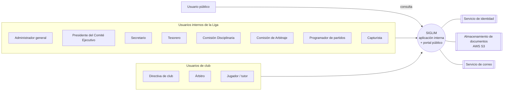

*Figura 1. Contexto del sistema.*

La arquitectura y el diseño jerárquico detallados (versión 2.1, alineada con esta revisión) están en [`../arquitectura/arquitectura-y-diseno-jerarquico.md`](../arquitectura/arquitectura-y-diseno-jerarquico.md), con su versión en PDF junto al Markdown, y las decisiones técnicas en los ADR ([`../arquitectura/adr/`](../arquitectura/adr/README.md)).

### 2.2 Funcionalidad del producto

El sistema se organiza en 14 módulos funcionales. No se exige una interfaz o un servicio independiente por módulo.

| Módulo | Nombre | Propósito | Usuarios principales |
| --- | --- | --- | --- |
| M-01 | Administración y seguridad | Usuarios, roles, permisos con ámbito y control dual, consentimiento y aviso de privacidad, auditoría. | Administrador general, Presidente |
| M-02 | Temporadas y normativa | Temporadas, convocatoria, catálogo y jerarquía de categorías, grupos y parámetros deportivos configurables. | Administrador general, Presidente, Secretario |
| M-03 | Organización deportiva | Clubes, afiliación por temporada, directiva, equipos, venta de equipo y plaza, personas y tutores. | Secretario, Directiva de club, Presidente |
| M-04 | Registros y elegibilidad | Alta, baja, renovación y transferencia entre temporadas; documentos; unicidad por CURP; elegibilidad y alineación en categoría superior. | Directiva de club, Secretario, Jugador |
| M-05 | Árbitros y designaciones | Árbitros presentados por los clubes, validación, disponibilidad y designación a partidos. | Comisión de Arbitraje, Directiva de club, Árbitro |
| M-06 | Canchas y recursos | Canchas de la liga y de clubes, comodatos, ofertas, préstamos, horarios, disponibilidad y bloqueos. | Administrador general, Secretario, Presidente, Directiva de club |
| M-07 | Programación manual | Jornadas y partidos con validación de conflictos y localía, aprobación y publicación. | Programador de partidos, Presidente |
| M-08 | Partidos, cédula y resultados | Ciclo de vida del partido, cédula con validación arbitral, resultado oficial, tabla y estadísticas. | Capturista, Árbitro, Comisión de Arbitraje |
| M-09 | Disciplina | Catálogos de incidencias y artículos, expedientes, resoluciones, sanciones, bajas y recursos. | Comisión Disciplinaria, Presidente |
| M-10 | Competencias y fases finales | Liguilla, llaves, campeón, ascensos y descensos. | Programador de partidos, Presidente |
| M-11 | Portal público y publicación | Programación, resultados, tablas, calendario, comunicados, sanciones autorizadas, equipos y buscador. | Usuario público, Secretario, Presidente |
| M-12 | Reportes y documentos | Reportes operativos y exportación a PDF y Excel. | Todos los internos según permiso |
| M-13 | Tesorería y cobros | Tarifas, cobros automáticos y manuales, pago simulado, adeudos y vencimientos. | Tesorero, Directiva de club |
| M-14 | Notificaciones | Avisos dentro del sistema y por correo ante eventos del flujo. | Todos los usuarios internos |

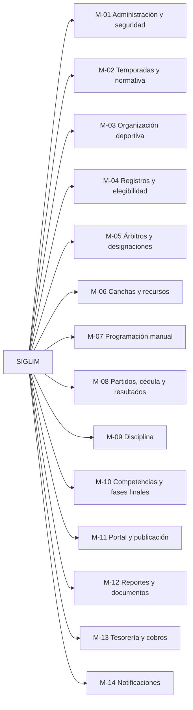

*Figura 2. Módulos funcionales.*

**Cadena de trazabilidad del dominio.** Convocatoria → reglas de temporada → afiliación y registros → jornada y designación → partido → cédula → resultado oficial → tabla → clasificación, liguilla, ascenso y descenso; y, en paralelo, cédula → incidencia → expediente → resolución → sanción → elegibilidad y programación; jornada publicada → cobros → pagos. Cada cambio crítico conserva usuario, fecha y motivo.

### 2.3 Características de los usuarios

Existen 12 tipos de usuario (DEC-01, DEC-02). Cada uno tiene permisos por módulo y acción con un ámbito; el Administrador general puede modificar esos permisos con los límites de RN-053. La matriz inicial está en el Apéndice E. El portal público no tiene privilegios de edición.

| # | Tipo de usuario | Ámbito | Formación y habilidades | Descripción y responsabilidades | Núcleo comprometido (N) |
| --- | --- | --- | --- | --- | --- |
| 1 | Administrador general | Liga | Presente ante problemáticas que surjan en campo. | Administra usuarios, roles, permisos, catálogos y temporadas. No aprueba decisiones del negocio. | Usuarios y permisos, temporada y categorías, catálogos, auditoría. |
| 2 | Presidente del Comité Ejecutivo | Liga | Conocimiento del reglamento y de la convocatoria **[PROPUESTA]**. | Autoridad de la Liga: aprueba afiliaciones, programación, cambios de permisos incompatibles, cartas de cancha, ventas de equipo, recursos y ascensos. | Aprobar afiliaciones, programación y permisos incompatibles. |
| 3 | Secretario (liga) | Liga | Manejo administrativo y documental **[PROPUESTA]**. | Captura y revisa tarjetones, valida documentos e identidad de jugadores, genera oficios y redacta comunicados. | Tarjetones y validación de documentos e identidad. |
| 4 | Tesorero (liga) | Liga | Manejo de cobros y pagos **[PROPUESTA]**. | Configura tarifas, genera cobros, registra pagos y da seguimiento a adeudos. | Cobros manuales, registro de pagos y adeudos. |
| 5 | Comisión Disciplinaria | Liga | Dominio de las reglas a seguir y de la plataforma. | Revisa expedientes, aplica artículos del reglamento y resuelve sanciones y bajas. | Expedientes, resoluciones y sanciones con vigencia. |
| 6 | Comisión de Arbitraje | Liga | Conocimiento del cuerpo arbitral **[PROPUESTA]**. | Valida árbitros, administra su disponibilidad, los designa y aprueba cédulas cuando vence el plazo del árbitro. | Validación y designación de árbitros; aprobación por vencimiento. |
| 7 | Programador de partidos | Liga | Disponer de horarios y dominar la plataforma. | Arma las jornadas, asigna canchas y horarios, ajusta la programación y configura fases finales. | Programación manual con conflictos y estados del partido. |
| 8 | Directiva de club | Club | Conocimiento de su club y de la convocatoria **[PROPUESTA]**. | Cargos presidente, secretario, tesorero y delegado. Solicita la afiliación, registra jugadores y árbitros, solicita canchas, interpone recursos y paga adeudos de su club. | Afiliación, registro de jugadores y árbitros, pago de adeudos. |
| 9 | Árbitro | Propio | Conocimiento del reglamento de juego **[PROPUESTA]**. | Consulta sus designaciones y aprueba o devuelve la cédula de sus partidos. | Validación de la cédula. |
| 10 | Capturista | Liga | Noción del entorno de la plataforma. | Captura la cédula del partido (alineación, marcador, goles, tarjetas, incidencias, sustituciones y observaciones) y la envía a validación. | Captura de la cédula. |
| 11 | Jugador (o su tutor) | Propio | Manejo básico de teléfono móvil u ordenador. | Consulta su registro, documentos, elegibilidad, partidos, estadísticas y sanciones. El de un menor lo consulta su tutor (DEC-11). | Consulta de información propia. |
| 12 | Usuario público | — | Conocimiento y manejo básico de ordenador y/o teléfono móvil. | Consulta la información publicada. | Portal público. |

**Separación de funciones.** Captura de la cédula (Capturista) ≠ validación (Árbitro o Comisión de Arbitraje); programación (Programador) ≠ aprobación (Presidente); resolución disciplinaria (Comisión Disciplinaria) ≠ recurso (Presidente); redacción de comunicados (Secretario) ≠ aprobación (Presidente); cambio de permisos (Administrador) ≠ aprobación de pares incompatibles (Presidente) (DD-010, RN-044, RN-053).

### 2.4 Restricciones

Decisiones de diseño que el equipo debe respetar (R3 §18.1 y R9):

| ID | Restricción | Entrega |
| --- | --- | --- |
| DD-001 | El sistema será una aplicación web responsive. | N |
| DD-002 | Debe existir un backend modular dentro de una sola aplicación. | N |
| DD-003 | Se utilizará una base de datos relacional. | N |
| DD-004 | Las reglas deportivas y disciplinarias se parametrizan por temporada en catálogos y configuración, no en código (motor de reglas por configuración). | N |
| DD-005 | ~~Servicio específico de programación automática~~. Descartada: no hay programación automática (DEC-06). | F |
| DD-006 | Debe existir trazabilidad de cambios y decisiones críticas. | N |
| DD-007 | Las temporadas históricas no deben sobrescribirse. | N |
| DD-008 | La publicación requiere control: la programación y los comunicados se aprueban; los resultados oficiales se publican al validarse la cédula. | N |
| DD-009 | Los permisos se basan en roles, acciones y ámbito, y son configurables. | N |
| DD-010 | La captura y la resolución se separan (cédula y disciplina). | N |
| DD-011 | El sistema administra una sola liga, pero su diseño no debe impedir varias (DEC-07). | N |
| DD-012 | No se almacenan contraseñas propias; la identidad se delega en un servicio de autenticación. | N |

Otras restricciones:

- Proyecto académico de **8 semanas** (4 Sprints de 2 semanas) con un equipo de tres personas (DEC-08).
- El stack elegido por el equipo es React con TypeScript, Spring Boot con Java y Spring JDBC, PostgreSQL en Supabase, Supabase Auth y AWS S3 para imágenes y documentos (DEC-43, DEC-45). Su justificación está en la arquitectura y en los ADR.
- No existe flujo inverso desde el portal público para editar información.
- Los datos personales se tratan conforme a la sección 3.4.4.
- El sistema refleja los procesos reales de la Liga; lo que no esté respaldado por las fuentes debe validarse antes de convertirse en requisito definitivo.

### 2.5 Suposiciones y dependencias

Este documento no asume reglas de negocio sin respaldo. Cuando una regla no la ha fijado el cliente, se implementa como parámetro configurable con un valor **[DEMO]** (RN-006, RN-035).

Dependencias:

- Validación de requisitos, procesos, interfaces, modelo de datos y reglas con la Liga y el profesor.
- Reglamento y Convocatoria 2025–2026 de la Liga para sustituir los valores [DEMO] (R4, PEN-021).
- Servicio de identidad, almacenamiento privado de documentos y servicio de correo, con los proveedores que se justifiquen en los ADR.
- Naturaleza jurídica de la Liga, que determina la ley de datos personales aplicable (PEN-039).

### 2.6 Fuera del alcance de esta entrega

Los siguientes elementos se conservan solo por su identificador, para trazabilidad.

| Capacidad | Identificadores | Motivo |
| --- | --- | --- |
| Programación automática (generación de enfrentamientos, fechas, horarios y descansos; restricciones blandas; explicación de inviabilidad) | RF-034, RF-035, RF-037, RF-038, RF-041, RF-042; RN-016, RN-017; VAL-007; DD-005; PEN-027, PEN-028 | DEC-06. La reprogramación de un partido se hace manualmente con RF-040 y RF-043. |
| Pasarela de pago real | — | DEC-37: el pago en línea es simulado. |
| Reconocimiento facial de jugadores | — | Mencionado como idea en R2; el nivel de validación acordado es el 2 (DEC-10). |
| Integraciones no aprobadas: WhatsApp/SMS, mapas, API pública, autenticación con proveedores externos, importación masiva CSV/Excel de históricos | PEN-003, PEN-033 a PEN-035 | Sin justificación de costo y necesidad. La exportación a PDF/Excel sí está incluida (RF-092). |
| Operación simultánea de varias ligas | — | DEC-07: una sola liga; el diseño no lo impide. |
| CI/CD y contenedores | PEN-038 | Opcionales según R3; no forman parte de esta entrega. |

La reducción de alcance de la Rev. 0.3 queda sin efecto (DEC-01).

## 3 Requisitos específicos

Este capítulo contiene los requisitos con el detalle necesario para diseñar y probar el sistema. Cada requisito tiene identificador, nombre, descripción, actor, fuente, prioridad de producto y entrega (N, B o F).

### 3.1 Requisitos comunes de las interfaces

#### 3.1.1 Interfaces de usuario

El sistema es una aplicación web responsive (RNF-007) con una aplicación interna de acceso autenticado y un portal público. Las pantallas son una **[PROPUESTA]** derivada de las funcionalidades; su composición y nomenclatura se validan en el prototipo de [Figma](https://www.figma.com/design/kxtW96Gd0FNxdwmvSk6S4t/Untitled?node-id=0-1&t=VymLfyImOGjy1T3f-1) (PEN-014). Una vista puede cubrir varios identificadores.

| ID | Pantalla | Actor | Objetivo | Entrega |
| --- | --- | --- | --- | --- |
| UI-001 | Inicio de sesión | Usuarios internos, jugador o tutor | Autenticarse | N |
| UI-002 | Panel de inicio | Usuarios internos | Acceder a las funciones permitidas y a las notificaciones pendientes | N |
| UI-003 | Gestión de temporadas | Administrador general | Crear, configurar, activar y cerrar temporadas | N |
| UI-004 | Categorías, jerarquía, grupos y parámetros | Administrador general | Configurar la estructura y los parámetros deportivos | N |
| UI-005 | Clubes y equipos | Secretario, Directiva de club | Administrar clubes, directiva y equipos | N |
| UI-006 | Registro de jugadores | Directiva de club, Secretario | Alta, baja, renovación y transferencia; estado de elegibilidad | N |
| UI-007 | Árbitros | Comisión de Arbitraje | Catálogo, validación y disponibilidad | N |
| UI-008 | Canchas | Administrador general, Secretario | Catálogo, propietario, comodato, horarios, disponibilidad y bloqueos | N |
| UI-009 | Programación de jornada | Programador, Presidente | Registrar, ajustar, validar conflictos, aprobar y publicar | N |
| UI-010 | Detalle de partido | Usuarios internos | Estado, historial, árbitros, cédula y acciones permitidas | N |
| UI-011 | Captura de cédula | Capturista | Alineación, marcador, goles, tarjetas, incidencias, sustituciones y observaciones | N |
| UI-012 | Tabla de posiciones | Interno y público | Consultar la clasificación | N |
| UI-013 | Estadísticas | Interno y público | Estadísticas de equipo y de jugador | B |
| UI-014 | Validación de cédula | Árbitro, Comisión de Arbitraje | Aprobar o devolver la cédula con observaciones | N |
| UI-015 | Expediente disciplinario | Comisión Disciplinaria | Revisar, aplicar artículo y resolver | N |
| UI-016 | Sanciones y castigados | Comisión Disciplinaria, público | Consultar y publicar sanciones vigentes | B |
| UI-017 | Recursos de inconformidad | Directiva de club, Presidente | Interponer y resolver recursos | B |
| UI-018 | Ascensos y descensos | Presidente | Revisar y validar la propuesta | B |
| UI-019 | Liguilla y fases finales | Programador | Configurar la fase y consultar llaves | B |
| UI-020 | Portal público | Usuario público | Programación, resultados, tablas, calendario, comunicados, sanciones y equipos | N |
| UI-021 | Reportes | Usuarios internos | Generar y exportar reportes | B |
| UI-022 | Auditoría | Administrador general, Presidente | Consultar la trazabilidad | N |
| UI-023 | Afiliación (tarjetón) | Directiva de club, Secretario, Presidente | Solicitar, revisar y aprobar la afiliación | N |
| UI-024 | Documentos e identidad | Directiva de club, Secretario | Cargar y validar documentos y fotos | N |
| UI-025 | Designación de árbitros | Comisión de Arbitraje | Designar árbitros a los partidos de una jornada | N |
| UI-026 | Catálogos disciplinarios | Administrador general, Comisión Disciplinaria | Tipos de incidencia y artículos | N |
| UI-027 | Tesorería | Tesorero, Directiva de club | Tarifas, cobros, pagos y adeudos | N |
| UI-028 | Solicitudes y ofertas de cancha | Directiva de club, Secretario, Presidente | Formatos 1 y 2 y su aprobación | B |
| UI-029 | Roles y permisos | Administrador general, Presidente | Editar permisos y aprobar pares incompatibles | N |
| UI-030 | Notificaciones | Usuarios internos | Consultar y marcar avisos | N |
| UI-031 | Comunicados | Secretario, Presidente | Redactar, aprobar y publicar | B |
| UI-032 | Mi información | Jugador o tutor | Registro, documentos, partidos y sanciones propios | N |
| UI-033 | Aviso de privacidad y consentimiento | Tutor, jugador, Directiva de club | Mostrar el aviso y registrar el consentimiento | N |
| UI-034 | Venta de equipo y plaza | Directiva de club, Presidente | Registrar y autorizar el cambio de propietario y la plaza | B |

Comportamientos que la interfaz debe reflejar:

- Mostrar la causa del bloqueo cuando una persona o un equipo no puede participar.
- Mostrar los conflictos de programación y su motivo, y las advertencias de localía.
- Mostrar el estado del partido, de la cédula y de cada trámite, con las acciones permitidas en ese estado.
- Diferenciar los datos oficiales de los indicadores calculados y rotular los valores [DEMO] como «no oficiales».
- Mostrar a cada usuario solo la información de su ámbito.
- Evitar que usuarios sin autorización vean o ejecuten acciones.

**Navegación.** Aplicación interna: inicio de sesión → panel con los módulos permitidos y las notificaciones. Portal público: Programación, Resultados, Tablas, Calendario, Comunicados, Sanciones, Equipos y buscador por fecha, categoría/grupo y equipo. La navegación final se valida en el prototipo **[PENDIENTE]** (PEN-014).

#### 3.1.2 Interfaces de hardware

No aplica. El acceso es mediante navegador web desde equipos de escritorio y móviles (RNF-007). La captura de fotos de documentos usa la cámara o los archivos del dispositivo a través del navegador.

#### 3.1.3 Interfaces de software

| Interfaz | Propósito | Datos | Entrega |
| --- | --- | --- | --- |
| Servicio de identidad (Supabase Auth) | Autenticación y emisión de sesiones; el sistema no guarda contraseñas | Credenciales, token de sesión | N |
| Almacenamiento privado de archivos (AWS S3; la referencia se guarda en Supabase) | Documentos de identidad y fotos de jugadores; evidencias disciplinarias | Archivos, identificadores, URL firmadas temporales | N |
| Servicio de correo transaccional | Notificaciones por correo (RF-143) | Destinatario, asunto, contenido | B |
| Exportación PDF/Excel | Reportes (RF-092) | Datos tabulares | B |

Cada integración se justifica por costo, seguridad y necesidad en una decisión de arquitectura (PEN-033, PEN-034). El diccionario de datos v2.0 ([`../base-de-datos/diccionario-de-datos.md`](../base-de-datos/diccionario-de-datos.md)) y el script SQL ([`../../supabase/migrations/`](../../supabase/migrations/)) están alineados con esta revisión.

#### 3.1.4 Interfaces de comunicación

El acceso del navegador al sistema es por HTTPS con datos en JSON. La comunicación del backend con la base de datos usa TLS. El contrato detallado de la API está en las convenciones de API del repositorio.

### 3.2 Requisitos funcionales

Los requisitos funcionales (RF) describen comportamientos verificables; no definen la implementación. Conservan el identificador de la fuente (RF-001 a RF-093) y los nuevos continúan desde RF-094. La columna **Fuente** cita R3 (formalización de R1), R2 (levantamiento) o la decisión DEC-xx (R9).

#### 3.2.1 M-01 Administración y seguridad

| ID | Requisito | Descripción | Actor | Fuente | Prioridad | Entrega |
| --- | --- | --- | --- | --- | --- | --- |
| RF-094 | Gestionar usuarios y roles con ámbito | El sistema debe permitir crear cuentas internas, activarlas o desactivarlas y asignarles uno o más roles con su ámbito (liga, club o propio). | Administrador general | DEC-02, DEC-03 | Alta | N |
| RF-095 | Modificar permisos de los roles | El sistema debe permitir modificar los permisos por módulo y acción de cada rol, excepto los del rol del propio usuario, y auditar cada cambio con motivo. | Administrador general | DEC-04 | Alta | N |
| RF-096 | Aprobar permisos incompatibles | Cuando un cambio asigne a un mismo rol un par de permisos declarados incompatibles, el sistema debe dejarlo pendiente hasta que lo apruebe el Presidente del Comité Ejecutivo. | Presidente | DEC-04 | Alta | N |
| RF-097 | Registrar consentimiento y aviso de privacidad | El sistema debe mostrar el aviso de privacidad y registrar el consentimiento expreso del titular o, si es menor, de su tutor, con fecha, versión del aviso y finalidades. | Directiva de club, tutor, jugador | DEC-11, DEC-40 | Alta | N |
| RF-098 | Atender solicitudes ARCO | El sistema debe registrar las solicitudes de acceso, rectificación, cancelación y oposición y su seguimiento. | Administrador general | DEC-40 | Media | B |
| RF-093 | Auditar acciones críticas | El sistema debe registrar las acciones críticas con usuario, fecha, módulo, acción, registro afectado y motivo. | Sistema | R3 §3.12 | Alta | N |
| RF-134 | Consultar auditoría | El sistema debe permitir consultar y filtrar la auditoría por usuario, operación, módulo y fecha. | Administrador general, Presidente | R3 §10 (UI-022), DEC-05 | Media | N |

#### 3.2.2 M-02 Temporadas y normativa

| ID | Requisito | Descripción | Actor | Fuente | Prioridad | Entrega |
| --- | --- | --- | --- | --- | --- | --- |
| RF-001 | Gestionar temporadas | El sistema debe registrar y administrar temporadas como periodos deportivos, con una sola temporada activa a la vez. | Administrador general | R3 §3.2, RN-058 | Alta | N |
| RF-002 | Asociar convocatoria a temporada | El sistema debe asociar a cada temporada la referencia de su convocatoria. | Secretario | R3 §3.2 | Media | B |
| RF-003 | Conservar histórico de temporadas | El sistema debe conservar la información de temporadas cerradas sin sobrescribirla. | Sistema | R3 §3.2 | Alta | N |
| RF-004 | Gestionar categorías por temporada | El sistema debe permitir definir qué categorías del catálogo participan en cada temporada. | Administrador general | R3 §3.2 | Alta | N |
| RF-005 | Gestionar grupos | El sistema debe permitir uno o varios grupos por categoría de una temporada. | Administrador general | R3 §3.2 | Alta | N |
| RF-099 | Configurar orden y jerarquía de categorías | El sistema debe mantener un catálogo de categorías con orden y categoría superior inmediata configurables, sin cambios de código ni de esquema. | Administrador general | DEC-16 | Alta | N |
| RF-006 | Configurar reglas versionables | El sistema debe asociar a cada temporada la versión de las reglas usadas, de modo que los cálculos se puedan rastrear a la configuración que los produjo. | Administrador general, Presidente | R3 §3.2 | Alta | N |
| RF-100 | Configurar parámetros deportivos | El sistema debe permitir configurar por temporada: puntos por resultado, orden de criterios de desempate, duración de juego y bloque de cancha por categoría, marcador por default, plazo de validación de la cédula y parámetros de liguilla y de ascenso y descenso. | Administrador general | DEC-20, DEC-23 a DEC-29 | Alta | N |
| RF-007 | Registrar reglas interpretadas como pendientes | El sistema no debe convertir una interpretación administrativa en regla permanente; debe registrarla como pendiente de autorización del Presidente. | Presidente | R3 §3.2 | Media | B |

#### 3.2.3 M-03 Organización deportiva

| ID | Requisito | Descripción | Actor | Fuente | Prioridad | Entrega |
| --- | --- | --- | --- | --- | --- | --- |
| RF-008 | Gestionar clubes | El sistema debe registrar y administrar los clubes afiliados. | Secretario | R3 §3.3 | Alta | N |
| RF-101 | Registrar la afiliación por temporada | El sistema debe registrar el tarjetón del club en cada temporada (nombre, presidente, secretario y tesorero del club, colores del uniforme, categorías y firmas) con folio, y someterlo a la aprobación del Presidente. | Directiva de club, Secretario, Presidente | R2, DEC-09 | Alta | N |
| RF-102 | Registrar la directiva del club | El sistema debe registrar los cargos de la directiva del club (presidente, secretario, tesorero y delegado) y sus cambios con fecha y autorización. | Directiva de club, Secretario | R2, DEC-03 | Alta | N |
| RF-009 | Gestionar equipos | El sistema debe registrar los equipos de un club en una categoría y grupo de la temporada. | Directiva de club, Secretario | R3 §3.3 | Alta | N |
| RF-103 | Registrar la venta de un equipo | El sistema debe registrar el cambio de propietario de un equipo con la autorización del Presidente; surte efecto al cierre de la temporada y conserva el historial de propietarios. | Directiva de club, Presidente | R2, DEC-14 | Media | B |
| RF-104 | Registrar la conservación de plaza | El sistema debe registrar, como operación independiente de la venta, la conservación de la categoría y de la plaza deportiva, con autorización del Presidente. | Presidente | DEC-14 | Media | B |
| RF-105 | Registrar el cambio de nombre de un club | El sistema debe registrar el cambio de nombre como un club nuevo sin historial y cerrar el anterior. | Secretario | R2, DEC-15 | Baja | B |
| RF-010 | Reutilizar identidad de persona | El sistema debe mantener una sola identidad por persona, identificada por su CURP, reutilizable en diferentes roles. | Sistema | R3 §3.3, DEC-10 | Alta | N |
| RF-011 | Separar roles de la identidad | El sistema debe permitir que una persona sea jugador, árbitro, directivo o tutor sin duplicar su identidad. | Sistema | R3 §3.3 | Media | N |
| RF-012 | Mantener historial de pertenencia | El sistema debe conservar el historial de clubes y equipos de cada jugador por temporada. | Sistema | R3 §3.3, DEC-13 | Media | N |
| RF-106 | Vincular menores con su tutor | El sistema debe vincular a cada menor con su tutor, cuya cuenta gestiona la información del menor; el menor no tiene credenciales propias. | Directiva de club, tutor | DEC-11 | Alta | N |

#### 3.2.4 M-04 Registros y elegibilidad

| ID | Requisito | Descripción | Actor | Fuente | Prioridad | Entrega |
| --- | --- | --- | --- | --- | --- | --- |
| RF-013 | Dar de alta jugador | El sistema debe registrar el alta de un jugador en un equipo de su club con los datos y documentos requeridos por su categoría; el registro queda pendiente de validación. | Directiva de club | R3 §3.4, R2 | Alta | N |
| RF-107 | Validar unicidad por CURP | El sistema debe impedir que una misma CURP tenga más de un registro activo en la misma temporada, en cualquier club o categoría, e informar dónde está registrada. | Sistema | R2, DEC-10, DEC-12 | Alta | N |
| RF-108 | Resguardar documentos y fotos | El sistema debe almacenar en forma privada los documentos y fotos requeridos por tipo de categoría (infantil, libre, veteranos) y el INE del tutor cuando el jugador sea menor. | Directiva de club | R2, DEC-10 | Alta | N |
| RF-109 | Validar documentos e identidad | El sistema debe permitir revisar los documentos y aprobar o rechazar el registro con observaciones. | Secretario | DEC-10 | Alta | N |
| RF-014 | Dar de baja jugador | El sistema debe registrar la baja de un jugador con fecha y motivo, conservando su historial. | Directiva de club, Secretario | R3 §3.4 | Alta | N |
| RF-015 | Renovar registro de jugador | El sistema debe permitir renovar el registro de un jugador en una temporada nueva reutilizando sus datos y documentos vigentes. | Directiva de club | R3 §3.4 | Media | B |
| RF-016 | Transferir jugador entre temporadas | El sistema debe permitir registrar a un jugador en otro club en una temporada nueva, si la configuración de la Liga lo permite. Dentro de una temporada no hay cambio de equipo. | Directiva de club, Secretario | R3 §3.4, R2, DEC-13 | Media | B |
| RF-111 | Configurar restricción de cambio de club | El sistema debe permitir configurar por temporada si se aceptan cambios de club entre temporadas y con qué condiciones. | Administrador general | DEC-13 | Media | B |
| RF-017 | Registrar estado de elegibilidad | El sistema debe manejar los estados del registro (pendiente de validación, activo, suspendido, baja, rechazado) y la causa de cada cambio. | Sistema | R3 §3.4 | Alta | N |
| RF-018 | Mantener historial de cambios de registro | El sistema debe conservar cada cambio de estado del registro con usuario, fecha y motivo. | Sistema | R3 §3.4 | Media | B |
| RF-019 | Validar elegibilidad antes de participar | El sistema debe comprobar, al capturar la alineación, que cada jugador tenga registro activo, esté validado y no tenga sanción vigente. | Sistema | R3 §3.4 | Alta | N |
| RF-110 | Validar alineación en categoría superior | El sistema debe aceptar a un jugador en la alineación de otro equipo de su club solo si ese equipo está en la categoría inmediata superior; se permite el mismo día. | Sistema | R2, DEC-12 | Alta | N |
| RF-020 | Bloquear participación por sanción vigente | Cuando una sanción vigente impida participar, el sistema debe impedir la alineación y explicar el motivo. | Sistema | R3 §3.4, RN-057 | Alta | N |
| RF-144 | Consultar información propia | El sistema debe permitir al jugador, o al tutor del menor, consultar su registro, documentos, estado de elegibilidad, partidos, estadísticas y sanciones. | Jugador, tutor | DEC-02, Apéndice E | Media | N |

#### 3.2.5 M-05 Árbitros y designaciones

| ID | Requisito | Descripción | Actor | Fuente | Prioridad | Entrega |
| --- | --- | --- | --- | --- | --- | --- |
| RF-112 | Registrar árbitros del club | El sistema debe permitir a cada club registrar a los árbitros que presenta. | Directiva de club | R2, DEC-17 | Alta | N |
| RF-113 | Validar árbitros | El sistema debe permitir aprobar o rechazar a los árbitros presentados. | Comisión de Arbitraje | DEC-17 | Alta | N |
| RF-021 | Gestionar catálogo de árbitros | El sistema debe mantener el catálogo de árbitros validados con el club que los presenta y su estado. | Comisión de Arbitraje | R3 §3.5 | Alta | N |
| RF-114 | Verificar la cuota de árbitros | El sistema debe indicar si un club presenta al menos un árbitro por cada cuatro equipos (redondeo hacia arriba). | Sistema | R2, DEC-17 | Media | B |
| RF-022 | Gestionar disponibilidad arbitral | El sistema debe registrar la disponibilidad de los árbitros por fecha y horario. | Comisión de Arbitraje, árbitro | R3 §3.5 | Media | B |
| RF-023 | Designar árbitros a partido | El sistema debe permitir asignar árbitros a los partidos de una jornada. | Comisión de Arbitraje | R3 §3.5, DEC-18 | Alta | N |
| RF-115 | Impedir designación al propio club | El sistema debe rechazar la designación de un árbitro a un partido en que juegue un equipo de su club. | Sistema | DEC-18 | Alta | N |
| RF-024 | Consultar historial de designaciones | El sistema debe conservar y permitir consultar el historial de designaciones. | Comisión de Arbitraje, árbitro | R3 §3.5 | Media | B |

#### 3.2.6 M-06 Canchas y recursos

| ID | Requisito | Descripción | Actor | Fuente | Prioridad | Entrega |
| --- | --- | --- | --- | --- | --- | --- |
| RF-027 | Gestionar catálogo de canchas | El sistema debe registrar las canchas con sus características, ubicación (unidad deportiva o externa) y propietario (liga, club o externo). | Administrador general | R3 §3.6, R2 | Alta | N |
| RF-028 | Gestionar sedes | El sistema debe agrupar canchas por sede o unidad deportiva. | Administrador general | R3 §3.6 | Media | B |
| RF-029 | Registrar disponibilidad temporal | El sistema debe administrar la disponibilidad de cada cancha por fecha y hora. | Administrador general | R3 §3.6 | Alta | N |
| RF-030 | Bloquear cancha | El sistema debe permitir bloquear una cancha por intervalo con motivo. | Administrador general | R3 §3.6 | Alta | N |
| RF-031 | Registrar mantenimiento | El sistema debe registrar periodos de mantenimiento como bloqueos tipificados. | Administrador general | R3 §3.6 | Media | B |
| RF-032 | Considerar partidos consecutivos | El sistema debe validar que los partidos consecutivos en una cancha respeten el bloque de cancha de cada categoría. | Sistema | R3 §3.6, DEC-25 | Media | B |
| RF-119 | Registrar horarios de cancha de club | El sistema debe registrar los horarios por categoría de la cancha que ofrece un club y la cancha asignada en comodato por temporada. | Secretario | R2, DEC-33 | Media | B |
| RF-116 | Registrar oferta de cancha | El sistema debe registrar la oferta de una cancha conforme al Formato 2 con los estados Pendiente de negociación, Aceptada y Rechazada; si el oferente es externo, la captura el Secretario. | Directiva de club, Secretario, Presidente | R8, DEC-35 | Media | B |
| RF-117 | Gestionar préstamo y comodato | El sistema debe registrar la solicitud de préstamo o comodato conforme al Formato 1, dirigida a la Liga o a un dueño externo, con los estados Pendiente, Aprobada y No aprobada. | Directiva de club, Presidente | R2, R8, DEC-35 | Media | B |
| RF-118 | Generar cartas con número de oficio | El sistema debe generar la carta de los Formatos 1 y 2 con número de oficio y datos del trámite. | Sistema | R2, R8 | Baja | B |

#### 3.2.7 M-07 Programación manual

| ID | Requisito | Descripción | Actor | Fuente | Prioridad | Entrega |
| --- | --- | --- | --- | --- | --- | --- |
| RF-033 | Registrar programación | El sistema debe permitir registrar manualmente jornadas y partidos por categoría, grupo, equipos, cancha, fecha y hora. | Programador | R3 §3.7, DEC-06 | Alta | N |
| RF-036 | Asignar canchas | El sistema debe permitir asignar manualmente una cancha disponible a un partido y rechazar la asignación si genera un conflicto duro. | Programador | R3 §3.7 | Alta | N |
| RF-039 | Detectar conflictos de programación | El sistema debe detectar equipo duplicado, cancha ocupada, cancha no disponible, equipo con baja o sanción que impida jugar, y árbitro con conflicto, usando el bloque de cancha de cada categoría. | Sistema | R3 §3.7, RN-050, RN-057 | Alta | N |
| RF-120 | Advertir reglas de localía | El sistema debe advertir cuando un partido no respete las reglas de localía o use una cancha externa en las últimas diez fechas; el programador puede aceptar con motivo. | Sistema | R2, DEC-34 | Media | B |
| RF-040 | Permitir ajuste manual autorizado | El sistema debe permitir modificar la programación, incluida la reprogramación de partidos, con motivo y traza (RN-018). | Programador | R3 §3.7 | Alta | N |
| RF-121 | Aprobar la programación | El sistema debe someter cada jornada a la aprobación del Presidente antes de publicarla; el Presidente puede aprobarla o devolverla con observaciones. | Presidente | DEC-04, DEC-21 | Alta | N |
| RF-034, RF-035, RF-037, RF-038, RF-041, RF-042 | Programación automática | Generación de enfrentamientos, fechas, horarios y descansos; registro de causa de generación; explicación de inviabilidad. | — | R3 §3.7 | — | F |

#### 3.2.8 M-08 Partidos, cédula y resultados

| ID | Requisito | Descripción | Actor | Fuente | Prioridad | Entrega |
| --- | --- | --- | --- | --- | --- | --- |
| RF-043 | Gestionar estado del partido | El sistema debe manejar los estados Programado, En curso, Finalizado, Suspendido, Reprogramado y Cancelado con las transiciones de 4.3.1. | Programador, sistema | R3 §3.8, DEC-23 | Alta | N |
| RF-127 | Cambiar automáticamente el estado | El sistema debe pasar el partido a En curso al llegar su fecha y hora, y a Finalizado al aprobarse su cédula. | Sistema | DEC-23 | Alta | N |
| RF-044 | Mantener historial del partido | El sistema no debe eliminar partidos con historial. | Sistema | R3 §3.8 | Alta | N |
| RF-045 | Auditar transiciones de estado | Cada transición debe conservar usuario, fecha y motivo. | Sistema | R3 §3.8 | Alta | N |
| RF-046 | Restringir acciones por estado | El estado del partido debe determinar las acciones permitidas. | Sistema | R3 §3.8 | Alta | N |
| RF-025 | Registrar cédula | El sistema debe permitir capturar la cédula del partido: alineación de ambos equipos, marcador, goles, tarjetas, sustituciones y observaciones. | Capturista | R3 §3.5, R2, DEC-19 | Alta | N |
| RF-026 | Registrar incidencias | El sistema debe registrar las incidencias de la cédula por tipo y relacionarlas con las personas o equipos involucrados. | Capturista | R3 §3.5, DEC-19 | Alta | N |
| RF-122 | Enviar la cédula a validación | Al completar los campos obligatorios, el sistema debe pasar la cédula a Pendiente de validación y notificar al árbitro designado. | Capturista | DEC-19 | Alta | N |
| RF-123 | Aprobar o devolver la cédula | El sistema debe permitir al árbitro designado aprobar la cédula o devolverla con observaciones al capturista. | Árbitro | DEC-19 | Alta | N |
| RF-124 | Aprobar la cédula al vencer el plazo | Si el árbitro no responde en el plazo configurado (48 h [DEMO]), el sistema debe habilitar la aprobación de la cédula a la Comisión de Arbitraje y notificarla. | Comisión de Arbitraje | DEC-20 | Alta | N |
| RF-047 | Capturar marcador | El sistema debe registrar el marcador como parte de la cédula. | Capturista | R3 §3.9 | Alta | N |
| RF-048 | Validar resultado | El resultado queda oficial cuando se aprueba la cédula; ninguna otra vía lo oficializa, salvo una resolución disciplinaria. | Árbitro, Comisión de Arbitraje | R3 §3.9, DEC-21 | Alta | N |
| RF-125 | Oficializar y publicar el resultado | Al aprobarse la cédula, el sistema debe registrar el resultado oficial, recalcular la tabla, publicar el resultado en el portal y abrir los expedientes que correspondan. | Sistema | DEC-21, DEC-22 | Alta | N |
| RF-126 | Registrar no presentación | El sistema debe registrar en la cédula la no presentación de un equipo y asignar el marcador por default configurado (3-0 [DEMO]). | Capturista | DEC-24 | Alta | N |
| RF-049 | Calcular tabla automáticamente | El sistema debe calcular PJ, PG, PE, PP, GF, GC, DG y puntos con los parámetros de la temporada (3, 1 y 0). | Sistema | R3 §3.9, DEC-26 | Alta | N |
| RF-050 | Parametrizar desempates | El sistema debe aplicar los criterios de desempate en el orden configurado para la temporada; el nombre del equipo nunca decide una posición. | Sistema | R3 §3.9, DEC-27 | Alta | N |
| RF-051 | Mantener histórico de tabla | El sistema debe conservar el estado de la tabla por jornada. | Sistema | R3 §3.9 | Media | B |
| RF-052 | Recalcular tras corrección autorizada | El sistema debe recalcular la tabla cuando un resultado cambie por resolución disciplinaria, conservando la versión anterior. | Sistema | R3 §3.9, DEC-24 | Alta | N |
| RF-053 | Calcular estadísticas de equipo | El sistema debe producir PJ, PG, PE, PP, GF, GC, DG, puntos y posición. | Sistema | R3 §3.9 | Alta | N |
| RF-054 | Calcular estadísticas de jugador | El sistema debe calcular participaciones, goles, tarjetas y sanciones de cada jugador a partir de las cédulas. | Sistema | R3 §3.9, DEC-05 | Baja | B |
| RF-055 | Separar dato oficial de indicador calculado | El sistema debe distinguir la información oficial de las métricas derivadas. | Sistema | R3 §3.9 | Media | N |
| RF-056 | Publicar solo información validada | El portal solo debe mostrar resultados de cédulas aprobadas y programación aprobada. | Sistema | R3 §3.9 | Alta | N |

#### 3.2.9 M-09 Disciplina

| ID | Requisito | Descripción | Actor | Fuente | Prioridad | Entrega |
| --- | --- | --- | --- | --- | --- | --- |
| RF-128 | Configurar tipos de incidencia | El sistema debe mantener un catálogo de tipos de incidencia que indique cuáles abren expediente. | Administrador general | DEC-22 | Alta | N |
| RF-129 | Configurar artículos y sanciones | El sistema debe mantener el catálogo de artículos del reglamento con tipo de sanción, sujeto (jugador, equipo o club), efecto (hacia adelante o retroactivo) y marca de aplicación automática. | Administrador general, Comisión Disciplinaria | DEC-30 | Alta | N |
| RF-057 | Generar expediente disciplinario | El sistema debe abrir automáticamente un expediente por cada incidencia cuyo tipo lo requiera al aprobarse la cédula. | Sistema | R3 §3.10, DEC-22 | Alta | N |
| RF-058 | Relacionar incidentes con personas y equipos | Cada incidencia debe quedar relacionada con las personas y equipos involucrados. | Sistema | R3 §3.10 | Alta | N |
| RF-059 | Registrar evidencias | El sistema debe permitir adjuntar evidencias al expediente en el almacenamiento privado. | Comisión Disciplinaria | R3 §3.10 | Media | B |
| RF-060 | Consultar artículos e infracciones | El sistema debe permitir consultar el catálogo de artículos al resolver. | Comisión Disciplinaria | R3 §3.10 | Media | N |
| RF-061 | Generar propuesta de sanción | El sistema debe proponer la sanción según el artículo seleccionado, sujeta a validación humana. | Sistema | R3 §3.10 | Media | B |
| RF-062 | Validar y resolver sanción | El sistema debe permitir a la Comisión Disciplinaria resolver el expediente y establecer la sanción. | Comisión Disciplinaria | R3 §3.10 | Alta | N |
| RF-063 | Calcular vigencia de sanción | El sistema debe calcular y conservar la vigencia de la sanción (por partidos o por fechas). | Sistema | R3 §3.10 | Alta | N |
| RF-064 | Aplicar bloqueo derivado de sanción | La sanción vigente debe afectar la elegibilidad del jugador o la programación del equipo según RN-057. | Sistema | R3 §3.10 | Alta | N |
| RF-065 | Mantener resolución inmutable | El historial de resoluciones debe conservarse sin alteración destructiva. | Sistema | R3 §3.10 | Alta | N |
| RF-066 | Gestionar lista de castigados | El sistema debe generar la lista de personas y equipos con sanción vigente. | Sistema | R3 §3.10 | Media | B |
| RF-067 | Gestionar recursos de inconformidad | El sistema debe permitir al club interponer un recurso sobre una resolución y al Presidente resolverlo como segunda instancia. | Directiva de club, Presidente | R3 §3.10, DEC-31 | Media | B |
| RF-068 | Publicar sanciones autorizadas | El sistema debe permitir publicar las sanciones vigentes autorizadas para difusión. | Comisión Disciplinaria | R3 §3.10 | Media | B |
| RF-130 | Aplicar baja automática | El sistema debe aplicar la baja del equipo cuando se cumpla un artículo marcado como automático (5 partidos perdidos por default, falta de pago) y auditarla. | Sistema | R2, DEC-31 | Media | B |
| RF-131 | Aplicar sanción retroactiva | El sistema debe declarar perdidos por el equipo los partidos en que participó una persona sancionada con efecto retroactivo y recalcular la tabla. | Sistema | R2, DEC-24, DEC-32 | Media | B |
| RF-132 | Resolver partidos restantes de un equipo dado de baja | El sistema debe otorgar por default al rival los partidos pendientes de un equipo dado de baja, según la configuración del artículo. | Sistema | DEC-32 | Media | B |
| RF-133 | Generar cobro por multa | Una sanción de multa debe generar el cobro correspondiente en tesorería. | Sistema | DEC-30 | Media | B |

#### 3.2.10 M-10 Competencias y fases finales

| ID | Requisito | Descripción | Actor | Fuente | Prioridad | Entrega |
| --- | --- | --- | --- | --- | --- | --- |
| RF-069 | Configurar reglas de ascenso y descenso | El sistema debe configurar por temporada cuántos equipos suben y bajan entre categorías adyacentes (2 y 2 [DEMO]). | Administrador general | R3 §3.11, DEC-29 | Media | B |
| RF-070 | Determinar posiciones finales | El sistema debe determinar las posiciones finales con los resultados y reglas de la temporada. | Sistema | R3 §3.11 | Media | B |
| RF-071 | Evaluar elegibilidad para ascenso | El sistema debe excluir a equipos con adeudos, con sanción de baja o cuyo club ya tenga equipo en la categoría superior (RN-052). | Sistema | R3 §3.11, DEC-29 | Media | B |
| RF-072 | Aplicar restricciones documentadas | El sistema debe aplicar las restricciones de la convocatoria configuradas para la temporada. | Sistema | R3 §3.11 | Media | B |
| RF-073 | Generar propuesta de ascenso y descenso | El sistema debe generar la propuesta de ascensos y descensos. | Sistema | R3 §3.11 | Media | B |
| RF-074 | Solicitar validación | Toda propuesta de ascenso y descenso requiere la validación del Presidente. | Presidente | R3 §3.11, RN-035 | Media | B |
| RF-075 | Guardar versión de reglas utilizada | El sistema debe registrar la versión de la configuración que produjo la propuesta. | Sistema | R3 §3.11 | Media | B |
| RF-076 | Configurar fases finales | El sistema debe permitir definir la fase final: número de clasificados (8 [DEMO]), formato (partido único o ida y vuelta) y criterio de empate. | Programador | R3 §3.11, DEC-28 | Media | B |
| RF-077 | Clasificar equipos a fase final | El sistema debe clasificar a los equipos según la tabla. | Sistema | R3 §3.11 | Media | B |
| RF-078 | Generar llaves de fase final | El sistema debe generar las llaves; la programación de sus partidos es manual. | Sistema, Programador | R3 §3.11, DEC-06 | Baja | B |
| RF-079 | Resolver empates de fase final | El sistema debe resolver empates según el criterio configurado (penales registrados en la cédula). | Sistema | R3 §3.11, DEC-28 | Baja | B |
| RF-080 | Registrar avances y eliminaciones | El sistema debe conservar el avance de los equipos en la fase final. | Sistema | R3 §3.11 | Baja | B |
| RF-081 | Determinar campeón y subcampeón | El sistema debe registrar los resultados finales de la competencia. | Sistema | R3 §3.11 | Baja | B |

#### 3.2.11 M-11 Portal público y publicación

| ID | Requisito | Descripción | Actor | Fuente | Prioridad | Entrega |
| --- | --- | --- | --- | --- | --- | --- |
| RF-082 | Consultar programación semanal | El portal debe mostrar la programación aprobada de la semana. | Usuario público | R3 §3.12 | Alta | N |
| RF-083 | Consultar resultados | El portal debe mostrar los resultados oficiales. | Usuario público | R3 §3.12 | Alta | N |
| RF-084 | Consultar tablas | El portal debe mostrar las tablas de posiciones. | Usuario público | R3 §3.12 | Alta | N |
| RF-085 | Consultar calendario | El portal debe mostrar el calendario de la competencia. | Usuario público | R3 §3.12 | Media | B |
| RF-086 | Consultar comunicados | El portal debe mostrar las noticias y comunicados aprobados. | Usuario público | R3 §3.12 | Media | B |
| RF-087 | Consultar sanciones autorizadas | El portal debe mostrar las sanciones publicadas. | Usuario público | R3 §3.12 | Media | B |
| RF-088 | Consultar equipos y competencias | El portal debe permitir consultar equipos y fases publicadas. | Usuario público | R3 §3.12 | Media | B |
| RF-089 | Buscar por fecha, categoría y equipo | El portal debe permitir filtrar por fecha, categoría/grupo y equipo. | Usuario público | R3 §3.12 | Media | N |
| RF-090 | Gestionar flujo de publicación | La programación y los comunicados siguen el flujo Borrador → Revisión → Publicado con aprobación del Presidente; los resultados oficiales se publican automáticamente (DEC-21). | Secretario, Programador, Presidente | R3 §3.12, DEC-21 | Alta | N |
| RF-145 | Publicar estadísticas de jugador con consentimiento | El portal solo debe mostrar estadísticas con nombre de jugador cuando exista consentimiento para la finalidad de difusión **[PROPUESTA]**. | Sistema | DEC-05, DEC-40 | Baja | B |

#### 3.2.12 M-12 Reportes y documentos

| ID | Requisito | Descripción | Actor | Fuente | Prioridad | Entrega |
| --- | --- | --- | --- | --- | --- | --- |
| RF-091 | Generar reportes operativos | El sistema debe producir los reportes REP-001 a REP-014 según el permiso y el ámbito del usuario. | Usuarios internos | R3 §3.12, DEC-05 | Media | B |
| RF-092 | Exportar reportes | El sistema debe exportar los reportes a PDF y a Excel. | Usuarios internos | R3 §3.12, DEC-05 | Baja | B |

#### 3.2.13 M-13 Tesorería y cobros

| ID | Requisito | Descripción | Actor | Fuente | Prioridad | Entrega |
| --- | --- | --- | --- | --- | --- | --- |
| RF-135 | Configurar tarifas | El sistema debe permitir configurar las tarifas de arbitraje y de cancha por temporada y categoría. | Tesorero | DEC-36 | Media | B |
| RF-136 | Generar cobros automáticos por partido | Al publicarse una jornada, el sistema debe generar a cada equipo los cobros de arbitraje y de cancha de sus partidos, sin cobro de cancha si juega en la propia. | Sistema | R2, DEC-36 | Media | B |
| RF-137 | Crear cobros manuales | El sistema debe permitir crear un cobro a un club o a un equipo con concepto, monto y periodo de pago. | Tesorero | R2, DEC-36 | Alta | N |
| RF-138 | Pagar un cobro en línea (simulado) | El sistema debe permitir al club pagar un cobro mediante un pago simulado con referencia ficticia y los estados Pendiente, Pagado, Rechazado y Vencido. | Directiva de club | DEC-37 | Alta | N |
| RF-139 | Registrar pagos fuera del sistema | El sistema debe permitir registrar pagos recibidos por otros medios con su comprobante. | Tesorero | DEC-36 | Alta | N |
| RF-140 | Consultar adeudos | El sistema debe mostrar los adeudos por club y por equipo según el ámbito del usuario. | Tesorero, Directiva de club | DEC-36 | Alta | N |
| RF-141 | Vencer cobros no pagados | El sistema debe marcar como vencidos los cobros no pagados al terminar su periodo y notificar al club; el vencimiento alimenta el artículo de baja por falta de pago. | Sistema | R2, DEC-31 | Media | B |

#### 3.2.14 M-14 Notificaciones

| ID | Requisito | Descripción | Actor | Fuente | Prioridad | Entrega |
| --- | --- | --- | --- | --- | --- | --- |
| RF-142 | Notificar dentro del sistema | El sistema debe avisar dentro de la aplicación los eventos del flujo: cédula pendiente, devuelta o vencida; expediente abierto; trámite por aprobar; cobro generado o vencido; programación publicada. | Sistema | DEC-38 | Alta | N |
| RF-143 | Notificar por correo | El sistema debe enviar por correo los mismos eventos a los usuarios que correspondan. | Sistema | DEC-38 | Media | B |

#### 3.2.15 Validaciones y manejo de errores

Validaciones que el sistema debe aplicar y su comportamiento ante el fallo. Los mensajes exactos se definen en el prototipo (PEN-016).

| ID | Elemento | Validación | Comportamiento si falla | Entrega |
| --- | --- | --- | --- | --- |
| VAL-001 | Registro de jugador | Datos y documentos completos según la categoría | No completar la operación; indicar lo faltante | N |
| VAL-002 | Elegibilidad | Registro activo, validado y sin sanción vigente | Bloquear la alineación y explicar el motivo | N |
| VAL-003 | Programación | Equipo con otro partido en el mismo bloque | Rechazar y explicar el conflicto | N |
| VAL-004 | Programación | Cancha ocupada en el bloque | Rechazar y explicar el conflicto | N |
| VAL-005 | Programación | Cancha bloqueada, en mantenimiento, inactiva o fuera de disponibilidad | Rechazar y explicar el conflicto | N |
| VAL-006 | Programación | Equipo dado de baja o con sanción que impide jugar | Rechazar y explicar el conflicto | N |
| VAL-007 | Programación automática | No existe solución | Fuera de alcance | F |
| VAL-008 | Estado del partido | Acción no permitida por el estado | Rechazar la acción | N |
| VAL-009 | Resultado | Cédula no aprobada | No oficializar ni publicar | N |
| VAL-010 | Corrección de resultado | Corrección sin resolución disciplinaria | Rechazar y conservar el dato oficial | N |
| VAL-011 | Desempate | Igualdad en la tabla | Aplicar los criterios configurados | N |
| VAL-012 | Disciplina | Artículo no identificado | Dejar el expediente en revisión | N |
| VAL-013 | Sanción | Excepción no definida en el catálogo | No automatizarla; requerir resolución | N |
| VAL-014 | Publicación | Información no aprobada | No mostrarla en el portal | N |
| VAL-015 | Acceso | Rol sin permiso | Denegar la acción | N |
| VAL-016 | Auditoría | Operación crítica | Registrar usuario, fecha, acción y motivo | N |
| VAL-017 | Identidad | CURP con registro activo en la temporada | Rechazar y mostrar el club y equipo donde está registrada | N |
| VAL-018 | Alineación | Jugador de otro equipo que no está en la categoría inmediata superior de su club | Rechazar la alineación | N |
| VAL-019 | Designación | Árbitro del mismo club que uno de los equipos | Rechazar la designación | N |
| VAL-020 | Cédula | Campos obligatorios incompletos | No permitir el envío a validación | N |
| VAL-021 | Cédula | Aprobación por quien la capturó | Denegar la aprobación | N |
| VAL-022 | Permisos | Cambio de permisos del propio rol | Denegar el cambio | N |
| VAL-023 | Permisos | Par de permisos incompatibles | Dejar el cambio pendiente de aprobación del Presidente | N |
| VAL-024 | Ámbito | Consulta o cambio fuera del ámbito del usuario | Denegar sin revelar si el recurso existe | N |
| VAL-025 | Registro de menor | Falta el consentimiento o el INE del tutor | No completar el registro | N |
| VAL-026 | Transferencia | Cambio de club dentro de la temporada | Rechazar | N |
| VAL-027 | Localía | Cancha fuera de la regla de localía o externa en las últimas diez fechas | Advertir; aceptar solo con motivo | B |
| VAL-028 | Pago | Pago de un cobro vencido o ya pagado | Rechazar e indicar el estado del cobro | N |

#### 3.2.16 Reportes

| ID | Reporte | Filtros | Entrega |
| --- | --- | --- | --- |
| REP-001 | Programación | Fecha, categoría, cancha | N (consulta) · B (exportación) |
| REP-002 | Resultados | Temporada, categoría, grupo, jornada | N (consulta) · B (exportación) |
| REP-003 | Tabla de posiciones | Categoría, grupo | N (consulta) · B (exportación) |
| REP-004 | Castigados | Vigencia, categoría, club | B |
| REP-005 | Sanciones | Estado, vigencia, artículo | B |
| REP-006 | Cédulas | Partido, árbitro, fecha, estado | B |
| REP-007 | Historial de equipo o jugador | Temporada, club | B |
| REP-008 | Ascensos y descensos propuestos | Temporada | B |
| REP-009 | Uso de canchas | Fecha, cancha | B |
| REP-010 | Auditoría | Usuario, operación, módulo, fecha | N (consulta) · B (exportación) |
| REP-011 | Exportación PDF/Excel | Reportes compatibles | B |
| REP-012 | Adeudos y pagos | Club, equipo, estado, periodo | N (consulta) · B (exportación) |
| REP-013 | Árbitros y designaciones | Árbitro, club, fecha | B |
| REP-014 | Afiliaciones de la temporada | Estado, categoría | B |

### 3.3 Requisitos no funcionales

Las metas se dimensionaron con el volumen de R2 (cerca de 200 clubes, más de 600 equipos, 40 canchas y 5,000 a 6,000 asistentes por fin de semana) y son **[PROPUESTA]** del equipo (DEC-39). Se verifican en el entorno de pruebas del proyecto.

#### 3.3.1 Requisitos de rendimiento

| ID | Requisito | Criterio verificable | Fuente | Prioridad | Entrega |
| --- | --- | --- | --- | --- | --- |
| RNF-002 | Rendimiento de consultas públicas | p95 del tiempo de respuesta menor a 2 s con 300 usuarios simultáneos en el portal. | R3 §4, DEC-39 | Media | N |
| RNF-016 | Rendimiento de operaciones internas | p95 menor a 3 s en operaciones internas; generación o exportación de un reporte en menos de 10 s. | DEC-39 | Media | N |
| RNF-017 | Volumen de datos | El sistema debe operar con al menos 250 clubes, 800 equipos, 15,000 personas y 50 canchas por temporada sin degradar las metas anteriores. | R2, DEC-39 | Media | N |

#### 3.3.2 Seguridad

| ID | Requisito | Criterio verificable | Fuente | Prioridad | Entrega |
| --- | --- | --- | --- | --- | --- |
| RNF-003 | Seguridad y mínimo privilegio | Toda operación se autoriza por permiso y ámbito con denegación por defecto; las pruebas cubren 401, 403 y acceso fuera de ámbito por endpoint. | R3 §4, DEC-04 | Alta | N |
| RNF-012 | Protección de datos personales | El portal no expone datos personales salvo los consentidos para difusión; los usuarios solo ven datos personales de su ámbito. | R3 §4, DEC-40 | Alta | N |
| RNF-013 | Sin contraseñas propias | Las contraseñas no se almacenan en el sistema; la identidad se delega al servicio de autenticación. | R3 §4, DD-012 | Alta | N |
| RNF-014 | Gestión segura de sesiones | Sesiones con expiración y límite de intentos según la política de PEN-030. | R3 §4 | Alta | N |
| RNF-015 | Auditoría | Las acciones críticas son trazables y la auditoría no puede modificarse por los usuarios. | R3 §4 | Alta | N |
| RNF-018 | Resguardo de documentos | Los documentos y fotos se almacenan en un repositorio privado; solo se acceden con URL firmadas de vigencia corta y por usuarios con permiso y ámbito. | DEC-10 | Alta | N |
| RNF-019 | Cifrado en tránsito | Toda comunicación con el sistema y con la base de datos usa TLS. | R3 §15.2 | Alta | N |

Controles por definir **[PENDIENTE]**: política de contraseñas, duración y renovación de la sesión, recuperación de acceso y límite de intentos (PEN-030); retención de auditoría y de documentos (PEN-040).

#### 3.3.3 Fiabilidad

| ID | Requisito | Criterio verificable | Fuente | Prioridad | Entrega |
| --- | --- | --- | --- | --- | --- |
| RNF-004 | Integridad transaccional | Las operaciones críticas (cédula, resultado, sanción, pago) son atómicas: si falla un paso no queda ningún cambio parcial. | R3 §4 | Alta | N |

#### 3.3.4 Disponibilidad

| ID | Requisito | Criterio verificable | Fuente | Prioridad | Entrega |
| --- | --- | --- | --- | --- | --- |
| RNF-001 | Disponibilidad durante jornadas | 99 % de disponibilidad los sábados y domingos de 7:00 a 21:00. | R3 §4, DEC-39 | Alta | B |
| RNF-010 | Respaldo y recuperación | Respaldo diario con 7 días de retención; RPO de 24 h y RTO de 4 h, comprobados con una restauración de prueba. | R3 §4, DEC-39 | Alta | B |

#### 3.3.5 Mantenibilidad

| ID | Requisito | Criterio verificable | Fuente | Prioridad | Entrega |
| --- | --- | --- | --- | --- | --- |
| RNF-005 | Escalabilidad funcional | Se pueden agregar temporadas, categorías, artículos, tipos de incidencia y criterios de desempate sin cambios de código ni de esquema. | R3 §4, DD-004 | Media | N |
| RNF-009 | Mantenibilidad | Los módulos no tienen dependencias cíclicas, verificado con una prueba de arquitectura. | R3 §4, DEC-39 | Media | N |
| RNF-011 | Observabilidad | Bitácora estructurada sin datos personales y un punto de verificación de salud. | R3 §4, DEC-39 | Media | B |

#### 3.3.6 Portabilidad

El acceso es desde cualquier navegador moderno de escritorio o móvil (RNF-007). El diseño del modelo de datos no debe impedir operar varias ligas (DD-011).

#### 3.3.7 Usabilidad y accesibilidad

| ID | Requisito | Criterio verificable | Fuente | Prioridad | Entrega |
| --- | --- | --- | --- | --- | --- |
| RNF-006 | Usabilidad | Las tareas clave (capturar la cédula, aprobarla, registrar un jugador, pagar un cobro) se completan en tres pasos o menos desde el panel. | R3 §4, DEC-39 | Media | N |
| RNF-007 | Responsive | Todas las pantallas son legibles y operables sin desplazamiento horizontal desde 360 px de ancho. | R3 §4 | Alta | N |
| RNF-008 | Accesibilidad | Cumplimiento de WCAG 2.1 nivel AA en las pantallas del núcleo. | R3 §4, DEC-39 | Media | N |

### 3.4 Otros requisitos

#### 3.4.1 Reglas de negocio

Las reglas deportivas y disciplinarias provienen de la convocatoria de cada temporada y se versionan. Si una regla no es explícita, su interpretación requiere autorización (RN-006, RN-035).

**Reglas de temporada y configuración**

| ID | Regla | Condición | Comportamiento esperado | Entrega |
| --- | --- | --- | --- | --- |
| RN-001 | La temporada representa un periodo deportivo | Se gestiona una competencia | La información queda asociada a su temporada | N |
| RN-002 | La convocatoria es normativa | Una temporada tiene convocatoria | Las reglas de operación se vinculan a su documento normativo | B |
| RN-003 | Las categorías y grupos pueden variar por temporada | Se abre una temporada | No se hereda una estructura fija sin configuración | N |
| RN-004 | Las reglas de ascenso y descenso se versionan | Cambia una regla | Se conserva la versión utilizada | B |
| RN-005 | El histórico no se sobrescribe | Se modifica una temporada | Los datos históricos se conservan (excepción: RN-041) | N |
| RN-006 | Las interpretaciones requieren validación | Una regla no es explícita | Pasa por autorización del Presidente | N |
| RN-058 | Una sola temporada activa a la vez | Se activa una temporada | La anterior debe estar cerrada | N |

**Reglas deportivas, de registro y de clubes**

| ID | Regla | Condición | Comportamiento esperado | Entrega |
| --- | --- | --- | --- | --- |
| RN-007 | Un equipo pertenece a una categoría y grupo durante una temporada | Durante su participación | La relación se identifica por temporada | N |
| RN-008 | Una persona es una identidad reutilizable | Tiene uno o más roles | No se duplica su identidad; la clave es la CURP | N |
| RN-009 | El registro del jugador está sujeto a reglas | Alta, baja, renovación o transferencia | Se valida conforme a la configuración de la temporada | N |
| RN-010 | La elegibilidad se comprueba antes de participar | Se captura la alineación | Se bloquea si existe impedimento | N |
| RN-011 | La sanción vigente puede impedir participación | La norma lo establece | Se impide la participación correspondiente (RN-057) | N |
| RN-037 | Un jugador pertenece a un solo equipo por temporada | Se registra un jugador | Una CURP no puede tener dos registros activos en la temporada | N |
| RN-038 | Alineación solo en la categoría inmediata superior | Un jugador se alinea con otro equipo de su club | Solo si ese equipo está en la categoría inmediata superior; se permite el mismo día | N |
| RN-039 | Sin cambio de club dentro de la temporada | Se solicita un cambio | Se rechaza; entre temporadas se aplica la configuración de la Liga | N |
| RN-040 | La venta de un equipo surte efecto al cierre | Se registra una venta o una conservación de plaza | Requiere autorización del Presidente y se aplica al cerrar la temporada | B |
| RN-041 | Un cambio de nombre crea un club nuevo | Un club cambia de nombre | El club nuevo empieza sin historial; el anterior se cierra | B |
| RN-055 | Datos de menores con consentimiento del tutor | Se registra un menor | Se exige el consentimiento expreso y el INE del tutor; el menor no tiene credenciales propias | N |

**Reglas de árbitros**

| ID | Regla | Condición | Comportamiento esperado | Entrega |
| --- | --- | --- | --- | --- |
| RN-042 | Cuota de árbitros por club | Un club afilia equipos | Debe presentar un árbitro por cada cuatro equipos, redondeando hacia arriba | B |
| RN-043 | Un árbitro no pita a su club | Se designa un árbitro | Se rechaza si juega un equipo de su club | N |

**Reglas de canchas y programación**

| ID | Regla | Condición | Comportamiento esperado | Entrega |
| --- | --- | --- | --- | --- |
| RN-012 | Un equipo no puede aparecer duplicado | Se edita una jornada | Conflicto duro | N |
| RN-013 | Una cancha ocupada no se reutiliza en el mismo bloque | Se asigna cancha | Se bloquea la asignación | N |
| RN-014 | Una cancha no disponible no se asigna | Bloqueo, mantenimiento, inactividad o fuera de disponibilidad | Se impide la asignación | N |
| RN-015 | Una sanción puede afectar la programación | Equipo dado de baja o con pérdida de partidos | La programación lo considera (RN-057) | N |
| RN-016 | Las preferencias son restricciones blandas del algoritmo | — | Fuera de alcance (programación automática) | F |
| RN-017 | Explicación de conflictos sin solución | — | Fuera de alcance (programación automática) | F |
| RN-018 | Los cambios manuales quedan trazados | Se modifica la programación | Se registra usuario, fecha y motivo | N |
| RN-048 | Localía | Un equipo es local | Se usa su cancha; si el rival no tiene cancha, se juega en la del que sí tiene; la cancha de un club solo se usa cuando ese club es local | B |
| RN-049 | Últimas diez fechas en la unidad deportiva | Partido en las últimas diez fechas de la fase regular | Se advierte el uso de canchas externas (restricción blanda) | B |
| RN-050 | Choques por bloque de cancha | Se detectan choques | Se usa el bloque de cancha de la categoría (120 min [DEMO]); la duración de juego es de 90 min sin tiempo extra | N |

**Reglas de partidos, cédula y resultados**

| ID | Regla | Condición | Comportamiento esperado | Entrega |
| --- | --- | --- | --- | --- |
| RN-019 | El estado del partido controla acciones | Cualquier momento del ciclo | Solo se permiten las acciones válidas para el estado | N |
| RN-020 | Los partidos históricos no se eliminan | El partido tiene historial | Se conserva | N |
| RN-021 | Cada transición es auditable | Cambio de estado | Se registra usuario, fecha y motivo | N |
| RN-044 | Separación en la cédula | Se valida una cédula | El capturista no la aprueba; la aprueba o devuelve el árbitro designado y, al vencer el plazo, la Comisión de Arbitraje | N |
| RN-045 | La cédula aprobada oficializa y publica | Se aprueba la cédula | El resultado queda oficial, actualiza la tabla y se publica sin revisión adicional | N |
| RN-047 | No presentación | Un equipo no se presenta | Se asigna el marcador por default configurado (3-0 [DEMO]) | N |
| RN-022 | La tabla se deriva de resultados oficiales | Se oficializa un resultado | Se recalcula la tabla | N |
| RN-023 | Los desempates dependen de reglas configuradas | Igualdad de puntos | Se aplica el orden configurado: puntos, diferencia de goles, goles a favor, resultado entre los empatados, menos expulsiones, sorteo registrado por el Presidente [DEMO] | N |
| RN-024 | Una corrección requiere recálculo | Un resultado cambia por resolución disciplinaria | Se recalcula la tabla y se conserva la versión anterior | N |
| RN-025 | Solo información validada se publica | Un dato no es oficial | No se muestra en el portal | N |

**Reglas disciplinarias**

| ID | Regla | Condición | Comportamiento esperado | Entrega |
| --- | --- | --- | --- | --- |
| RN-026 | Una cédula origina incidencias | Se captura una cédula | Las incidencias se registran vinculadas al partido | N |
| RN-046 | Las incidencias abren expediente según su tipo | Se aprueba una cédula con incidencias | Se abre expediente si el tipo lo indica | N |
| RN-027 | Los incidentes se relacionan con artículos | Existe presunta infracción | Se registra el artículo aplicable | N |
| RN-028 | La propuesta automática requiere validación | Se genera una propuesta de sanción | La Comisión la acepta, modifica o rechaza | B |
| RN-029 | La resolución genera vigencia verificable | Se aprueba una sanción | Se conserva el periodo de vigencia | N |
| RN-030 | El historial de resolución es inmutable | Se emite una resolución | No se altera destructivamente | N |
| RN-031 | Un recurso abre un nuevo estado | Se presenta un recurso | El expediente pasa a En recurso y lo resuelve el Presidente | B |
| RN-032 | La publicación disciplinaria es controlada | Sanción autorizada | Solo se publica lo autorizado | B |
| RN-056 | Efectos de la baja de un equipo | Se da de baja un equipo | Sus partidos pendientes se otorgan por default al rival (configurable por artículo); con efecto retroactivo pierde además los partidos en que participó la persona sancionada | B |
| RN-057 | Alcance de las sanciones | Hay una sanción vigente | La suspensión de un jugador impide su alineación; la baja de un equipo o la pérdida de partidos afecta su programación y resultados | N |

**Reglas de competencias**

| ID | Regla | Condición | Comportamiento esperado | Entrega |
| --- | --- | --- | --- | --- |
| RN-033 | Ascensos y descensos dependen de la temporada | Se calcula la clasificación final | Se aplica la versión de reglas de la temporada | B |
| RN-034 | La elegibilidad forma parte del cálculo | Se determina ascenso o descenso | No basta la posición deportiva (RN-052) | B |
| RN-035 | Los casos no automáticos requieren validación | Regla ambigua o propuesta | Se genera propuesta y se solicita autorización del Presidente | N |
| RN-036 | Las fases finales conservan historial | Avanza o se elimina un equipo | Se conserva el historial | B |
| RN-052 | Restricciones de ascenso | Un equipo califica para ascender | No asciende si tiene adeudos, sanción de baja o si su club ya tiene equipo en la categoría superior | B |

**Reglas de seguridad y tesorería**

| ID | Regla | Condición | Comportamiento esperado | Entrega |
| --- | --- | --- | --- | --- |
| RN-053 | Límites a la edición de permisos | El administrador modifica permisos | No puede modificar su propio rol; los pares incompatibles requieren aprobación del Presidente; todo cambio se audita | N |
| RN-054 | Ámbito de club | Un usuario con ámbito de club opera | Solo ve y modifica información de su club | N |
| RN-051 | Sin cobro de cancha propia | Se generan cobros de un partido | No se cobra cancha al equipo que juega en su cancha | B |

#### 3.4.2 Requisitos de datos

Principios de diseño de datos respaldados por la fuente y las decisiones:

- Usar catálogos e identificadores para resolver abreviaturas, nombres variables y formatos no uniformes.
- La CURP es la clave natural de la persona; el folio identifica la afiliación (R2).
- No sobrescribir históricos: registros, propietarios de equipos, directivas, designaciones, resultados y resoluciones conservan sus versiones.
- Separar la identidad de la persona de sus roles y la cuenta de usuario de la persona.
- Separar datos oficiales de indicadores calculados.
- Mantener la trazabilidad de la configuración y las reglas utilizadas en cada cálculo.
- Identificar la liga en las entidades raíz para no impedir varias ligas (DD-011).

Atributos que requieren definición **[PENDIENTE]**: campos obligatorios por formulario (PEN-015) y política de retención de datos (PEN-040).

#### 3.4.3 Criterios de aceptación

| ID | Criterio | Entrega |
| --- | --- | --- |
| CA-001 | Las temporadas históricas no se alteran. | N |
| CA-002 | La programación manual no acepta asignaciones con conflicto duro detectable. | N |
| CA-003 | Una cédula aprobada actualiza la tabla y el portal. | N |
| CA-004 | Una sanción vigente impide la alineación o la programación según su alcance. | N |
| CA-005 | Una resolución genera una vigencia verificable. | N |
| CA-006 | El sistema explica por qué un equipo o una persona no puede participar. | N |
| CA-007 | El portal muestra solo información autorizada y sin datos personales no consentidos. | N |
| CA-008 | Los cambios críticos quedan auditados. | N |
| CA-009 | Ningún resultado se vuelve oficial sin la aprobación del árbitro o, vencido el plazo, de la Comisión de Arbitraje. | N |
| CA-010 | Una CURP con registro activo en la temporada no puede registrarse en otro club o categoría. | N |
| CA-011 | Un usuario con ámbito de club no puede consultar ni modificar información de otro club. | N |
| CA-012 | El administrador no puede ampliar los permisos de su propio rol. | N |
| CA-013 | Un pago registrado actualiza el adeudo del club o equipo. | N |
| CA-014 | Un árbitro no puede ser designado a un partido de su club. | N |

#### 3.4.4 Requisitos legales y normativos

- El tratamiento de datos personales se diseña conforme a la Ley Federal de Protección de Datos Personales en Posesión de los Particulares (R10): aviso de privacidad integral y simplificado, consentimiento expreso para datos sensibles y de menores (otorgado por el tutor), finalidades separadas y atención de derechos ARCO (DEC-40). Si la Liga resultara un organismo público, aplicaría la ley general para sujetos obligados (R11) **[PENDIENTE]** (PEN-039).
- Los documentos de identidad y las fotos se consideran datos personales de acceso restringido (RNF-018).
- La normativa deportiva proviene del Reglamento y la Convocatoria de la Liga (R4). Mientras no se consulten, las reglas se configuran con valores [DEMO].
- Este documento no constituye asesoría legal; el aviso de privacidad definitivo debe revisarlo la Liga.

## 4 Modelado del sistema

Este capítulo reúne los modelos que complementan los requisitos: casos de uso, procesos, máquinas de estado, datos, estructura modular y trazabilidad. La asignación de tareas a carriles y las entidades auxiliares son **[PROPUESTA]** del equipo.

### 4.1 Modelo de casos de uso

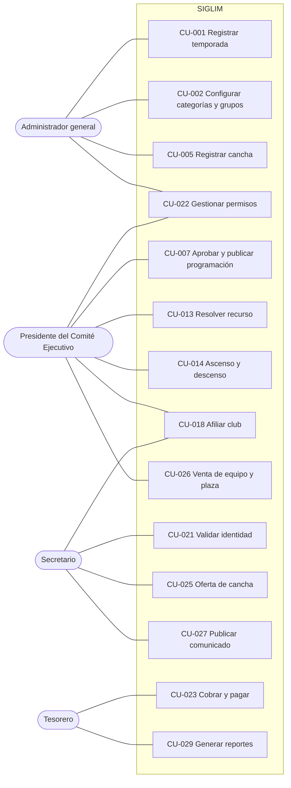

*Figura 3a. Casos de uso de administración y autoridades de la Liga.*

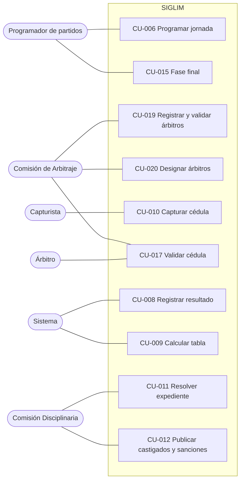

*Figura 3b. Casos de uso de la operación deportiva.*

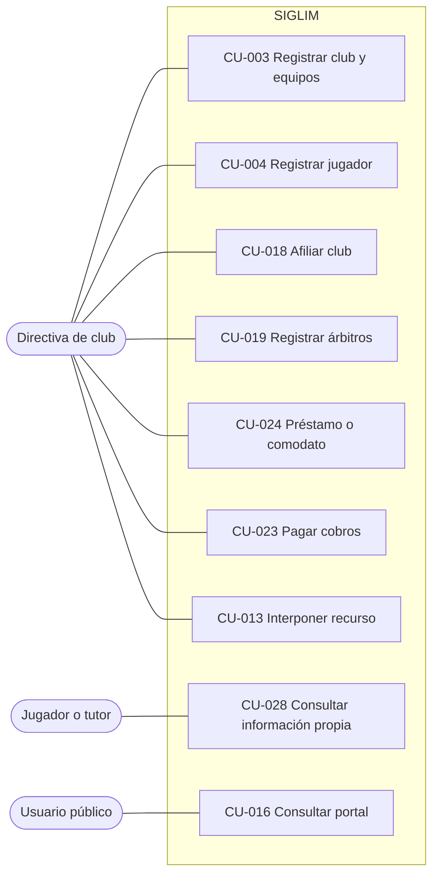

*Figura 3c. Casos de uso de los clubes, jugadores y público.*

| Caso de uso | Actores | Objetivo y precondiciones | Flujo principal | Alternativas y excepciones | Requisitos | Entrega |
| --- | --- | --- | --- | --- | --- | --- |
| CU-001 Registrar temporada | Administrador general; secundario: Presidente | Crear y configurar un periodo deportivo. Usuario autorizado. | Registrar temporada → asociar convocatoria → configurar parámetros → activar. | Otra temporada activa → no se activa (RN-058). Datos incompletos. | RF-001 a RF-003, RF-006, RF-100 | N |
| CU-002 Configurar categorías y grupos | Administrador general | Definir la estructura deportiva. Temporada en configuración. | Seleccionar categorías del catálogo → confirmar jerarquía → crear grupos. | Categoría sin superior inmediata → se registra como tope de su rama. | RF-004, RF-005, RF-099 | N |
| CU-003 Registrar club y equipos | Secretario, Directiva de club | Incorporar un club y sus equipos. | Registrar club → registrar directiva → registrar equipos por categoría y grupo. | Cambio de nombre → club nuevo (RN-041). | RF-008, RF-009, RF-102, RF-105 | N |
| CU-004 Registrar jugador | Directiva de club | Inscribir a una persona en un equipo. Club afiliado en la temporada. | Capturar CURP → validar unicidad → datos y documentos según categoría → consentimiento (tutor si es menor) → enviar a validación. | CURP con registro activo → rechazo (VAL-017). Menor sin tutor → no se completa (VAL-025). Renovación o transferencia entre temporadas. | RF-010 a RF-017, RF-097, RF-106 a RF-108, RF-111 | N |
| CU-005 Registrar cancha | Administrador general | Incorporar una cancha y su disponibilidad. | Registrar cancha → propietario y ubicación → disponibilidad → bloqueos. | Cancha de club → horarios por categoría (RF-119). | RF-027 a RF-032, RF-119 | N |
| CU-006 Programar jornada | Programador | Registrar o ajustar los partidos sin conflictos duros. Equipos y canchas registrados. | Crear jornada → registrar partidos (equipos, fecha, hora, cancha) → validar conflictos y localía → enviar a aprobación. | Conflicto duro → rechazo explicado. Advertencia de localía → aceptar con motivo. Reprogramación con motivo. | RF-033, RF-036, RF-039, RF-040, RF-120 | N |
| CU-007 Aprobar y publicar programación | Presidente | Autorizar la jornada antes de hacerla pública. Jornada en revisión. | Revisar → aprobar → publicar → generar cobros de la jornada. | Devolver con observaciones → Borrador. | RF-121, RF-090, RF-056, RF-082, RF-136 | N |
| CU-008 Registrar resultado | Sistema | Oficializar el resultado de un partido. Cédula aprobada. | Registrar resultado oficial → recalcular tabla → publicar → abrir expedientes. | Resolución disciplinaria posterior → recalcular (RF-052). | RF-047, RF-048, RF-052, RF-055, RF-056, RF-125 | N |
| CU-009 Calcular tabla | Sistema | Calcular posiciones con los parámetros de la temporada. | Recuperar resultados oficiales → estadísticas → puntos → desempates → posiciones. | Empate total → sorteo registrado por el Presidente. | RF-049 a RF-051, RF-053, RF-055 | N |
| CU-010 Capturar cédula | Capturista | Registrar la cédula del partido. Partido en curso o terminado. | Seleccionar partido → alineaciones (con validación de elegibilidad) → marcador, goles, tarjetas, sustituciones, incidencias y observaciones → enviar a validación. | No presentación → marcador por default (RF-126). Campos incompletos → no se envía (VAL-020). | RF-019, RF-020, RF-025, RF-026, RF-110, RF-122, RF-126 | N |
| CU-011 Resolver expediente | Comisión Disciplinaria | Resolver un expediente con base en el reglamento. Expediente abierto. | Revisar incidencias → seleccionar artículo → definir sanción y vigencia → resolver. | Artículo no identificado → en revisión (VAL-012). Baja automática o retroactiva. | RF-057 a RF-065, RF-130 a RF-133 | N |
| CU-012 Publicar castigados y sanciones | Comisión Disciplinaria | Difundir las sanciones autorizadas. | Seleccionar sanciones → publicar. | — | RF-066, RF-068, RF-087 | B |
| CU-013 Resolver recurso | Directiva de club, Presidente | Revisar una resolución en segunda instancia. Expediente resuelto. | Interponer recurso → En recurso → Presidente resuelve → cierre. | Recurso fuera de plazo [PENDIENTE] (PEN-041). | RF-067 | B |
| CU-014 Ascenso y descenso | Sistema, Presidente | Proponer y validar ascensos y descensos al cierre. | Cargar reglas → posiciones finales → elegibilidad → propuesta → validación. | Equipo no elegible → se excluye con motivo (RN-052). | RF-069 a RF-075 | B |
| CU-015 Fase final | Programador | Configurar y llevar la liguilla. | Configurar fase → clasificar → llaves → programar partidos → registrar avances → campeón. | Empate → penales en la cédula. | RF-076 a RF-081 | B |
| CU-016 Consultar portal | Usuario público | Consultar información publicada. | Elegir sección → filtrar → consultar. | — | RF-082 a RF-089, RF-145 | N |
| CU-017 Validar cédula | Árbitro; Comisión de Arbitraje | Aprobar o devolver la cédula. Cédula pendiente de validación. | Revisar → aprobar → el resultado se oficializa (CU-008). | Devolver con observaciones → En captura. Plazo vencido → aprueba la Comisión (RF-124). | RF-123, RF-124, RF-127 | N |
| CU-018 Afiliar club | Directiva de club, Secretario, Presidente | Registrar el tarjetón de la temporada. | Capturar tarjetón → folio → revisión del Secretario → aprobación del Presidente. | Rechazo con observaciones. | RF-101, RF-102 | N |
| CU-019 Registrar y validar árbitros | Directiva de club, Comisión de Arbitraje | Incorporar los árbitros que presenta un club. | Registrar árbitro (CURP) → validar → catálogo. | Cuota incompleta → aviso (RF-114). | RF-021, RF-022, RF-112 a RF-114 | N |
| CU-020 Designar árbitros | Comisión de Arbitraje | Asignar árbitros a los partidos de la jornada. Jornada registrada. | Seleccionar partido → elegir árbitro disponible → designar. | Árbitro de un club participante → rechazo (VAL-019). | RF-023, RF-024, RF-115 | N |
| CU-021 Validar identidad | Secretario | Validar documentos y unicidad de un registro. Registro pendiente. | Revisar documentos → aprobar o rechazar con observaciones. | — | RF-107 a RF-109 | N |
| CU-022 Gestionar permisos | Administrador general, Presidente | Ajustar los permisos de los roles. | Editar permisos de un rol → guardar con motivo. | Rol propio → denegado. Par incompatible → pendiente de aprobación del Presidente. | RF-094 a RF-096 | N |
| CU-023 Cobrar y pagar | Tesorero, Directiva de club | Generar cobros y registrar su pago. | Crear cobro (o automático por jornada) → el club consulta adeudos → paga (simulado) o el Tesorero registra el pago. | Cobro vencido → no se paga en línea (VAL-028); alimenta la baja por falta de pago. | RF-135 a RF-141, RF-133 | N |
| CU-024 Préstamo o comodato de cancha | Directiva de club, Presidente | Solicitar el uso de una cancha (Formato 1). | Capturar solicitud → carta con oficio → aprobación o rechazo. | — | RF-117, RF-118 | B |
| CU-025 Oferta de cancha | Directiva de club, Secretario, Presidente | Registrar la oferta de una cancha (Formato 2). | Capturar oferta → negociación → aceptar o rechazar → alta de la cancha y horarios. | Oferente externo → captura el Secretario. | RF-116, RF-118, RF-119 | B |
| CU-026 Venta de equipo y plaza | Directiva de club, Presidente | Registrar el cambio de propietario y la plaza. | Registrar venta → registrar plaza → autorizar → aplicar al cierre de temporada. | — | RF-103, RF-104 | B |
| CU-027 Publicar comunicado | Secretario, Presidente | Difundir un comunicado oficial. | Redactar → enviar a revisión → aprobar → publicar. | Devolver con observaciones. | RF-086, RF-090 | B |
| CU-028 Consultar información propia | Jugador o tutor | Consultar su registro, partidos y sanciones. Cuenta activa. | Iniciar sesión → consultar. | Menor → lo consulta el tutor. | RF-144, RF-097 | N |
| CU-029 Generar reportes | Usuarios internos | Obtener y exportar reportes. | Elegir reporte → filtros → generar → exportar. | — | RF-091, RF-092, RF-134 | B |

### 4.2 Modelo de procesos

Los procesos se resumen con diagramas de flujo por carril (un subgrupo por participante). La notación BPMN 2.0 completa (R7) se desarrolla en el documento de BPMN v2.0 ([`bpmn/bpmn-procesos-del-sistema.md`](bpmn/bpmn-procesos-del-sistema.md)). Inicio y fin se representan con círculos, decisiones con rombos.

#### 4.2.1 P-01 Configuración de temporada

| Elemento | Contenido |
| --- | --- |
| Objetivo | Preparar el marco deportivo y normativo de una temporada. |
| Entradas | Convocatoria, categorías, grupos, parámetros deportivos, tarifas. |
| Salida | Temporada configurada, versionada y activa. |
| Requisitos | RF-001 a RF-007, RF-099, RF-100, RF-135; CU-001, CU-002 |

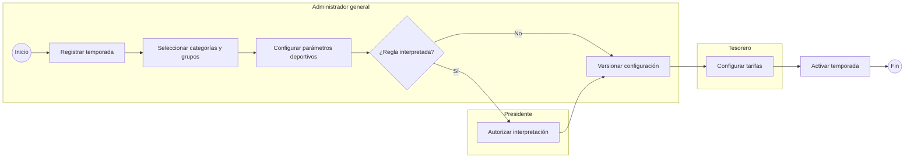

#### 4.2.2 P-02 Afiliación y registro de jugadores

| Elemento | Contenido |
| --- | --- |
| Objetivo | Afiliar al club en la temporada y registrar a sus jugadores con identidad validada. |
| Entradas | Tarjetón, directiva, equipos, CURP, documentos, consentimiento. |
| Salida | Club afiliado; registros activos o rechazados con causa. |
| Requisitos | RF-008 a RF-017, RF-097, RF-101, RF-102, RF-106 a RF-109; CU-003, CU-004, CU-018, CU-021 |

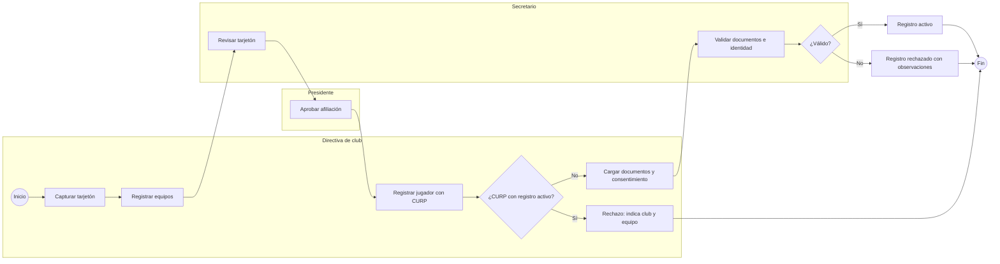

#### 4.2.3 P-03 Programación manual, designación y publicación

| Elemento | Contenido |
| --- | --- |
| Objetivo | Registrar la jornada sin conflictos duros, designar árbitros, aprobarla y publicarla. |
| Restricciones duras | Equipo duplicado, cancha ocupada, cancha no disponible, equipo con baja o sanción, árbitro de un club participante. |
| Restricciones blandas | Localía y canchas externas en las últimas diez fechas (advertencia). |
| Requisitos | RF-023, RF-033, RF-036, RF-039, RF-040, RF-115, RF-120, RF-121, RF-136; CU-006, CU-007, CU-020 |

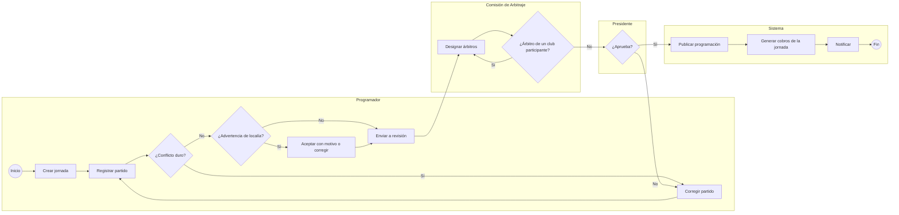

#### 4.2.4 P-04 Ciclo de vida del partido

Se modela como máquina de estados en 4.3.1. Reglas: no se eliminan partidos con historial (RN-020); toda transición registra usuario, fecha y motivo (RN-021); el estado controla las acciones permitidas (RN-019). Requisitos: RF-043 a RF-046, RF-127.

#### 4.2.5 P-05 Cédula, resultado oficial y tabla

| Elemento | Contenido |
| --- | --- |
| Objetivo | Capturar la cédula, validarla y oficializar el resultado. |
| Salida | Resultado oficial publicado, tabla actualizada y expedientes abiertos. |
| Requisitos | RF-019, RF-025, RF-026, RF-047 a RF-056, RF-110, RF-122 a RF-127; CU-008 a CU-010, CU-017 |

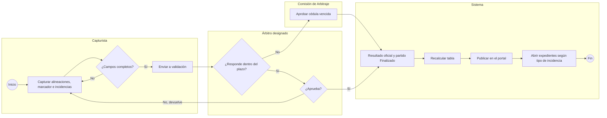

#### 4.2.6 P-06 Expediente, resolución y sanción

| Elemento | Contenido |
| --- | --- |
| Objetivo | Convertir las incidencias en una resolución trazable conforme al reglamento. |
| Separación de funciones | La captura (Capturista) y la validación (Árbitro) están separadas de la resolución (Comisión Disciplinaria) y del recurso (Presidente). |
| Requisitos | RF-057 a RF-068, RF-130 a RF-133; CU-011 a CU-013 |

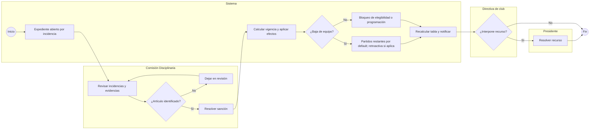

#### 4.2.7 P-07 Ascenso, descenso y clasificación

Al cierre de la fase regular el sistema carga la versión de reglas, determina posiciones, excluye a los equipos no elegibles (RN-052), genera la propuesta y la somete a validación del Presidente. Requisitos: RF-069 a RF-075; CU-014.

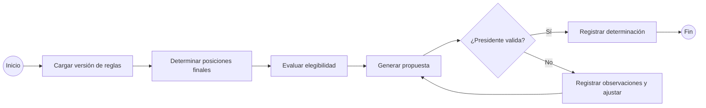

#### 4.2.8 P-08 Liguilla y fases finales

El programador configura la fase con los parámetros de la temporada; el sistema clasifica y genera las llaves; los partidos se programan manualmente (P-03) y se juegan con cédula (P-05); los empates se resuelven por penales registrados en la cédula; se registran avances, eliminaciones, campeón y subcampeón. Requisitos: RF-076 a RF-081; CU-015.

#### 4.2.9 P-09 Publicación del portal

La programación y los comunicados siguen el flujo Borrador → Revisión → Publicado con aprobación del Presidente; los resultados oficiales y la tabla se publican al aprobarse la cédula (DEC-21); las sanciones se publican cuando la Comisión Disciplinaria las autoriza. Requisitos: RF-056, RF-068, RF-082 a RF-090; CU-007, CU-012, CU-016, CU-027.

#### 4.2.10 P-10 Préstamo, comodato y oferta de cancha

| Elemento | Contenido |
| --- | --- |
| Objetivo | Tramitar el uso o la oferta de canchas con los formatos del cliente (R8). |
| Requisitos | RF-116 a RF-119; CU-024, CU-025 |

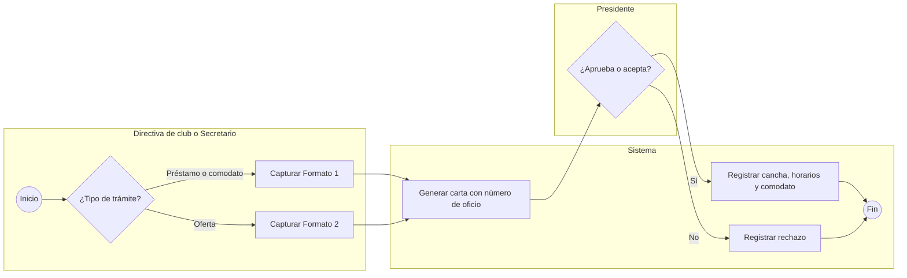

#### 4.2.11 P-11 Cobros y pagos

| Elemento | Contenido |
| --- | --- |
| Objetivo | Generar los cobros de la temporada y registrar su pago. |
| Requisitos | RF-133, RF-135 a RF-141; CU-023 |

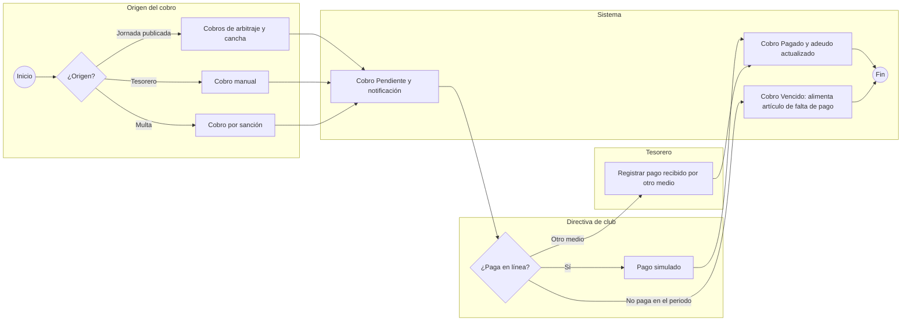

#### 4.2.12 P-12 Venta de equipo y conservación de plaza

La directiva registra la venta; la conservación de la categoría y de la plaza se registra como operación independiente; el Presidente autoriza ambas; el sistema las aplica al cerrar la temporada y conserva el historial de propietarios (RN-040). Requisitos: RF-103, RF-104; CU-026.

#### 4.2.13 P-13 Cambio de permisos con control dual

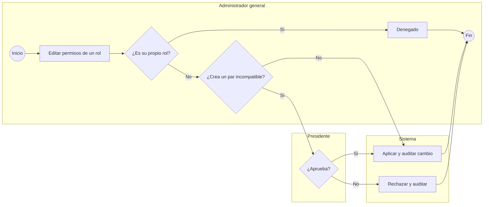

Requisitos: RF-094 a RF-096; CU-022.

### 4.3 Máquinas de estado

#### 4.3.1 Partido (DEC-23)

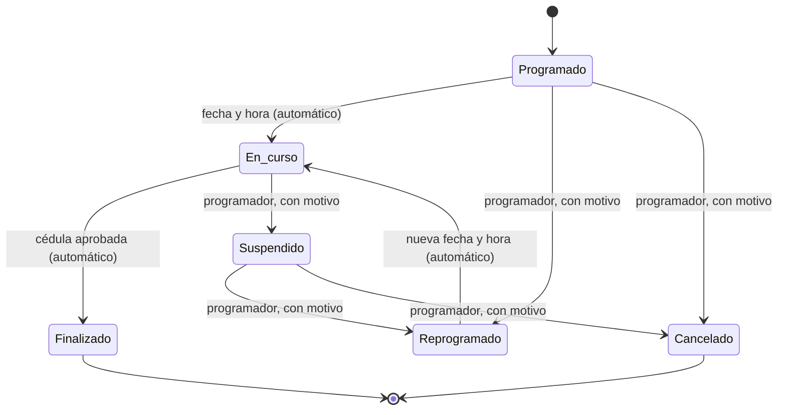

La no presentación se registra en la cédula con marcador por default; una sanción retroactiva modifica el resultado de un partido Finalizado por resolución, sin cambiar su estado (DEC-24).

#### 4.3.2 Cédula (DEC-19, DEC-20)

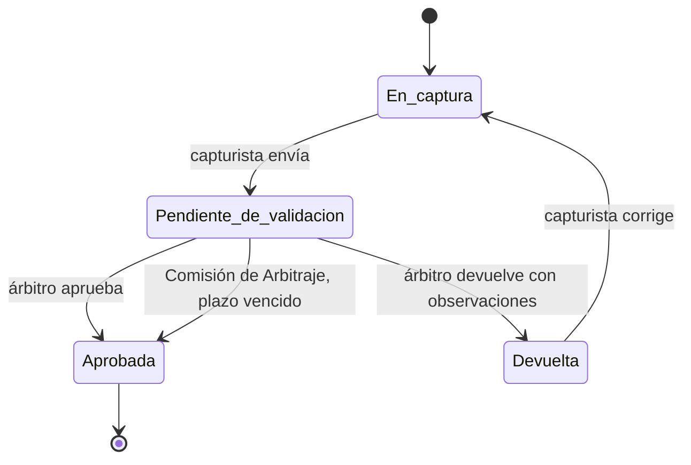

#### 4.3.3 Registro de jugador

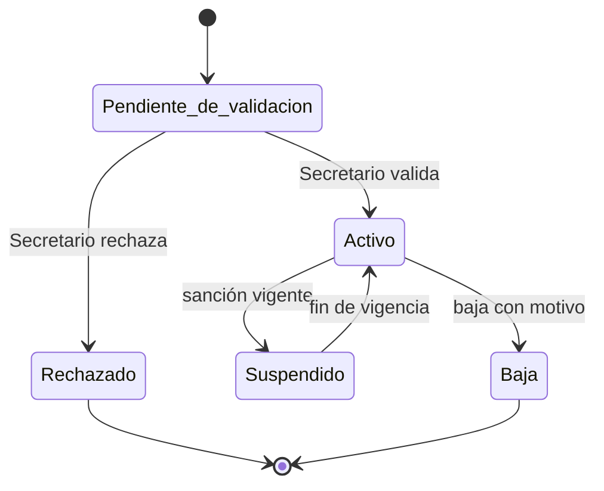

#### 4.3.4 Expediente disciplinario

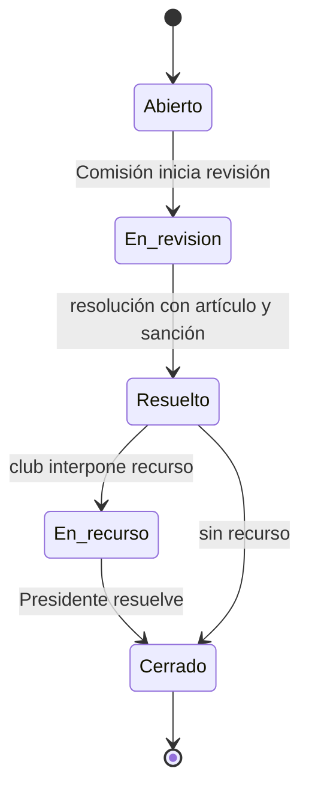

#### 4.3.5 Cobro (DEC-37)

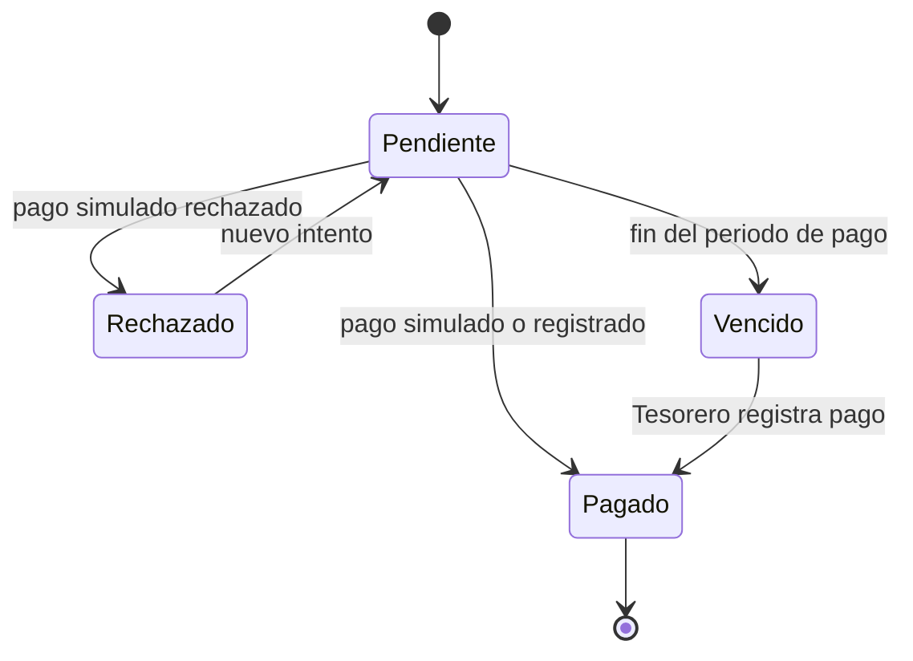

#### 4.3.6 Publicación de programación y comunicados

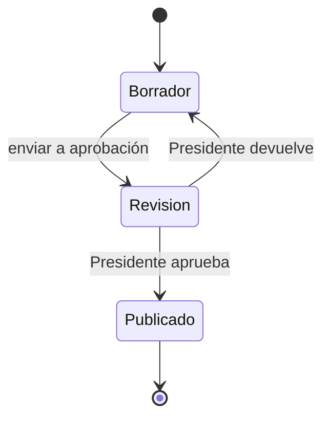

Otros estados: temporada (Configuración, Activa, Cerrada); afiliación (Solicitada, Aprobada, Rechazada); solicitud de cancha (Formato 1: Pendiente, Aprobada, No aprobada; Formato 2: Pendiente de negociación, Aceptada, Rechazada); cambio de permisos (Solicitado, Aprobado, Rechazado).

### 4.4 Modelo de datos conceptual

Modelo conceptual. Las entidades provienen de la fuente (R3 §11) y de las decisiones (R9); las auxiliares son **[PROPUESTA]**. Los atributos, tipos e índices se definen en el diccionario de datos v2.0 ([`../base-de-datos/diccionario-de-datos.md`](../base-de-datos/diccionario-de-datos.md)), generado a partir de la nueva migración inicial (DEC-42).

| Entidad | Propósito | Atributos clave | Origen | Entrega |
| --- | --- | --- | --- | --- |
| Liga | Organización que opera el sistema | Nombre | DEC-07 | N |
| Temporada | Periodo deportivo | Periodo, estado, versión de reglas | R3 | N |
| Convocatoria | Documento normativo de la temporada | Referencia, versión | R3 | B |
| Categoría | Nivel deportivo del catálogo | Nombre, orden, categoría superior inmediata, tipo (infantil, libre, veteranos) | R3, DEC-16 | N |
| Categoría de temporada / Grupo | Participación de la categoría y sus grupos | Temporada, categoría, grupos | R3 | N |
| Parámetros de temporada | Reglas configurables | Puntos, desempates, bloque de cancha, marcador por default, plazo de cédula, liguilla, ascenso | DEC-26 a DEC-29 | N |
| Persona | Identidad única | CURP, nombre, fecha de nacimiento, contacto | R3, DEC-10 | N |
| Tutela | Relación tutor–menor | Tutor, menor, consentimiento | DEC-11 | N |
| Consentimiento | Aceptación del aviso de privacidad | Titular u otorgante, versión del aviso, finalidades, fecha | DEC-40 | N |
| Usuario (perfil) | Cuenta de acceso | Persona, estado | R3 | N |
| Rol, permiso, asignación de rol | RBAC con ámbito | Módulo, acción, ámbito, club | R3, DEC-03, DEC-04 | N |
| Solicitud de cambio de permisos | Control dual | Rol, permisos, estado, aprobador | DEC-04 | N |
| Club | Entidad afiliada | Nombre, estado, club anterior (cambio de nombre) | R3, DEC-15 | N |
| Afiliación | Tarjetón por temporada | Folio, colores, categorías, firmas, estado | R2, DEC-09 | N |
| Cargo de directiva | Directiva del club | Club, persona, cargo, vigencia | R2, DEC-03 | N |
| Equipo | Representación del club en categoría y grupo | Club, grupo, temporada, estado | R3 | N |
| Propiedad de equipo / plaza | Historial de propietarios y plaza deportiva | Equipo, club, fechas, autorización | DEC-14 | B |
| Registro de jugador | Persona en un equipo por temporada | Persona, equipo, estado, fechas | R3, DEC-12 | N |
| Documento | Archivo del registro o evidencia | Tipo, ruta privada, estado de validación | DEC-10 | N |
| Árbitro | Persona con rol arbitral | Persona, club que lo presenta, estado | R3, DEC-17 | N |
| Disponibilidad arbitral / Designación | Disponibilidad y asignación | Árbitro, partido, fecha | R3 | N |
| Cancha / Sede | Recurso físico | Ubicación, propietario, sede, estado | R3, DEC-33 | N |
| Disponibilidad de cancha | Disponibilidad, bloqueos y mantenimiento | Cancha, intervalo, tipo | R3 | N |
| Horario de cancha de club / Comodato | Uso de canchas por club | Cancha, club, categoría, día y hora | DEC-33 | B |
| Solicitud de cancha | Formatos 1 y 2 | Tipo, oficio, datos del formato, estado | R8, DEC-35 | B |
| Jornada | Unidad de programación | Grupo, número, estado de publicación | R3 | N |
| Partido | Unidad competitiva | Equipos, cancha, inicio, fin de bloque, estado | R3 | N |
| Historial de estados del partido | Transiciones | Estado anterior y nuevo, usuario, motivo | R3 | N |
| Cédula | Registro oficial del partido | Partido, estado, capturista, árbitro validador, fechas | R3, DEC-19 | N |
| Alineación | Jugadores del partido | Cédula, registro de jugador, equipo, categoría superior | R2, DEC-12 | N |
| Evento de cédula | Goles, tarjetas, sustituciones | Cédula, persona, tipo, minuto | DEC-19 | N |
| Incidencia | Hecho disciplinario | Cédula, tipo, personas o equipos | R3 | N |
| Tipo de incidencia | Catálogo | Nombre, abre expediente | DEC-22 | N |
| Resultado | Marcador oficial | Partido, goles, origen (cédula o resolución), versión | R3, DEC-21 | N |
| Artículo / Infracción | Catálogo del reglamento | Número, tipo de sanción, sujeto, efecto, automático | R3, DEC-30 | N |
| Expediente | Caso disciplinario | Incidencias, estado | R3 | N |
| Resolución / Sanción | Decisión y consecuencia | Artículo, vigencia, sujeto | R3 | N |
| Recurso | Inconformidad | Expediente, estado, resolución | R3 | B |
| Competencia / Fase | Fase regular y liguilla | Tipo, formato, llaves | R3, DEC-28 | B |
| Tarifa | Cuotas por temporada y categoría | Concepto, monto | DEC-36 | B |
| Cobro / Pago | Cargos y pagos | Club o equipo, concepto, monto, periodo, estado, referencia | R2, DEC-36, DEC-37 | N |
| Publicación / Comunicado | Contenido del portal | Tipo, estado, aprobador | R3 | N |
| Notificación | Aviso a usuarios | Destinatario, evento, canal, leída | DEC-38 | N |
| Auditoría | Trazabilidad | Usuario, fecha, módulo, acción, motivo | R3 | N |

```mermaid
erDiagram
    LIGA ||--o{ TEMPORADA : organiza
    LIGA ||--o{ CLUB : afilia
    TEMPORADA ||--o{ CATEGORIA_TEMPORADA : incluye
    CATEGORIA ||--o{ CATEGORIA_TEMPORADA : participa
    CATEGORIA |o--o{ CATEGORIA : "superior inmediata de"
    CATEGORIA_TEMPORADA ||--o{ GRUPO : contiene
    CLUB ||--o{ AFILIACION : presenta
    TEMPORADA ||--o{ AFILIACION : recibe
    CLUB ||--o{ CARGO_DIRECTIVA : tiene
    PERSONA ||--o{ CARGO_DIRECTIVA : ocupa
    CLUB ||--o{ EQUIPO : "es propietario de"
    GRUPO ||--o{ EQUIPO : agrupa
    PERSONA ||--o{ REGISTRO_JUGADOR : tiene
    EQUIPO ||--o{ REGISTRO_JUGADOR : registra
    PERSONA ||--o{ TUTELA : "es tutor en"
    REGISTRO_JUGADOR ||--o{ DOCUMENTO : respalda
    PERSONA ||--o| ARBITRO : "actúa como"
    CLUB ||--o{ ARBITRO : presenta
    GRUPO ||--o{ JORNADA : programa
    JORNADA ||--o{ PARTIDO : contiene
    CANCHA ||--o{ PARTIDO : aloja
    PARTIDO ||--o{ DESIGNACION : recibe
    ARBITRO ||--o{ DESIGNACION : asignado
    PARTIDO ||--|| CEDULA : documenta
    CEDULA ||--o{ ALINEACION : registra
    CEDULA ||--o{ EVENTO_CEDULA : registra
    CEDULA ||--o{ INCIDENCIA : reporta
    PARTIDO ||--o{ RESULTADO : "versiones de"
    INCIDENCIA }o--o| EXPEDIENTE : origina
    EXPEDIENTE ||--o{ RESOLUCION : produce
    ARTICULO ||--o{ RESOLUCION : fundamenta
    RESOLUCION ||--o{ SANCION : determina
    EXPEDIENTE ||--o{ RECURSO : recibe
    CLUB ||--o{ COBRO : adeuda
    EQUIPO ||--o{ COBRO : adeuda
    COBRO ||--o{ PAGO : liquida
    USUARIO ||--o{ ASIGNACION_ROL : posee
    ROL ||--o{ ASIGNACION_ROL : asigna
    ROL ||--o{ ROL_PERMISO : concede
```

*Figura 4. Modelo entidad-relación conceptual (relaciones principales).*

### 4.5 Estructura modular y arquitectura conceptual

Arquitectura cliente-servidor de tres niveles **[PROPUESTA]** justificada en el documento de arquitectura y los ADR: una aplicación web de una sola página (React) con el portal público y la aplicación interna; un backend monolítico modular en capas (Spring Boot), con un paquete por módulo M-xx; servicios administrados de datos e identidad (Supabase); y almacenamiento de archivos en AWS S3 (DEC-45). Componentes adicionales que exige esta revisión:

- **Tareas programadas** para el cambio automático de estado del partido, el vencimiento del plazo de la cédula y de los cobros (RF-124, RF-127, RF-141).
- **Autorización por permiso y ámbito** en la capa de servicios, con políticas de seguridad a nivel de fila como defensa adicional (RN-054).
- **Almacenamiento privado** de documentos con URL firmadas (RNF-018).
- **Servicio de correo** transaccional (RF-143).

| ID | Propuesta de diseño | Motivo | Entrega |
| --- | --- | --- | --- |
| DP-001 | Módulos de dominio desacoplados dentro del backend | Reduce acoplamiento y facilita la evolución | N |
| DP-002 | Versionar explícitamente las reglas de la temporada | Trazabilidad normativa | N |
| DP-003 | Máquinas de estado explícitas (partido, cédula, expediente, cobro) | El estado controla acciones y auditoría | N |
| DP-004 | Tratar la jornada como entidad con estado de publicación | Histórico, publicación y cobros | N |
| DP-005 | Componente específico de validación de conflictos de programación | La programación es manual; se validan restricciones duras y blandas | N |
| DP-006 | Separar datos publicados de datos internos | Reduce la exposición accidental | N |
| DP-007 | Tareas programadas idempotentes para los procesos por tiempo | Plazos de cédula, estados y vencimientos | N |
| DP-008 | Permisos como datos (rol, módulo, acción, ámbito), nunca por nombre de rol en el código | Permisos configurables (DEC-04) | N |

### 4.6 Flujo de información

**Por operación.** Entrada del usuario → interfaz → validación de formato, permiso y ámbito → reglas de negocio → procesamiento del módulo → persistencia transaccional → auditoría → notificación → resultado → publicación (cuando corresponde).

**Público.** Datos internos → aprobación o validación de cédula → estado publicado → portal público → consulta. No existe flujo inverso desde el portal.

### 4.7 Matriz de trazabilidad

| Requisitos | Casos de uso | Proceso | Módulo | Pantallas | Entidades | Decisiones |
| --- | --- | --- | --- | --- | --- | --- |
| RF-093 a RF-098, RF-134 | CU-022 | P-13 | M-01 | UI-001, UI-002, UI-022, UI-029, UI-033 | Usuario, rol, permiso, solicitud de cambio, consentimiento, auditoría | DEC-02 a DEC-04, DEC-40 |
| RF-001 a RF-007, RF-099, RF-100 | CU-001, CU-002 | P-01 | M-02 | UI-003, UI-004 | Temporada, convocatoria, categoría, grupo, parámetros | DEC-16, DEC-26 a DEC-29 |
| RF-008 a RF-012, RF-101 a RF-106 | CU-003, CU-018, CU-026 | P-02, P-12 | M-03 | UI-005, UI-023, UI-034 | Club, afiliación, cargo, equipo, propiedad, persona, tutela | DEC-09, DEC-11, DEC-14, DEC-15 |
| RF-013 a RF-020, RF-107 a RF-111, RF-144 | CU-004, CU-021, CU-028 | P-02 | M-04 | UI-006, UI-024, UI-032 | Registro de jugador, documento, alineación | DEC-10, DEC-12, DEC-13 |
| RF-021 a RF-024, RF-112 a RF-115 | CU-019, CU-020 | P-03 | M-05 | UI-007, UI-025 | Árbitro, disponibilidad, designación | DEC-17, DEC-18 |
| RF-027 a RF-032, RF-116 a RF-119 | CU-005, CU-024, CU-025 | P-10 | M-06 | UI-008, UI-028 | Cancha, sede, disponibilidad, horario, solicitud | DEC-33, DEC-35 |
| RF-033, RF-036, RF-039, RF-040, RF-120, RF-121 | CU-006, CU-007 | P-03 | M-07 | UI-009 | Jornada, partido | DEC-06, DEC-34 |
| RF-025, RF-026, RF-043 a RF-056, RF-122 a RF-127 | CU-008 a CU-010, CU-017 | P-04, P-05 | M-08 | UI-010 a UI-014 | Partido, cédula, alineación, evento, incidencia, resultado | DEC-19 a DEC-21, DEC-23 a DEC-27 |
| RF-057 a RF-068, RF-128 a RF-133 | CU-011 a CU-013 | P-06 | M-09 | UI-015 a UI-017, UI-026 | Tipo de incidencia, artículo, expediente, resolución, sanción, recurso | DEC-22, DEC-30 a DEC-32 |
| RF-069 a RF-081 | CU-014, CU-015 | P-07, P-08 | M-10 | UI-018, UI-019 | Competencia/fase, temporada | DEC-28, DEC-29 |
| RF-082 a RF-090, RF-145 | CU-007, CU-012, CU-016, CU-027 | P-09 | M-11 | UI-020, UI-031 | Publicación, comunicado | DEC-05, DEC-21 |
| RF-091, RF-092 | CU-029 | Transversal | M-12 | UI-021 | Reportes | DEC-05 |
| RF-135 a RF-141 | CU-023 | P-11 | M-13 | UI-027 | Tarifa, cobro, pago | DEC-36, DEC-37 |
| RF-142, RF-143 | Transversal | Transversal | M-14 | UI-030 | Notificación | DEC-38 |

## Apéndice A. Pendientes por definir

Se conservan los identificadores PEN de la fuente. **Estado:** Resuelto (con la decisión que lo resuelve), Demo (resuelto con un valor configurable [DEMO] hasta conocer el real), Abierto o Fuera (fuera de alcance, 2.6).

| ID | Pendiente | Estado | Resolución o quién debe aclararlo |
| --- | --- | --- | --- |
| PEN-001 | Prioridad formal de cada requisito | Resuelto | Prioridad de producto conservada [PROPUESTA]; entrega N/B/F (DEC-01) |
| PEN-002 | Alcance exacto de cada actor | Resuelto | 2.3 y Apéndice E (DEC-02 a DEC-04); falta validación de la Liga |
| PEN-003 | Importación de datos históricos | Fuera | 2.6 |
| PEN-004 | Operaciones obligatorias por temporada | Resuelto | Afiliación y registro con validación (DEC-09, DEC-10) |
| PEN-005 | Quién crea y quién aprueba la programación | Resuelto | Programador crea; Presidente aprueba (RF-121) |
| PEN-006 | Qué es obligatorio antes de programar | Resuelto | Clubes afiliados, equipos, canchas y árbitros validados (CU-006) [PROPUESTA] |
| PEN-007 | Qué ocurre al bloquear una cancha | Abierto | Propuesta: se listan los partidos afectados para reprogramarlos manualmente; validar con la Liga |
| PEN-008 | Suspensión y cancelación | Resuelto | DEC-23, 4.3.1 |
| PEN-009 | Flujo de publicación | Resuelto | DEC-21, 4.2.9 |
| PEN-010 | Matriz rol → módulo → acción | Resuelto | Apéndice E, configurable (DEC-04); falta validación de la Liga |
| PEN-011 | Facultades del Comité, Secretaría, Tesorería y comisiones | Resuelto | DEC-02 a DEC-04 |
| PEN-012 | Acciones del presidente o delegado de club | Resuelto | Directiva de club (DEC-03) |
| PEN-013 | Acciones del jugador | Resuelto | Consulta de información propia (RF-144); menores mediante su tutor (DEC-11) |
| PEN-014 | Prototipo y navegación final | Abierto | Equipo y cliente, sobre el prototipo de Figma |
| PEN-015 | Campos obligatorios por formulario | Abierto | Parcial: tarjetón y documentos por categoría (R2); el resto con la Liga |
| PEN-016 | Mensajes de error y bloqueo | Abierto | Equipo y Liga |
| PEN-017 | Estados de publicación | Resuelto | 4.3.6 |
| PEN-018 | Identificadores oficiales | Resuelto | CURP para personas; folio para afiliación (DEC-09, DEC-10) |
| PEN-019 | Atributos de persona y jugador | Abierto | Parcial: documentos por categoría (R2); datos de contacto con la Liga |
| PEN-020 | Estructura de cédula e incidencias | Resuelto | DEC-19 y R2 |
| PEN-021 | Catálogo de artículos, infracciones y sanciones | Demo | Semilla con las tres causas de baja de R2 (DEC-30); catálogo real del Reglamento (R4) |
| PEN-022 | Modelo de disponibilidad de canchas | Resuelto | DEC-25, DEC-33 |
| PEN-023 | Documentos y evidencias | Resuelto | Almacenamiento privado en AWS S3 (DEC-10, DEC-45, RNF-018, ADR-0013) |
| PEN-024 a PEN-026 | Stack, frontend y base de datos | Resuelto | DEC-43 |
| PEN-027 | Estrategia del motor de reglas | Resuelto | Reglas por configuración y catálogos (DD-004) |
| PEN-028 | Algoritmo de programación | Fuera | DEC-06 |
| PEN-029 | Matriz de permisos detallada | Resuelto | Apéndice E |
| PEN-030 | Políticas de sesión y contraseñas | Resuelto | ADR-0003; los valores [PROPUESTA] se confirman con la Liga |
| PEN-031 | Política de respaldo y recuperación | Resuelto | Metas de RNF-010; procedimiento en la arquitectura |
| PEN-032 | Datos públicos y restringidos | Resuelto | RNF-012, RF-145 |
| PEN-033 | Integraciones necesarias | Resuelto | Identidad, almacenamiento y correo (3.1.3) |
| PEN-034 | Proveedor de correo | Abierto | Equipo, más adelante (DEC-46): el volumen inicial es bajo; el mecanismo está en ADR-0010 |
| PEN-035 | Mapas, API pública y autenticación externa | Fuera | 2.6 |
| PEN-036 | Ambientes de desarrollo, pruebas y producción | Abierto | Equipo |
| PEN-037 | Dominio y alojamiento | Abierto | Liga y equipo |
| PEN-038 | CI/CD y contenedores | Fuera | 2.6 |
| PEN-039 | Naturaleza jurídica de la Liga | Abierto | Liga: define la ley de datos personales aplicable (3.4.4) |
| PEN-040 | Retención de datos personales, documentos y auditoría | Abierto | Liga y equipo |
| PEN-041 | Plazo para interponer un recurso | Abierto | Liga (Reglamento) |
| PEN-042 | Tarifas reales de arbitraje y cancha | Abierto | Liga (Tesorería) |
| PEN-043 | Duración de juego y bloque de cancha por categoría | Demo | 90 min de juego y 120 min de bloque [DEMO] (DEC-25); valores reales con la Liga |

## Apéndice B. Ambigüedades, riesgos y verificación de fuentes

**Ambigüedades**

| ID | Ambigüedad | Estado |
| --- | --- | --- |
| AMB-001 | Alcance de la sanción: participación, programación o ambas | Resuelta: RN-057 (adoptada por estándar) |
| AMB-002 | Qué resultado se considera oficial | Resuelta: cédula aprobada (DEC-21) |
| AMB-003 | Qué elementos pueden publicarse | Resuelta: RNF-012, RF-145, 4.2.9 |
| AMB-004 | Excepciones en las reglas | Abierta: se registran como artículos o como interpretaciones pendientes (RF-007) |
| AMB-005 | Cardinalidades del modelo | Resuelta en 4.4 [PROPUESTA] |
| AMB-006 | Permisos por cargo y comisión | Resuelta: Apéndice E |

**Contradicciones entre la fuente R3 y el levantamiento R2** (prevalece R2)

| ID | R3 | R2 / decisión | Tratamiento |
| --- | --- | --- | --- |
| X-A | RF-016: transferir jugador | No hay cambio de equipo dentro de la temporada | RF-016 limitado a cambios entre temporadas (DEC-13) |
| X-B | Equipo–Persona N:M | Un jugador pertenece a un solo equipo por temporada | RN-037; la alineación en categoría superior es una entidad aparte |
| X-C | Secretario y Tesorero como cargos de la liga | También son cargos del club | Existen en ambos (DEC-03) |
| X-D | Conservar el histórico del club | Cambio de nombre = club nuevo sin histórico | RN-041 |
| X-E | Sin módulo financiero | Gestión de cobros a club y equipo | M-13 (DEC-36) |
| X-F | El árbitro captura la cédula | El capturista la captura; el árbitro la valida | DEC-19 |

**Riesgos**

| ID | Riesgo | Impacto | Mitigación |
| --- | --- | --- | --- |
| RSK-001 | Reglas que requieren interpretación | Automatización incorrecta | Versionado, autorización del Presidente y valores [DEMO] rotulados |
| RSK-002 | Convocatorias que cambian por temporada | Diseño rígido | Parámetros por temporada (RF-100) |
| RSK-003 | Datos históricos no estructurados | Duplicados | CURP y catálogos; sin importación en esta entrega |
| RSK-005 | Pérdida de evidencia disciplinaria | Resoluciones sin sustento | Expediente, auditoría y resolución inmutable |
| RSK-006 | Parametrización incorrecta | Decisiones deportivas erróneas | Validación humana y pruebas con casos reales |
| RSK-007 | Exposición de datos personales | Riesgo legal y de privacidad | Ámbitos, almacenamiento privado, consentimiento |
| RSK-008 | Demasiadas decisiones técnicas abiertas | Retraso | ADR antes del primer Sprint de desarrollo |
| RSK-009 | Alcance integral en 8 semanas con 3 personas | No completar el núcleo | Núcleo N comprometido por rol; el resto en backlog priorizado; recalibrar tras el Sprint 1 |
| RSK-010 | Datos de menores | Incumplimiento legal | Cuenta del tutor, consentimiento expreso, acceso restringido (DEC-11, DEC-40) |
| RSK-011 | Dependencia de servicios administrados (identidad, almacenamiento, correo) | Indisponibilidad o costo | Capas de abstracción y capa gratuita justificada en ADR |
| RSK-012 | Procesos por tiempo (plazos, estados automáticos) | Estados incorrectos si falla la tarea | Tareas idempotentes y auditadas (DP-007) |

## Apéndice C. Preguntas y su estado

| ID | Tema | Estado | Respuesta o pendiente |
| --- | --- | --- | --- |
| Q-01 | Renovación y transferencia | Resuelta | DEC-13 |
| Q-02 | Alcance que exige la rúbrica | Abierta | Profesor |
| Q-03 | Reglamento y Convocatoria como fuente | Abierta | Valores [DEMO] hasta contar con ellos |
| Q-04 | Programación automática | Resuelta | No se incluye (DEC-06) |
| Q-05 | Disciplina en el producto | Resuelta | Incluida (DEC-01, DEC-19 a DEC-22, DEC-30 a DEC-32) |
| Q-06 | Arbitraje y cédula | Resuelta | DEC-17 a DEC-20 |
| Q-07 | Matriz de permisos | Resuelta | DEC-04, Apéndice E |
| Q-08 | Datos de jugadores y privacidad | Resuelta | DEC-40; la demostración usa datos ficticios |
| Q-09 | Integraciones y alojamiento | Resuelta parcialmente | Integraciones en 3.1.3; alojamiento en PEN-037 |
| Q-10 | Puntos y desempates | Resuelta | DEC-26, DEC-27 |
| Q-11 | Temporada de trabajo | Resuelta | Una temporada activa a la vez (RN-058) |
| Q-12 | Resultado oficial | Resuelta | DEC-21 |
| Q-13 | Estados del partido | Resuelta | DEC-23 |
| Q-14 | Competencia/Fase | Resuelta | Se incluye para la liguilla (DEC-28) |
| Q-15 | Pantalla de auditoría | Resuelta | RF-134 (N) |
| Q-16 | Reglas de elegibilidad | Resuelta | DEC-12, RN-037 a RN-039, RN-057 |
| Q-17 | Alcance de la sanción | Resuelta | RN-057 |
| Q-18 | Ascensos, descensos y fases finales | Resuelta | DEC-28, DEC-29 [DEMO] |
| Q-19 | Valores de los RNF | Resuelta | DEC-39 |
| Q-20 | Roles de Scrum y revisión de código | Abierta | Equipo |
| Q-21 | Criterios de RNF-006 y RNF-009 | Resuelta | DEC-39 |
| Q-22 | Representante de la Liga | Resuelta parcialmente | El profesor actuó como cliente en el levantamiento (R2); falta el representante formal |
| Q-23 | Audio R2 y fuentes R4 | Resuelta parcialmente | Audio transcrito (R2); R4 sin consultar |
| Q-24 | Calendario y entregables | Resuelta parcialmente | 8 semanas (DEC-08); entregables evaluados con el profesor |

## Apéndice D. Supuestos [PROPUESTA]

| ID | Supuesto | Relacionado con |
| --- | --- | --- |
| S-01 | El calendario es de 8 semanas con un equipo de tres personas. | DEC-08 |
| S-02 | Opera una sola liga y una temporada activa a la vez. | DEC-07, RN-058 |
| S-03 | Las reglas deportivas y disciplinarias usan valores [DEMO] rotulados como no oficiales hasta contar con el Reglamento y la Convocatoria. | Q-03, PEN-021 |
| S-04 | Los 12 tipos de usuario usan la matriz inicial del Apéndice E, configurable por el Administrador general. | DEC-04 |
| S-05 | El stack es React, Spring Boot, PostgreSQL en Supabase y Supabase Auth. | DEC-43 |
| S-06 | La prioridad de producto se conserva de la revisión 0.1; la entrega se clasifica en N, B y F. | DEC-01 |
| S-07 | La demostración usa datos ficticios. | Q-08 |
| S-08 | El pago en línea es simulado. | DEC-37 |
| S-09 | No se presume que el uso de herramientas de IA reduzca el esfuerzo de análisis, integración, pruebas o mantenimiento. | — |
| S-10 | El profesor actuó como representante del cliente en el levantamiento. | Q-22 |

## Apéndice E. Matriz inicial rol → módulo → acción

Configuración inicial de DEC-04. **C** crear/registrar · **L** consultar · **E** editar · **A** aprobar, validar o resolver · **P** publicar · **X** exportar · **(\*)** solo su ámbito (su club, sus partidos o sus datos).

| # | Rol | Permisos por módulo |
| --- | --- | --- |
| 1 | Administrador general | M-01 C L E (usuarios, roles, permisos, auditoría) · M-02 C L E (temporadas, categorías, parámetros) · M-03 L E · M-06 C L E (catálogo de canchas) · M-09 C L E (catálogos) · M-12 L X. No aprueba decisiones del negocio. |
| 2 | Presidente del Comité Ejecutivo | M-02 A (reglas interpretadas) · M-03 A (afiliaciones, cambios de directiva, venta de equipo, plaza) · M-06 A (préstamos, ofertas, comodatos) · M-07 A (programación) · M-09 A (recursos) · M-10 A (ascensos y descensos) · M-11 A (comunicados) · M-01 A (pares de permisos incompatibles), L (auditoría) · M-12 L X |
| 3 | Secretario (liga) | M-02 C E (convocatoria) · M-03 C L E (tarjetones) · M-04 L A (documentos e identidad) · M-06 C (oficios; ofertas de externos) · M-11 C E P (comunicados aprobados) · M-12 L X |
| 4 | Tesorero (liga) | M-13 C L E A (tarifas, cobros, pagos, adeudos) · M-06 L (costos de cancha) · M-12 L X |
| 5 | Comisión Disciplinaria | M-09 C L E A (expedientes, resoluciones, sanciones, publicación de sanciones) · M-08 L (cédulas e incidencias) · M-04 L (elegibilidad) · M-12 L X |
| 6 | Comisión de Arbitraje | M-05 C L E A (catálogo, validación, disponibilidad, designaciones) · M-08 A (cédula con plazo vencido) · M-07 L · M-12 L X |
| 7 | Programador de partidos | M-07 C L E (programación y ajustes) · M-08 E (Suspendido, Reprogramado, Cancelado) · M-10 C E (fases y llaves) · M-05 L · M-06 L |
| 8 | Directiva de club | M-03 C\* E\* (tarjetón y equipos; solo el presidente del club lo firma) · M-04 C\* E\* (jugadores y documentos) · M-05 C\* (árbitros del club) · M-06 C\* (solicitudes y ofertas) · M-09 C\* L\* (recursos, sanciones del club) · M-13 L\* y pago\* (cargo tesorero) · M-07 y M-08 L\* · M-12 L X\* |
| 9 | Árbitro | M-05 L\* E\* (designaciones y disponibilidad propias) · M-08 A\* (cédula de sus partidos) |
| 10 | Capturista | M-08 C E (cédula y envío a validación) |
| 11 | Jugador o tutor | M-04 L\* · M-08 L\* · M-09 L\* (información propia o del menor) |
| 12 | Usuario público | M-11 L (información publicada) |

Pares de permisos incompatibles iniciales [PROPUESTA]: capturar y validar cédula; programar y aprobar programación; resolver expediente y resolver recurso; redactar y aprobar comunicados; modificar permisos y aprobar pares incompatibles.
