# BPMN de los procesos del sistema

**SIGLIM · Sistema de Gestión de la Liga Municipal de Futbol Amateur Morelia**  
Versión 2.0 · 19 de octubre de 2026 · Alineado con el [ERS Rev. 0.4](../ERS.md)

> [!NOTE]
> Este documento reemplaza la versión 1.0 (6 de octubre de 2026), que se conserva en
> [`historico/`](historico/). Los diagramas son archivos BPMN 2.0 editables en
> [`procesos/`](procesos/); las figuras se generan a partir de ellos.

## Control del documento

| Versión | Fecha | Cambios |
| --- | --- | --- |
| 1.0 | 6 de octubre de 2026 | Procesos P-01 a P-09 del levantamiento inicial. |
| 2.0 | 19 de octubre de 2026 | Procesos P-01 a P-13 alineados con el ERS Rev. 0.4 y el registro de decisiones DEC-01 a DEC-44; archivos BPMN 2.0 editables. |

## 1. Propósito y alcance

Este documento modela en BPMN 2.0 los trece procesos de negocio que el ERS Rev. 0.4 resume en su
sección 4.2. Su objetivo es que el equipo, el profesor y la Liga revisen **quién hace cada paso,
en qué orden y qué decide el sistema** antes de diseñar la arquitectura, la base de datos y el
backlog. Los estados del partido, de la cédula, del registro y del expediente se detallan en las
máquinas de estado del ERS (§4.3); aquí aparecen solo los cambios de estado que mueven el flujo.

Si un diagrama y el ERS no coinciden, **prevalece el ERS** y el diagrama se corrige.

## 2. Referencias

| ID | Documento |
| --- | --- |
| R1 | Especificación de requisitos de software SIGLIM, Rev. 0.4 (`docs/requisitos/ERS.md`). |
| R2 | Registro de decisiones DEC-01 a DEC-44 (`docs/requisitos/decisiones/registro-de-decisiones.md`). |
| R3 | OMG, *Business Process Model and Notation (BPMN)*, versión 2.0.2 (ISO/IEC 19510:2013). |

## 3. Convenciones de modelado

- Cada proceso es un **pool** («Liga Municipal de Futbol Amateur Morelia — SIGLIM») con un **carril** por tipo de usuario que participa y un
  carril **Sistema** para lo que SIGLIM ejecuta solo.
- Las tareas se nombran con verbo en infinitivo y objeto («Revisar cédula»). Toda compuerta
  exclusiva lleva una pregunta y cada salida su respuesta.
- Los plazos y valores marcados **[DEMO]** en el ERS (por ejemplo, las 48 horas para aprobar la
  cédula) son configuración de la temporada, no constantes del sistema.
- Los procesos se conectan por eventos de mensaje (por ejemplo, P-05 abre expedientes que inician
  P-06). La referencia «(P-xx)» en un nombre indica el proceso que produce o recibe el evento.
- No se modelan funciones fuera del alcance (ERS §2.6): programación automática, pasarela de pago
  real, avisos por WhatsApp o SMS, entre otras.

### 3.1 Simbología

| Símbolo | Significado |
| --- | --- |
| Evento de inicio (círculo delgado) | Inicia el proceso. Con sobre: inicia al recibir un mensaje de otro proceso. |
| Evento de fin (círculo grueso) | Termina el camino; su nombre indica el resultado. |
| Tarea de usuario (icono de persona) | La realiza el tipo de usuario del carril, en la interfaz del sistema. |
| Tarea de servicio (icono de engranes) | La ejecuta el sistema sin intervención de un usuario. |
| Compuerta exclusiva (rombo vacío) | Toma un solo camino según la pregunta; cada salida va rotulada. Sin nombre, une caminos. |
| Compuerta basada en eventos (rombo con pentágono) | Espera el primer evento que ocurra entre los que le siguen. |
| Evento intermedio de mensaje (sobre) | Espera un aviso de otro proceso o de un usuario. |
| Evento intermedio de temporizador (reloj) | Espera una fecha u hora. |
| Evento de borde de temporizador | Interrumpe la tarea a la que está pegado cuando vence un plazo configurable. |
| Carril | Tipo de usuario responsable (ERS §2.3) o el propio sistema. |

## 4. Catálogo de procesos

| ID | Proceso | Disparador | Resultado |
| --- | --- | --- | --- |
| P-01 | Configuración de temporada | Decisión de abrir una nueva temporada. | Temporada configurada, versionada y activa. |
| P-02 | Afiliación y registro de jugadores | Apertura del periodo de afiliación de la temporada. | Club afiliado; registros de jugador activos o rechazados con causa. |
| P-03 | Programación manual, designación y publicación | Preparación de una jornada de la temporada activa. | Jornada publicada, cobros generados y participantes notificados. |
| P-04 | Ciclo de vida del partido | Publicación del partido en estado Programado. | Partido Finalizado o Cancelado, con historial de transiciones. |
| P-05 | Cédula, resultado oficial y tabla | Partido en curso o terminado. | Resultado oficial publicado, tabla actualizada y expedientes abiertos. |
| P-06 | Expediente, resolución y sanción | Expediente abierto por una incidencia de cédula aprobada (P-05) o por un artículo automático. | Sanción vigente aplicada o expediente cerrado. |
| P-07 | Ascenso, descenso y clasificación | Cierre de la fase regular de la temporada. | Determinación de ascensos y descensos validada. |
| P-08 | Liguilla y fases finales | Cierre de la fase regular de la temporada. | Campeón y subcampeón registrados. |
| P-09 | Publicación del portal (comunicados) | Necesidad de difundir un comunicado oficial. | Comunicado publicado en el portal. |
| P-10 | Préstamo, comodato y oferta de cancha | Un club necesita cancha o un club o externo ofrece la suya. | Cancha y horarios registrados, o trámite rechazado. |
| P-11 | Cobros y pagos | Jornada publicada, cobro manual del Tesorero o sanción de multa. | Cobro pagado o vencido. |
| P-12 | Venta de equipo y conservación de plaza | Acuerdo de venta entre dos clubes. | Cambio aplicado al cierre de la temporada con historial de propietarios. |
| P-13 | Cambio de permisos con control dual | Necesidad de ajustar los permisos de un rol. | Cambio aplicado o rechazado, siempre auditado. |

### 4.1 Participación por carril

| Carril | Procesos |
| --- | --- |
| Administrador general | P-01, P-13 |
| Presidente del Comité Ejecutivo | P-01, P-02, P-03, P-06, P-07, P-09, P-10, P-12, P-13 |
| Tesorero (liga) | P-01, P-11 |
| Sistema | P-01, P-02, P-03, P-04, P-05, P-06, P-07, P-08, P-09, P-10, P-11, P-12, P-13 |
| Directiva de club | P-02, P-06, P-11, P-12 |
| Secretario (liga) | P-02, P-09 |
| Programador de partidos | P-03, P-04, P-08 |
| Comisión de Arbitraje | P-03, P-05 |
| Capturista | P-05 |
| Árbitro designado | P-05 |
| Comisión Disciplinaria | P-06 |
| Directiva de club o Secretario | P-10 |

Los tipos de usuario Jugador (o su tutor) y Usuario público no tienen carril: consultan la
información que estos procesos producen (perfil propio y portal) y no deciden ningún paso.

## 5. Procesos

### 5.1 P-01 Configuración de temporada

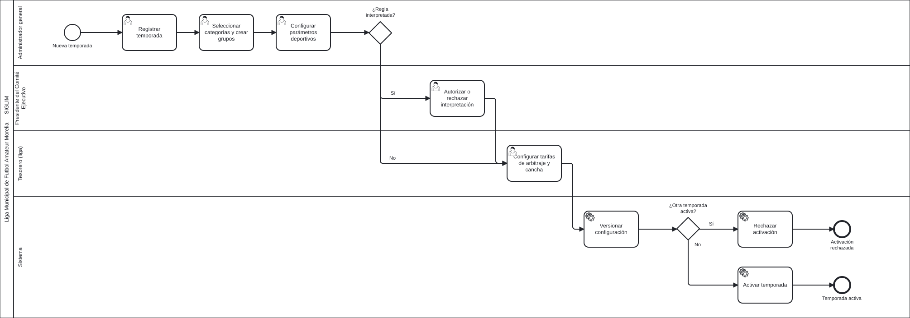

*Figura 1. P-01 Configuración de temporada.*

| Elemento | Contenido |
| --- | --- |
| Objetivo | Preparar el marco deportivo y normativo de una temporada. |
| Disparador | Decisión de abrir una nueva temporada. |
| Resultado | Temporada configurada, versionada y activa. |
| Carriles | Administrador general, Presidente del Comité Ejecutivo, Tesorero (liga), Sistema |
| Requisitos | RF-001 a RF-007, RF-099, RF-100, RF-135; CU-001, CU-002; RN-001 a RN-006, RN-058 |
| Archivo | [`procesos/P-01-configuracion-de-temporada.bpmn`](procesos/P-01-configuracion-de-temporada.bpmn) |

**Notas de modelado**

- Solo puede existir una temporada activa (RN-058): la anterior debe estar cerrada.
- Los parámetros deportivos (puntos, desempates, bloque de cancha, plazo de cédula, marcador por default, liguilla y ascensos) se capturan como configuración con valores [DEMO] hasta contar con el Reglamento.
- Una regla que requiera interpretación queda pendiente hasta que el Presidente la autorice (RF-007, RN-006).

### 5.2 P-02 Afiliación y registro de jugadores

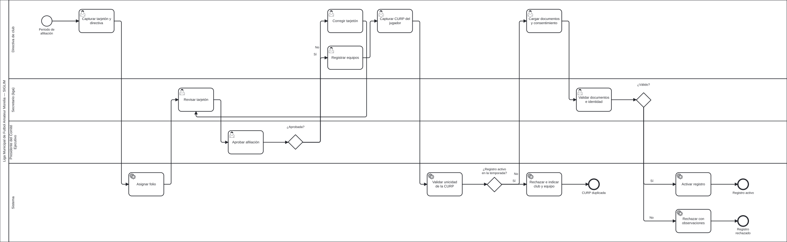

*Figura 2. P-02 Afiliación y registro de jugadores.*

| Elemento | Contenido |
| --- | --- |
| Objetivo | Afiliar al club en la temporada y registrar a sus jugadores con identidad validada por CURP. |
| Disparador | Apertura del periodo de afiliación de la temporada. |
| Resultado | Club afiliado; registros de jugador activos o rechazados con causa. |
| Carriles | Directiva de club, Secretario (liga), Presidente del Comité Ejecutivo, Sistema |
| Requisitos | RF-008 a RF-017, RF-097, RF-101, RF-102, RF-106 a RF-109; CU-003, CU-004, CU-018, CU-021; RN-037, RN-055; VAL-001, VAL-017, VAL-025 |
| Archivo | [`procesos/P-02-afiliacion-y-registro-de-jugadores.bpmn`](procesos/P-02-afiliacion-y-registro-de-jugadores.bpmn) |

**Notas de modelado**

- Una CURP no puede tener dos registros activos en la temporada, en ningún club ni categoría (RN-037, VAL-017).
- Si el jugador es menor, el registro exige el consentimiento expreso y el INE del tutor; la cuenta del tutor gestiona al menor (DEC-11, VAL-025).
- Los documentos requeridos dependen del tipo de categoría (infantil, libre o veteranos) según R2.

### 5.3 P-03 Programación manual, designación y publicación

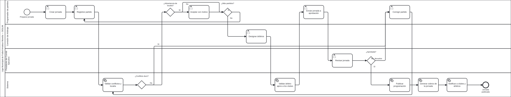

*Figura 3. P-03 Programación manual, designación y publicación.*

| Elemento | Contenido |
| --- | --- |
| Objetivo | Registrar la jornada sin conflictos duros, designar árbitros, aprobarla y publicarla. |
| Disparador | Preparación de una jornada de la temporada activa. |
| Resultado | Jornada publicada, cobros generados y participantes notificados. |
| Carriles | Programador de partidos, Comisión de Arbitraje, Presidente del Comité Ejecutivo, Sistema |
| Requisitos | RF-023, RF-033, RF-036, RF-039, RF-040, RF-115, RF-120, RF-121, RF-136; CU-006, CU-007, CU-020; RN-012 a RN-015, RN-018, RN-043, RN-048 a RN-050; VAL-003 a VAL-006, VAL-019, VAL-027 |
| Archivo | [`procesos/P-03-programacion-designacion-y-publicacion.bpmn`](procesos/P-03-programacion-designacion-y-publicacion.bpmn) |

**Notas de modelado**

- No hay programación automática (DEC-06): el programador captura cada partido.
- Restricciones duras: equipo duplicado, cancha ocupada, cancha no disponible, equipo con baja o sanción, árbitro de un club participante. Se usan los bloques de cancha de cada categoría (RN-050).
- Restricciones blandas: localía y canchas externas en las últimas diez fechas; se advierten y se aceptan con motivo (RN-048, RN-049).

### 5.4 P-04 Ciclo de vida del partido

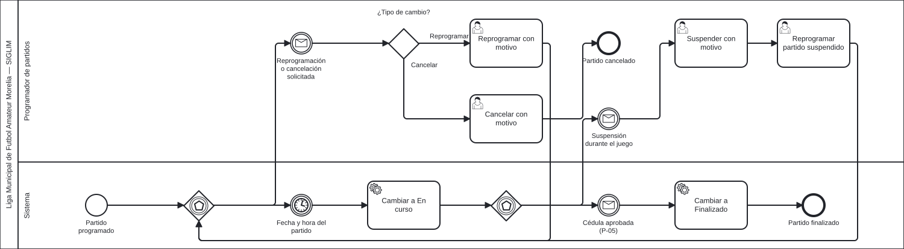

*Figura 4. P-04 Ciclo de vida del partido.*

| Elemento | Contenido |
| --- | --- |
| Objetivo | Controlar los estados del partido con trazabilidad. |
| Disparador | Publicación del partido en estado Programado. |
| Resultado | Partido Finalizado o Cancelado, con historial de transiciones. |
| Carriles | Programador de partidos, Sistema |
| Requisitos | RF-043 a RF-046, RF-127; RN-019 a RN-021; VAL-008 |
| Archivo | [`procesos/P-04-ciclo-de-vida-del-partido.bpmn`](procesos/P-04-ciclo-de-vida-del-partido.bpmn) |

**Notas de modelado**

- Estados: Programado, En curso, Finalizado, Suspendido, Reprogramado y Cancelado (DEC-23). La máquina de estados completa está en el ERS §4.3.1.
- Toda transición registra usuario, fecha y motivo; las automáticas se registran con el usuario del sistema.
- La no presentación se resuelve en la cédula con marcador por default (P-05).

### 5.5 P-05 Cédula, resultado oficial y tabla

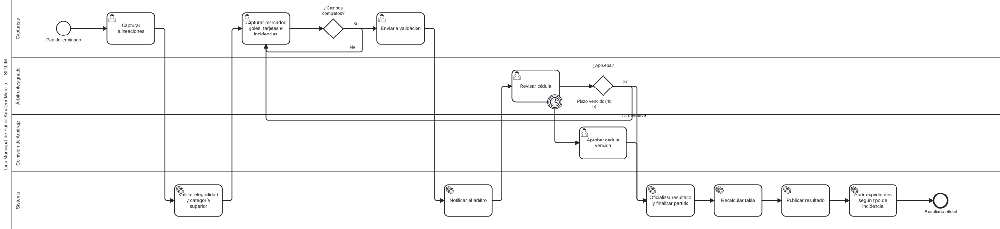

*Figura 5. P-05 Cédula, resultado oficial y tabla.*

| Elemento | Contenido |
| --- | --- |
| Objetivo | Capturar la cédula, validarla y oficializar el resultado. |
| Disparador | Partido en curso o terminado. |
| Resultado | Resultado oficial publicado, tabla actualizada y expedientes abiertos. |
| Carriles | Capturista, Árbitro designado, Comisión de Arbitraje, Sistema |
| Requisitos | RF-019, RF-020, RF-025, RF-026, RF-047 a RF-056, RF-110, RF-122 a RF-127; CU-008 a CU-010, CU-017; RN-044 a RN-047; VAL-002, VAL-018, VAL-020, VAL-021 |
| Archivo | [`procesos/P-05-cedula-resultado-oficial-y-tabla.bpmn`](procesos/P-05-cedula-resultado-oficial-y-tabla.bpmn) |

**Notas de modelado**

- El capturista nunca aprueba su propia cédula (RN-044, VAL-021).
- El plazo de validación del árbitro es configurable: 48 h [DEMO] (DEC-20). Al vencer, el temporizador de borde pasa la aprobación a la Comisión de Arbitraje.
- La cédula aprobada oficializa y publica el resultado sin revisión adicional (DEC-21).

### 5.6 P-06 Expediente, resolución y sanción

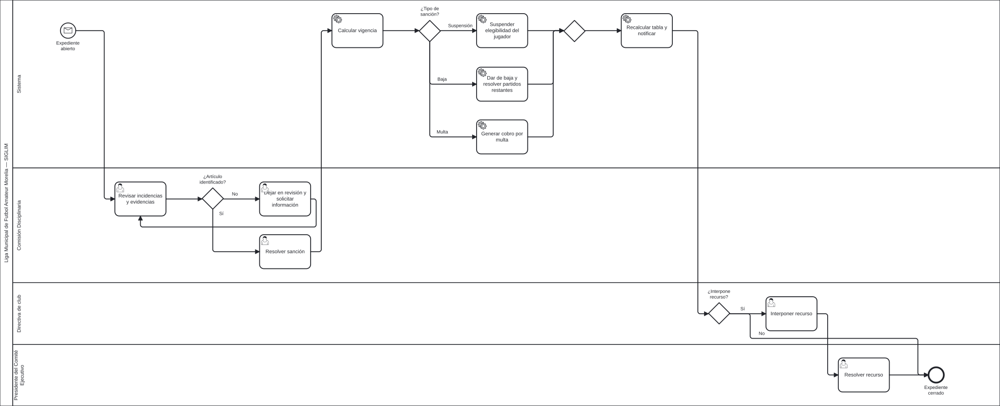

*Figura 6. P-06 Expediente, resolución y sanción.*

| Elemento | Contenido |
| --- | --- |
| Objetivo | Convertir las incidencias en una resolución trazable conforme al reglamento. |
| Disparador | Expediente abierto por una incidencia de cédula aprobada (P-05) o por un artículo automático. |
| Resultado | Sanción vigente aplicada o expediente cerrado. |
| Carriles | Sistema, Comisión Disciplinaria, Directiva de club, Presidente del Comité Ejecutivo |
| Requisitos | RF-057 a RF-068, RF-128 a RF-133; CU-011 a CU-013; RN-026 a RN-032, RN-046, RN-056, RN-057; VAL-012, VAL-013 |
| Archivo | [`procesos/P-06-expediente-resolucion-y-sancion.bpmn`](procesos/P-06-expediente-resolucion-y-sancion.bpmn) |

**Notas de modelado**

- El catálogo de artículos define tipo de sanción, sujeto, efecto (hacia adelante o retroactivo) y si se aplica automáticamente (DEC-30).
- Baja de equipo: los partidos restantes se otorgan por default al rival; con efecto retroactivo pierde además los partidos en que participó la persona sancionada (RN-056).
- Una multa genera un cobro en tesorería (RF-133). El recurso lo resuelve el Presidente como segunda instancia (DEC-31).

### 5.7 P-07 Ascenso, descenso y clasificación

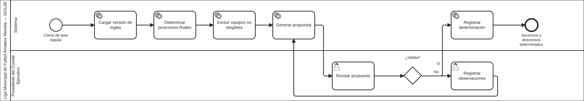

*Figura 7. P-07 Ascenso, descenso y clasificación.*

| Elemento | Contenido |
| --- | --- |
| Objetivo | Proponer y validar ascensos y descensos al cierre de la fase regular. |
| Disparador | Cierre de la fase regular de la temporada. |
| Resultado | Determinación de ascensos y descensos validada. |
| Carriles | Sistema, Presidente del Comité Ejecutivo |
| Requisitos | RF-069 a RF-075; CU-014; RN-033 a RN-035, RN-052 |
| Archivo | [`procesos/P-07-ascenso-descenso-y-clasificacion.bpmn`](procesos/P-07-ascenso-descenso-y-clasificacion.bpmn) |

**Notas de modelado**

- Valores [DEMO]: 2 equipos suben y 2 bajan entre categorías adyacentes (DEC-29).
- No asciende un equipo con adeudos, con sanción de baja o cuyo club ya tenga equipo en la categoría superior (RN-052).

### 5.8 P-08 Liguilla y fases finales

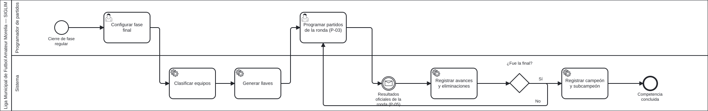

*Figura 8. P-08 Liguilla y fases finales.*

| Elemento | Contenido |
| --- | --- |
| Objetivo | Configurar y llevar la fase final hasta determinar campeón y subcampeón. |
| Disparador | Cierre de la fase regular de la temporada. |
| Resultado | Campeón y subcampeón registrados. |
| Carriles | Programador de partidos, Sistema |
| Requisitos | RF-076 a RF-081; CU-015; RN-036 |
| Archivo | [`procesos/P-08-liguilla-y-fases-finales.bpmn`](procesos/P-08-liguilla-y-fases-finales.bpmn) |

**Notas de modelado**

- Valores [DEMO]: 8 clasificados por grupo, eliminación directa a partido único y penales registrados en la cédula si hay empate (DEC-28).
- Los partidos de la fase final se programan manualmente (P-03) y se juegan con cédula (P-05).

### 5.9 P-09 Publicación del portal (comunicados)

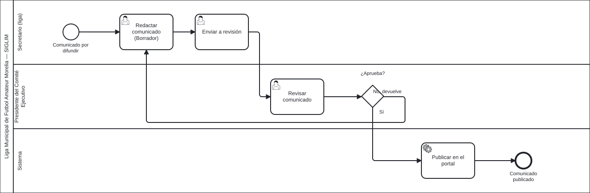

*Figura 9. P-09 Publicación del portal (comunicados).*

| Elemento | Contenido |
| --- | --- |
| Objetivo | Llevar los comunicados por el flujo Borrador → Revisión → Publicado. |
| Disparador | Necesidad de difundir un comunicado oficial. |
| Resultado | Comunicado publicado en el portal. |
| Carriles | Secretario (liga), Presidente del Comité Ejecutivo, Sistema |
| Requisitos | RF-056, RF-086, RF-090; CU-027; RN-025; VAL-014 |
| Archivo | [`procesos/P-09-publicacion-de-comunicados.bpmn`](procesos/P-09-publicacion-de-comunicados.bpmn) |

**Notas de modelado**

- La programación sigue el mismo flujo de aprobación dentro de P-03.
- Los resultados oficiales y la tabla se publican automáticamente al aprobarse la cédula (P-05, DEC-21); las sanciones, cuando la Comisión Disciplinaria las autoriza (RF-068).

### 5.10 P-10 Préstamo, comodato y oferta de cancha

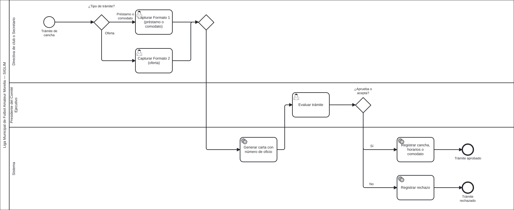

*Figura 10. P-10 Préstamo, comodato y oferta de cancha.*

| Elemento | Contenido |
| --- | --- |
| Objetivo | Tramitar el uso o la oferta de canchas con los formatos del cliente. |
| Disparador | Un club necesita cancha o un club o externo ofrece la suya. |
| Resultado | Cancha y horarios registrados, o trámite rechazado. |
| Carriles | Directiva de club o Secretario, Presidente del Comité Ejecutivo, Sistema |
| Requisitos | RF-116 a RF-119; CU-024, CU-025; RN-048 |
| Archivo | [`procesos/P-10-prestamo-comodato-y-oferta-de-cancha.bpmn`](procesos/P-10-prestamo-comodato-y-oferta-de-cancha.bpmn) |

**Notas de modelado**

- Formato 1 (préstamo o comodato): estados Pendiente, Aprobada y No aprobada. Formato 2 (oferta): Pendiente de negociación, Aceptada y Rechazada (R8, DEC-35).
- Si el oferente es externo y no tiene cuenta, el Secretario de la liga captura la oferta.

### 5.11 P-11 Cobros y pagos

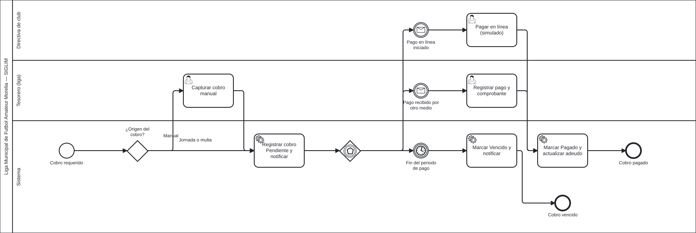

*Figura 11. P-11 Cobros y pagos.*

| Elemento | Contenido |
| --- | --- |
| Objetivo | Generar los cobros de la temporada y registrar su pago. |
| Disparador | Jornada publicada, cobro manual del Tesorero o sanción de multa. |
| Resultado | Cobro pagado o vencido. |
| Carriles | Directiva de club, Tesorero (liga), Sistema |
| Requisitos | RF-133, RF-135 a RF-141; CU-023; RN-051; VAL-028 |
| Archivo | [`procesos/P-11-cobros-y-pagos.bpmn`](procesos/P-11-cobros-y-pagos.bpmn) |

**Notas de modelado**

- El pago en línea es simulado: no hay pasarela real (DEC-37).
- Los cobros por jornada publicada y por multa los genera el sistema; los manuales los captura el Tesorero.
- Un cobro vencido alimenta el artículo de baja por falta de pago (RF-141, P-06).

### 5.12 P-12 Venta de equipo y conservación de plaza

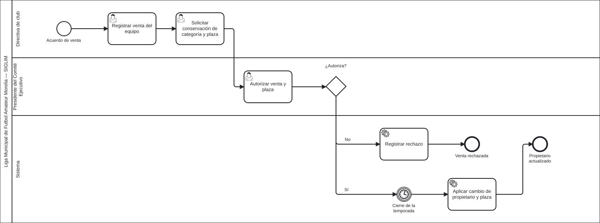

*Figura 12. P-12 Venta de equipo y conservación de plaza.*

| Elemento | Contenido |
| --- | --- |
| Objetivo | Registrar el cambio de propietario de un equipo y, por separado, la conservación de su plaza. |
| Disparador | Acuerdo de venta entre dos clubes. |
| Resultado | Cambio aplicado al cierre de la temporada con historial de propietarios. |
| Carriles | Directiva de club, Presidente del Comité Ejecutivo, Sistema |
| Requisitos | RF-103, RF-104; CU-026; RN-040 |
| Archivo | [`procesos/P-12-venta-de-equipo-y-plaza.bpmn`](procesos/P-12-venta-de-equipo-y-plaza.bpmn) |

**Notas de modelado**

- La venta y la conservación de la plaza deportiva son operaciones independientes; ambas requieren autorización del Presidente (DEC-14).
- La venta no transfiere el registro de los jugadores: los registros siguen sus propias reglas (RN-039).

### 5.13 P-13 Cambio de permisos con control dual

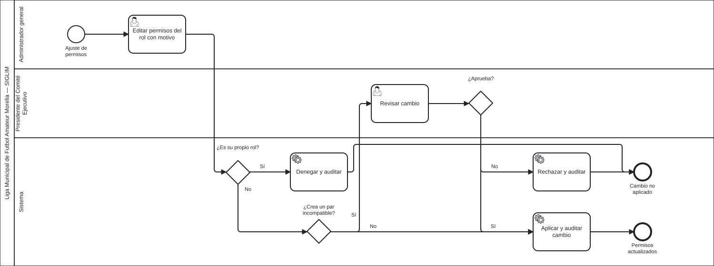

*Figura 13. P-13 Cambio de permisos con control dual.*

| Elemento | Contenido |
| --- | --- |
| Objetivo | Modificar los permisos de un rol sin romper la separación de funciones. |
| Disparador | Necesidad de ajustar los permisos de un rol. |
| Resultado | Cambio aplicado o rechazado, siempre auditado. |
| Carriles | Administrador general, Presidente del Comité Ejecutivo, Sistema |
| Requisitos | RF-094 a RF-096; CU-022; RN-053; VAL-022, VAL-023 |
| Archivo | [`procesos/P-13-cambio-de-permisos-con-control-dual.bpmn`](procesos/P-13-cambio-de-permisos-con-control-dual.bpmn) |

**Notas de modelado**

- El Administrador no puede modificar los permisos de su propio rol (VAL-022).
- Pares incompatibles iniciales [PROPUESTA]: capturar y validar cédula; programar y aprobar programación; resolver expediente y resolver recurso; redactar y aprobar comunicados; modificar permisos y aprobar pares incompatibles.

## 6. Cambios respecto a la versión 1.0

| Aspecto | Versión 1.0 | Versión 2.0 |
| --- | --- | --- |
| Procesos | P-01 a P-09. | P-01 a P-13: se agregan préstamo y oferta de cancha (P-10), cobros (P-11), venta de equipo (P-12) y control dual de permisos (P-13). |
| Participantes | «Administración», «Autoridad», «usuario autorizado», «por definir». | Los 12 tipos de usuario del ERS Rev. 0.4 (§2.3) como carriles, más el carril Sistema. |
| P-03 | Generación automática de la programación con restricciones duras y blandas. | Programación manual con validación de conflictos y aprobación del Presidente; la programación automática queda fuera del alcance (DEC-06, ERS §2.6). |
| P-04 | Estados SUSPENDIDO, CANCELADO, NO PROGRAMADO y RESUELTO ADMINISTRATIVAMENTE. | Seis estados: Programado, En curso, Finalizado, Suspendido, Reprogramado y Cancelado (ERS §4.3.1). |
| P-05 y P-06 | Resultado capturado y validado por un usuario autorizado; la cédula iniciaba el expediente. | Cédula capturada por el Capturista y aprobada por el árbitro; al vencer el plazo [DEMO] la aprueba la Comisión de Arbitraje. Al aprobarse, el resultado es oficial, se publica y las incidencias abren expedientes. |
| Notación | Diagramas de imagen. | Archivos BPMN 2.0 (XML con diagrama) que se abren y editan en cualquier modelador compatible, más SVG y PNG. |

## 7. Archivos y regeneración

| Carpeta | Contenido |
| --- | --- |
| `procesos/` | Un archivo `.bpmn` (BPMN 2.0 con diagrama) por proceso; se abre en bpmn.io, Camunda Modeler u otro modelador. |
| `figuras/` | SVG y PNG de cada proceso, renderizados con bpmn-js. |
| `fuente/` | `procesos.py` (definición de los procesos), `generar_bpmn.py` (XML y distribución), `render.mjs` (validación y figuras) y `generar_documento.py` (este documento). |

Para modificar un proceso se edita `fuente/procesos.py` y se regeneran los archivos (ver
`fuente/README.md`). Editar un `.bpmn` a mano en un modelador también es válido, pero entonces
`procesos.py` deja de ser la fuente y debe actualizarse para no perder el cambio.
