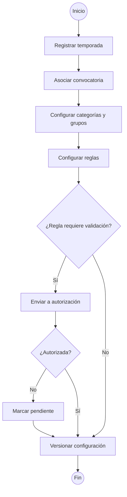
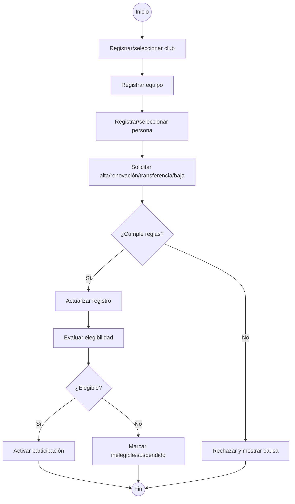
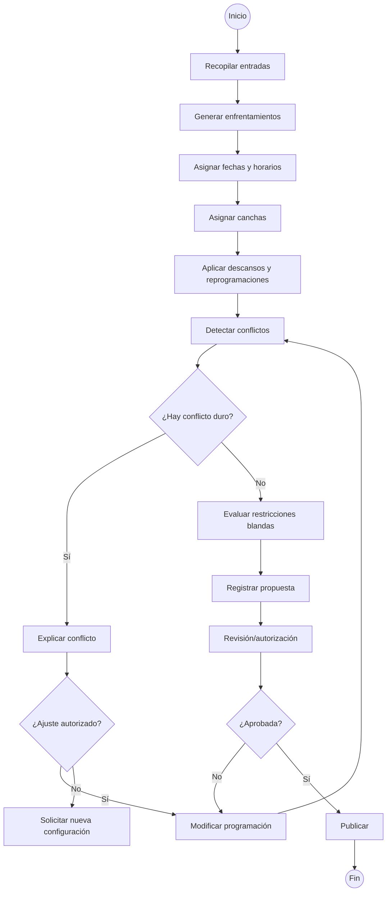
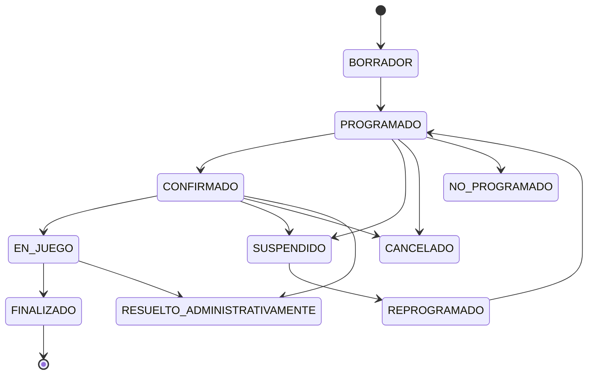
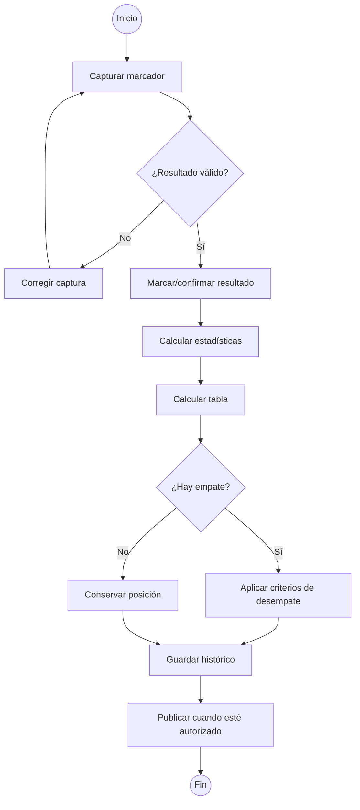
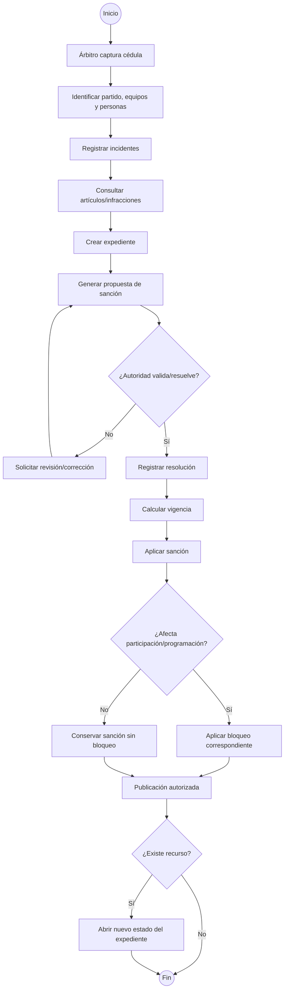
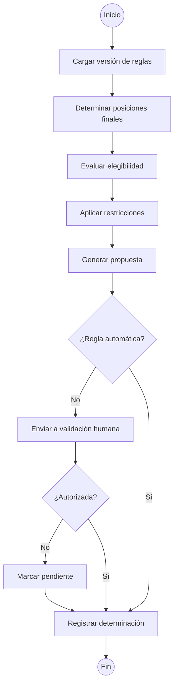
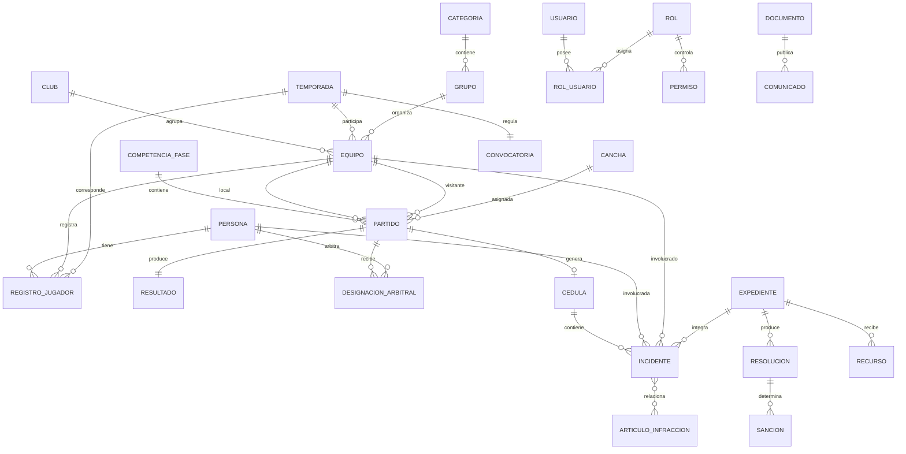

# Sistema de Gestión de la Liga Municipal de Futbol Amateur Morelia

> **Estado del documento:** Base técnica para ERS/SRS, UML, diseño, desarrollo, pruebas y despliegue.
>
> **Etiquetas de certeza:**
> - **[CONFIRMADO]**: respaldado explícitamente por las fuentes disponibles.
> - **[INFERIDO]**: deducido razonablemente a partir del dominio y de información explícita.
> - **[PROPUESTA]**: recomendación técnica del análisis; requiere validación.
> - **[PENDIENTE]**: necesita definición antes de convertirlo en requisito definitivo.
> - **[CONTRADICCIÓN]**: existe información incompatible entre fuentes o definiciones.
>
> **Nota de fuente:** el archivo de audio adjunto está disponible como material de levantamiento, pero el entorno no pudo extraer una transcripción confiable. Por precisión, este documento no atribuye al audio ninguna respuesta que no pueda verificarse. Los puntos que deben validarse mediante el audio quedan señalados como pendientes y la presentación se utiliza como base textual verificable.

---

## 1. Información general del sistema

### 1.1 Identificación

| Elemento | Valor | Estado |
| --- | --- | --- |
| Nombre | Sistema de Gestión de la Liga Municipal de Futbol Amateur Morelia | **[CONFIRMADO]** |
| Tipo | Plataforma web de gestión deportiva con portal público e información interna | **[CONFIRMADO]** |
| Contexto | Liga Municipal de Futbol Amateur Morelia | **[CONFIRMADO]** |
| Documento base | Visión, alcance y requerimientos preliminares | **[CONFIRMADO]** |
| Horizonte académico | Proyecto de Ingeniería de Software; desarrollo planificado en 10 semanas | **[CONFIRMADO]** |

### 1.2 Propósito

El sistema debe convertir y soportar la operación de la Liga en una plataforma integral para administrar temporadas, clubes, equipos, jugadores, árbitros, canchas, programación, partidos, resultados, disciplina y competencias; además debe exponer al público la información que la Liga autorice publicar. **[CONFIRMADO]**

### 1.3 Problemas que debe resolver

- Operación distribuida de temporadas, equipos, jugadores, árbitros, canchas, partidos y disciplina. **[CONFIRMADO]**
- Necesidad de generar programación a partir de datos y restricciones, evitando conflictos operativos. **[CONFIRMADO]**
- Necesidad de conservar históricos y evitar sobrescribir información de temporadas anteriores. **[CONFIRMADO]**
- Necesidad de controlar estados, aprobaciones, publicaciones y cambios críticos con trazabilidad. **[CONFIRMADO]**
- Necesidad de parametrizar reglas deportivas y disciplinarias por temporada/convocatoria sin convertir interpretaciones administrativas en reglas permanentes. **[CONFIRMADO]**
- Necesidad de separar información interna de información pública. **[CONFIRMADO]**
- Necesidad de transformar procesos y reglas reales de la Liga en requisitos verificables. **[CONFIRMADO]**

### 1.4 Objetivo general

Diseñar e implementar una solución mantenible y evolutiva que permita administrar el ciclo completo de las competencias de la Liga, desde la configuración de una temporada y sus reglas hasta la programación, resultados, disciplina, clasificación, liguillas, ascensos/descensos y publicación de información autorizada. **[CONFIRMADO]**

### 1.5 Alcance conocido

Incluye:

- Administración de organización y usuarios.
- Temporadas, convocatorias, categorías, grupos y competencias/fases.
- Clubes, equipos, jugadores, delegados y árbitros.
- Registro de jugadores con alta, baja, renovación y transferencia según reglas.
- Canchas, sedes, disponibilidad, bloqueos y mantenimiento.
- Generación automática y ajuste manual autorizado de programación.
- Partidos y su ciclo de vida.
- Resultados, tablas y estadísticas.
- Disciplina, sanciones, castigados, recursos e inconformidades.
- Ascensos, descensos, liguillas y fases finales.
- Reportes.
- Portal público con programación, resultados, tablas, calendario, noticias/comunicados, sanciones autorizadas y buscador.
- Auditoría, control de acceso, protección de datos, respaldo y recuperación.
- Integraciones potenciales con correo, WhatsApp/SMS, almacenamiento documental, mapas, CSV/Excel, API pública y autenticación externa, sujetas a justificación. **[CONFIRMADO]**

### 1.6 Fuera del alcance / no definido

No queda definido que todas las integraciones posibles deban implementarse. Tampoco queda definido el stack tecnológico concreto, el algoritmo exacto de programación, los umbrales cuantitativos de rendimiento/disponibilidad, ni el detalle final de cada permiso. **[PENDIENTE]**

### 1.7 Contexto operativo

La operación observada se organiza alrededor de una estructura deportiva de:

```text
Temporada
  └── Categoría
      └── Grupo
          └── Equipos
              └── Partidos
```

Las programaciones observadas incluyen categorías como Primera Especial, Primera Fuerza, Reserva, Intermedia, Segunda, Tercera, Juvenil, Cuarta y Veteranos. Una categoría puede contener uno o varios grupos y el modelo debe permitir nuevas categorías sin rediseño. **[CONFIRMADO]**

---

## 2. Actores y tipos de usuario

### 2.1 Actores identificados

| Actor | Descripción | Responsabilidades | Permisos/Acciones |
| --- | --- | --- | --- |
| Administrador general | Usuario con control administrativo del sistema | Administración global del sistema | **[PENDIENTE]**; debe definirse catálogo exacto de acciones |
| Presidente del Comité Ejecutivo | Autoridad de gobierno de la Liga | Participación en decisiones y aprobaciones según facultades | **[PENDIENTE]**; permisos exactos |
| Secretario | Cargo organizacional | Funciones administrativas y documentales según facultades | **[PENDIENTE]** |
| Tesorero | Cargo organizacional | Funciones administrativas/financieras de su ámbito | **[PENDIENTE]**; no se definió un módulo financiero explícito |
| Comisión Disciplinaria | Autoridad para tratamiento disciplinario | Consulta de artículos, expediente, resolución y sanción | Revisar expedientes; intervenir en resolución según facultades **[CONFIRMADO/PENDIENTE en detalle]** |
| Comisión de Arbitraje | Órgano relacionado con árbitros | Gestión/participación en asignaciones y arbitraje | Catálogo, disponibilidad, designaciones y restricciones según reglas **[CONFIRMADO/PENDIENTE]** |
| Programador de partidos | Responsable de programación | Generar, revisar y ajustar programación | Generación automática; ajuste manual autorizado **[CONFIRMADO]** |
| Presidente/delegado de club | Representante del club/equipo | Gestión de información del club/equipo y trámites que correspondan | **[PENDIENTE]**; definir acciones exactas |
| Árbitro | Responsable arbitral del partido | Capturar cédula e incidencias | Registrar cédula e incidencias **[CONFIRMADO]** |
| Capturista | Usuario operativo de captura | Registrar información operativa | Capturar información autorizada; ejemplo explícito: cédula **[CONFIRMADO]** |
| Jugador | Persona participante en competencia | Participar conforme a elegibilidad | Consulta/gestión de su información **[PENDIENTE]** |
| Usuario público | Visitante sin privilegios de edición | Consultar información publicada | Consultar programación, resultados, tablas, calendario, noticias/comunicados, sanciones autorizadas, equipos/competencias y buscador **[CONFIRMADO]** |

### 2.2 Modelo de autorización

- Control de acceso basado en roles (RBAC). **[CONFIRMADO]**
- Permisos por módulo y acción. **[CONFIRMADO]**
- Separación de funciones. **[CONFIRMADO]**
- El portal público no debe tener privilegios de edición. **[CONFIRMADO]**
- Cada permiso debe modelarse explícitamente; no todos los usuarios tienen las mismas capacidades. **[CONFIRMADO]**

### 2.3 Separación de funciones relevante

Caso expresamente indicado:

```text
Capturista
   │ registra cédula
   ▼
Cédula / Incidentes
   │
   ▼
Comisión / Autoridad distinta
   │ resuelve
   ▼
Resolución / Sanción
```

**[CONFIRMADO]** La separación exacta entre cargos, comisiones y autoridades debe formalizarse mediante una matriz de permisos.

---

## 3. Requisitos funcionales

### 3.1 Criterio

Los siguientes requisitos convierten el alcance y los casos críticos identificados en comportamientos verificables del sistema. No se define implementación interna.

### 3.2 Gestión de temporadas, convocatorias y configuración deportiva

| ID | Requisito | Actor | Prioridad | Descripción |
| --- | --- | --- | --- | --- |
| RF-001 | Gestionar temporadas | Administrador general / autoridad autorizada | **[PENDIENTE]** | El sistema debe permitir registrar y administrar temporadas como periodos deportivos. |
| RF-002 | Asociar convocatoria a temporada | Usuario autorizado | **[PENDIENTE]** | El sistema debe asociar el documento normativo correspondiente a una temporada. |
| RF-003 | Conservar histórico de temporadas | Usuario autorizado | **[PENDIENTE]** | El sistema debe conservar información histórica sin sobrescribir temporadas anteriores. |
| RF-004 | Gestionar categorías por temporada | Usuario autorizado | **[PENDIENTE]** | El sistema debe permitir que las categorías puedan variar entre temporadas. |
| RF-005 | Gestionar grupos por categoría y temporada | Usuario autorizado | **[PENDIENTE]** | El sistema debe permitir uno o varios grupos por categoría de una temporada. |
| RF-006 | Configurar reglas versionables | Usuario autorizado | **[PENDIENTE]** | El sistema debe almacenar reglas de ascenso/descenso y otras reglas configurables asociadas a su temporada/convocatoria. |
| RF-007 | Registrar reglas interpretadas como pendientes de validación | Autoridad autorizadora | **[PENDIENTE]** | El sistema no debe convertir automáticamente una interpretación administrativa en una regla permanente; debe permitir su validación/autorización. |

### 3.3 Clubes, equipos y personas

| ID | Requisito | Actor | Prioridad | Descripción |
| --- | --- | --- | --- | --- |
| RF-008 | Gestionar clubes | Administrador / usuario autorizado | **[PENDIENTE]** | El sistema debe registrar y administrar clubes afiliados. |
| RF-009 | Gestionar equipos | Administrador / usuario autorizado | **[PENDIENTE]** | El sistema debe registrar equipos como representación deportiva de un club dentro de categoría/grupo/temporada. |
| RF-010 | Reutilizar identidad de persona | Usuario autorizado | **[PENDIENTE]** | El sistema debe mantener una identidad de persona reutilizable en diferentes roles. |
| RF-011 | Mantener roles de persona separados de su identidad | Usuario autorizado | **[PENDIENTE]** | El sistema debe permitir que una persona sea jugador, delegado, árbitro o directivo sin duplicar su identidad. |
| RF-012 | Mantener historial de pertenencia | Usuario autorizado | **[PENDIENTE]** | El sistema debe conservar el historial de un jugador por temporadas/equipos. |

### 3.4 Registro y elegibilidad de jugadores

| ID | Requisito | Actor | Prioridad | Descripción |
| --- | --- | --- | --- | --- |
| RF-013 | Dar de alta jugador | Usuario autorizado | **[PENDIENTE]** | El sistema debe registrar el alta de un jugador conforme a las reglas de la Liga. |
| RF-014 | Dar de baja jugador | Usuario autorizado | **[PENDIENTE]** | El sistema debe registrar la baja de un jugador conservando su historial. |
| RF-015 | Renovar registro de jugador | Usuario autorizado | **[PENDIENTE]** | El sistema debe permitir renovación conforme a las reglas de la temporada. |
| RF-016 | Transferir jugador | Usuario autorizado | **[PENDIENTE]** | El sistema debe soportar transferencias conforme a las reglas aplicables. |
| RF-017 | Registrar estado de elegibilidad | Usuario autorizado | **[PENDIENTE]** | El sistema debe manejar estados como activo, suspendido, baja e inelegible. |
| RF-018 | Mantener historial de cambios de registro | Usuario autorizado | **[PENDIENTE]** | El sistema debe registrar cambios de estado y registro del jugador. |
| RF-019 | Validar elegibilidad antes de participación | Sistema / usuario autorizado | **[PENDIENTE]** | El sistema debe comprobar la elegibilidad antes de permitir una participación cuando la regla así lo exija. |
| RF-020 | Bloquear participación por sanción vigente | Sistema | **[PENDIENTE]** | Cuando una sanción vigente impida participar, el sistema debe impedir la acción correspondiente y explicar el motivo. |

### 3.5 Árbitros y designaciones

| ID | Requisito | Actor | Prioridad | Descripción |
| --- | --- | --- | --- | --- |
| RF-021 | Gestionar catálogo de árbitros | Comisión de Arbitraje / usuario autorizado | **[PENDIENTE]** | El sistema debe mantener el catálogo de árbitros. |
| RF-022 | Gestionar disponibilidad arbitral | Comisión de Arbitraje / usuario autorizado | **[PENDIENTE]** | El sistema debe registrar disponibilidad de árbitros. |
| RF-023 | Designar árbitros a partido | Comisión de Arbitraje / usuario autorizado | **[PENDIENTE]** | El sistema debe asignar árbitros a partidos. |
| RF-024 | Consultar historial de designaciones | Usuario autorizado | **[PENDIENTE]** | El sistema debe conservar el historial de designaciones. |
| RF-025 | Registrar cédula arbitral | Árbitro / capturista autorizado | **[PENDIENTE]** | El sistema debe permitir registrar la cédula asociada a un partido. |
| RF-026 | Registrar incidencias de arbitraje | Árbitro / capturista autorizado | **[PENDIENTE]** | El sistema debe registrar incidencias de la cédula y relacionarlas con el partido y participantes. |

### 3.6 Canchas y sedes

| ID | Requisito | Actor | Prioridad | Descripción |
| --- | --- | --- | --- | --- |
| RF-027 | Gestionar catálogo de canchas | Usuario autorizado | **[PENDIENTE]** | El sistema debe registrar canchas y sus características conocidas. |
| RF-028 | Gestionar sedes | Usuario autorizado | **[PENDIENTE]** | El sistema debe representar sedes utilizadas por las programaciones. |
| RF-029 | Registrar disponibilidad temporal | Usuario autorizado | **[PENDIENTE]** | El sistema debe administrar disponibilidad por fecha/hora. |
| RF-030 | Bloquear cancha | Usuario autorizado | **[PENDIENTE]** | El sistema debe permitir bloquear una cancha cuando corresponda. |
| RF-031 | Registrar mantenimiento | Usuario autorizado | **[PENDIENTE]** | El sistema debe representar bloqueos o periodos de mantenimiento. |
| RF-032 | Considerar partidos consecutivos | Sistema | **[PENDIENTE]** | El sistema debe contemplar la capacidad de una cancha para recibir partidos consecutivos al generar programación. |

### 3.7 Programación

| ID | Requisito | Actor | Prioridad | Descripción |
| --- | --- | --- | --- | --- |
| RF-033 | Registrar programación | Programador / usuario autorizado | **[PENDIENTE]** | El sistema debe manejar la programación por categoría, grupo, equipos, cancha, sede, fecha y hora. |
| RF-034 | Generar enfrentamientos | Sistema | **[PENDIENTE]** | El sistema debe generar los enfrentamientos de acuerdo con la configuración y reglas disponibles. |
| RF-035 | Asignar fechas y horarios | Sistema | **[PENDIENTE]** | El sistema debe asignar fechas y horarios a los partidos programables. |
| RF-036 | Asignar canchas | Sistema | **[PENDIENTE]** | El sistema debe asignar canchas o sedes disponibles evitando conflictos duros. |
| RF-037 | Aplicar descansos | Sistema | **[PENDIENTE]** | El sistema debe aplicar los descansos que correspondan. |
| RF-038 | Aplicar reprogramaciones | Sistema / usuario autorizado | **[PENDIENTE]** | El sistema debe contemplar reprogramaciones. |
| RF-039 | Detectar conflictos de programación | Sistema | **[PENDIENTE]** | El sistema debe detectar conflictos como equipo duplicado, cancha ocupada, sanción o cancha no disponible. |
| RF-040 | Permitir ajuste manual autorizado | Programador / usuario autorizado | **[PENDIENTE]** | El sistema debe permitir modificar manualmente la programación con autorización. |
| RF-041 | Registrar causa de generación/modificación | Sistema | **[PENDIENTE]** | El sistema debe registrar por qué una programación fue generada o modificada. |
| RF-042 | Explicar conflictos sin solución | Sistema | **[PENDIENTE]** | Cuando no exista una solución válida, el sistema debe explicar los conflictos que impiden generarla. |

### 3.8 Partidos y ciclo de vida

| ID | Requisito | Actor | Prioridad | Descripción |
| --- | --- | --- | --- | --- |
| RF-043 | Gestionar estado del partido | Usuario autorizado / sistema | **[PENDIENTE]** | El sistema debe manejar los estados del ciclo de vida del partido. |
| RF-044 | Mantener historial del partido | Sistema | **[PENDIENTE]** | El sistema no debe eliminar partidos con historial. |
| RF-045 | Auditar transiciones de estado | Sistema | **[PENDIENTE]** | Cada transición debe conservar usuario, fecha y motivo. |
| RF-046 | Restringir acciones por estado | Sistema | **[PENDIENTE]** | El estado del partido debe determinar las acciones permitidas. |

### 3.9 Resultados, tablas y estadísticas

| ID | Requisito | Actor | Prioridad | Descripción |
| --- | --- | --- | --- | --- |
| RF-047 | Capturar marcador | Usuario autorizado | **[PENDIENTE]** | El sistema debe permitir registrar el marcador y estado del resultado. |
| RF-048 | Validar resultado | Usuario/autoridad autorizada | **[PENDIENTE]** | El sistema debe permitir identificar cuándo un resultado queda validado/oficial. |
| RF-049 | Calcular tabla automáticamente | Sistema | **[PENDIENTE]** | El sistema debe calcular PJ, resultados, goles y puntos según reglas configuradas. |
| RF-050 | Parametrizar desempates | Usuario autorizado | **[PENDIENTE]** | El sistema debe soportar criterios de desempate configurables. |
| RF-051 | Mantener histórico de tabla | Sistema | **[PENDIENTE]** | El sistema debe conservar el estado histórico de la tabla por fecha. |
| RF-052 | Recalcular tras corrección autorizada | Sistema | **[PENDIENTE]** | El sistema debe recalcular las tablas cuando se corrija un resultado de forma autorizada. |
| RF-053 | Calcular estadísticas de equipo | Sistema | **[PENDIENTE]** | El sistema debe producir PJ, PG, PE, PP, GF, GC, DG, puntos y posición. |
| RF-054 | Calcular estadísticas de jugador cuando haya datos | Sistema | **[PENDIENTE]** | El sistema debe calcular participaciones, goles, tarjetas y sanciones cuando los datos estén disponibles. |
| RF-055 | Separar dato oficial de indicador calculado | Sistema | **[PENDIENTE]** | El sistema debe distinguir información oficial de métricas derivadas. |
| RF-056 | Publicar sólo información validada | Usuario autorizado / sistema | **[PENDIENTE]** | El portal sólo debe mostrar resultados y datos que hayan sido validados y publicados. |

### 3.10 Disciplina

| ID | Requisito | Actor | Prioridad | Descripción |
| --- | --- | --- | --- | --- |
| RF-057 | Generar expediente disciplinario | Sistema | **[PENDIENTE]** | El sistema debe permitir construir un expediente a partir de una cédula e incidentes. |
| RF-058 | Relacionar incidentes con personas/equipos | Sistema / usuario autorizado | **[PENDIENTE]** | Cada incidente debe quedar relacionado con las personas y/o equipos involucrados. |
| RF-059 | Registrar evidencias | Comisión / autoridad autorizada | **[PENDIENTE]** | El sistema debe permitir asociar evidencias al expediente cuando existan. |
| RF-060 | Consultar artículos/infracciones | Comisión Disciplinaria / autoridad | **[PENDIENTE]** | El sistema debe permitir consultar el catálogo de artículos e infracciones aplicables. |
| RF-061 | Generar propuesta de sanción | Sistema | **[PENDIENTE]** | El sistema debe generar una propuesta automática basada en la correspondencia de artículo a sanción, sujeta a validación humana. |
| RF-062 | Validar y resolver sanción | Autoridad competente | **[PENDIENTE]** | El sistema debe permitir que una autoridad resuelva el expediente y establezca la sanción correspondiente. |
| RF-063 | Calcular vigencia de sanción | Sistema | **[PENDIENTE]** | El sistema debe calcular y conservar la vigencia derivada de la resolución. |
| RF-064 | Aplicar bloqueo derivado de sanción | Sistema | **[PENDIENTE]** | Cuando corresponda, la sanción debe afectar elegibilidad, participación y/o programación según la regla configurada. |
| RF-065 | Mantener resolución inmutable | Sistema | **[PENDIENTE]** | El historial de resolución debe conservarse sin alteración destructiva. |
| RF-066 | Gestionar lista de castigados | Usuario autorizado / sistema | **[PENDIENTE]** | El sistema debe generar y mantener la lista de personas/equipos castigados según sanciones vigentes. |
| RF-067 | Gestionar recursos de inconformidad | Autoridad / usuario autorizado | **[PENDIENTE]** | El sistema debe registrar un recurso y abrir un nuevo estado del expediente. |
| RF-068 | Publicar sanciones autorizadas | Usuario autorizado | **[PENDIENTE]** | El sistema debe permitir publicar únicamente las sanciones autorizadas para difusión pública. |

### 3.11 Ascensos, descensos y liguilla

| ID | Requisito | Actor | Prioridad | Descripción |
| --- | --- | --- | --- | --- |
| RF-069 | Configurar reglas de ascenso/descenso | Usuario autorizado | **[PENDIENTE]** | El sistema debe almacenar las reglas correspondientes a la temporada/convocatoria. |
| RF-070 | Determinar posiciones finales | Sistema | **[PENDIENTE]** | El sistema debe determinar las posiciones finales de acuerdo con resultados y reglas. |
| RF-071 | Evaluar elegibilidad | Sistema / autoridad | **[PENDIENTE]** | El sistema debe evaluar la elegibilidad para ascenso/descenso. |
| RF-072 | Aplicar restricciones documentadas | Sistema | **[PENDIENTE]** | El sistema debe considerar las restricciones definidas en la normativa aplicable. |
| RF-073 | Generar propuesta de ascenso/descenso | Sistema | **[PENDIENTE]** | El sistema debe generar una propuesta cuando la regla sea automatizable. |
| RF-074 | Solicitar validación en casos no automáticos | Sistema / autoridad | **[PENDIENTE]** | El sistema debe requerir validación humana cuando la regla no sea automática. |
| RF-075 | Guardar versión de reglas utilizada | Sistema | **[PENDIENTE]** | El sistema debe identificar qué versión normativa/configuración produjo la propuesta o resultado. |
| RF-076 | Configurar fases finales | Usuario autorizado | **[PENDIENTE]** | El sistema debe permitir definir fase y formato de competencia. |
| RF-077 | Clasificar equipos a fase final | Sistema | **[PENDIENTE]** | El sistema debe clasificar equipos conforme a las reglas aplicables. |
| RF-078 | Generar llaves y calendario de fase final | Sistema | **[PENDIENTE]** | El sistema debe generar llaves/calendario. |
| RF-079 | Resolver empates de fase final | Sistema | **[PENDIENTE]** | El sistema debe resolver empates de acuerdo con las reglas configuradas. |
| RF-080 | Registrar avances y eliminaciones | Sistema | **[PENDIENTE]** | El sistema debe conservar el avance de equipos en fases finales. |
| RF-081 | Determinar campeón y subcampeón | Sistema | **[PENDIENTE]** | El sistema debe registrar los resultados finales de la competencia. |

### 3.12 Portal público, reportes y auditoría

| ID | Requisito | Actor | Prioridad | Descripción |
| --- | --- | --- | --- | --- |
| RF-082 | Consultar programación semanal | Usuario público | **[PENDIENTE]** | El portal debe mostrar la programación semanal publicada. |
| RF-083 | Consultar resultados | Usuario público | **[PENDIENTE]** | El portal debe mostrar resultados validados/publicados. |
| RF-084 | Consultar tablas | Usuario público | **[PENDIENTE]** | El portal debe mostrar tablas publicadas. |
| RF-085 | Consultar calendario | Usuario público | **[PENDIENTE]** | El portal debe mostrar el calendario de competencias. |
| RF-086 | Consultar noticias/comunicados | Usuario público | **[PENDIENTE]** | El portal debe mostrar noticias y comunicados autorizados. |
| RF-087 | Consultar sanciones autorizadas | Usuario público | **[PENDIENTE]** | El portal debe mostrar las sanciones autorizadas para publicación. |
| RF-088 | Consultar equipos y competencias | Usuario público | **[PENDIENTE]** | El portal debe permitir consultar equipos y competencias publicadas. |
| RF-089 | Buscar por fecha/categoría/equipo | Usuario público | **[PENDIENTE]** | El portal debe proporcionar búsquedas por los criterios indicados. |
| RF-090 | Gestionar flujo de publicación | Usuario autorizado | **[PENDIENTE]** | La información pública debe seguir un flujo de borrador → revisión → publicado. |
| RF-091 | Generar reportes operativos | Usuario autorizado | **[PENDIENTE]** | El sistema debe producir reportes de programación, resultados, tablas, castigados, sanciones, cédulas, históricos, ascensos/descensos, uso de canchas y auditoría. |
| RF-092 | Exportar reportes | Usuario autorizado | **[PENDIENTE]** | El sistema debe permitir exportación a PDF/Excel cuando el reporte lo soporte. |
| RF-093 | Auditar acciones críticas | Sistema | **[PENDIENTE]** | El sistema debe registrar acciones críticas con trazabilidad suficiente para revisión posterior. |

---

## 4. Requisitos no funcionales

No se establecen métricas numéricas en la base disponible; por ello los siguientes requisitos describen la propiedad requerida y dejan los valores cuantitativos como pendientes.

| ID | Requisito no funcional | Estado | Criterio/observación |
| --- | --- | --- | --- |
| RNF-001 | Disponibilidad durante jornadas | **[CONFIRMADO]** | El sistema debe estar disponible durante las jornadas; porcentaje y tolerancia de indisponibilidad **[PENDIENTE]**. |
| RNF-002 | Rendimiento de consultas públicas | **[CONFIRMADO]** | Las consultas del portal deben responder adecuadamente; tiempo objetivo **[PENDIENTE]**. |
| RNF-003 | Seguridad y mínimo privilegio | **[CONFIRMADO]** | El acceso debe limitarse a las capacidades necesarias por rol/contexto. |
| RNF-004 | Integridad transaccional | **[CONFIRMADO]** | Las operaciones críticas deben preservar consistencia e integridad de datos. |
| RNF-005 | Escalabilidad | **[CONFIRMADO]** | El diseño debe soportar nuevas temporadas y nuevas categorías sin rediseño del dominio. |
| RNF-006 | Usabilidad | **[CONFIRMADO]** | El sistema debe ser utilizable por actores con funciones distintas. |
| RNF-007 | Responsive | **[CONFIRMADO]** | La aplicación web debe ser responsive. |
| RNF-008 | Accesibilidad | **[CONFIRMADO]** | Debe contemplarse accesibilidad; estándar/nivel **[PENDIENTE]**. |
| RNF-009 | Mantenibilidad | **[CONFIRMADO]** | Debe facilitar evolución de reglas, temporadas y módulos. |
| RNF-010 | Respaldo y recuperación | **[CONFIRMADO]** | Deben existir mecanismos de respaldo y recuperación; política exacta **[PENDIENTE]**. |
| RNF-011 | Observabilidad | **[CONFIRMADO]** | Deben existir mecanismos para observar el comportamiento del sistema; detalle técnico **[PENDIENTE]**. |
| RNF-012 | Protección de datos personales | **[CONFIRMADO]** | La información personal debe protegerse y separarse adecuadamente de la información pública. |
| RNF-013 | Hash seguro de contraseñas | **[CONFIRMADO]** | Las contraseñas no deben almacenarse en texto plano. |
| RNF-014 | Gestión segura de sesiones | **[CONFIRMADO]** | Deben existir sesiones y controles antiabuso. |
| RNF-015 | Auditoría | **[CONFIRMADO]** | Las acciones relevantes deben ser trazables. |

---

## 5. Reglas de negocio

### 5.1 Reglas de temporada y configuración

| ID | Regla | Condición | Comportamiento esperado | Actores afectados |
| --- | --- | --- | --- | --- |
| RN-001 | La temporada representa un periodo deportivo | Cuando se gestione una competencia | La información debe quedar asociada a su temporada | Todos los usuarios administrativos |
| RN-002 | La convocatoria es normativa | Una temporada tiene una convocatoria asociada | Las reglas de operación deben poder vincularse a su documento normativo | Autoridades / usuarios administrativos |
| RN-003 | Las categorías/grupos pueden variar por temporada | Al abrir una nueva temporada | No debe asumirse una estructura fija heredada sin configuración | Administración |
| RN-004 | Las reglas de ascenso/descenso deben versionarse | Cuando cambie una regla | Debe conservarse la versión utilizada | Autoridades |
| RN-005 | El histórico no se sobrescribe | Al modificar una temporada nueva o actual | Los datos históricos deben conservarse | Todos |
| RN-006 | Las interpretaciones requieren validación | Cuando una regla no sea explícita | Debe pasar por validación/autorización | Autoridades |

### 5.2 Reglas deportivas y de registro

| ID | Regla | Condición | Comportamiento esperado | Actores afectados |
| --- | --- | --- | --- | --- |
| RN-007 | Un equipo pertenece a una categoría/grupo durante una temporada | Durante su participación | La relación deportiva debe poder identificarse por temporada | Administración |
| RN-008 | Una persona es una identidad reutilizable | Cuando tenga uno o más roles | No debe duplicarse la identidad para cada rol | Administración |
| RN-009 | El registro del jugador está sujeto a reglas | Alta, baja, renovación o transferencia | La operación debe validarse conforme a la temporada | Jugadores / clubes |
| RN-010 | La elegibilidad debe comprobarse antes de participar | Antes de una acción que habilite participación | El sistema debe bloquear cuando exista impedimento | Sistema / usuarios operativos |
| RN-011 | La sanción vigente puede impedir participación | Cuando la norma lo establezca | El sistema debe impedir la participación correspondiente | Jugador / equipo / administración |

### 5.3 Reglas de programación

| ID | Regla | Condición | Comportamiento esperado | Actores afectados |
| --- | --- | --- | --- | --- |
| RN-012 | Un equipo no puede aparecer duplicado en conflicto | Generación/edición de jornada | Debe detectarse como conflicto duro | Programador |
| RN-013 | Una cancha ocupada no puede reutilizarse en el mismo intervalo | Generación de jornada | Debe bloquearse la asignación conflictiva | Programador |
| RN-014 | Una cancha no disponible no puede asignarse | Existe bloqueo/mantenimiento/no disponibilidad | El sistema debe impedir la asignación | Programador |
| RN-015 | Una sanción puede afectar programación | Si la regla lo establece | La programación debe considerar el impedimento | Programador / disciplina |
| RN-016 | Las preferencias son restricciones blandas | Cuando existan preferencias | El algoritmo debe intentar satisfacerlas sin violar restricciones duras | Programador |
| RN-017 | Debe existir explicación de conflictos | No existe solución válida | El sistema debe identificar los conflictos | Programador |
| RN-018 | Los cambios manuales autorizados deben quedar trazados | Al modificar una programación | Registrar usuario, fecha y motivo | Programador / administración |

### 5.4 Reglas de partidos y resultados

| ID | Regla | Condición | Comportamiento esperado | Actores afectados |
| --- | --- | --- | --- | --- |
| RN-019 | El estado del partido controla acciones | En cualquier momento del ciclo | Sólo deben permitirse acciones válidas para el estado | Todos los usuarios internos |
| RN-020 | Los partidos históricos no se eliminan | Un partido posee historial | Debe conservarse | Administración |
| RN-021 | Cada transición de estado es auditable | Cambio de estado | Registrar usuario, fecha y motivo | Usuarios internos |
| RN-022 | La tabla se deriva de resultados validados | Se oficializa un resultado | Debe actualizarse el cálculo de la tabla | Sistema / administración |
| RN-023 | Los desempates dependen de reglas configuradas | Existe igualdad de posiciones | Se deben aplicar los criterios configurados para la temporada | Sistema |
| RN-024 | Una corrección autorizada puede requerir recálculo | Se corrige un resultado oficial | La tabla debe recalcularse y quedar trazada | Administración |
| RN-025 | Sólo información validada se publica | Un dato aún no es oficial | No debe mostrarse como oficial en el portal | Sistema / publicación |

### 5.5 Reglas disciplinarias

| ID | Regla | Condición | Comportamiento esperado | Actores afectados |
| --- | --- | --- | --- | --- |
| RN-026 | Una cédula origina incidencias | Se registra una cédula | Deben poder registrarse incidentes vinculados | Árbitro / capturista |
| RN-027 | Los incidentes deben relacionarse con artículos | Existe presunta infracción | Debe registrarse el artículo/infracción aplicable | Comisión Disciplinaria |
| RN-028 | La propuesta automática requiere validación humana | El motor genera una propuesta | La autoridad debe aceptar/modificar/resolver según facultades | Comisión / autoridad |
| RN-029 | La resolución genera vigencia verificable | Se aprueba una sanción | Debe conservarse el periodo de vigencia | Sistema / disciplina |
| RN-030 | El historial de resolución es inmutable | Resolución generada | No debe alterarse destructivamente | Autoridades |
| RN-031 | Un recurso abre un nuevo estado | Se presenta inconformidad/recurso | El expediente debe continuar su trazabilidad | Autoridad |
| RN-032 | La publicación disciplinaria es controlada | Sanción autorizada | Sólo debe publicarse lo autorizado | Sistema / portal |

### 5.6 Reglas de promoción y fases finales

| ID | Regla | Condición | Comportamiento esperado | Actores afectados |
| --- | --- | --- | --- | --- |
| RN-033 | Ascensos/descensos dependen de convocatoria/temporada | Se calcula clasificación final | Aplicar versión normativa correspondiente | Sistema / autoridades |
| RN-034 | La elegibilidad forma parte del cálculo | Al determinar ascenso/descenso | No basta únicamente la posición deportiva | Sistema / autoridades |
| RN-035 | Los casos no automáticos requieren validación | Regla ambigua/no automatizada | Generar propuesta y solicitar autorización | Autoridades |
| RN-036 | Las fases finales conservan historial | Avanza/elimina un equipo | Debe conservarse el historial | Administración |

---

## 6. Procesos del sistema

### 6.1 P-01 Configuración de temporada

**Objetivo:** preparar el marco deportivo y normativo de una temporada. **[CONFIRMADO]**

- **Inicio:** decisión de crear/configurar una nueva temporada.
- **Actor iniciador:** usuario autorizado.
- **Participantes:** administración/autoridades, según facultades.
- **Entradas:** temporada, convocatoria, categorías, grupos y reglas.
- **Actividades principales:** registrar temporada → asociar convocatoria → configurar categorías/grupos → registrar reglas/configuración → validar elementos interpretables.
- **Decisiones:** ¿regla explícita? ¿regla sujeta a validación?
- **Salida:** temporada configurada y versionada.
- **Excepciones:** información incompleta; regla no validada.

#### BPMN de referencia



**BPMN real requerido:** pool `Liga`; lanes `Administración`, `Autoridad`; tareas de registro/configuración; gateway de validación; evento final de temporada configurada; flujo de excepción para pendiente.

---

### 6.2 P-02 Registro de clubes, equipos y jugadores

**Objetivo:** mantener la estructura de participantes y la elegibilidad deportiva. **[CONFIRMADO]**

- **Inicio:** alta o modificación de club/equipo/jugador.
- **Entradas:** identificación de persona, datos administrativos, club, equipo, categoría, temporada y operación solicitada.
- **Actividades:** registrar club → registrar equipo → registrar/seleccionar persona → crear/actualizar registro → validar estado/elegibilidad → conservar historial.
- **Decisiones:** ¿datos completos? ¿registro permitido por reglas? ¿persona elegible?
- **Salida:** registro válido o solicitud rechazada con causa.



---

### 6.3 P-03 Generación y publicación de programación

**Objetivo:** generar una programación operativamente válida y publicable. **[CONFIRMADO]**

- **Actor iniciador:** programador o usuario autorizado.
- **Entradas:** temporada, categoría, grupo, equipos, calendario, canchas, disponibilidad y restricciones.
- **Actividades:** generar enfrentamientos → asignar fechas/horarios → asignar canchas → aplicar descansos/reprogramaciones → detectar conflictos → producir propuesta → ajustar manualmente cuando esté autorizado → registrar motivo → revisar → publicar.
- **Decisiones:** conflicto duro; preferencia blanda; ¿solución encontrada?; ¿requiere ajuste manual?; ¿está aprobada?
- **Salidas:** programación propuesta, programación ajustada o error explicado; programación publicada.



#### Restricciones del problema de optimización

**Restricciones duras [CONFIRMADO]:**

- Equipo duplicado.
- Cancha ocupada.
- Sanción cuando impida la operación.
- Cancha no disponible.

**Restricciones blandas [CONFIRMADO]:**

- Preferencias.
- Equilibrio de localía.
- Desplazamientos.
- Continuidad.

**Objetivo [CONFIRMADO]:** programación válida y operativamente conveniente.

**Algoritmo [PENDIENTE]:** los alumnos deben justificar el algoritmo elegido.

---

### 6.4 P-04 Ciclo de vida del partido

Estados base **[CONFIRMADO]**:

```text
BORRADOR
   ↓
PROGRAMADO
   ↓
CONFIRMADO
   ↓
EN JUEGO
   ↓
FINALIZADO
```

Estados alternativos:

```text
SUSPENDIDO
CANCELADO
REPROGRAMADO
NO PROGRAMADO
RESUELTO ADMINISTRATIVAMENTE
```

Reglas del proceso:

- No eliminar partidos con historial.
- Toda transición registra usuario, fecha y motivo.
- El estado controla acciones permitidas.



---

### 6.5 P-05 Registro de resultado y actualización de tabla

- **Inicio:** partido finalizado y resultado disponible.
- **Actor:** usuario autorizado.
- **Entradas:** marcador, estado y datos oficiales disponibles.
- **Actividades:** capturar resultado → validar/oficializar → recalcular estadísticas → recalcular tabla → conservar historial → publicar cuando proceda.
- **Decisiones:** ¿resultado validado? ¿es una corrección? ¿existe empate en clasificación?
- **Salida:** resultado oficial y tabla actualizada.



---

### 6.6 P-06 Cédula → expediente → resolución → sanción

**Flujo explícito [CONFIRMADO]:**

```text
Árbitro captura cédula
        ↓
Sistema identifica partido/equipos/personas
        ↓
Se registran incidentes
        ↓
Comisión consulta artículos
        ↓
Se genera expediente
        ↓
Autoridad resuelve
        ↓
Sistema aplica sanción
        ↓
Publicación autorizada
        ↓
Recurso abre nuevo estado del expediente
```



**BPMN real requerido:** pool `Liga`; lanes `Árbitro`, `Comisión Disciplinaria`, `Autoridad`, `Sistema`, `Portal`; mensaje/flujo para la publicación.

---

### 6.7 P-07 Ascenso, descenso y clasificación

- **Inicio:** cierre de temporada/fase.
- **Entradas:** posiciones finales, elegibilidad, restricciones documentadas y versión de reglas.
- **Actividades:** cargar reglas → determinar posiciones → evaluar elegibilidad → aplicar restricciones → generar propuesta → validar si aplica → conservar resultado.
- **Salida:** propuesta o determinación autorizada de ascenso/descenso.



---

### 6.8 P-08 Liguilla y fases finales

- Definir fase y formato.
- Clasificar equipos.
- Generar llaves/calendario.
- Resolver empates según reglas.
- Registrar avances/eliminaciones.
- Determinar campeón y subcampeón.
- Conservar historial. **[CONFIRMADO]**

---

### 6.9 P-09 Flujo de publicación del portal

```text
Borrador → Revisión → Publicado
```

Aplica a programación, resultados, tablas, noticias/comunicados y sanciones/autorizaciones según corresponda. **[CONFIRMADO]**

---

## 7. Casos de uso

### 7.1 CU-001 Registrar temporada

- **Actor principal:** Administrador general / usuario autorizado.
- **Actores secundarios:** Autoridad responsable de validación.
- **Objetivo:** Crear y configurar un periodo deportivo.
- **Precondiciones:** Usuario autenticado y autorizado.
- **Flujo principal:** registrar temporada → asociar convocatoria → guardar.
- **Alternativas:** convocatoria no disponible → dejar configuración pendiente.
- **Excepciones:** datos incompletos.
- **Postcondición:** temporada registrada con histórico preservado.
- **Requisitos:** RF-001, RF-002, RF-003.

### 7.2 CU-002 Configurar categoría/grupo

- **Actor principal:** Usuario autorizado.
- **Objetivo:** Definir estructura deportiva de la temporada.
- **Precondiciones:** temporada existente.
- **Flujo principal:** seleccionar temporada → crear categoría → crear uno o más grupos → guardar.
- **Postcondición:** estructura disponible para registrar equipos.
- **Requisitos:** RF-004, RF-005.

### 7.3 CU-003 Registrar club/equipo

- **Actor principal:** Usuario autorizado.
- **Objetivo:** Incorporar un club y su representación deportiva.
- **Flujo principal:** registrar club → registrar equipo → asociar categoría/grupo/temporada.
- **Requisitos:** RF-008, RF-009.

### 7.4 CU-004 Registrar jugador

- **Actor principal:** Usuario autorizado.
- **Objetivo:** Incorporar o actualizar el registro competitivo de una persona.
- **Flujo principal:** identificar persona → asociar equipo → seleccionar operación de registro → validar reglas → guardar.
- **Alternativas:** datos incompletos; regla no satisfecha.
- **Requisitos:** RF-010 a RF-019.

### 7.5 CU-005 Registrar cancha

- **Actor principal:** Usuario autorizado.
- **Objetivo:** Incorporar una cancha/sede y su disponibilidad.
- **Flujo principal:** registrar cancha → características → disponibilidad → bloqueos/mantenimiento.
- **Requisitos:** RF-027 a RF-032.

### 7.6 CU-006 Generar programación

- **Actor principal:** Programador de partidos.
- **Objetivo:** Generar una programación sin conflictos duros.
- **Precondiciones:** temporada/categoría/grupo/equipos/calendario/canchas disponibles y reglas accesibles.
- **Flujo principal:** cargar entradas → generar enfrentamientos → asignar fecha/hora/cancha → validar conflictos → generar propuesta.
- **Alternativas:** ajuste manual autorizado.
- **Excepciones:** no existe solución; sistema debe explicar conflictos.
- **Requisitos:** RF-033 a RF-042.

### 7.7 CU-007 Publicar programación

- **Actor principal:** Usuario autorizado.
- **Objetivo:** Pasar una programación de revisión a publicación.
- **Flujo:** seleccionar propuesta → revisar → aprobar → publicar.
- **Requisitos:** RF-040, RF-056, RF-090.

### 7.8 CU-008 Registrar/confirmar resultado

- **Actor principal:** Usuario autorizado.
- **Objetivo:** Registrar un resultado y convertirlo en dato oficial cuando corresponda.
- **Flujo:** capturar marcador → validar → actualizar tabla/estadísticas → conservar histórico.
- **Alternativas:** corrección autorizada → recalcular.
- **Requisitos:** RF-047 a RF-056.

### 7.9 CU-009 Calcular tabla

- **Actor principal:** Sistema.
- **Objetivo:** Calcular posiciones con las reglas configuradas.
- **Precondiciones:** resultados válidos.
- **Flujo:** recuperar resultados → calcular estadísticas → aplicar puntos → aplicar desempates → guardar histórico.
- **Requisitos:** RF-049 a RF-055.

### 7.10 CU-010 Capturar cédula

- **Actor principal:** Árbitro.
- **Actor secundario:** Capturista autorizado.
- **Objetivo:** Registrar la cédula y sus incidencias.
- **Flujo:** identificar partido → capturar cédula → registrar incidentes → guardar.
- **Requisitos:** RF-025, RF-026, RF-057, RF-058.

### 7.11 CU-011 Resolver sanción

- **Actor principal:** Autoridad competente / Comisión Disciplinaria.
- **Objetivo:** Resolver un expediente y aplicar la sanción correspondiente.
- **Flujo:** abrir expediente → consultar artículos → revisar propuesta → resolver → registrar vigencia → aplicar sanción.
- **Alternativas:** devolver a revisión.
- **Requisitos:** RF-060 a RF-065.

### 7.12 CU-012 Publicar castigados/sanciones

- **Actor principal:** Usuario autorizado.
- **Objetivo:** Publicar información disciplinaria autorizada.
- **Requisitos:** RF-066, RF-068, RF-090.

### 7.13 CU-013 Resolver recurso

- **Actor principal:** Autoridad competente.
- **Objetivo:** Gestionar un recurso de inconformidad sobre un expediente.
- **Flujo:** recibir recurso → abrir nuevo estado → revisar → resolver → actualizar trazabilidad.
- **Requisitos:** RF-067.

### 7.14 CU-014 Determinar clasificación/ascenso/descenso

- **Actor principal:** Sistema + autoridad cuando sea necesario.
- **Objetivo:** Determinar propuesta o resolución según la versión de reglas aplicable.
- **Flujo:** cargar reglas → determinar posiciones → evaluar elegibilidad → aplicar restricciones → generar propuesta → validar cuando corresponda.
- **Requisitos:** RF-069 a RF-075.

### 7.15 CU-015 Gestionar fase final

- **Actor principal:** Usuario autorizado.
- **Objetivo:** Configurar y ejecutar liguilla/fases finales.
- **Requisitos:** RF-076 a RF-081.

### 7.16 CU-016 Consultar portal público

- **Actor principal:** Usuario público.
- **Objetivo:** Consultar información publicada.
- **Flujo:** elegir fecha/categoría/equipo → consultar → filtrar → visualizar.
- **Requisitos:** RF-082 a RF-090.

### 7.17 Matriz de casos de uso

| Caso de uso | Actor | Requisitos relacionados |
| --- | --- | --- |
| CU-001 Registrar temporada | Administrador / usuario autorizado | RF-001–RF-003 |
| CU-002 Configurar categoría/grupo | Usuario autorizado | RF-004–RF-007 |
| CU-003 Registrar club/equipo | Usuario autorizado | RF-008–RF-012 |
| CU-004 Registrar jugador | Usuario autorizado | RF-013–RF-020 |
| CU-005 Registrar cancha | Usuario autorizado | RF-027–RF-032 |
| CU-006 Generar programación | Programador | RF-033–RF-042 |
| CU-007 Publicar programación | Usuario autorizado | RF-040, RF-056, RF-090 |
| CU-008 Registrar/confirmar resultado | Usuario autorizado | RF-047–RF-056 |
| CU-009 Calcular tabla | Sistema | RF-049–RF-055 |
| CU-010 Capturar cédula | Árbitro / capturista | RF-025–RF-026, RF-057–RF-058 |
| CU-011 Resolver sanción | Comisión / autoridad | RF-060–RF-065 |
| CU-012 Publicar castigados/sanciones | Usuario autorizado | RF-066, RF-068, RF-090 |
| CU-013 Resolver recurso | Autoridad | RF-067 |
| CU-014 Determinar clasificación/ascenso/descenso | Sistema / autoridad | RF-069–RF-075 |
| CU-015 Gestionar fase final | Usuario autorizado | RF-076–RF-081 |
| CU-016 Consultar portal público | Usuario público | RF-082–RF-090 |

---

## 8. Módulos del sistema

### 8.1 Módulo M-01: Administración y seguridad

- **Propósito:** gestionar usuarios, roles, permisos y auditoría.
- **Funcionalidades:** usuarios, roles, permisos, sesiones, auditoría.
- **Actores:** Administrador general, autoridades y usuarios internos.
- **Datos:** Usuario, Rol, Permiso, Auditoría, Persona.
- **Dependencias:** identidad/personas y módulos operativos.

### 8.2 Módulo M-02: Temporadas y normativa

- **Propósito:** administrar temporadas, convocatorias y configuración/versionado de reglas.
- **Actores:** Administración, autoridades.
- **Datos:** Temporada, Convocatoria, Documento, reglas/configuración.

### 8.3 Módulo M-03: Organización deportiva

- **Propósito:** administrar clubes, equipos, personas, categorías y grupos.
- **Actores:** Administración, delegados/clubes según permisos.
- **Datos:** Club, Equipo, Persona, Categoría, Grupo.

### 8.4 Módulo M-04: Registros y elegibilidad

- **Propósito:** gestionar registros de jugadores y su estado de participación.
- **Datos:** Persona, Registro, Equipo, Temporada, estado de elegibilidad, historial.
- **Dependencias:** disciplina, reglas y organización deportiva.

### 8.5 Módulo M-05: Árbitros y designaciones

- **Propósito:** catálogo, disponibilidad, designaciones y cédulas arbitrales.
- **Datos:** Persona/Árbitro, Partido, Designación, Cédula, Incidente.

### 8.6 Módulo M-06: Canchas y recursos

- **Propósito:** gestionar canchas/sedes y disponibilidad temporal.
- **Datos:** Cancha, sede, disponibilidad, bloqueo/mantenimiento.

### 8.7 Módulo M-07: Programación

- **Propósito:** generar, validar y ajustar jornadas.
- **Componentes lógicos:** generador de enfrentamientos, asignador de recursos, detección de conflictos, reprogramación.
- **Datos:** Programación, Partido, Cancha, Equipo, calendario, restricciones.
- **Dependencias:** Temporadas, equipos, canchas, disciplina, reglas.

### 8.8 Módulo M-08: Partidos y resultados

- **Propósito:** controlar estados, resultados, estadísticas y tablas.
- **Datos:** Partido, Resultado, Estadísticas, tabla histórica.

### 8.9 Módulo M-09: Disciplina

- **Propósito:** gestionar cédulas, incidentes, expedientes, artículos, sanciones y recursos.
- **Datos:** Cédula, Incidente, Artículo/Infracción, Expediente, Resolución, Sanción, Recurso, evidencias.
- **Dependencias:** Personas, Equipos, Partidos, publicación, elegibilidad.

### 8.10 Módulo M-10: Competencias y fases finales

- **Propósito:** gestionar clasificación, liguilla, fases finales, ascensos y descensos.
- **Datos:** Competencia/Fase, clasificaciones, llaves, historial.

### 8.11 Módulo M-11: Portal público y publicación

- **Propósito:** exponer sólo información autorizada.
- **Funcionalidades:** programación, resultados, tablas, calendario, noticias/comunicados, sanciones autorizadas, equipos, competencias, buscador.
- **Dependencias:** módulo de publicación, resultados, programación, disciplina, competencias.

### 8.12 Módulo M-12: Reportes y documentos

- **Propósito:** generar reportes, exportaciones y administrar documentos cuando esta capacidad se adopte.
- **Datos:** documentos, reportes, auditoría.
- **Integraciones potenciales:** almacenamiento documental, PDF/Excel. **[PENDIENTE]**

---

## 9. Diseño jerárquico del sistema

```text
Sistema de Gestión de la Liga Municipal de Futbol Amateur Morelia
│
├── M-01 Administración y Seguridad
│   ├── Usuarios
│   ├── Roles
│   ├── Permisos
│   ├── Sesiones
│   └── Auditoría
│
├── M-02 Temporadas y Normativa
│   ├── Temporadas
│   ├── Convocatorias
│   ├── Categorías
│   ├── Grupos
│   └── Reglas versionadas
│
├── M-03 Organización Deportiva
│   ├── Clubes
│   ├── Equipos
│   ├── Personas
│   └── Relaciones deportivas
│
├── M-04 Registros y Elegibilidad
│   ├── Alta
│   ├── Baja
│   ├── Renovación
│   ├── Transferencia
│   ├── Estados
│   └── Historial
│
├── M-05 Árbitros y Designaciones
│   ├── Árbitros
│   ├── Disponibilidad
│   ├── Designaciones
│   ├── Cédulas
│   └── Incidencias
│
├── M-06 Canchas y Recursos
│   ├── Canchas
│   ├── Sedes
│   ├── Disponibilidad
│   ├── Bloqueos
│   └── Mantenimiento
│
├── M-07 Programación
│   ├── Enfrentamientos
│   ├── Asignación de fecha/hora
│   ├── Asignación de cancha
│   ├── Descansos
│   ├── Reprogramaciones
│   ├── Conflictos
│   └── Ajustes autorizados
│
├── M-08 Partidos y Resultados
│   ├── Estado del partido
│   ├── Resultado
│   ├── Tabla
│   ├── Estadísticas
│   └── Histórico
│
├── M-09 Disciplina
│   ├── Cédula
│   ├── Incidentes
│   ├── Artículos/Infracciones
│   ├── Expedientes
│   ├── Resoluciones
│   ├── Sanciones
│   ├── Castigados
│   └── Recursos
│
├── M-10 Competencias y Fases Finales
│   ├── Clasificación
│   ├── Liguilla
│   ├── Llaves
│   ├── Avances/Eliminaciones
│   ├── Campeón/Subcampeón
│   ├── Ascenso
│   └── Descenso
│
├── M-11 Portal Público
│   ├── Programación semanal
│   ├── Resultados
│   ├── Tablas
│   ├── Calendario
│   ├── Noticias/Comunicados
│   ├── Sanciones autorizadas
│   ├── Equipos/Competencias
│   └── Buscador
│
└── M-12 Reportes y Documentos
    ├── Programación
    ├── Resultados
    ├── Tablas
    ├── Castigados/Sanciones
    ├── Cédulas
    ├── Históricos
    ├── Ascensos/Descensos
    ├── Uso de canchas
    ├── Auditoría
    └── Exportación PDF/Excel
```

### Procesos principales dentro de la jerarquía

```text
Temporada
  → Configuración normativa
  → Categoría/Grupo
  → Equipos
  → Programación
  → Partidos
  → Resultados
  → Tabla/Clasificación
  → Liguilla / Ascenso / Descenso

Partido
  → Árbitro
  → Cédula
  → Incidente
  → Artículo
  → Expediente
  → Resolución
  → Sanción
  → Elegibilidad / Programación
```

---

## 10. Diseño de interfaz de usuario (UI/UX)

> No se definen colores, tipografías ni estilos visuales específicos porque no están establecidos en la fuente.

### 10.1 Pantallas y vistas identificadas

| ID | Pantalla/Vista | Actor | Objetivo | Elementos | Acciones |
| --- | --- | --- | --- | --- | --- |
| UI-001 | Inicio/Login interno | Usuarios internos | Autenticarse | Credenciales, mensajes de error | Iniciar sesión |
| UI-002 | Dashboard administrativo | Usuarios internos | Acceder a funciones autorizadas | Resumen, accesos por módulo | Navegar |
| UI-003 | Gestión de temporadas | Administración | Administrar temporadas | Formulario, listado, estado | Crear, consultar, editar |
| UI-004 | Configuración de categorías/grupos | Administración | Estructurar temporada | Selectores/listados | Crear, editar, consultar |
| UI-005 | Gestión de clubes/equipos | Administración / delegados | Administrar organizaciones deportivas | Formularios, tablas | Registrar, consultar, actualizar |
| UI-006 | Registro de jugadores | Usuarios autorizados | Gestionar registros | Datos de persona, equipo, estado | Alta, baja, renovación, transferencia |
| UI-007 | Gestión de árbitros | Comisión de Arbitraje | Administrar árbitros | Catálogo, disponibilidad | Registrar, consultar, asignar |
| UI-008 | Gestión de canchas | Usuarios autorizados | Administrar recursos | Canchas, disponibilidad, bloqueos | Registrar, bloquear, mantener |
| UI-009 | Programación | Programador | Generar/revisar jornada | Filtros, partidos, conflictos, estado | Generar, ajustar, revisar, publicar |
| UI-010 | Detalle de partido | Usuarios internos | Consultar ciclo del partido | Estado, fecha, cancha, árbitros, incidencias | Cambiar estado según permiso |
| UI-011 | Captura de resultado | Usuario autorizado | Registrar marcador | Marcador, estado, mensajes | Capturar, validar, corregir |
| UI-012 | Tabla de posiciones | Interno / público | Consultar clasificación | Tabla, filtros por temporada/categoría/grupo | Consultar |
| UI-013 | Estadísticas | Interno / público | Consultar indicadores | Métricas de equipo/jugador/partido | Filtrar, consultar |
| UI-014 | Cédula arbitral | Árbitro / capturista | Registrar cédula | Partido, participantes, incidencias | Capturar, guardar |
| UI-015 | Expediente disciplinario | Comisión / autoridad | Resolver expediente | Incidentes, artículos, evidencias, estado, resolución | Revisar, resolver |
| UI-016 | Sanción/Castigados | Disciplina / público | Consultar sanciones autorizadas | Sanción, vigencia, estado | Consultar/publicar |
| UI-017 | Recursos | Autoridad | Gestionar inconformidades | Expediente, recurso, estado | Registrar, resolver |
| UI-018 | Ascensos/Descensos | Autoridad | Revisar propuesta | Reglas, posiciones, elegibilidad | Generar, validar |
| UI-019 | Liguilla/Fases finales | Administración | Configurar y consultar fase | Fase, equipos, llaves, calendario | Configurar, avanzar |
| UI-020 | Portal público | Usuario público | Consultar información publicada | Menú, buscador, listados | Buscar, filtrar, consultar |
| UI-021 | Reportes | Usuario autorizado | Consultar/exportar reportes | Filtros, tablas, acciones de exportación | Generar, exportar |
| UI-022 | Auditoría | Administrador / autoridad | Revisar trazabilidad | Eventos, usuario, fecha, motivo | Consultar, filtrar |

Las pantallas concretas son **[INFERIDAS]** a partir de funcionalidades explícitas. Su nomenclatura, composición exacta y layout deben validarse en prototipo.

### 10.2 Navegación propuesta

```text
Login
  ↓
Dashboard
  ├── Temporadas y normativa
  │   ├── Temporadas
  │   ├── Convocatorias
  │   ├── Categorías
  │   └── Grupos/Reglas
  ├── Organización deportiva
  │   ├── Clubes
  │   ├── Equipos
  │   └── Personas
  ├── Registros y elegibilidad
  │   └── Jugadores
  ├── Árbitros y designaciones
  ├── Canchas y sedes
  ├── Programación
  ├── Partidos y resultados
  │   ├── Partidos
  │   ├── Resultados
  │   ├── Tablas
  │   └── Estadísticas
  ├── Disciplina
  │   ├── Cédulas
  │   ├── Expedientes
  │   ├── Sanciones
  │   └── Recursos
  ├── Competencias
  │   ├── Liguilla
  │   └── Ascensos/Descensos
  ├── Reportes
  └── Administración
      ├── Usuarios
      ├── Roles/Permisos
      └── Auditoría

Portal público
  ├── Programación
  ├── Resultados
  ├── Tablas
  ├── Calendario
  ├── Noticias/Comunicados
  ├── Sanciones autorizadas
  ├── Equipos/Competencias
  └── Buscador
```

### 10.3 Validaciones y estados que deben reflejarse en UI

- Mostrar causa de bloqueo cuando una persona/equipo no puede participar. **[CONFIRMADO]**
- Mostrar conflictos de programación y su motivo. **[CONFIRMADO]**
- Mostrar el estado del partido y las acciones permitidas por ese estado. **[CONFIRMADO]**
- Diferenciar datos oficiales de indicadores calculados. **[CONFIRMADO]**
- Diferenciar borrador, revisión y publicado en el contenido público. **[CONFIRMADO]**
- Evitar que usuarios sin autorización visualicen o ejecuten acciones administrativas. **[CONFIRMADO]**

---

## 11. Diseño de base de datos

### 11.1 Entidades identificadas

El modelo conceptual preliminar proporciona las siguientes entidades explícitas: Persona, Club, Equipo, Temporada, Categoría, Grupo, Competencia/Fase, Partido, Cancha, Árbitro, Cédula, Incidente, Artículo/Infracción, Sanción, Recurso, Resultado, Programación, Usuario/Rol y Documento/Comunicado. **[CONFIRMADO]**

### 11.2 Entidades y propósito

| Entidad | Propósito | Atributos/propiedades conocidas | Estado |
| --- | --- | --- | --- |
| Persona | Identidad reutilizable | Datos de identidad/administrativos; detalles exactos **[PENDIENTE]** | **[CONFIRMADO]** |
| Club | Entidad afiliada | Identificación del club; detalle **[PENDIENTE]** | **[CONFIRMADO]** |
| Equipo | Representación deportiva de club | Club, categoría, grupo, temporada | **[CONFIRMADO]** |
| Temporada | Periodo deportivo | Periodo; convocatoria asociada | **[CONFIRMADO]** |
| Convocatoria | Documento normativo de temporada | Documento/contenido normativo | **[CONFIRMADO]** |
| Categoría | Nivel/categoría deportiva | Nombre; contexto de temporada | **[CONFIRMADO]** |
| Grupo | Agrupación dentro de categoría | Identificación del grupo | **[CONFIRMADO]** |
| Competencia/Fase | Estructura de competencia y fase | Tipo/fase/formato; detalle **[PENDIENTE]** | **[CONFIRMADO]** |
| Partido | Unidad competitiva | Local/visitante, fecha/hora, estado, cancha, competencia, incidencias | **[CONFIRMADO]** |
| Cancha | Recurso físico | Características, disponibilidad, bloqueo/mantenimiento | **[CONFIRMADO]** |
| Árbitro | Persona con rol arbitral | Catálogo, disponibilidad | **[CONFIRMADO]** |
| Cédula | Registro arbitral del partido | Partido, participantes, incidencias | **[CONFIRMADO]** |
| Incidente | Hecho disciplinario | Participantes, evidencia, presunta infracción | **[CONFIRMADO]** |
| Artículo/Infracción | Norma aplicable | Artículo, relación con sanción | **[CONFIRMADO]** |
| Expediente | Caso disciplinario | Incidentes, actuaciones/resoluciones, estado | **[CONFIRMADO]** en trazabilidad; nombre de entidad **[INFERIDO]** por flujo |
| Resolución | Determinación de autoridad | Decisión, vigencia; detalle **[PENDIENTE]** | **[INFERIDO/CONFIRMADO por flujo]** |
| Sanción | Consecuencia disciplinaria | Vigencia, estado, relación con regla | **[CONFIRMADO]** |
| Recurso | Inconformidad | Expediente, nuevo estado, resolución | **[CONFIRMADO]** |
| Resultado | Marcador/resultado oficial | Marcador, estado; detalle **[PENDIENTE]** | **[CONFIRMADO]** |
| Programación | Organización de jornada/partidos | Fecha, hora, cancha/sede, estado | **[CONFIRMADO]** |
| Usuario | Cuenta de acceso | Credenciales/estado; detalle **[PENDIENTE]** | **[CONFIRMADO]** |
| Rol | Conjunto de permisos | Nombre y permisos | **[CONFIRMADO]** |
| Documento/Comunicado | Publicación/documento | Contenido, estado de publicación; detalle **[PENDIENTE]** | **[CONFIRMADO]** |
| Registro de jugador | Relación persona-equipo-temporada | Persona, equipo, categoría, temporada, estado, historial | **[INFERIDO]** a partir de relación explícita |
| Designación arbitral | Relación árbitro-partido | Árbitro, partido, historial | **[INFERIDO]** |
| Disponibilidad de cancha | Disponibilidad temporal | Cancha, fecha/hora, estado | **[INFERIDO]** |
| Auditoría | Trazabilidad de acciones | Usuario, fecha, acción, motivo/contexto | **[INFERIDO]** |
| Permiso | Autorización por módulo/acción | Módulo, acción | **[INFERIDO]** |

### 11.3 Relaciones identificadas

Las siguientes cardinalidades fueron presentadas como hipótesis a validar; por ello no deben tomarse como diseño definitivo sin confirmación.

| Origen | Relación | Destino | Cardinalidad indicada | Estado |
| --- | --- | --- | --- | --- |
| Club | tiene | Equipo por temporada | 1:N | **[INFERIDO / VALIDAR]** |
| Equipo | pertenece a | Categoría/Grupo | N:1 | **[INFERIDO / VALIDAR]** |
| Equipo | registra | Persona | N:M mediante Registro | **[INFERIDO / VALIDAR]** |
| Partido | pertenece a | Competencia/Fase | N:1 | **[INFERIDO / VALIDAR]** |
| Partido | usa | Cancha | N:1 | **[INFERIDO / VALIDAR]** |
| Partido | tiene | Árbitro | N:M si aplica | **[INFERIDO / VALIDAR]** |
| Partido | tiene | Resultado | 1:1 cuando finaliza | **[INFERIDO / VALIDAR]** |
| Cédula | contiene | Incidente | 1:N | **[INFERIDO / VALIDAR]** |
| Expediente | contiene | Actuaciones/Resoluciones | 1:N | **[INFERIDO / VALIDAR]** |

### 11.4 Modelo ER preliminar



**Nota:** varias entidades de este ER son relaciones o entidades auxiliares **[INFERIDAS]** necesarias para normalizar el modelo; sus nombres y cardinalidades deben validarse antes del diseño lógico definitivo.

### 11.5 Principios de diseño de datos

- Usar catálogos e identificadores para resolver abreviaturas, nombres variables y formatos no uniformes. **[CONFIRMADO]**
- Validar duplicados y ambigüedades. **[CONFIRMADO]**
- No sobrescribir históricos. **[CONFIRMADO]**
- Separar identidad de persona de sus roles. **[CONFIRMADO]**
- Separar datos oficiales de indicadores calculados. **[CONFIRMADO]**
- Proteger datos personales. **[CONFIRMADO]**
- Mantener trazabilidad de configuraciones y reglas utilizadas. **[CONFIRMADO]**

### 11.6 Atributos que requieren definición

**[PENDIENTE]** No están definidos en la base disponible, entre otros:

- Identificador exacto y claves naturales de cada entidad.
- Datos personales obligatorios del jugador/persona.
- Datos específicos del club/equipo.
- Datos de convocatoria y versionado.
- Estructura de una cédula.
- Tipos y estructura de incidencias.
- Forma exacta de las evidencias.
- Catálogo de sanciones y duración.
- Estructura de recursos.
- Campos del resultado.
- Variables de disponibilidad de cancha/árbitro.
- Auditoría detallada.

---

## 12. Arquitectura del sistema

### 12.1 Directrices arquitectónicas confirmadas

- Aplicación web responsive. **[CONFIRMADO]**
- Backend/API modular. **[CONFIRMADO]**
- Base de datos relacional. **[CONFIRMADO]**
- Frontend separado o integrado: decisión abierta. **[CONFIRMADO como alternativa]**
- Motor de reglas desacoplado. **[CONFIRMADO como dirección]**
- Servicio de programación. **[CONFIRMADO como componente lógico]**
- Almacenamiento documental. **[CONFIRMADO como componente/posibilidad]**
- CI/CD y contenedores: opciones, no obligación. **[CONFIRMADO como opciones]**
- Los alumnos deben justificar stack y arquitectura. **[CONFIRMADO]**

### 12.2 Arquitectura conceptual

```text
                           ┌──────────────────────┐
                           │   Usuario público    │
                           └──────────┬───────────┘
                                      │ HTTPS
                                      ▼
                           ┌──────────────────────┐
                           │    Portal público    │
                           │     Web responsive   │
                           └──────────┬───────────┘
                                      │
                                      ▼
┌─────────────────┐         ┌──────────────────────┐
│ Usuarios internos│ ─────▶ │ Frontend interno    │
└─────────────────┘         └──────────┬───────────┘
                                       │
                                       ▼
                            ┌──────────────────────┐
                            │ Backend / API modular│
                            ├──────────────────────┤
                            │ Seguridad/RBAC       │
                            │ Temporadas           │
                            │ Organización          │
                            │ Registros             │
                            │ Canchas               │
                            │ Programación          │
                            │ Partidos/Resultados   │
                            │ Disciplina             │
                            │ Competencias          │
                            │ Publicación            │
                            └───────┬───────┬──────┘
                                    │       │
                  ┌─────────────────┘       └─────────────────┐
                  ▼                                           ▼
        ┌────────────────────┐                      ┌─────────────────────┐
        │ Motor de reglas    │                      │ Servicio programación│
        │ desacoplado        │                      │ / optimización       │
        └─────────┬──────────┘                      └──────────┬──────────┘
                  │                                            │
                  └─────────────────┬──────────────────────────┘
                                    ▼
                         ┌──────────────────────┐
                         │ BD relacional        │
                         └──────────┬───────────┘
                                    │
                   ┌────────────────┴────────────────┐
                   ▼                                 ▼
        ┌─────────────────────┐           ┌─────────────────────┐
        │ Almacenamiento      │           │ Auditoría / logs    │
        │ documental          │           │ / observabilidad     │
        └─────────────────────┘           └─────────────────────┘
```

### 12.3 Propuesta de organización lógica

**[PROPUESTA]** Para un proyecto académico de 10 semanas, una arquitectura modular con un backend único y componentes lógicos desacoplados puede reducir la complejidad operativa frente a una distribución temprana en múltiples servicios. Esto no constituye un requisito de la fuente y debe justificarse ante el equipo/profesor.

```text
Capa de presentación
 ├── Portal público
 └── Aplicación interna

Capa de aplicación/API
 ├── Autenticación/Autorización
 ├── Temporadas/Normativa
 ├── Organización
 ├── Registros
 ├── Canchas
 ├── Programación
 ├── Partidos/Resultados
 ├── Disciplina
 ├── Competencias
 └── Publicación/Reportes

Capa de dominio
 ├── Reglas versionadas
 ├── Elegibilidad
 ├── Estados de partido
 ├── Restricciones de programación
 └── Reglas de clasificación/ascenso/descenso

Capa de infraestructura
 ├── BD relacional
 ├── Almacenamiento documental
 ├── Auditoría/observabilidad
 └── Integraciones externas cuando sean aprobadas
```

### 12.4 Decisiones arquitectónicas pendientes

- [ ] Stack de frontend.
- [ ] Stack de backend/API.
- [ ] Motor de base de datos relacional.
- [ ] Estrategia de autenticación y sesión.
- [ ] Elección de arquitectura de frontend separado/integrado.
- [ ] Forma concreta de desacoplar el motor de reglas.
- [ ] Implementación concreta del servicio de programación.
- [ ] Estrategia de almacenamiento documental.
- [ ] CI/CD.
- [ ] Contenedores.
- [ ] Infraestructura de despliegue.

---

## 13. Flujo de información

### 13.1 Cadena de trazabilidad extremo a extremo

```text
Convocatoria
   ↓
Regla
   ↓
Configuración
   ↓
Jornada
   ↓
Partido
   ↓
Árbitro
   ↓
Cédula
   ↓
Incidente
   ↓
Artículo
   ↓
Expediente
   ↓
Resolución
   ↓
Sanción
   ↓
Elegibilidad / Programación
   ↓
Resultado
   ↓
Tabla
   ↓
Clasificación
   ↓
Liguilla / Campeón / Ascenso / Descenso
```

**[CONFIRMADO]** Esta cadena representa una preocupación central de trazabilidad del sistema.

### 13.2 Flujo lógico de información por operación

```text
Entrada del usuario
      ↓
Interfaz
      ↓
Validación de formato/permisos
      ↓
Reglas de negocio
      ↓
Procesamiento del módulo
      ↓
Persistencia transaccional
      ↓
Auditoría
      ↓
Resultado
      ↓
Publicación (sólo cuando corresponda)
```

### 13.3 Flujo público

```text
Datos internos
   ↓
Validación / autorización
   ↓
Estado publicado
   ↓
Portal público
   ↓
Consulta del usuario
```

No debe existir flujo inverso desde el portal público para editar información. **[CONFIRMADO]**

---

## 14. Validaciones y manejo de errores

| ID | Elemento | Validación | Comportamiento si falla |
| --- | --- | --- | --- |
| VAL-001 | Registro de jugador | Cumplimiento de reglas de alta/baja/renovación/transferencia | No completar operación; informar causa |
| VAL-002 | Elegibilidad | Jugador no suspendido/inelegible cuando la regla impida participación | Bloquear participación y explicar motivo |
| VAL-003 | Programación | Equipo duplicado | Rechazar asignación y explicar conflicto |
| VAL-004 | Programación | Cancha ocupada | Rechazar asignación y explicar conflicto |
| VAL-005 | Programación | Cancha no disponible | Rechazar asignación y explicar conflicto |
| VAL-006 | Programación | Restricción disciplinaria aplicable | Impedir programación cuando corresponda |
| VAL-007 | Programación | No existe solución | Mostrar conflictos detectados |
| VAL-008 | Estado de partido | Acción no permitida por el estado | Rechazar la acción |
| VAL-009 | Resultado | Resultado no validado | No convertir en información oficial/publicada |
| VAL-010 | Corrección de resultado | Corrección no autorizada | Rechazar y conservar dato oficial previo |
| VAL-011 | Desempate | Igualdad | Aplicar criterios configurados |
| VAL-012 | Disciplina | Artículo/infracción no identificado | Dejar caso en revisión |
| VAL-013 | Sanción | Excepción no formalmente definida | No automatizarla como regla general; requerir validación |
| VAL-014 | Publicación | Información en borrador/revisión | No mostrarla como pública |
| VAL-015 | Acceso | Rol sin permiso | Denegar acción |
| VAL-016 | Auditoría | Operación crítica | Debe registrarse usuario, fecha y motivo/contexto |

**Nota:** los mensajes exactos de interfaz y códigos técnicos de error son **[PENDIENTES]**.

---

## 15. Seguridad

### 15.1 Requisitos confirmados

- Autenticación segura. **[CONFIRMADO]**
- Autorización por rol y contexto. **[CONFIRMADO]**
- RBAC. **[CONFIRMADO]**
- Permisos por módulo y acción. **[CONFIRMADO]**
- Separación de funciones. **[CONFIRMADO]**
- Protección de datos personales. **[CONFIRMADO]**
- Hash seguro de contraseñas. **[CONFIRMADO]**
- Gestión de sesiones y controles antiabuso. **[CONFIRMADO]**
- Auditoría. **[CONFIRMADO]**
- Respaldo y recuperación. **[CONFIRMADO]**
- Separación de datos internos y públicos. **[CONFIRMADO]**

### 15.2 Controles que deben definirse

**[PENDIENTE]**

- Política de contraseña.
- Duración de sesión y renovación.
- Recuperación de acceso.
- Política de bloqueo o rate limiting.
- Matriz de permisos por rol.
- Alcance de datos personales visibles por cada rol.
- Política de retención de auditoría.
- Política de respaldo y recuperación.
- Tratamiento de evidencias disciplinarias.
- Requisitos concretos de protección de la información en tránsito y en almacenamiento.

### 15.3 Separación de datos públicos

```text
                    ┌───────────────┐
                    │ Datos internos │
                    └───────┬───────┘
                            │ autorización/publicación
                            ▼
                    ┌───────────────┐
                    │ Datos públicos │
                    └───────┬───────┘
                            ▼
                     Portal público
```

---

## 16. Integraciones y sistemas externos

| Integración | Propósito | Datos enviados | Datos recibidos | Dependencia | Estado |
| --- | --- | --- | --- | --- | --- |
| Correo | Comunicaciones | Contenido/destinatarios **[PENDIENTE]** | Estado de envío **[PENDIENTE]** | Proveedor externo | **[PENDIENTE]** |
| WhatsApp/SMS | Notificaciones | Mensaje/destinatario **[PENDIENTE]** | Estado de entrega **[PENDIENTE]** | Proveedor externo | **[PENDIENTE]** |
| Almacenamiento documental | Evidencias/documentos | Archivos | Identificadores/estado | Proveedor | **[PENDIENTE]** |
| Mapas | Información de sedes/desplazamientos | Ubicación | Datos de mapa/ruta | Proveedor | **[PENDIENTE]** |
| CSV/Excel | Importación/exportación | Datos tabulares | Datos tabulares | Herramienta/formato | **[PENDIENTE]** |
| API pública | Exposición de información publicada | Datos publicados | Consultas | Consumidor externo | **[PENDIENTE]** |
| Autenticación externa | Acceso con identidad externa | Datos de autenticación | Identidad/claims | Proveedor | **[PENDIENTE]** |

**Regla [CONFIRMADA]:** cada integración debe justificarse por costo, seguridad y necesidad.

---

## 17. Matriz de trazabilidad

> La trazabilidad se muestra a nivel funcional. En el diseño detallado de ERS, cada requisito deberá vincularse además con historias de usuario, pruebas y criterios de aceptación específicos.

| Requisito | Caso de uso | Proceso | Módulo | Pantalla | Entidades |
| --- | --- | --- | --- | --- | --- |
| RF-001–RF-007 | CU-001, CU-002 | P-01 | M-02 | UI-003, UI-004 | Temporada, Convocatoria, Categoría, Grupo, Documento |
| RF-008–RF-012 | CU-003 | P-02 | M-03 | UI-005 | Club, Equipo, Persona |
| RF-013–RF-020 | CU-004 | P-02 | M-04 | UI-006 | Persona, Registro, Equipo, Temporada, Sanción |
| RF-021–RF-026 | CU-010 | P-06 | M-05/M-09 | UI-007, UI-014 | Persona/Árbitro, Partido, Cédula, Incidente |
| RF-027–RF-032 | CU-005, CU-006 | P-03 | M-06 | UI-008 | Cancha, disponibilidad, bloqueo |
| RF-033–RF-042 | CU-006, CU-007 | P-03 | M-07 | UI-009 | Programación, Partido, Equipo, Cancha |
| RF-043–RF-046 | CU-008 | P-04 | M-08 | UI-010 | Partido, estado, auditoría |
| RF-047–RF-056 | CU-008, CU-009 | P-05 | M-08 | UI-011–UI-013 | Resultado, Partido, Equipo, estadísticas/tabla |
| RF-057–RF-068 | CU-010–CU-013 | P-06 | M-09 | UI-014–UI-017 | Cédula, Incidente, Artículo, Expediente, Resolución, Sanción, Recurso |
| RF-069–RF-075 | CU-014 | P-07 | M-10/M-02 | UI-018 | Temporada, reglas, clasificación, Equipo |
| RF-076–RF-081 | CU-015 | P-08 | M-10 | UI-019 | Competencia/Fase, Partido, Equipo |
| RF-082–RF-090 | CU-007, CU-012, CU-016 | P-09 | M-11 | UI-020 | datos publicados de programación/resultados/tablas/noticias/sanciones |
| RF-091–RF-093 | No aplica / administración | Transversal | M-12/M-01 | UI-021/UI-022 | reportes, documentos, auditoría |

### 17.1 Trazabilidad normativa-operativa

```text
Convocatoria
   → Regla
   → Configuración
   → Jornada
   → Partido
   → Resultado / Cédula
   → Tabla / Expediente
   → Clasificación / Sanción
   → Publicación / Elegibilidad
```

---

## 18. Decisiones de diseño identificadas

### 18.1 Decisiones confirmadas

| ID | Decisión | Estado |
| --- | --- | --- |
| DD-001 | El sistema será una aplicación web responsive | **[CONFIRMADO]** |
| DD-002 | Debe existir backend/API modular | **[CONFIRMADO]** |
| DD-003 | Se utilizará una base de datos relacional | **[CONFIRMADO]** |
| DD-004 | Existirá un motor de reglas desacoplado como dirección arquitectónica | **[CONFIRMADO]** |
| DD-005 | La programación debe contar con un servicio/componente específico | **[CONFIRMADO]** |
| DD-006 | Debe existir trazabilidad de cambios y decisiones críticas | **[CONFIRMADO]** |
| DD-007 | Las temporadas históricas no deben sobrescribirse | **[CONFIRMADO]** |
| DD-008 | La publicación requiere control y aprobación | **[CONFIRMADO]** |
| DD-009 | Los permisos se basan en roles y acciones | **[CONFIRMADO]** |
| DD-010 | La lógica disciplinaria debe separar captura y resolución | **[CONFIRMADO]** |

### 18.2 Propuestas del análisis

| ID | Propuesta | Motivo | Estado |
| --- | --- | --- | --- |
| DP-001 | Mantener módulos de dominio desacoplados dentro del backend | Reduce acoplamiento y facilita evolución | **[PROPUESTA]** |
| DP-002 | Versionar explícitamente reglas de temporada | Alineado con trazabilidad normativa | **[PROPUESTA]** |
| DP-003 | Diseñar una máquina de estados de partido | El estado controla acciones y auditoría | **[PROPUESTA]** |
| DP-004 | Tratar Programación como entidad/documento de jornada además de los partidos | Facilita histórico, publicación y trazabilidad | **[PROPUESTA]** |
| DP-005 | Mantener un módulo lógico específico para restricciones y generación de programación | El problema es de optimización/restricciones | **[PROPUESTA]** |
| DP-006 | Separar datos publicados de datos internos a nivel de aplicación y autorización | Reduce exposición accidental | **[PROPUESTA]** |

---

## 19. Información faltante y preguntas pendientes

### Requisitos

| ID | Pendiente | Por qué debe definirse | Quién debería aclararlo |
| --- | --- | --- | --- |
| PEN-001 | Prioridad formal de cada requisito | Permite ordenar backlog y entregas | Equipo/cliente/profesor |
| PEN-002 | Alcance exacto de cada actor | Evita permisos incorrectos | Liga / autoridades |
| PEN-003 | Requisitos de importación de datos históricos | Afecta modelo y migración | Liga |
| PEN-004 | Qué operaciones son obligatorias por temporada | Define validaciones y flujos | Liga |

### Procesos

| ID | Pendiente | Por qué debe definirse | Quién debería aclararlo |
| --- | --- | --- | --- |
| PEN-005 | Quién crea y quién aprueba programación | Define separación de funciones | Liga |
| PEN-006 | Qué es obligatorio antes de programar | Define precondiciones del algoritmo | Liga |
| PEN-007 | Qué ocurre formalmente al bloquear una cancha | Define reprogramación y conflictos | Liga |
| PEN-008 | Qué sucede ante una suspensión/cancelación | Define estados y transiciones reales | Liga |
| PEN-009 | Flujo exacto de publicación/revisión | Define gobernanza del portal | Liga |

### Usuarios y permisos

| ID | Pendiente | Por qué debe definirse | Quién debería aclararlo |
| --- | --- | --- | --- |
| PEN-010 | Matriz rol → módulo → acción | Es necesaria para implementar RBAC | Liga |
| PEN-011 | Facultades exactas del Comité Ejecutivo, Secretaría, Tesorería y comisiones | El modelo organizacional requiere facultades explícitas | Liga |
| PEN-012 | Acciones permitidas a presidente/delegado de club | Define alcance de autoservicio | Liga |
| PEN-013 | Acciones permitidas al jugador | Define participación directa o sólo consulta | Liga |

### Interfaz

| ID | Pendiente | Por qué debe definirse | Quién debería aclararlo |
| --- | --- | --- | --- |
| PEN-014 | Prototipo y navegación final | Reduce retrabajo de desarrollo | Equipo + cliente |
| PEN-015 | Campos obligatorios por formulario | Define validaciones concretas | Liga |
| PEN-016 | Mensajes de error/bloqueo | Necesarios para UX y soporte | Equipo + Liga |
| PEN-017 | Diseño final de estados de publicación | Evita mostrar datos no oficiales | Liga |

### Base de datos

| ID | Pendiente | Por qué debe definirse | Quién debería aclararlo |
| --- | --- | --- | --- |
| PEN-018 | Identificadores oficiales y claves | Evita duplicados y ambigüedad | Liga + equipo |
| PEN-019 | Atributos de persona/jugador | Define protección de datos y formularios | Liga |
| PEN-020 | Estructura detallada de cédula e incidentes | Es núcleo del módulo disciplinario | Liga / árbitros |
| PEN-021 | Catálogo de artículos, infracciones y sanciones | Necesario para motor de reglas disciplinarias | Liga |
| PEN-022 | Modelo definitivo de disponibilidad de canchas | Crítico para programación | Liga |
| PEN-023 | Estructura de documentos/evidencias | Afecta almacenamiento documental | Liga |

### Arquitectura

| ID | Pendiente | Por qué debe definirse | Quién debería aclararlo |
| --- | --- | --- | --- |
| PEN-024 | Stack tecnológico | Requisito para prototipos e implementación | Equipo |
| PEN-025 | Frontend separado o integrado | Afecta despliegue y arquitectura | Equipo |
| PEN-026 | Base de datos concreta | Afecta persistencia y despliegue | Equipo |
| PEN-027 | Estrategia del motor de reglas | Afecta mantenibilidad y pruebas | Equipo |
| PEN-028 | Algoritmo de programación | Es un problema técnico central | Equipo + validación con reglas reales |

### Seguridad

| ID | Pendiente | Por qué debe definirse | Quién debería aclararlo |
| --- | --- | --- | --- |
| PEN-029 | Matriz de permisos detallada | Sin ella no se puede implementar autorización correctamente | Liga |
| PEN-030 | Políticas de sesiones/contraseñas | Convierte seguridad general en controles verificables | Equipo |
| PEN-031 | Política de respaldo/recuperación | Define continuidad operativa | Liga + equipo |
| PEN-032 | Datos públicos vs restringidos | Evita exposición de información personal/disciplinaria | Liga |

### Integraciones

| ID | Pendiente | Por qué debe definirse | Quién debería aclararlo |
| --- | --- | --- | --- |
| PEN-033 | Integraciones realmente necesarias | Evita sobrecoste y dependencia innecesaria | Liga + equipo |
| PEN-034 | Proveedor y presupuesto de WhatsApp/SMS/correo | Afecta factibilidad | Liga |
| PEN-035 | Necesidad real de mapas/API pública/autenticación externa | Afecta alcance | Liga + equipo |

### Infraestructura

| ID | Pendiente | Por qué debe definirse | Quién debería aclararlo |
| --- | --- | --- | --- |
| PEN-036 | Ambiente de desarrollo/pruebas/producción | Necesario para despliegue controlado | Equipo |
| PEN-037 | Dominio/hosting/infraestructura | Necesario para despliegue funcional | Liga + equipo |
| PEN-038 | Estrategia CI/CD y contenedores | Necesaria sólo si se adopta | Equipo |

### Preguntas de descubrimiento que deben resolverse

1. ¿Quién crea y quién aprueba la programación?
2. ¿Qué es obligatorio para programar?
3. ¿Qué ocurre al bloquear una cancha?
4. ¿Quién modifica resultados?
5. ¿Cuándo un resultado se considera oficial?
6. ¿Quién resuelve sanciones?
7. ¿Qué sanciones son públicas?
8. ¿Cómo se presentan recursos?
9. ¿Qué criterios de desempate aplican?
10. ¿Qué impide ascender/descender?
11. ¿Qué excepciones existen?

Estas preguntas están explícitamente planteadas como preguntas de descubrimiento y deben resolverse antes de cerrar el ERS. **[CONFIRMADO]**

---

## 20. Riesgos, ambigüedades y contradicciones

### 20.1 Riesgos

| ID | Problema/Riesgo | Impacto | Información/mitigación necesaria |
| --- | --- | --- | --- |
| RSK-001 | Reglas pueden requerir interpretación | Automatización incorrecta | Versionado, validación humana y autorización |
| RSK-002 | Convocatorias cambian por temporada | Diseño rígido | Configuración versionable |
| RSK-003 | Datos históricos no estructurados | Migración/duplicados | Catálogos, identificadores, validación |
| RSK-004 | Programación es un problema de restricciones | No encontrar una solución válida | Definir restricciones duras/blandas y justificar algoritmo |
| RSK-005 | Disciplina exige trazabilidad | Riesgo de perder evidencia o contexto | Modelo de expediente + auditoría + historial inmutable |
| RSK-006 | Automatización incorrecta por mala parametrización | Decisiones deportivas/disciplinares erróneas | Validación humana y pruebas con casos reales |
| RSK-007 | Exposición de datos personales | Riesgo de privacidad | Separar datos internos/públicos y permisos explícitos |
| RSK-008 | Demasiadas decisiones técnicas abiertas | Retraso del desarrollo | Cerrar arquitectura durante sprint de arquitectura |

### 20.2 Ambigüedades

| ID | Ambigüedad | Impacto |
| --- | --- | --- |
| AMB-001 | Alcance de la sanción: participación, programación o ambas | Afecta reglas, UI, programación y BD |
| AMB-002 | Qué resultado se considera oficial | Afecta tablas y publicación |
| AMB-003 | Qué elementos pueden publicarse | Afecta privacidad y portal |
| AMB-004 | Qué excepciones se reconocen en reglas | Afecta motor de reglas |
| AMB-005 | Cardinalidades de datos preliminares | Afecta modelo ER |
| AMB-006 | Permisos exactos por cargo/comisión | Afecta seguridad y procesos |

### 20.3 Contradicciones

No se identifica una contradicción explícita en el contenido textual de la presentación entre las definiciones centrales. Sí existen múltiples puntos deliberadamente abiertos que no deben resolverse por suposición. **[CONFIRMADO respecto de la fuente textual disponible]**

> **Pendiente de verificación del audio:** antes de cerrar el ERS deben comprobarse las respuestas dadas verbalmente durante el levantamiento y registrar como **[CONTRADICCIÓN]** cualquier respuesta del audio que difiera de estas definiciones.

---

## 21. Checklist para comenzar el desarrollo

### Análisis

- [ ] Requisitos funcionales definidos y revisados
- [ ] Requisitos no funcionales definidos
- [ ] Reglas de negocio definidas
- [ ] Actores definidos
- [ ] Matriz de permisos validada
- [ ] Glosario del dominio aprobado
- [ ] Preguntas de descubrimiento resueltas

### Diseño

- [ ] Casos de uso
- [ ] BPMN de procesos críticos
- [ ] Diseño jerárquico
- [ ] Arquitectura
- [ ] Diseño de interfaces
- [ ] Diseño de base de datos
- [ ] Máquina de estados del partido
- [ ] Modelo del expediente disciplinario
- [ ] Diseño del motor de reglas
- [ ] Diseño del generador de programación

### Desarrollo

- [ ] Módulos definidos
- [ ] API definida
- [ ] Base de datos definida
- [ ] Autenticación definida
- [ ] Permisos definidos
- [ ] Versionado de reglas definido
- [ ] Auditoría definida
- [ ] Integraciones aprobadas
- [ ] Estrategia de despliegue definida

### Validación

- [ ] Requisitos revisados con la Liga
- [ ] Procesos revisados con la Liga
- [ ] Interfaces revisadas
- [ ] Modelo de datos revisado
- [ ] Reglas de programación validadas
- [ ] Reglas disciplinarias validadas
- [ ] Reglas de ascenso/descenso validadas
- [ ] Política de publicación validada
- [ ] Pendientes resueltos

---

## Anexo A. Estados de partido

| Estado | Tipo | Implicación |
| --- | --- | --- |
| BORRADOR | Principal | Se puede preparar información antes de programación definitiva |
| PROGRAMADO | Principal | Existe una asignación de jornada |
| CONFIRMADO | Principal | Programación/partido confirmado |
| EN JUEGO | Principal | Partido en ejecución |
| FINALIZADO | Principal | Partido concluyó |
| SUSPENDIDO | Alternativo | Interrupción que puede requerir reprogramación |
| CANCELADO | Alternativo | Partido no se realizará en la programación vigente |
| REPROGRAMADO | Alternativo | Partido cambia de fecha/hora/sede según reglas |
| NO PROGRAMADO | Alternativo | Sin programación válida |
| RESUELTO ADMINISTRATIVAMENTE | Alternativo | Resultado/estado resuelto fuera del flujo deportivo normal |

Los eventos y transiciones exactas de cada estado deben ser validados con la Liga. **[PENDIENTE]**

---

## Anexo B. Reportes requeridos

| ID | Reporte | Filtros/alcance conocido |
| --- | --- | --- |
| REP-001 | Programación | Fecha / categoría / cancha |
| REP-002 | Resultados | Temporada / competencia **[PENDIENTE]** |
| REP-003 | Tabla de posiciones | Categoría / grupo |
| REP-004 | Castigados | Vigencia / categoría **[PENDIENTE]** |
| REP-005 | Sanciones | Estado/vigencia **[PENDIENTE]** |
| REP-006 | Cédulas | Partido / árbitro / fecha **[PENDIENTE]** |
| REP-007 | Historial de equipo/jugador | Temporada |
| REP-008 | Ascensos/descensos propuestos | Temporada |
| REP-009 | Uso de canchas | Fecha / cancha |
| REP-010 | Auditoría | Usuario / operación / fecha **[PENDIENTE]** |
| REP-011 | Exportación PDF/Excel | Reportes compatibles |

---

## Anexo C. Trazabilidad de criterios de aceptación

| ID | Criterio |
| --- | --- |
| CA-001 | Las temporadas históricas no se alteran. |
| CA-002 | La programación automática no contiene conflictos duros. |
| CA-003 | Un resultado validado actualiza la tabla. |
| CA-004 | Una sanción vigente bloquea cuando corresponda. |
| CA-005 | Una resolución genera vigencia verificable. |
| CA-006 | El sistema explica por qué un equipo/persona no puede participar. |
| CA-007 | El portal muestra sólo información publicada. |
| CA-008 | Los cambios críticos quedan auditados. |

---

## Anexo D. Plan sugerido de trabajo alineado a la base disponible

El material propone una referencia de 10 semanas; no sustituye el Scrum que debe construir el equipo. **[CONFIRMADO]**

```text
S1  Descubrimiento
    ├── Entrevistas
    ├── Inventario de procesos/documentos
    ├── Glosario
    ├── Actores/permisos
    └── Preguntas de validación

S2  ERS + Backlog

S3  Arquitectura + Datos

S4–S5
    ├── Usuarios
    ├── Clubes
    ├── Categorías
    ├── Temporadas
    └── Jugadores

S6–S7
    ├── Partidos
    ├── Programación
    ├── Resultados
    └── Tablas

S8  Disciplina

S9
    ├── Portal
    ├── Reportes
    ├── Pruebas
    └── Seguridad

S10
    ├── Integración
    ├── Despliegue
    └── Demostración
```

---

## Anexo E. Principio de implementación

```text
1. Entender el dominio
        ↓
2. Identificar actores y procesos
        ↓
3. Definir reglas de negocio
        ↓
4. Modelar datos y arquitectura
        ↓
5. Diseñar interfaces y trazabilidad
        ↓
6. Implementar
        ↓
7. Probar
        ↓
8. Desplegar
```

El sistema debe reflejar los procesos reales de la Liga, no imponer primero una estructura de pantallas. **[CONFIRMADO]**

---

## Fuentes de trabajo

- **Documento principal:** `Sistema_Gestion_Liga_Municipal_Morelia_Base_Ingenieria_Software(2).pptx`.
- **Levantamiento complementario:** `PREGUNTAS - PROY LIGAS DEPORTIVAS(2).m4a`.
- La presentación indica como fuentes de fondo el Reglamento de la Liga, la Convocatoria 2025–2026 y las programaciones oficiales de las Fechas 32 y 33 (11–12 y 18–19 de julio de 2026). **[CONFIRMADO]**
- Lo que no esté soportado expresamente debe validarse con la Liga antes de convertirse en requisito definitivo. **[CONFIRMADO]**
